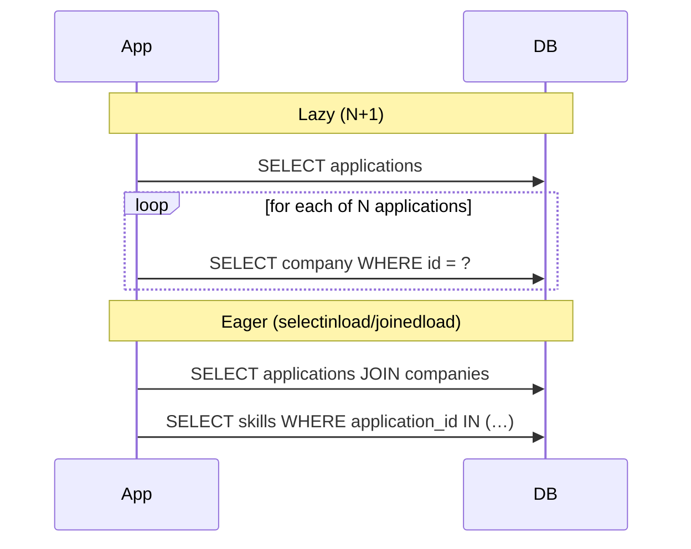

::part[Learn the Concept]{n="1"}

## 🎯 What you'll learn

- `ForeignKey` vs `relationship()`: the database link vs the Python navigation
- One-to-many with `back_populates`, typed as `Mapped[list[...]]`
- Many-to-many with an **association table** and with an **association object** (extra columns)
- ORM **cascades** (`all, delete-orphan`) vs database `ON DELETE`
- **Lazy loading**, the **N+1 problem**, and fixing it with `selectinload` / `joinedload`
- Counting queries to prove your fix works

## 🧠 The big idea

A foreign key is the **address written on an envelope** (the database knows where it points). A `relationship()` is **a courier who fetches the house for you**: `application.company` gives you the `Company` object without writing a query.

Convenient — but a courier who makes **one trip per envelope** is slow when you have 500 envelopes. Knowing *when* the courier travels is the difference between a 30 ms page and a 3-second page.

## ❓ Why does this exist?

Business logic navigates between objects all the time: an application's company, its interviews, its required skills; a user's applications. Writing a join query for every navigation would be repetitive. Relationships make navigation natural — **and** let you control how related data is loaded.

## 💥 What happens if we DON'T control loading?

```python
applications = db.session.scalars(select(Application).where(Application.user_id == 7)).all()  # 1 query
for application in applications:
    print(application.company.name)          # +1 query per application
    print([s.name for s in application.skills])   # +1 more query per application
```

With 100 applications: **1 + 100 + 100 = 201 queries** for one page. Everything works in development with 3 rows; production crawls. This is the :term[N+1 problem]{bahasa="masalah N+1 — 1 query untuk daftar, lalu N query tambahan untuk setiap item"}.

## 📖 How it works, step by step

### 1. One-to-many

```python
class Company(db.Model):
    __tablename__ = "companies"
    id: Mapped[int] = mapped_column(primary_key=True)
    name: Mapped[str] = mapped_column(String(200), unique=True)

    applications: Mapped[list["Application"]] = relationship(back_populates="company")


class Application(db.Model):
    __tablename__ = "applications"
    id: Mapped[int] = mapped_column(primary_key=True)
    company_id: Mapped[int] = mapped_column(ForeignKey("companies.id", ondelete="RESTRICT"), index=True)

    company: Mapped["Company"] = relationship(back_populates="applications")
```

- `ForeignKey(...)` creates the **database** constraint.
- `relationship(...)` creates **Python attributes** on both sides; `back_populates` keeps them in sync in memory.
- `Mapped[list[...]]` = "many"; `Mapped["Company"]` = "one".

```python
kopi = Company(name="Kopi Data")
kopi.applications.append(Application(role_title="Analyst", user_id=7))
db.session.add(kopi)       # the application is saved too (save-update cascade)
db.session.commit()
```

### 2. Many-to-many with an association table

When the link has **no** extra data:

```python
application_skills = Table(
    "application_skills",
    Base.metadata,
    Column("application_id", ForeignKey("applications.id", ondelete="CASCADE"), primary_key=True),
    Column("skill_id", ForeignKey("skills.id", ondelete="RESTRICT"), primary_key=True),
)

class Application(db.Model):
    skills: Mapped[list["Skill"]] = relationship(secondary=application_skills, back_populates="applications")

class Skill(db.Model):
    applications: Mapped[list["Application"]] = relationship(secondary=application_skills, back_populates="skills")
```

```python
application.skills.append(python_skill)   # inserts a row into application_skills on commit
```

### 3. Many-to-many with an association object

When the link **has data** (`level`, `added_at`), make it a model:

```python
class ApplicationSkill(db.Model):
    __tablename__ = "application_skills"
    application_id: Mapped[int] = mapped_column(ForeignKey("applications.id", ondelete="CASCADE"), primary_key=True)
    skill_id: Mapped[int] = mapped_column(ForeignKey("skills.id", ondelete="RESTRICT"), primary_key=True)
    level: Mapped[str] = mapped_column(String(20))

    application: Mapped["Application"] = relationship(back_populates="skill_links")
    skill: Mapped["Skill"] = relationship()
```

Start with the simple table; switch to an association object as soon as the relationship needs its own facts.

### 4. Cascades: ORM vs database

| Setting | Where | Effect |
|---|---|---|
| `ForeignKey(..., ondelete="CASCADE")` | database | deleting the parent row deletes child rows — for **every** writer, even raw SQL |
| `relationship(cascade="all, delete-orphan")` | ORM | deleting the parent object through the session deletes loaded children; removing a child from the list deletes it |
| `passive_deletes=True` | ORM | "let the database cascade" — don't load children just to delete them |

For owned children (an application's interviews):

```python
interviews: Mapped[list["Interview"]] = relationship(
    back_populates="application", cascade="all, delete-orphan", passive_deletes=True
)
```

Use both layers consistently: `ON DELETE CASCADE` in the database, `delete-orphan` + `passive_deletes` in the ORM. For shared data (companies, skills), **no** delete cascade.

### 5. Loading strategies

| Strategy | SQL | Best for |
|---|---|---|
| `lazy="select"` (default) | a query **when** you access the attribute | rarely-used relationships |
| `selectinload(...)` | 1 extra query: `WHERE parent_id IN (…)` | **collections** (one-to-many, many-to-many) |
| `joinedload(...)` | a `JOIN` in the same query | **many-to-one** (application → company) |
| `raiseload("*")` | raises if something lazy-loads | catching accidental N+1 in tests/critical paths |

Choose per **query**, not globally:

```python
from sqlalchemy.orm import joinedload, selectinload

stmt = (
    select(Application)
    .where(Application.user_id == 7)
    .options(
        joinedload(Application.company),          # many-to-one: join
        selectinload(Application.skills),          # collection: one IN query
    )
    .order_by(Application.created_at.desc())
)
applications = db.session.scalars(stmt).unique().all()
```

**3 queries at most**, no matter how many applications. (`.unique()` is required when `joinedload` targets a collection; harmless otherwise.)



### 6. Detecting N+1

- Development: `SQLALCHEMY_ECHO=True` and **count** the statements for one request.
- Tests: listen to `before_cursor_execute` and assert a maximum (the exercise does this).
- Production: APM tools show "this endpoint runs 240 queries".

### 7. Serializing related data

When returning JSON, make the loading strategy match the fields you serialize. If the response includes `company.name` and `skills`, load them eagerly **in the repository query** — don't let the serializer trigger lazy loads.

## ⚖️ Trade-offs

| Choice | ✅ | ❌ |
|---|---|---|
| Lazy loading | loads only what's used | N+1 in loops |
| `joinedload` | one round trip | duplicated parent rows for collections, large result sets |
| `selectinload` | efficient for collections | one extra query per relationship |
| Association table | simple | can't store link data |
| Association object | link data, explicit model | more code |
| ORM cascade only | works without DB constraints | raw SQL bypasses it |
| DB `ON DELETE` only | enforced everywhere | session may hold stale objects unless `passive_deletes` configured |

## ✅ When to use it / 🚫 When NOT to use it

- ✅ `relationship()` + `back_populates` for navigation you actually use.
- ✅ Eager loading options in queries that feed lists and API responses.
- ✅ `delete-orphan` for owned children only.
- 🚫 Don't access relationships in loops without eager loading.
- 🚫 Don't set `lazy="joined"` globally on big collections — it slows every query of that model.

## 🏆 Best practices

- [ ] Declare relationships on **both sides** with `back_populates` and typed `Mapped[...]`.
- [ ] Mirror database `ON DELETE` rules in the ORM (`cascade="all, delete-orphan"`, `passive_deletes=True`) for owned children.
- [ ] Default to lazy relationships, and **choose eager loading per query**: `joinedload` for many-to-one, `selectinload` for collections.
- [ ] **Count queries** for list endpoints in tests; consider `raiseload` to forbid accidental lazy loads.
- [ ] Load everything a serializer needs inside the repository/service query.
- [ ] Use an association object as soon as a many-to-many link needs extra columns.
- [ ] Index foreign key columns (Week 2 still applies!).

## 🏭 How it's used in industry

- "Reduce queries on the dashboard from 300 to 4" is one of the most common backend performance PRs.
- Code reviewers look for relationship access inside loops.
- GraphQL servers and nested REST responses make N+1 especially likely — tools like DataLoader exist just for it.

## ⚠️ Common mistakes

- Accessing `application.company` in a loop over hundreds of applications.
- `cascade="all, delete-orphan"` on shared data.
- Forgetting `back_populates` → one side of the relationship out of sync in memory.
- Using `joinedload` on large collections and multiplying rows.
- Serializing objects after the session closed → `DetachedInstanceError` from lazy loads.

:::revoshop
Open `app/models/products.py`: `images = db.relationship('ProductImage', backref='product', lazy=True, cascade='all, delete-orphan', order_by=...)`, and `to_dict()` reads `self.primary_image` → `self.images`. Now think about the product **list** endpoint returning 20 products with their primary image: how many queries run? Check `app/repositories/product_repository.py` for `selectinload`/`joinedload`. Turn on `SQLALCHEMY_ECHO` locally, call `GET /api/v1/products`, and count. If it's N+1, write the one-line fix.
:::

::part[Explain & Design]{n="2"}

## 🗣️ Explain it

Explain the N+1 problem to a non-programmer using a teacher who needs the parents' phone numbers for 30 students: calling the office 30 times versus asking once for the whole list.

## 📐 Design it

CareerPilot's dashboard endpoint returns, for the current user: each application with company name, required skills, the **next** upcoming interview, and the number of notes. Design the models' relationships (with cascades) and the query options so the endpoint runs a **fixed small number** of queries regardless of how many applications exist.

:::quiz
Show a possible design

**Relationships**
- `Application.company` (many-to-one, no cascade), `Company.applications`
- `Application.skills` via `application_skills` table (many-to-many, no delete cascade on skills)
- `Application.interviews` (one-to-many, `cascade="all, delete-orphan"`, `passive_deletes=True`, FK `ON DELETE CASCADE`)
- `Application.notes` (one-to-many, same cascade as interviews)

**Query**
```python
stmt = (
    select(Application, func.count(Note.id).label("note_count"))
    .outerjoin(Note, Note.application_id == Application.id)
    .where(Application.user_id == user_id)
    .group_by(Application.id)
    .options(
        joinedload(Application.company),
        selectinload(Application.skills),
        selectinload(Application.interviews.and_(Interview.starts_at >= now)),
    )
)
```

About 3 queries: applications + companies + note counts (one), skills (one), upcoming interviews (one). The "next" interview is the earliest of the loaded ones. Counting notes with `GROUP BY` avoids loading every note.
:::

### 📝 Self-review checklist

- [ ] Owned children cascade; shared data doesn't
- [ ] Collections use `selectinload`, many-to-one uses `joinedload`
- [ ] Counts are computed in SQL, not by loading whole collections
- [ ] The number of queries doesn't grow with the number of applications

::ai-review{task="design"}

::part[Toy Exercise]{n="3"}

:::exercise{path="exercises/m2/w4/05-relationships" ai="no-ai" title="Relationships without N+1"}
Complete `models.py` with typed relationships (one-to-many, many-to-many through an association table, owned children with cascades), and implement `dashboard(user_id)` in `queries.py`. The tests seed 30 applications and **fail if your dashboard runs more than 3 SQL statements** — a lazy-loading loop will not pass.
:::

:::hints
- `relationship(back_populates="…")` on both sides; `secondary=application_skills` for skills.
- `cascade="all, delete-orphan", passive_deletes=True` for interviews.
- `joinedload(Application.company)` + `selectinload(Application.skills)` + `selectinload(Application.interviews)`.
- Build the dict output **after** loading — the tests count statements while `dashboard()` runs.
:::

### 🏆 Stretch goal

Add `.options(raiseload("*"))` to the query (after the explicit loaders). Then deliberately access a relationship you didn't load and read the error — this is how teams prevent N+1 from sneaking back in.

## ✅ Quick check

:::quiz
What's the difference between `ForeignKey` and `relationship()`?

`ForeignKey` defines the database column constraint; `relationship()` defines Python navigation between objects (and how they're loaded and cascaded). You typically need both.
:::

:::quiz
When do you use `selectinload` vs `joinedload`?

`selectinload` for collections (one extra `IN` query, no row multiplication); `joinedload` for many-to-one/one-to-one references (a join in the same query).
:::

:::quiz
What does `cascade="all, delete-orphan"` add beyond saving children?

Deleting the parent deletes its children, and removing a child from the parent's collection deletes that child — appropriate only for children owned by the parent.
:::

## 📖 Kamus (glossary)

| Term | Bahasa Indonesia |
|---|---|
| Relationship | Relasi antar model |
| Association table | Tabel penghubung many-to-many |
| Lazy loading | Memuat data terkait saat diakses |
| Eager loading | Memuat data terkait sekaligus di awal |
| N+1 problem | Masalah query berlebih dalam perulangan |
| Cascade | Aksi berantai ke data anak |

## 📚 Keep learning

- [SQLAlchemy: Basic relationship patterns](https://docs.sqlalchemy.org/en/20/orm/basic_relationships.html)
- [SQLAlchemy: Relationship loading techniques](https://docs.sqlalchemy.org/en/20/orm/queryguide/relationships.html)
- [SQLAlchemy: Cascades](https://docs.sqlalchemy.org/en/20/orm/cascades.html)
