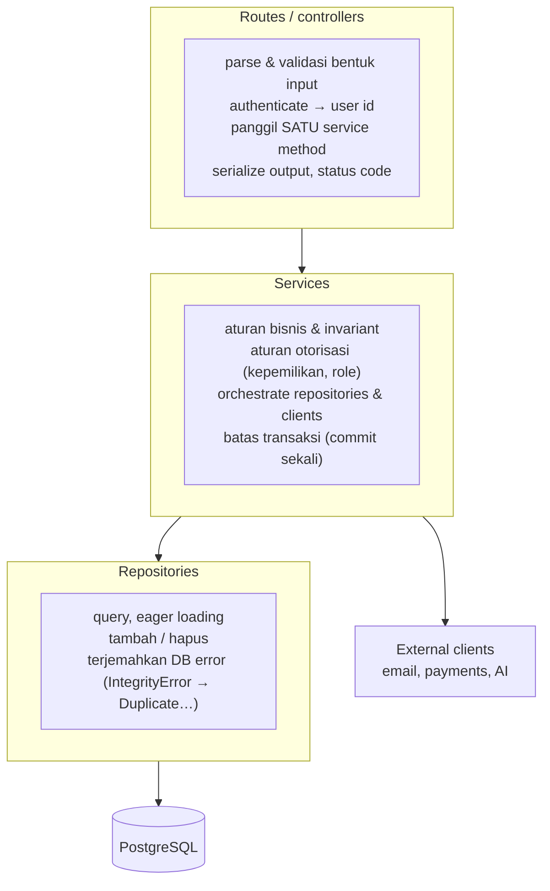

::part[Pelajari Konsepnya]{n="1"}

## 🎯 Yang akan kamu pelajari

- Tiga lapisan backend biasa dan **apa yang masuk ke setiap lapisan**
- Aturan **arah ketergantungan** dan kenapa ia membuat kode bisa diubah
- Di mana **validasi**, **transaksi**, **otorisasi** dan **pemetaan error** tinggal
- **Repositories** sebagai satu-satunya tempat yang tahu SQL/ORM
- Strategi tes: **unit test** cepat untuk services dengan pengganti palsu, **integration test** untuk routes dan repositories
- Kapan layering berlebihan

## 🔤 Istilah penting

| Istilah | Artinya (sederhana) |
|---|---|
| **Layer (lapisan)** | Kelompok kode dengan satu tugas (HTTP, aturan bisnis, data) |
| **Route (lapisan HTTP)** | Membaca permintaan dan format jawaban — hanya itu | 
| **Service (lapisan bisnis)** | Tempat aturan dan alur kerja tinggal |
| **Repository (lapisan data)** | Satu-satunya tempat yang menulis query |
| **Dependency direction (arah ketergantungan)** | Lapisan luar boleh panggil yang dalam, tidak sebaliknya |
| **Dependency injection (penyuntikan)** | Memberikan apa yang dibutuhkan service, bukan dibuat sendiri |
| **Fake / stub** | Pengganti sederhana dipakai saat tes, bukan database sungguhan |
| **Unit test / integration test** | Uji satu bagian saja / uji bagian-bagian bekerja bersama |

## 🧠 Ide besarnya

Bayangkan sebuah restoran lagi:

| Lapisan | Restoran | Backend |
|---|---|---|
| **Routes** (lapisan HTTP) | **pelayan**: terima pesanan, bawa hidangan | parse request, cek siapa kamu, panggil service, format jawaban |
| **Services** (lapisan bisnis) | **chef**: tahu resep dan aturan dapur | aturan bisnis, alur kerja, transaksi |
| **Repositories** (lapisan data) | **pengelola pantry**: tahu di mana setiap bahan disimpan | query, insert, update |

Pelayan tidak masak. Chef tidak bicara dengan pelanggan atau tata ulang rak pantry. Masing-masing bisa diganti atau dilatih ulang tanpa yang lain berubah.

## ❓ Kenapa ini penting

Kalau segalanya terjadi di dalam fungsi route, aturan bisnis yang sama disalin ke API web, CLI, dan background worker; tes satu aturan butuh HTTP request dan database; dan tukar ORM atau tambah cache menyentuh setiap endpoint. Lapisan menjaga setiap jenis pengetahuan di **satu** tempat saja.

Inilah versi tanpa lapisan:

```python
@bp.post("/applications/<int:app_id>/status")
def change_status(app_id):
    data = request.get_json()
    row = db.session.execute(text("SELECT * FROM applications WHERE id = :id"), {"id": app_id}).first()
    if row.status == "rejected" and data["status"] == "offer":       # business rule #1
        return {"error": "nope"}, 400
    db.session.execute(text("UPDATE applications SET status = :s WHERE id = :id"), {...})
    send_email(row.email, "Status changed!")                         # side effect inside the request
    db.session.commit()
    return {"ok": True}
```

- Aturan status tertanam di kode HTTP, jadi tugas malam hari yang auto-reject aplikasi lama harus salin — dan akan salah sedikit.
- Tidak ada pengecekan kepemilikan.
- Tes aturannya butuh database hidup dan HTTP call.
- Kalau email gagal, seluruh request gagal walaupun perubahan database baik-baik saja.

## 📖 Langkah demi langkah

### 1. Lapisan dan tugasnya



**Aturan ketergantungan:** panah menunjuk **ke bawah saja**. Services jangan import Flask. Repositories jangan import services atau Flask. Models jangan import apa pun di atas mereka.

### 2. Apa masuk ke mana

| Perhatian | Lapisan | Kenapa |
|---|---|---|
| Parsing JSON, query params, header | route | spesifik HTTP |
| "Apakah token sah? Siapa ini?" | route (atau decorator/middleware) | spesifik HTTP |
| **Bentuk** input (tipe, field wajib) | route/schema (marshmallow, Pydantic) | validasi bentuk request |
| **Aturan** bisnis ("offer tidak boleh balik ke applied", "maksimal 50 aplikasi aktif") | service | harus berlaku di API, CLI dan job sama-sama |
| Otorisasi kepemilikan / role | service (sering dengan decorator route untuk role) | itu aturan bisnis |
| Commit / rollback | service (sekali per use case) | satu use case adalah unit kerja |
| SQL, ORM query, eager loading | repository | satu-satunya tempat tahu penyimpanan |
| Peta `AppError` → HTTP status | error handler pusat | satu tempat konsisten |
| Kirim email, panggil payment/AI API | service panggil **client** yang disuntik; kerja lambat ke background job | bisa diuji dan ditukar |

### 3. Service dengan dependency yang disuntik

Memberikan repository daripada import adalah apa membuat chef bisa diuji: di tes kamu beri pantry berisi bahan pura-pura, dan resep tetap jalan.

```python
class ApplicationService:
    def __init__(self, repository: ApplicationRepository, notifier: Notifier, clock: Callable[[], datetime]):
        self._repository = repository
        self._notifier = notifier
        self._clock = clock

    def change_status(self, user_id: int, application_id: int, status: str) -> Application:
        application = self._repository.get_for_user(application_id, user_id)
        if application is None:
            raise ApplicationNotFound(application_id)
        if status not in TRANSITIONS[application.status]:
            raise InvalidTransition(application.status, status)

        application.status = status
        application.updated_at = self._clock()
        self._repository.commit()

        if status == "offer":
            self._notifier.send(user_id, f"🎉 Offer from {application.company}!")
        return application
```

Composition dan dependency injection (Week 3 dan Architecture Stage A) adalah yang membuat lapisan ini bisa diuji.

### 4. Route yang tipis

```python
@applications_bp.post("/<int:application_id>/status")
@jwt_required()
def change_status(application_id: int):
    payload = StatusChangeSchema().load(request.get_json())     # shape validation
    application = get_application_service().change_status(
        current_user_id(), application_id, payload["status"]
    )
    return {"data": ApplicationSchema().dump(application)}
```

Tiga langkah: **parse → panggil → format**. Tidak ada `db`, tidak ada bisnis `if`.

### 5. Repository

```python
class SqlApplicationRepository:
    def get_for_user(self, application_id: int, user_id: int) -> Application | None:
        return db.session.scalars(
            select(Application)
            .where(Application.id == application_id, Application.user_id == user_id)
            .options(joinedload(Application.company))
        ).one_or_none()

    def commit(self) -> None:
        try:
            db.session.commit()
        except IntegrityError as error:
            db.session.rollback()
            raise DuplicateApplication() from error
```

Sisa aplikasi tidak pernah lihat `IntegrityError`, `select` atau `db.session`.

### 6. Tes setiap lapisan

| Jenis tes | Tes apa | Pakai | Kecepatan |
|---|---|---|---|
| **Unit** | service, aturan domain | fake repositories/clients (di memory) | milidetik |
| **Integration** | repositories melawan database asli | PostgreSQL (seperti latihan kita) | agak cepat |
| **API / end-to-end** | routes + semuanya di bawah | Flask test client + test database | lebih lambat |

Kebanyakan tes harus unit test cepat pada services; lebih sedikit integration test; segelintir API test per endpoint untuk status code dan wiring. (Week 6 lebih dalam.)

### 7. Terapkan aturannya

Aturan import bisa dicek otomatis — latihan melakukannya dengan Python `ast`; tim pakai tools seperti **import-linter** di CI.

### 8. Kapan berlebihan

Untuk script 200 baris, tiga lapisan adalah tiga kali paperwork. Tambah lapisan saat aturan perlu dipakai dari lebih dari satu tempat, atau saat kamu tidak bisa tes sesuatu tanpa database.

Prototype 3-endpoint atau alat internal kecil tidak perlu repositories dan interface untuk segalanya. Mulai sederhana, dan perkenalkan lapisan **saat** aturan bisnis muncul atau kode mulai diduplikasi. (YAGNI masih berlaku — tapi CareerPilot dan RevoShop sudah melampaui itu.)

### Pilih setup-mu

Setiap pilihan di sini adalah trade-off:

| Pilihan | ✅ | ❌ |
|---|---|---|
| Routes gemuk | tercepat mulai | aturan tersebar, sulit diuji, duplikat di entry point |
| Routes → services → repositories | bisa diuji, aturan dapat dipakai, penyimpanan bisa ditukar | lebih banyak file, ada kode pass-through |
| Service dengan static method | sederhana dipanggil | lebih sulit suntik pengganti; ketergantungan tersembunyi |
| Instance service dengan dependency disuntik | unit test mudah, ketergantungan terang | kode wiring (factory/container) |
| "Base repository" generik untuk semua model | lebih sedikit kode | abstraksi bocor; query berakhir di service |
| Repository per aggregate/use case | jelas, query optimal | lebih banyak method tulis |

- ✅ Setiap backend dengan aturan bisnis nyata, beberapa entry point (API, CLI, job), atau lebih dari satu developer.
- ✅ Jaga layering yang sama di Flask dan FastAPI — langsung transfer (Module 3).
- 🚫 Jangan buat lapisan kosong hanya untuk upacara di script kecil.
- 🚫 Jangan service kembalikan HTTP response atau baca `request`.

## ⚠️ Kesalahan umum

- Aturan bisnis di routes atau repositories.
- Services import `request`, `jsonify` atau `db`.
- Panggil `commit()` di beberapa lapisan untuk satu use case.
- Repositories kembalikan raw SQLAlchemy `Row` di beberapa method dan model di yang lain.
- Mock semuanya sangat berat sehingga tes hanya verifikasi mock, bukan perilaku.

:::revoshop
RevoShop sudah pakai struktur ini — ini kesempatan kamu **benar-benar** mengerti. Pilih satu fitur (misalnya products): `app/routes/products.py` → `app/services/product_service.py` → `app/repositories/product_repository.py`. Untuk fitur itu, jawab: (1) Apakah routes ada bisnis `if`? (2) Apakah service import Flask atau `db`? (3) Di mana `commit()` terjadi? (4) `ProductService.get_all(...)` dipanggil sebagai **static** method — bagaimana kamu akan unit-test dengan fake repository, dan apa yang perlu diubah? (5) Di mana `ProductNotFoundError` jadi 404? Tulis jawaban-mu sebagai bagian "architecture tour" di RevoShop README — itu poin pembicaraan wawancara yang kuat.
:::

## 🏆 Praktik terbaik

- [ ] **Routes tipis**: parse → authenticate → panggil satu service method → serialize.
- [ ] **Services punya aturan bisnis**, otorisasi dan **batas transaksi** (commit sekali per use case).
- [ ] **Repositories satu-satunya lapisan pakai ORM/SQL**, termasuk eager loading dan terjemah DB error.
- [ ] Ketergantungan tunjuk **ke bawah saja**; terapkan dengan tes atau import-linter.
- [ ] Suntik ketergantungan (repository, clients, clock) supaya service bisa diuji dengan pengganti.
- [ ] Angkat **domain error** di service; peta jadi HTTP di **satu** error handler.
- [ ] Jaga request/response **schema** di lapisan route; jangan bocor detail ORM object jadi JSON kebetulan.
- [ ] Taruh side effect lambat (email, AI call) di belakang client dan pindah ke background job kalau tidak perlu blok response.

::part[Jelaskan & Rancang]{n="2"}

## 🗣️ Jelaskan

Jelaskan ke non-programmer kenapa aturan "aplikasi tidak boleh balik dari offer jadi applied" harus tinggal di lapisan service dan bukan di route web, pakai contoh mobile app, website, dan otomasi malam hari semua ubah status.

## 📐 Rancang

Fitur CareerPilot baru: **"Import aplikasi dari upload CSV."** Setiap baris: validasi field, cari atau buat perusahaan, skip duplikat, buat aplikasi; kembalikan ringkasan (dibuat, dilewati, error per baris). Import yang sama harus bisa dari API dan dari perintah CLI. Rancang route, service, repository method dan penanganan error. Di mana batas transaksi, dan apa terjadi kalau baris 57 dari 100 tidak sah?

:::quiz
Lihat rancangan yang mungkin

**Route** `POST /api/v1/applications/import` — baca file upload, cek ukuran/tipe, panggil `ImportService.import_rows(user_id, rows)`, kembalikan `200 {"data": summary}`.

**CLI** `flask applications import path.csv --user 7` — baca file, panggil **service method yang sama**, cetak ringkasan.

**`ImportService.import_rows(user_id, rows)`**
- validasi setiap baris → kumpulkan `{row_number: errors}`; baris tidak sah dilewati, bukan fatal (keputusan produk — alternatifnya all-or-nothing)
- untuk baris sah: `companies.get_or_create(name)`, `applications.exists(user_id, company_id, role)` → skip duplikat, kalau tidak `applications.add(...)`
- **batas transaksi**: commit dalam batch (misalnya setiap 100 baris) supaya crash tidak kehilangan semuanya, atau satu commit di akhir untuk semantik all-or-nothing — putuskan dan dokumentasikan
- kembalikan `ImportSummary(created=…, skipped_duplicates=…, errors={57: {"role_title": "required"}})`

**Repositories**: `CompanyRepository.get_or_create(name)` (case-insensitive, tangani race unique-index), `ApplicationRepository.exists(...)`, `add(...)`, `commit()`.

Baris 57 tidak sah → tercatat di `errors`, import lanjut; response cerita user persis baris mana yang perlu diperbaiki.
:::

### 📝 Checklist review mandiri

- [ ] API dan CLI bagikan satu service method
- [ ] Route/CLI hanya tangani I/O
- [ ] Strategi transaksi keputusan terang
- [ ] Error per-baris dilaporkan, tidak disembunyikan

::ai-review{task="design"}

::part[Latihan Kecil]{n="3"}

:::exercise{path="exercises/m2/w4/06-layered-architecture" ai="no-ai" title="Pisahkan fitur jadi lapisan"}
Model, repository, error dan app factory disediakan. Tulis `services.py` (aturan bisnis dengan repository dan clock disuntik) dan `routes.py` (blueprint tipis). Tes jalankan **unit test** pada service-mu dengan repository palsu (tidak ada database), **API test** lewat Flask di PostgreSQL, dan **architecture test** yang gagal kalau routes sentuh SQLAlchemy atau service import Flask.
:::

:::hints
- Mulai dengan service dan unit test-nya — tidak perlu database.
- `ApplicationService(repository, clock)`; panggil `repository.commit()` persis sekali per use case.
- Di routes, angkat subkelas `AppError` dengan `status_code = 401` untuk `X-User-Id` hilang — handler yang disediakan format-nya.
- Jangan tangkap domain error di routes.
:::

### 🏆 Tantangan tambahan

Tambah perintah CLI (`flask --app ... applications list --user 7`) yang pakai **service yang sama** — tidak ada logika yang disalin.

## ✅ Cek cepat

:::quiz
Lapisan mana yang harus panggil `commit()` dan kenapa?

Service: ia definisikan use case (unit kerja), jadi ia tahu saat semua perubahan terkait selesai dan harus disimpan bersama.
:::

:::quiz
Kenapa service jangan import Flask?

Supaya aturan bisnis bekerja di luar HTTP (CLI, background job, tes) dan bisa diuji tanpa request context.
:::

:::quiz
Apa yang repository sembunyikan dari sisa aplikasi?

Bagaimana data disimpan dan di-query: detail SQL/ORM, eager loading, dan error database-spesifik (diterjemahkan jadi domain error).
:::


## 📚 Lanjut belajar

- [Martin Fowler: Presentation Domain Data Layering](https://martinfowler.com/bliki/PresentationDomainDataLayering.html)
- [Cosmic Python (buku online gratis): Repository dan Service Layer pattern](https://www.cosmicpython.com/book/preface.html)
- [Dokumentasi import-linter](https://import-linter.readthedocs.io/)

## 📣 Akhir Minggu 4 — bagikan progresmu

:::linkedin{type="weekly"}
🌶️ Minggu 4: Flask, SQLAlchemy dan migrasi — dan akhirnya saya *mengerti* backend yang saya buat.

- App factory + blueprint + JSON error handler
- Session dan model tipe SQLAlchemy 2.0 (fakta menarik: Enum bukan native hanya dapat constraint CHECK dengan create_constraint=True)
- Migrasi data yang upgrade DAN downgrade tanpa kehilangan baris
- Perbaiki masalah N+1: 30 item dulu berarti 60+ query, sekarang 3
- Routes → services → repositories, dengan service tes yang tidak perlu database

Pelajaran terbesar: [jawaban kamu].

Minggu depan: desain REST API, validasi dan otentikasi. 🔐

#Python #Flask #SQLAlchemy #LearningInPublic #BackendDevelopment
:::
