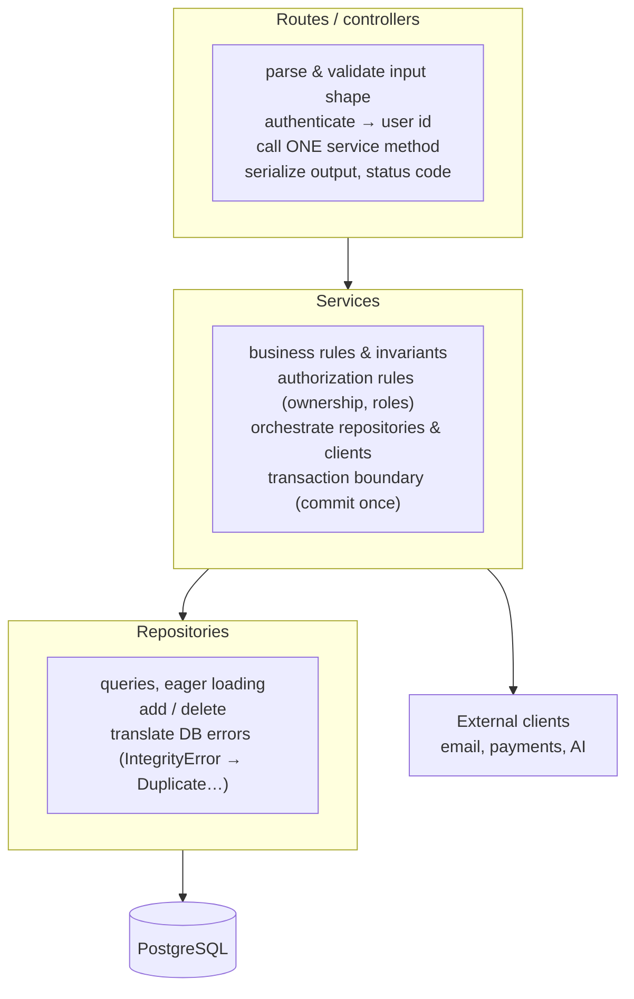

::part[Learn the Concept]{n="1"}

## 🎯 What you'll learn

- The three layers of a typical backend and **what belongs in each**
- The **dependency direction** rule and why it keeps code changeable
- Where **validation**, **transactions**, **authorization** and **error mapping** live
- **Repositories** as the only place that knows about SQL/ORM
- Testing strategy: fast **unit tests** for services with fakes, **integration tests** for routes and repositories
- When layering is overkill

## 🔤 Key words

| Word | In simple words | Bahasa Indonesia |
|---|---|---|
| **Layer** | A group of code with one job (HTTP, business rules, data) | Lapisan dengan satu tugas |
| **Route (HTTP layer)** | Reads the request and formats the response — nothing more | Lapisan penerima permintaan |
| **Service (business layer)** | Where the rules and workflows live | Lapisan aturan bisnis |
| **Repository (data layer)** | The only place that writes queries | Lapisan akses data |
| **Dependency direction** | Outer layers may call inner ones, never the reverse | Arah ketergantungan |
| **Dependency injection** | Passing what a service needs, instead of it creating them | Menyuntikkan kebutuhan |
| **Fake / stub** | A simple stand-in used in tests instead of a real database | Pengganti untuk tes |
| **Unit test / integration test** | Tests one piece alone / tests pieces working together | Uji satuan / uji gabungan |

## 🧠 The big idea

Think of a restaurant again:

| Layer | Restaurant | Backend |
|---|---|---|
| **Routes** (HTTP layer) | the **waiter**: takes the order, brings the plate | parse request, check who you are, call the service, format the response |
| **Services** (business layer) | the **chef**: knows the recipes and kitchen rules | business rules, workflows, transactions |
| **Repositories** (data layer) | the **pantry manager**: knows where every ingredient is stored | queries, inserts, updates |

The waiter never cooks. The chef never talks to customers or rearranges the pantry shelves. Each one can be replaced or retrained without the others changing.

## ❓ Why it matters

When everything happens inside route functions, the same business rule gets copied into the web API, the CLI and the background worker; testing one rule needs an HTTP request and a database; and swapping the ORM or adding a cache touches every endpoint. Layers keep each kind of knowledge in **one** place.

Here's the unlayered version:

```python
@bp.post("/applications/<int:app_id>/status")
def change_status(app_id):
    data = request.get_json()
    row = db.session.execute(text("SELECT * FROM applications WHERE id = :id"), {"id": app_id}).first()
    if row.status == "rejected" and data["status"] == "offer":       # business rule #1
        return {"error": "nope"}, 400
    db.session.execute(text("UPDATE applications SET status = :s WHERE id = :id"), {...})
    send_email(row.email, "Status changed!")                         # side effect inside the request
    db.session.commit()
    return {"ok": True}
```

- The status rule is buried in HTTP code, so the nightly job that auto-rejects stale applications must copy it — and will get it slightly wrong.
- There's no ownership check.
- Testing the rule needs a running database and an HTTP call.
- If the email fails, the whole request fails even though the database change was fine.

## 📖 Step by step

### 1. The layers and their jobs



**Dependency rule:** arrows point **downward only**. Services don't import Flask. Repositories don't import services or Flask. Models don't import anything above them.

### 2. What goes where

| Concern | Layer | Why |
|---|---|---|
| JSON parsing, query params, headers | route | HTTP-specific |
| "Is the token valid? Who is this?" | route (or a decorator/middleware) | HTTP-specific |
| Input **shape** (types, required fields) | route/schema (marshmallow, Pydantic) | validates the request format |
| Business **rules** ("offer can't go back to applied", "max 50 active applications") | service | must apply in API, CLI and jobs alike |
| Ownership / role authorization | service (often with a route decorator for roles) | it's a business rule |
| Commit / rollback | service (once per use case) | a use case is the unit of work |
| SQL, ORM queries, eager loading | repository | the only place that knows storage |
| Mapping `AppError` → HTTP status | a central error handler | one consistent place |
| Sending emails, calling payment/AI APIs | service calls an injected **client**; slow work goes to a background job | testable and swappable |

### 3. A service with injected dependencies

Passing the repository in (instead of importing it) is what makes the chef testable: in tests you hand over a pantry full of pretend ingredients, and the recipe still runs.

```python
class ApplicationService:
    def __init__(self, repository: ApplicationRepository, notifier: Notifier, clock: Callable[[], datetime]):
        self._repository = repository
        self._notifier = notifier
        self._clock = clock

    def change_status(self, user_id: int, application_id: int, status: str) -> Application:
        application = self._repository.get_for_user(application_id, user_id)
        if application is None:
            raise ApplicationNotFound(application_id)
        if status not in TRANSITIONS[application.status]:
            raise InvalidTransition(application.status, status)

        application.status = status
        application.updated_at = self._clock()
        self._repository.commit()

        if status == "offer":
            self._notifier.send(user_id, f"🎉 Offer from {application.company}!")
        return application
```

Composition and dependency injection (Week 3 and Architecture Stage A) are what make this layer testable.

### 4. A thin route

```python
@applications_bp.post("/<int:application_id>/status")
@jwt_required()
def change_status(application_id: int):
    payload = StatusChangeSchema().load(request.get_json())     # shape validation
    application = get_application_service().change_status(
        current_user_id(), application_id, payload["status"]
    )
    return {"data": ApplicationSchema().dump(application)}
```

Three steps: **parse → call → format**. No `db`, no business `if`s.

### 5. A repository

```python
class SqlApplicationRepository:
    def get_for_user(self, application_id: int, user_id: int) -> Application | None:
        return db.session.scalars(
            select(Application)
            .where(Application.id == application_id, Application.user_id == user_id)
            .options(joinedload(Application.company))
        ).one_or_none()

    def commit(self) -> None:
        try:
            db.session.commit()
        except IntegrityError as error:
            db.session.rollback()
            raise DuplicateApplication() from error
```

The rest of the app never sees `IntegrityError`, `select` or `db.session`.

### 6. Testing each layer

| Test type | Tests | Uses | Speed |
|---|---|---|---|
| **Unit** | services, domain rules | fake repositories/clients (in memory) | milliseconds |
| **Integration** | repositories against a real database | PostgreSQL (like our exercises) | fast-ish |
| **API / end-to-end** | routes + everything below | Flask test client + test database | slower |

Most tests should be fast unit tests on services; fewer integration tests; a handful of API tests per endpoint for status codes and wiring. (Week 6 goes deeper.)

### 7. Enforcing the rules

Import rules can be checked automatically — the exercise does it with Python's `ast`; teams use tools like **import-linter** in CI.

### 8. When it's overkill

For a 200-line script, three layers are three times the paperwork. Add layers when a rule needs to be used from more than one place, or when you can't test something without a database.

A 3-endpoint prototype or a tiny internal tool doesn't need repositories and interfaces for everything. Start simple, and introduce layers **when** business rules appear or code starts to be duplicated. (YAGNI still applies — but CareerPilot and RevoShop are past that point.)

### Choosing your setup

Every option here is a trade-off:

| Choice | ✅ | ❌ |
|---|---|---|
| Fat routes | fastest to start | rules scattered, hard to test, duplicated across entry points |
| Routes → services → repositories | testable, reusable rules, swappable storage | more files, some pass-through code |
| Services with static methods | simple to call | harder to inject fakes; hidden dependencies |
| Service instances with injected dependencies | easy unit tests, explicit dependencies | wiring code (factories/containers) |
| Generic "base repository" for all models | less code | leaky abstractions; queries end up in services anyway |
| Repositories per aggregate/use case | clear, optimized queries | more methods to write |

- ✅ Any backend with real business rules, several entry points (API, CLI, jobs), or more than one developer.
- ✅ Keep the same layering in Flask and FastAPI — it transfers directly (Module 3).
- 🚫 Don't create empty pass-through layers just for ceremony in tiny scripts.
- 🚫 Don't let services return HTTP responses or read `request`.

## ⚠️ Common mistakes

- Business rules in routes or in repositories.
- Services importing `request`, `jsonify` or `db`.
- Calling `commit()` in several layers for one use case.
- Repositories returning raw SQLAlchemy `Row` objects in some methods and models in others.
- Mocking everything so heavily that tests only verify mocks, not behavior.

:::revoshop
RevoShop already uses this structure — this is your chance to **really** understand it. Pick one feature (e.g. products): `app/routes/products.py` → `app/services/product_service.py` → `app/repositories/product_repository.py`. For that feature, answer: (1) Do routes contain any business `if`s? (2) Does the service import Flask or `db`? (3) Where does `commit()` happen? (4) `ProductService.get_all(...)` is called as a **static** method — how would you unit-test it with a fake repository, and what would you change to make that easier? (5) Where is `ProductNotFoundError` turned into a 404? Write your answers as an "architecture tour" section for your RevoShop README — it's a strong interview talking point.
:::

## 🏆 Best practices

- [ ] **Routes are thin**: parse → authenticate → call one service method → serialize.
- [ ] **Services own business rules**, authorization and the **transaction boundary** (commit once per use case).
- [ ] **Repositories are the only layer that uses the ORM/SQL**, including eager loading and DB-error translation.
- [ ] Dependencies point **downward only**; enforce it with tests or import-linter.
- [ ] Inject dependencies (repository, clients, clock) so services are unit-testable with fakes.
- [ ] Raise **domain errors** in services; map them to HTTP in **one** error handler.
- [ ] Keep request/response **schemas** at the route layer; don't leak ORM objects' internals into JSON by accident.
- [ ] Put slow side effects (emails, AI calls) behind clients and move them to background jobs when they don't need to block the response.

::part[Explain & Design]{n="2"}

## 🗣️ Explain it

Explain to a non-programmer why the rule "an application can't go back from offer to applied" should live in the service layer and not in the web route, using the example of a mobile app, a website and a nightly automation all changing statuses.

## 📐 Design it

A new CareerPilot feature: **"Import applications from a CSV upload."** For each row: validate fields, find or create the company, skip duplicates, create the application; return a summary (created, skipped, errors per row). The same import must be usable from the API and from a CLI command. Design the route, service, repository methods and error handling. Where is the transaction boundary, and what happens if row 57 of 100 is invalid?

:::quiz
Show a possible design

**Route** `POST /api/v1/applications/import` — reads the uploaded file, checks size/type, calls `ImportService.import_rows(user_id, rows)`, returns `200 {"data": summary}`.

**CLI** `flask applications import path.csv --user 7` — reads the file, calls the **same** service method, prints the summary.

**`ImportService.import_rows(user_id, rows)`**
- validates each row → collects `{row_number: errors}`; invalid rows are skipped, not fatal (a product decision — alternatively all-or-nothing)
- for valid rows: `companies.get_or_create(name)`, `applications.exists(user_id, company_id, role)` → skip duplicates, else `applications.add(...)`
- **transaction boundary**: commit in batches (e.g. every 100 rows) so a crash doesn't lose everything, or one commit at the end for all-or-nothing semantics — decide and document
- returns `ImportSummary(created=…, skipped_duplicates=…, errors={57: {"role_title": "required"}})`

**Repositories**: `CompanyRepository.get_or_create(name)` (case-insensitive, handles the unique-index race), `ApplicationRepository.exists(...)`, `add(...)`, `commit()`.

Row 57 invalid → recorded in `errors`, import continues; the response tells the user exactly which rows to fix.
:::

### 📝 Self-review checklist

- [ ] API and CLI share one service method
- [ ] The route/CLI only handle I/O
- [ ] The transaction strategy is an explicit decision
- [ ] Per-row errors are reported, not swallowed

::ai-review{task="design"}

::part[Toy Exercise]{n="3"}

:::exercise{path="exercises/m2/w4/06-layered-architecture" ai="no-ai" title="Split a feature into layers"}
The model, repository, errors and app factory are provided. Write `services.py` (business rules with an injected repository and clock) and `routes.py` (a thin blueprint). The tests run **unit tests** on your service with a fake repository (no database), **API tests** through Flask on PostgreSQL, and **architecture tests** that fail if routes touch SQLAlchemy or services import Flask.
:::

:::hints
- Start with the service and its unit tests — they don't need the database.
- `ApplicationService(repository, clock)`; call `repository.commit()` exactly once per use case.
- In routes, raise an `AppError` subclass with `status_code = 401` for a missing `X-User-Id` — the provided handler formats it.
- Don't catch domain errors in routes.
:::

### 🏆 Stretch goal

Add a CLI command (`flask --app ... applications list --user 7`) that uses the **same** service — no copied logic.

## ✅ Quick check

:::quiz
Which layer should call `commit()` and why?

The service: it defines the use case (the unit of work), so it knows when all related changes are complete and should be saved together.
:::

:::quiz
Why must services not import Flask?

So business rules work outside HTTP (CLI, background jobs, tests) and can be unit-tested without a request context.
:::

:::quiz
What does a repository hide from the rest of the app?

How data is stored and queried: SQL/ORM details, eager loading, and database-specific errors (translated into domain errors).
:::


## 📚 Keep learning

- [Martin Fowler: Presentation Domain Data Layering](https://martinfowler.com/bliki/PresentationDomainDataLayering.html)
- [Cosmic Python (free online book): Repository and Service Layer patterns](https://www.cosmicpython.com/book/preface.html)
- [import-linter documentation](https://import-linter.readthedocs.io/)

## 📣 End of Week 4 — share your progress

:::linkedin{type="weekly"}
🌶️ Week 4: Flask, SQLAlchemy and migrations — and I finally *understand* the backend I built.

- App factory + blueprints + JSON error handlers
- SQLAlchemy 2.0 sessions and typed models (fun fact: a non-native Enum only gets a CHECK constraint with create_constraint=True)
- A data migration that upgrades AND downgrades without losing a row
- Fixed an N+1 problem: 30 items used to mean 60+ queries, now it's 3
- Routes → services → repositories, with service tests that don't need a database

Biggest lesson: [your answer].

Next week: REST API design, validation and authentication. 🔐

#Python #Flask #SQLAlchemy #LearningInPublic #BackendDevelopment
:::
