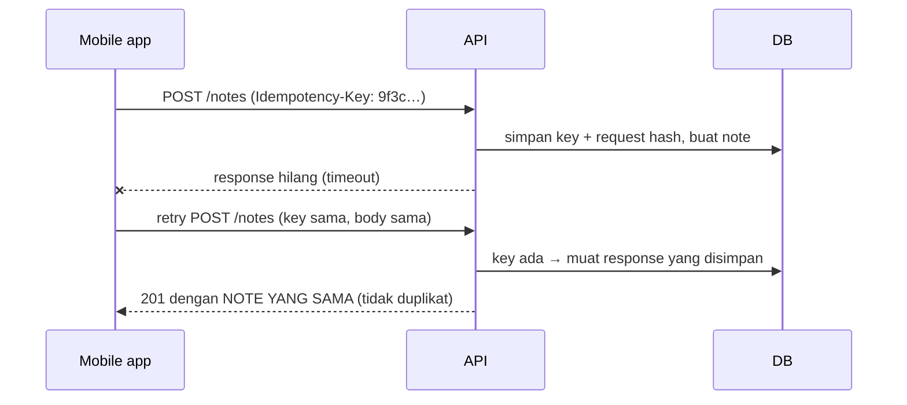

::part[Pelajari Konsepnya]{n="1"}

## 🎯 Yang akan kamu pelajari

- `POST` untuk membuat: `201 Created`, header `Location`, mengembalikan resource baru
- `PUT` (penggantian penuh) vs `PATCH` (pembaruan sebagian) — dan apa arti `null`
- `DELETE`: `204 No Content`, hard delete vs soft delete, menghapus berulang kali
- **Idempotency key** agar retry klien tidak pernah membuat duplikat
- Menolak **field tidak dikenal** dan **field read-only** (`id`, `created_at`, `user_id`)
- Kerentanan **mass assignment** dan cara menghindarinya

## 🔤 Istilah penting

| Istilah | Artinya (sederhana) |
|---|---|
| **`POST`** | Membuat data baru |
| **`PUT`** | Mengganti seluruhnya dengan apa yang kamu kirim |
| **`PATCH`** | Mengubah hanya field yang kamu kirim |
| **`DELETE`** | Menghapusnya |
| **`201 Created` / `Location`** | Status dan alamat yang mengatakan "dibuat, dan di sini tempatnya" |
| **`204 No Content`** | Berhasil, tanpa ada isi untuk dikirim balik |
| **Soft delete** | Menandai baris sebagai dihapus bukannya benar-benar menghapus |
| **Idempotency key** | ID yang dikirim klien supaya retry tidak membuat salinan kedua |
| **Mass assignment** | Klien bisa mengisi field yang seharusnya tidak (seperti `is_admin`) |
| **Read-only field** | Field yang hanya server boleh atur (`id`, `created_at`) |

## 🧠 Ide besarnya

Menulis data adalah tempat API sering rusak. Setiap method adalah janji berbeda ke klien:

| Method | Janjinya |
|---|---|
| `POST /notes` | "Buat yang baru — setiap panggilan bisa membuat lagi." |
| `PUT /notes/7` | "Buat note 7 terlihat **persis** seperti ini." |
| `PATCH /notes/7` | "Ubah **hanya** field-field ini di note 7." |
| `DELETE /notes/7` | "Note 7 tidak boleh ada setelahnya." |

Menjaga janji itu dengan tepat membuat app mobile di koneksi buruk bisa retry dengan aman, dan membuat frontend bisa update layarnya dengan benar.

## ❓ Kenapa ini penting

Jaringan gagal di saat terburuk: server membuat order, tapi response tidak sampai ke ponsel, jadi app retry. Apakah itu membuat **dua** order? Makna method yang jelas plus idempotency key menjawab pertanyaan itu — perbedaan antara produk yang orang percaya dengan mimpi buruk support.

Kalau salah, kamu memberikan kekuatan yang tidak dimaksud:

```python
@bp.post("/notes")
def create():
    note = Note(**request.get_json())      # mass assignment: client can send user_id, id, is_admin…
    db.session.add(note); db.session.commit()
    return {"ok": True}, 200               # no id, no Location, wrong status
```

## 📖 Langkah demi langkah

### 1. POST: membuat

```python
@notes_bp.post("")
def create_note():
    data = NoteCreateSchema().load(request.get_json())     # only allowed fields
    note = note_service().create(current_user_id(), data)
    return {"data": NoteSchema().dump(note)}, 201, {"Location": url_for(".get_note", note_id=note.id)}
```

- `201 Created` + `Location` dari resource baru + representasi yang dibuat (dengan `id` yang dibuat, default, timestamp).
- Untuk pekerjaan async yang selesai nanti: `202 Accepted` dengan link untuk cek status.

### 2. PUT: penggantian penuh

Isi request adalah **keadaan baru lengkap** dari field yang bisa diedit. Field opsional yang hilang direset ke default (atau ditolak sebagai missing kalau required).

```http
PUT /api/v1/notes/7
{"title": "Interview prep", "body": "STAR stories", "pinned": false}
```

PUT adalah idempotent: mengirimnya 5 kali meninggalkan keadaan akhir yang sama.

### 3. PATCH: pembaruan sebagian

Bagian yang rumit adalah `null`: "jangan sentuh field ini" dan "atur field ini jadi kosong" terlihat sama di JSON kecuali kamu putuskan — dan dokumentasikan — mana yang kamu maksud.

Hanya field yang ada yang berubah. Dengan semantik **JSON Merge Patch** (RFC 7396) — paling umum untuk JSON API:

| Isi | Makna |
|---|---|
| `{"title": "New title"}` | ubah `title`, biarkan yang lain |
| `{"body": null}` | **bersihkan** `body` (atur jadi null) — hanya kalau field nullable |
| `{}` | tidak ada perubahan (sering `422` "tidak ada field untuk update" atau `200` tidak berubah — pilih dan dokumentasikan) |

```python
data = NotePatchSchema(partial=True).load(request.get_json())   # every field optional
for field, value in data.items():                               # only allowed, validated fields
    setattr(note, field, value)
```

:::tip
"Hilang" dan "`null`" berbeda: hilang = jangan sentuh; `null` = atur jadi kosong. Jaga perbedaan itu saat parse.
:::

### 4. DELETE

```python
@notes_bp.delete("/<int:note_id>")
def delete_note(note_id: int):
    note_service().delete(current_user_id(), note_id)   # 404 if missing or not owned
    return "", 204
```

- `204 No Content` kalau berhasil.
- `DELETE` kedua dari resource yang sama: mengembalikan `404` umum dan bisa diterima (keadaan **akhir** masih "tidak ada", jadi idempotent secara efek). Beberapa API mengembalikan `204` lagi — pilih satu dan dokumentasikan.
- **Soft delete** (`deleted_at`) kalau kamu butuh undo, audit, atau referensi dari riwayat.

### 5. Field read-only dan field tidak dikenal

| Jenis field | Contoh | Saat write |
|---|---|---|
| dibuat server | `id`, `created_at`, `updated_at` | tolak (atau abaikan) — tidak pernah percaya nilai klien |
| kepemilikan | `user_id` | diambil dari **auth token**, tidak pernah dari body |
| dihitung | `word_count`, `status` berubah via aksi khusus | tolak |
| tidak dikenal | `pinnned` (typo) | tolak dengan `422` — mengabaikan diam-diam menyembunyikan bug klien |

Ini mencegah :term[mass assignment]{bahasa="mass assignment — kerentanan saat klien bisa mengisi field apa saja (mis. role, user_id) karena server menyalin semua input ke objek"} — kerentanan klasik di mana klien atur `role=admin` atau `user_id` orang lain.

### 6. Idempotency key untuk POST

Keynya adalah **referensi pemesanan**: kirim referensi yang sama dua kali dan kamu dapat pemesanan yang sama, bukan yang kedua.



Aturan:
1. Klien generate key unik (UUID) **per logical operation** dan kirim ulang saat retry.
2. Server simpan `(user_id, key) → request fingerprint + response` (dengan `UNIQUE` constraint dan expiry, mis. 24 jam).
3. Key sama + body sama → kembalikan response yang disimpan.
4. Key sama + body **berbeda** → `422`/`409` — klien menyalahgunakan key.

Payment API (Stripe, Xendit, Midtrans-style flow) bergantung pada pola ini.

### 7. Optimistic concurrency (preview)

Dua tab edit note yang sama. Untuk hindari yang kedua diam-diam menimpa yang pertama, sertakan `version` (atau `updated_at`) dan butuh saat update: `UPDATE … WHERE id = :id AND version = :version` → `0` baris → `409 Conflict` ("orang lain ubah ini"). Header HTTP `If-Match` + `ETag` adalah cara standarnya.

### Pilih setup-mu

Setiap opsi di sini adalah trade-off:

| Pilihan | ✅ | ❌ |
|---|---|---|
| PUT penggantian penuh | sederhana, idempotent, jelas | klien harus kirim semua; reset field tak disengaja |
| PATCH merge semantik | payload kecil, fleksibel | harus bedakan hilang vs `null` dengan hati-hati |
| JSON Patch (RFC 6902 operation) | tepat (array ops, moves) | rumit untuk klien |
| Hard DELETE | sederhana | tidak ada undo/audit |
| Soft delete | bisa dipulihkan | setiap query harus filter; unique constraint jadi ribet |
| Idempotency key | retry aman | storage, expiry, logic tambahan |
| Tolak field tidak dikenal | tangkap bug klien awal | lebih ketat untuk klien berkembang (pakai versioning) |

- ✅ `POST` untuk creation dan aksi non-idempotent; tambah idempotency key untuk uang, order dan apapun yang user benci duplikatnya.
- ✅ `PATCH` untuk update "form edit" biasa; `PUT` kalau klien naturally punya objek penuh.
- ✅ Endpoint aksi khusus untuk transisi dengan aturan (`POST /applications/42/status`).
- 🚫 Jangan copy request body ke model dengan `setattr` untuk setiap key.
- 🚫 Jangan ambil kepemilikan (`user_id`) dari request body.

## ⚠️ Kesalahan umum

- `200` bukannya `201`; tidak ada `Location`.
- PATCH yang null-kan setiap field yang tidak dikirim.
- Terima `id`, `user_id` atau `role` dari body.
- Record duplikat saat klien retry.
- Update tanpa cek resource milik pemanggil.

:::revoshop
Di RevoShop, buka route cart dan address (`app/routes/carts.py`, `app/routes/user_addresses.py`) dan schema mereka. (1) Method mana yang update pakai — `PUT` atau `PATCH`? Mereka berperilaku sebagai replacement atau partial update? (2) Bisakah klien kirim `user_id` atau `is_default` di body, dan apa yang terjadi? (3) Apa yang `POST` untuk buat order kembalikan — `201` dengan order dan `Location`? (4) Kalau checkout request di-retry setelah timeout, bisa pembeli dapat **dua order**? Sketch bagaimana `Idempotency-Key` cegah itu.
:::

## 🏆 Praktik terbaik

- [ ] `POST` → **`201` + `Location` + resource yang dibuat**; `DELETE` → **`204`**; update → `200` dengan resource yang diupdate.
- [ ] Validasi dengan **schema eksplisit** per operasi (create, replace, patch) — izinkan hanya field yang bisa diedit.
- [ ] **Tolak field tidak dikenal dan read-only** dengan `422`.
- [ ] Ambil `user_id` / tenant dari **identitas terautentikasi**, dan cek kepemilikan di setiap write.
- [ ] Implementasikan **PATCH merge semantik** dengan benar (hilang vs `null`).
- [ ] Dukung header **`Idempotency-Key`** untuk creation resource penting; simpan key dengan unique constraint dan expiry.
- [ ] Pakai **optimistic concurrency** (`version`/`ETag` + `If-Match`) di mana lost update penting.
- [ ] Dokumentasikan per endpoint apakah `DELETE` berulang kembalikan `404` atau `204`.

::part[Jelaskan & Rancang]{n="2"}

## 🗣️ Jelaskan

Jelaskan ke non-programmer kenapa toko online harus handle "pembeli tekan Bayar, layar freeze, mereka tekan Bayar lagi" — dan bagaimana idempotency key bekerja, pakai analogi nomor antrean di toko.

## 📐 Rancang

Rancang endpoint write untuk **catatan aplikasi** CareerPilot (title, body, pinned, tags): buat, ganti penuh, update sebagian, hapus. Untuk setiap: method, path, request schema (field diizinkan, required/optional, nullability), success response, error, perilaku idempotency, dan cara kamu cegah lost update saat user edit di dua tab.

:::quiz
Tampilkan rancangan yang mungkin

| Endpoint | Body | Sukses | Error |
|---|---|---|---|
| `POST /api/v1/applications/{app_id}/notes` (+ `Idempotency-Key`) | `title` (1–120, required), `body` (≤ 10 000, nullable, default null), `pinned` (bool, default false), `tags` (≤ 10 strings) | `201` + `Location` + note | 404 app tidak ketemu/tidak dimiliki · 422 field · 422 key reuse dengan body berbeda |
| `PUT /api/v1/notes/{id}` (+ `If-Match: "<version>"`) | semua field bisa diedit; opsi yang hilang reset ke default | `200` note (+ `ETag` baru) | 404 · 412 version mismatch · 422 |
| `PATCH /api/v1/notes/{id}` (+ `If-Match`) | subset apapun; `body: null` bersihkan | `200` note | 404 · 412 · 422 empty body/field tidak dikenal |
| `DELETE /api/v1/notes/{id}` | — | `204` | 404 (juga saat delete berulang) |

Read-only: `id`, `application_id`, `user_id`, `created_at`, `updated_at`, `version`. Lost update: setiap update butuh `version` sekarang via `If-Match`; SQL `UPDATE … WHERE id = :id AND version = :v` increment version; 0 baris → `412 Precondition Failed`.
:::

### 📝 Checklist self-review

- [ ] Setiap operasi punya schema field-yang-diizinkan sendiri
- [ ] Kepemilikan dari token dan dicek
- [ ] Hilang vs `null` didefinisikan untuk PATCH
- [ ] Retry dan edit concurrent ditangani

::ai-review{task="design"}

::part[Latihan Kecil]{n="3"}

:::exercise{path="exercises/m2/w5/02-write-methods" ai="no-ai" title="Betulkan write dengan idempotency key"}
Implementasikan endpoint create/replace/patch/delete untuk note di PostgreSQL: status code dan `Location` benar, whitelist field ketat (field tidak dikenal dan read-only ditolak), PATCH merge semantik termasuk `null`, kepemilikan dari header, dan dukungan `Idempotency-Key` yang kembalikan response yang disimpan saat retry dan tolak key reuse dengan body berbeda.
:::

:::hints
- Tulis helper `validate_fields(data, allowed, required)` kecil yang kembalikan data bersih dan dict error.
- Untuk PATCH, cek `"body" in data` (ada) terpisah dari `data["body"] is None` (bersihkan).
- Fingerprint request body dengan `hashlib.sha256(json.dumps(body, sort_keys=True).encode()).hexdigest()`.
- Model `IdempotencyRecord` (disediakan) punya unique constraint di `(user_id, key)`; simpan status response dan JSON.
:::

### 🏆 Tujuan stretch

Tambah optimistic concurrency: kolom `version`, `ETag: "<version>"` di response, dan `412 Precondition Failed` saat `If-Match` tidak match.

## ✅ Cek cepat

:::quiz
Apa perbedaan PUT dan PATCH?

PUT ganti keadaan editable resource dengan representasi lengkap yang dikirim; PATCH ubah hanya field yang ada di request.
:::

:::quiz
Apa itu mass assignment dan cara kamu cegah?

Kerentanan di mana server copy semua field request ke model, biar klien atur field seperti `role` atau `user_id`. Cegah dengan schema eksplisit per-operasi yang izinkan hanya field bisa-diedit, dan ambil kepemilikan dari user terautentikasi.
:::

:::quiz
Apa yang harus terjadi saat klien reuse idempotency key dengan request body berbeda?

Tolak (mis. `422` atau `409`) — key identifikasi satu operasi spesifik; reuse untuk data berbeda adalah bug klien dan tidak boleh buat atau kembalikan resource tidak match.
:::

## 📚 Lanjut belajar

- [RFC 7396 — JSON Merge Patch](https://www.rfc-editor.org/rfc/rfc7396)
- [OWASP API Security Top 10](https://owasp.org/API-Security/)
- [Stripe docs: Idempotent requests](https://docs.stripe.com/api/idempotent_requests)
