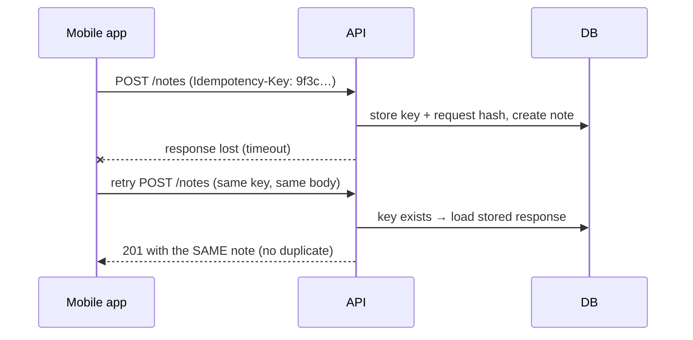

::part[Learn the Concept]{n="1"}

## 🎯 What you'll learn

- `POST` to create: `201 Created`, `Location` header, returning the new resource
- `PUT` (full replacement) vs `PATCH` (partial update) — and what `null` means
- `DELETE`: `204 No Content`, hard vs soft delete, repeated deletes
- **Idempotency keys** so client retries never create duplicates
- Rejecting **unknown fields** and **read-only fields** (`id`, `created_at`, `user_id`)
- **Mass assignment** vulnerabilities and how to avoid them

## 🔤 Key words

| Word | In simple words | Bahasa Indonesia |
|---|---|---|
| **`POST`** | Create something new | Membuat data baru |
| **`PUT`** | Replace the whole resource with what you send | Mengganti seluruhnya |
| **`PATCH`** | Change only the fields you send | Mengubah sebagian |
| **`DELETE`** | Remove it | Menghapus |
| **`201 Created` / `Location`** | The status and header that say "created, and here it is" | Status dan alamat hasil |
| **`204 No Content`** | Success, with nothing to send back | Berhasil tanpa isi |
| **Soft delete** | Marking a row as deleted instead of removing it | Hapus secara penanda |
| **Idempotency key** | A client-supplied id so a retry doesn't create a second copy | Kunci anti-duplikat |
| **Mass assignment** | Letting the client set fields it shouldn't (like `is_admin`) | Mengisi kolom terlarang |
| **Read-only field** | A field only the server may set (`id`, `created_at`) | Kolom yang tidak boleh diisi klien |

## 🧠 The big idea

Writing data is where APIs break things. Each method is a different **promise** to the client:

| Method | Promise |
|---|---|
| `POST /notes` | "Create a new one — each call may create another." |
| `PUT /notes/7` | "Make note 7 look **exactly** like this." |
| `PATCH /notes/7` | "Change **only** these fields of note 7." |
| `DELETE /notes/7` | "Note 7 should not exist afterwards." |

Keeping those promises exactly is what lets a mobile app on a bad connection retry safely, and lets a frontend update its screen correctly.

## ❓ Why it matters

Networks fail at the worst moment: the server created the order, but the response never reached the phone, so the app retries. Did it just create **two** orders? Clear method meanings plus idempotency keys answer that question — the difference between a product people trust and a support nightmare.

Get it wrong and you hand out powers you never meant to:

```python
@bp.post("/notes")
def create():
    note = Note(**request.get_json())      # mass assignment: client can send user_id, id, is_admin…
    db.session.add(note); db.session.commit()
    return {"ok": True}, 200               # no id, no Location, wrong status
```

## 📖 Step by step

### 1. POST: create

```python
@notes_bp.post("")
def create_note():
    data = NoteCreateSchema().load(request.get_json())     # only allowed fields
    note = note_service().create(current_user_id(), data)
    return {"data": NoteSchema().dump(note)}, 201, {"Location": url_for(".get_note", note_id=note.id)}
```

- `201 Created` + `Location` of the new resource + the created representation (with generated `id`, defaults, timestamps).
- For async work that finishes later: `202 Accepted` with a link to check status.

### 2. PUT: full replacement

The request body is the **complete** new state of the editable fields. Missing optional fields are reset to their defaults (or rejected as missing if required).

```http
PUT /api/v1/notes/7
{"title": "Interview prep", "body": "STAR stories", "pinned": false}
```

PUT is idempotent: sending it 5 times leaves the same final state.

### 3. PATCH: partial update

The tricky part is `null`: "don't touch this field" and "set this field to empty" look the same in JSON unless you decide — and document — which one you mean.

Only the fields present change. With **JSON Merge Patch** semantics (RFC 7396) — the most common for JSON APIs:

| Body | Meaning |
|---|---|
| `{"title": "New title"}` | change `title`, leave everything else |
| `{"body": null}` | **clear** `body` (set it to null) — only if the field is nullable |
| `{}` | nothing changes (often `422` "no fields to update" or `200` unchanged — choose and document) |

```python
data = NotePatchSchema(partial=True).load(request.get_json())   # every field optional
for field, value in data.items():                               # only allowed, validated fields
    setattr(note, field, value)
```

:::tip
"Missing" and "`null`" are different: missing = don't touch; `null` = set to empty. Keep that distinction when parsing.
:::

### 4. DELETE

```python
@notes_bp.delete("/<int:note_id>")
def delete_note(note_id: int):
    note_service().delete(current_user_id(), note_id)   # 404 if missing or not owned
    return "", 204
```

- `204 No Content` on success.
- A second `DELETE` of the same resource: returning `404` is common and acceptable (the **final state** is still "doesn't exist", so it's idempotent in effect). Some APIs return `204` again — choose one and document it.
- **Soft delete** (`deleted_at`) when you need undo, audit or references from history.

### 5. Read-only and unknown fields

| Field kind | Examples | On write |
|---|---|---|
| server-generated | `id`, `created_at`, `updated_at` | reject (or ignore) — never trust client values |
| ownership | `user_id` | taken from the **auth token**, never from the body |
| computed | `word_count`, `status` changed via dedicated action | reject |
| unknown | `pinnned` (typo) | reject with `422` — silent ignoring hides client bugs |

This prevents :term[mass assignment]{bahasa="mass assignment — celah keamanan saat klien bisa mengisi field apa saja (mis. role, user_id) karena server menyalin semua input ke objek"} — a classic vulnerability where a client sets `role=admin` or someone else's `user_id`.

### 6. Idempotency keys for POST

The key is a **booking reference**: send the same reference twice and you get the same booking back, not a second one.



Rules:
1. The client generates a unique key (UUID) **per logical operation** and resends it on retries.
2. The server stores `(user_id, key) → request fingerprint + response` (with a `UNIQUE` constraint and an expiry, e.g. 24 hours).
3. Same key + same body → return the stored response.
4. Same key + **different** body → `422`/`409` — the client is misusing the key.

Payment APIs (Stripe, Xendit, Midtrans-style flows) rely on this pattern.

### 7. Optimistic concurrency (preview)

Two tabs edit the same note. To avoid the second silently overwriting the first, include a `version` (or `updated_at`) and require it on update: `UPDATE … WHERE id = :id AND version = :version` → `0` rows → `409 Conflict` ("someone else changed this"). HTTP's `If-Match` + `ETag` headers are the standard way.

### Choosing your setup

Every option here is a trade-off:

| Choice | ✅ | ❌ |
|---|---|---|
| PUT full replacement | simple, idempotent, clear | clients must send everything; accidental field resets |
| PATCH merge semantics | small payloads, flexible | must distinguish missing vs `null` carefully |
| JSON Patch (RFC 6902 operations) | precise (array ops, moves) | complex for clients |
| Hard DELETE | simple | no undo/audit |
| Soft delete | recoverable | every query must filter; unique constraints get tricky |
| Idempotency keys | safe retries | storage, expiry, extra logic |
| Rejecting unknown fields | catches client bugs early | stricter for evolving clients (use versioning) |

- ✅ `POST` for creation and non-idempotent actions; add idempotency keys for money, orders and anything users would hate duplicated.
- ✅ `PATCH` for typical "edit form" updates; `PUT` when clients naturally hold the full object.
- ✅ Dedicated action endpoints for transitions with rules (`POST /applications/42/status`).
- 🚫 Don't copy request bodies onto models with `setattr` for every key.
- 🚫 Don't take ownership (`user_id`) from the request body.

## ⚠️ Common mistakes

- `200` instead of `201`; no `Location`.
- PATCH that nulls out every field that wasn't sent.
- Accepting `id`, `user_id` or `role` from the body.
- Duplicate records on client retries.
- Updating without checking the resource belongs to the caller.

:::revoshop
In RevoShop, open the cart and address routes (`app/routes/carts.py`, `app/routes/user_addresses.py`) and their schemas. (1) Which methods do updates use — `PUT` or `PATCH`? Do they behave as replacement or partial update? (2) Can a client send `user_id` or `is_default` in the body, and what happens? (3) What does `POST` to create an order return — `201` with the order and a `Location`? (4) If the checkout request is retried after a timeout, can a buyer end up with **two orders**? Sketch how an `Idempotency-Key` would prevent it.
:::

## 🏆 Best practices

- [ ] `POST` → **`201` + `Location` + created resource**; `DELETE` → **`204`**; updates → `200` with the updated resource.
- [ ] Validate with **explicit schemas** per operation (create, replace, patch) — allow only editable fields.
- [ ] **Reject unknown and read-only fields** with `422`.
- [ ] Take `user_id` / tenant from the **authenticated identity**, and check ownership on every write.
- [ ] Implement **PATCH merge semantics** correctly (missing vs `null`).
- [ ] Support an **`Idempotency-Key`** header for creation of important resources; store keys with a unique constraint and expiry.
- [ ] Use **optimistic concurrency** (`version`/`ETag` + `If-Match`) where lost updates matter.
- [ ] Document per endpoint whether repeated `DELETE` returns `404` or `204`.

::part[Explain & Design]{n="2"}

## 🗣️ Explain it

Explain to a non-programmer why an online shop must handle "the customer pressed Pay, the screen froze, and they pressed Pay again" — and how an idempotency key works, using a numbered ticket at a bakery.

## 📐 Design it

Design the write endpoints for CareerPilot **application notes** (title, body, pinned, tags): create, full replace, partial update, delete. For each: method, path, request schema (allowed fields, required/optional, nullability), success response, errors, idempotency behavior, and how you prevent lost updates when the user edits in two tabs.

:::quiz
Show a possible design

| Endpoint | Body | Success | Errors |
|---|---|---|---|
| `POST /api/v1/applications/{app_id}/notes` (+ `Idempotency-Key`) | `title` (1–120, required), `body` (≤ 10 000, nullable, default null), `pinned` (bool, default false), `tags` (≤ 10 strings) | `201` + `Location` + note | 404 app not found/not owned · 422 fields · 422 key reused with different body |
| `PUT /api/v1/notes/{id}` (+ `If-Match: "<version>"`) | all editable fields; missing optional ones reset to defaults | `200` note (+ new `ETag`) | 404 · 412 version mismatch · 422 |
| `PATCH /api/v1/notes/{id}` (+ `If-Match`) | any subset; `body: null` clears | `200` note | 404 · 412 · 422 empty body/unknown field |
| `DELETE /api/v1/notes/{id}` | — | `204` | 404 (also on repeated delete) |

Read-only: `id`, `application_id`, `user_id`, `created_at`, `updated_at`, `version`. Lost updates: every update requires the current `version` via `If-Match`; the SQL `UPDATE … WHERE id = :id AND version = :v` increments the version; 0 rows → `412 Precondition Failed`.
:::

### 📝 Self-review checklist

- [ ] Each operation has its own allowed-field schema
- [ ] Ownership comes from the token and is checked
- [ ] Missing vs `null` is defined for PATCH
- [ ] Retries and concurrent edits are handled

::ai-review{task="design"}

::part[Toy Exercise]{n="3"}

:::exercise{path="exercises/m2/w5/02-write-methods" ai="no-ai" title="Correct writes with idempotency keys"}
Implement create/replace/patch/delete endpoints for notes on PostgreSQL: correct status codes and `Location`, strict field whitelists (unknown and read-only fields rejected), PATCH merge semantics including `null`, ownership from a header, and `Idempotency-Key` support that returns the stored response on retries and rejects key reuse with a different body.
:::

:::hints
- Write a small `validate_fields(data, allowed, required)` helper that returns cleaned data and an errors dict.
- For PATCH, check `"body" in data` (present) separately from `data["body"] is None` (clear).
- Fingerprint the request body with `hashlib.sha256(json.dumps(body, sort_keys=True).encode()).hexdigest()`.
- The `IdempotencyRecord` model (provided) has a unique constraint on `(user_id, key)`; store the response status and JSON.
:::

### 🏆 Stretch goal

Add optimistic concurrency: a `version` column, `ETag: "<version>"` on responses, and `412 Precondition Failed` when `If-Match` doesn't match.

## ✅ Quick check

:::quiz
What's the difference between PUT and PATCH?

PUT replaces the resource's editable state with the full representation sent; PATCH changes only the fields present in the request.
:::

:::quiz
What is mass assignment and how do you prevent it?

A vulnerability where the server copies all request fields onto a model, letting clients set fields like `role` or `user_id`. Prevent it with explicit per-operation schemas that allow only editable fields, and take ownership from the authenticated user.
:::

:::quiz
What should happen when a client reuses an idempotency key with a different request body?

Reject it (e.g. `422` or `409`) — the key identifies one specific operation; reusing it for different data is a client bug and must not create or return a mismatched resource.
:::


## 📚 Keep learning

- [RFC 7396 — JSON Merge Patch](https://www.rfc-editor.org/rfc/rfc7396)
- [OWASP API Security Top 10](https://owasp.org/API-Security/)
- [Stripe docs: Idempotent requests](https://docs.stripe.com/api/idempotent_requests)
