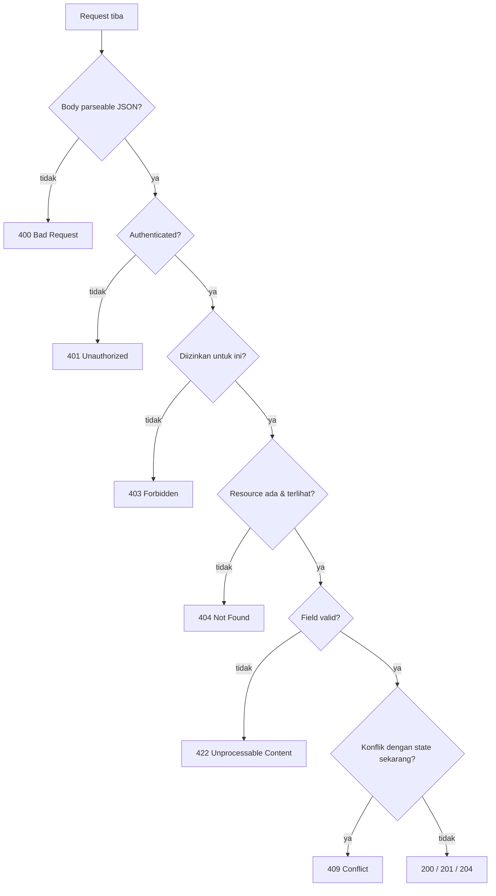

::part[Pelajari Konsepnya]{n="1"}

## 🎯 Yang akan kamu pelajari

- Validasi **syntactic** vs **semantic**, dan di mana masing-masing ditempatkan
- Skema marshmallow 4: field, `required`, `load_default`, `allow_none`, `validate`, nested schema, daftar
- Validator **custom** dan **antar-field** (`@validates`, `@validates_schema`), pembersihan dengan `@pre_load`
- **Skema terpisah** untuk input dan output (`load` vs `dump`), `dump_only`/`load_only`
- Mengubah kesalahan validasi menjadi **response 422 yang konsisten** dengan jalur field
- Tabel keputusan untuk **kode status HTTP**

## 🔤 Istilah penting

| Istilah | Artinya (sederhana) |
|---|---|
| **Validation** | Pemeriksaan data masuk sebelum kode kamu menggunakannya |
| **Syntactic check** | Bentuk dan tipe datanya benar? |
| **Semantic check** | Masuk akal menurut aturan bisnis? |
| **Schema** | Deskripsi tertulis tentang seperti apa data yang sah |
| **marshmallow** | Pustaka Python untuk membuat skema validasi |
| **`load` / `dump`** | Membaca data masuk / menyiapkan data keluar |
| **Cross-field rule** | Aturan yang melibatkan dua field (contoh: `max >= min`) |
| **`422`** | "Aku paham request, tapi datanya tidak valid" |

## 🧠 Ide besarnya

Validasi itu seperti **penjaga keamanan di pintu masuk**. Semua yang tiba — body JSON, query string, header, file yang diupload — diperiksa **sebelum** mencapai logika bisnis kamu. Setelah masuk, service kamu bisa percaya bahwa `salary_min` benar-benar angka negatif dan `applied_on` benar-benar tanggal.

:term[Schema validation]{bahasa="validasi skema — memeriksa bentuk, tipe, dan aturan data masuk berdasarkan deskripsi yang jelas"} mengganti puluhan pengecekan `if` yang ditulis tangan dengan satu deskripsi yang jelas dan dapat dipakai ulang tentang seperti apa data yang sah.

## ❓ Kenapa ini penting

Client mengirim apakah saja: field yang hilang, tipe salah, `"12jt"` daripada `12000000`, string 5 MB, tanggal seperti `31/02/2026`, field ekstra (kadang sengaja). Tanpa validasi kamu dapat error `500`, data rusak, atau lubang keamanan. Dengan itu, client mendapat `422` yang jelas yang mengatakan **persis** apa yang harus diperbaiki.

Tanpa validasi:

```python
@bp.post("/applications")
def create():
    data = request.json
    salary = int(data["salary"])                          # KeyError / ValueError → 500
    if data["applied_on"] > str(date.today()): ...        # comparing strings, not dates
    application = Application(**data)                     # mass assignment
```

- Field yang hilang crash dengan `500 Internal Server Error`, membangunkan engineer on-call di malam hari.
- Developer frontend mendapat error yang samar dan mulai menebak.
- Nilai yang rusak (gaji negatif, tanggal di masa depan) sampai ke database.

## 📖 Cara kerjanya, langkah demi langkah

### 1. Dua jenis validasi

| Jenis | Pertanyaan | Contoh | Di mana |
|---|---|---|---|
| **Syntactic** (bentuk) | Datanya well-formed? | field wajib, tipe, panjang, format, nilai yang diizinkan | skema di route layer |
| **Semantic** (bisnis) | Masuk akal **sekarang**? | perusahaan ada, tidak ada aplikasi duplikat, transisi status diizinkan, kuota tidak terlampaui | service layer (sering butuh database) |

Keduanya mengembalikan error yang membantu — tapi semantic error sering map ke `404`, `409`, atau `422` khusus.

### 2. Sebuah skema marshmallow

```python
from marshmallow import Schema, fields, validate

class ApplicationCreateSchema(Schema):
    company = fields.String(required=True, validate=validate.Length(min=1, max=200))
    role_title = fields.String(required=True, validate=validate.Length(min=1, max=200))
    status = fields.String(load_default="applied", validate=validate.OneOf(["wishlist", "applied", "interview"]))
    applied_on = fields.Date(load_default=None, allow_none=True)
    contact_email = fields.Email(load_default=None, allow_none=True)
    tags = fields.List(fields.String(validate=validate.Length(min=1, max=30)), load_default=list, validate=validate.Length(max=10))

data = ApplicationCreateSchema().load(request.get_json())     # raises ValidationError with ALL problems
```

| Opsi | Artinya |
|---|---|
| `required=True` | harus ada |
| `load_default=…` | nilai yang dipakai saat tidak ada (gunakan callable seperti `list` untuk default yang bisa berubah) |
| `allow_none=True` | `null` diterima |
| `validate=` | aturan ekstra: `Length`, `Range`, `OneOf`, `Regexp`, atau fungsi kamu sendiri |
| `data_key="appliedOn"` | nama JSON berbeda dari nama Python |

**Field yang tidak dikenal raise error secara default** di marshmallow 4 (`unknown = RAISE`) — persis apa yang kamu inginkan untuk write endpoint.

### 3. Pembersihan dan aturan custom

```python
from datetime import date
from marshmallow import ValidationError, pre_load, validates, validates_schema

class ApplicationCreateSchema(Schema):
    ...

    @pre_load
    def strip_strings(self, data, **kwargs):
        if isinstance(data, dict):
            return {k: v.strip() if isinstance(v, str) else v for k, v in data.items()}
        return data

    @validates("applied_on")
    def not_in_future(self, value, **kwargs):
        if value is not None and value > date.today():
            raise ValidationError("can't be in the future")

    @validates_schema
    def salary_range(self, data, **kwargs):
        low, high = data.get("salary_min"), data.get("salary_max")
        if low is not None and high is not None and high < low:
            raise ValidationError("must be greater than or equal to salary_min", field_name="salary_max")
```

`@validates_schema` melihat seluruh object — gunakan untuk aturan yang melibatkan beberapa field.

:::warning[Schema validator dilewati saat field gagal]
Secara default, marshmallow **tidak menjalankan** `@validates_schema` jika field sudah ada error (`skip_on_field_errors=True`). Jika kamu ingin client melihat setiap masalah dalam satu response, gunakan `@validates_schema(skip_on_field_errors=False)` — dan hati-hati dengan missing key, karena field yang tidak valid tidak akan ada di `data`.
:::

### 4. Object nested dan daftar

```python
class SalarySchema(Schema):
    min = fields.Integer(required=True, validate=validate.Range(min=0))
    max = fields.Integer(required=True, validate=validate.Range(min=0))
    currency = fields.String(load_default="IDR", validate=validate.OneOf(["IDR", "USD", "SGD"]))

class ApplicationCreateSchema(Schema):
    salary = fields.Nested(SalarySchema, load_default=None, allow_none=True)
```

Error datang kembali nested juga: `{"salary": {"max": ["…"]}, "tags": {"1": ["…"]}}`.

### 5. Skema input dan output terpisah

Data masuk dan keluar adalah dokumen berbeda: client mungkin tidak set `id` atau `user_id`, dan harus tidak pernah terima `password_hash`. Satu skema untuk keduanya selalu bocor sesuatu akhirnya.

```python
class ApplicationSchema(Schema):          # output
    id = fields.Integer(dump_only=True)
    company = fields.String()
    role_title = fields.String()
    status = fields.String()
    applied_on = fields.Date()
    created_at = fields.DateTime(dump_only=True)
    # NOT included: user_id, internal_score, private_notes
```

- Field `dump_only` **hanya output** — mengirimnya saat load adalah error ("Unknown field").
- Field `load_only` (seperti `password`) **hanya input** — tidak pernah diserialisasi kembali.
- Output schema adalah perlindungan kamu terhadap **kebocoran accidental** dari kolom internal saat model berkembang.

Update: `ApplicationCreateSchema(partial=True)` membuat setiap field optional untuk PATCH.

### 6. Satu response error yang konsisten

Ratakan nested message marshmallow menjadi dot path yang bisa di-map client ke form field:

```python
def flatten(messages, prefix=""):
    flat = {}
    for key, value in messages.items():
        path = f"{prefix}.{key}" if prefix else str(key)
        if isinstance(value, dict):
            flat.update(flatten(value, path))
        else:
            flat[path] = value[0]                # first message per field
    return flat
```

```json
{
  "error": {
    "code": "validation_failed",
    "message": "Some fields are invalid",
    "fields": { "company": "Missing data for required field.", "salary.max": "must be greater than or equal to salary_min", "tags.1": "Length must be between 1 and 30." }
  }
}
```

### 7. Memilih kode status

Panduan cepat: 400 request tidak well-formed, 401 kamu tidak login, 403 kamu login tapi tidak diizinkan, 404 tidak ada, 409 konflik dengan yang ada, 422 well-formed tapi tidak valid.



| Kode | Gunakan saat | Contoh |
|---|---|---|
| `200 OK` | read/update berhasil | `GET`, `PATCH` |
| `201 Created` | resource dibuat | `POST /applications` |
| `202 Accepted` | diterima untuk async processing | CV analysis job queued |
| `204 No Content` | sukses, tidak ada yang dikembalikan | `DELETE` |
| `400 Bad Request` | request tidak well-formed | JSON tidak valid, content type salah |
| `401 Unauthorized` | tidak authenticated | token hilang/expired |
| `403 Forbidden` | authenticated tapi tidak diizinkan | buyer edit produk orang lain |
| `404 Not Found` | tidak ada **atau** tidak terlihat untuk kamu | aplikasi orang lain |
| `405 Method Not Allowed` | method salah di path | `DELETE /applications` |
| `409 Conflict` | konflik state | duplikat, transisi tidak valid, version mismatch |
| `413 Content Too Large` | body/file terlalu besar | upload CV 20 MB |
| `415 Unsupported Media Type` | `Content-Type` salah | form data dikirim ke JSON endpoint |
| `422 Unprocessable Content` | well-formed tapi field tidak valid | salary max < min |
| `429 Too Many Requests` | rate limited | 100 login/menit |
| `500 Internal Server Error` | bug di server | unhandled exception |
| `502/503/504` | upstream failure / unavailable / timeout | AI provider down |

Banyak tim pakai `400` untuk semua client validation error daripada `422` — bagian penting adalah **konsisten** dan dokumentasikan.

### Memilih setup kamu

Setiap pilihan di sini adalah trade-off:

| Pilihan | ✅ | ❌ |
|---|---|---|
| Schema library (marshmallow, Pydantic) | deklaratif, dapat dipakai ulang, daftar error lengkap | abstraksi lain untuk dipelajari |
| Hand-written `if` checks | tidak ada dependency | tidak konsisten, tidak lengkap, verbose |
| Reject unknown fields | tangkap bug client dan attack | client harus update saat kamu hapus field |
| Ignore unknown fields | lenient untuk client yang berkembang | typo diam-diam diabaikan |
| `422` untuk validation | arti presisi | beberapa client hanya expect `400` |
| Validasi di database saja | selalu dipaksakan | error jelek, hanya error pertama |

Pakai **semua layer**: schema (error friendly, lengkap) → service (aturan bisnis) → database constraint (pertahanan terakhir).

- ✅ Validasi **setiap** input source: body, query, path, header, file.
- ✅ Skema terpisah untuk create, update (partial), dan output.
- 🚫 Jangan lakukan semantic check yang butuh database di dalam schema field validator — jaga schema cepat dan pure; lakukan di service.
- 🚫 Jangan kembalikan raw exception message atau stack trace sebagai validation error.

## ⚠️ Kesalahan umum

- Validasi hanya di frontend.
- Kembalikan `500` untuk input buruk.
- Satu skema untuk input dan output (bocor `password_hash`, accept `id`).
- Hanya error pertama dikembalikan — user perbaiki satu field satu waktu.
- Pakai `load_default=[]` (default mutable yang dibagi) daripada `load_default=list`.

:::revoshop
Buka `app/schemas/product_schema.py` (dan satu lagi, seperti `user_schema.py`). Untuk `CreateProductSchema`: field mana yang `required`? Ada `Length`/`Range` limit di name, description, dan price? Ada **response schema** terpisah (`ProductResponseSchema`) jadi field internal tidak bisa bocor? Kemudian lihat bagaimana flask-smorest ubah `ValidationError` jadi response (`@blp.arguments(...)` → `422` secara default): response error kamu seperti apa, dan cocok dengan bagian *Response Format* di README?
:::

## 🏆 Praktik terbaik

- [ ] Validasi di boundary dengan **schema**; konversi ke tipe yang tepat (tanggal, int, enum) sekali.
- [ ] **Reject unknown field** di write; tandai field yang dibuat server sebagai `dump_only`.
- [ ] Kembalikan **semua** field error sekaligus, dengan **jalur field stabil** dan `code` yang machine-readable.
- [ ] Batasi ukuran: panjang string, panjang daftar, request body size (`MAX_CONTENT_LENGTH`), upload size.
- [ ] Pakai **output schema** jadi field internal/sensitive tidak pernah bocor.
- [ ] Jaga business-rule validation di **service**, didukung oleh **database constraint**.
- [ ] Pilih kode status dengan tabel keputusan dan terapkan **konsisten** di seluruh API.
- [ ] Normalkan input dengan sengaja (trim string, lowercase email) dan dokumentasikan.
- [ ] Test input tidak valid sepadu-sepadunya dengan yang valid (parametrized test).

::part[Jelaskan & Rancang]{n="2"}

## 🗣️ Jelaskan

Jelaskan ke developer frontend perbedaan antara `400`, `422`, dan `409` dengan tiga contoh dari form aplikasi job.

## 📐 Rancang

Tulis skema marshmallow (di atas kertas) untuk endpoint CareerPilot **"buat interview"**: `type` (nilai diizinkan), `starts_at` dan `ends_at` (timezone-aware datetime; end setelah start; tidak lebih dari 1 tahun ke depan), optional `meeting_url` (https only), optional `interviewers` list (max 5, masing-masing dengan `name` 1–80 dan optional `email`), optional `notes` (max 2000). Kemudian daftar pengecekan yang harus terjadi di **service** daripada schema, dan kode status mereka.

:::quiz
Tunjukkan rancangan yang mungkin

```python
class InterviewerSchema(Schema):
    name = fields.String(required=True, validate=validate.Length(min=1, max=80))
    email = fields.Email(load_default=None, allow_none=True)

class InterviewCreateSchema(Schema):
    type = fields.String(required=True, validate=validate.OneOf(["hr", "technical", "system_design", "final"]))
    starts_at = fields.AwareDateTime(required=True)
    ends_at = fields.AwareDateTime(required=True)
    meeting_url = fields.Url(load_default=None, allow_none=True, schemes={"https"})
    interviewers = fields.List(fields.Nested(InterviewerSchema), load_default=list, validate=validate.Length(max=5))
    notes = fields.String(load_default=None, allow_none=True, validate=validate.Length(max=2000))

    @validates_schema
    def time_window(self, data, **kwargs):
        if data["ends_at"] <= data["starts_at"]:
            raise ValidationError("must be after starts_at", field_name="ends_at")
        if data["starts_at"] > datetime.now(UTC) + timedelta(days=365):
            raise ValidationError("must be within one year", field_name="starts_at")
```

**Pengecekan service:** aplikasi ada dan milik user → `404`; status aplikasi memungkinkan interview (tidak rejected/withdrawn) → `409`; interview tidak overlap dengan interview lain dari user yang sama → `409`.
:::

### 📝 Checklist review mandiri

- [ ] Field nested dan list ada limit mereka sendiri
- [ ] Aturan cross-field pakai `@validates_schema`
- [ ] Aturan yang depends database hidup di service
- [ ] Setiap service failure punya kode status yang sengaja

::ai-review{task="design"}

::part[Latihan Kecil]{n="3"}

:::exercise{path="exercises/m2/w5/03-validation" ai="no-ai" title="Skema, jalur error, dan kode status"}
Bangun marshmallow 4 schema untuk create, update, dan return aplikasi (nested salary, tag list, aturan cross-field dan tanggal, pembersihan input), helper `flatten_errors` yang menghasilkan field error dot-path, dan endpoint Flask tiny yang jawab `400`, `422`, atau `201` dengan benar. Tidak perlu database.
:::

:::hints
- Pakai `load_default=list` (callable) untuk `tags`, tidak pernah `[]`.
- `@validates_schema` di salary schema untuk `max >= min`, dan raise dengan `field_name="max"`.
- Tag harus unik abaikan case — check di method `@validates("tags")`.
- Di `flatten_errors`, marshmallow letakkan non-field error di bawah `_schema`; map itu ke `"body"`.
:::

### 🏆 Stretch goal

Tambah `data_key="appliedOn"` untuk support camelCase JSON sambil jaga snake_case di Python, dan buat output schema emit camelCase juga.

## ✅ Cek cepat

:::quiz
Apa perbedaan antara validasi syntactic dan semantic?

Syntactic check bentuk dan format data (tipe, field wajib, panjang) dan ada di schema; semantic check arti bisnis yang sering butuh state sekarang (duplikat, permission, transisi) dan ada di service.
:::

:::quiz
Kenapa jaga schema input dan output terpisah?

Schema input terima hanya field yang bisa diedit (cegah mass assignment); schema output kontrol persis apa yang di-expose (cegah bocor field internal atau sensitif).
:::

:::quiz
Client kirim body JSON well-formed di mana `salary_max` lebih kecil dari `salary_min`. Kode status mana?

`422 Unprocessable Content` (atau `400` jika API kamu pakai 400 untuk semua validation error) — dengan field error di `salary_max`.
:::


## 📚 Lanjut belajar

- [marshmallow documentation: Quickstart](https://marshmallow.readthedocs.io/en/stable/quickstart.html)
- [marshmallow: Upgrading to 4.0](https://marshmallow.readthedocs.io/en/latest/upgrading.html)
- [MDN: HTTP response status codes](https://developer.mozilla.org/en-US/docs/Web/HTTP/Status)
