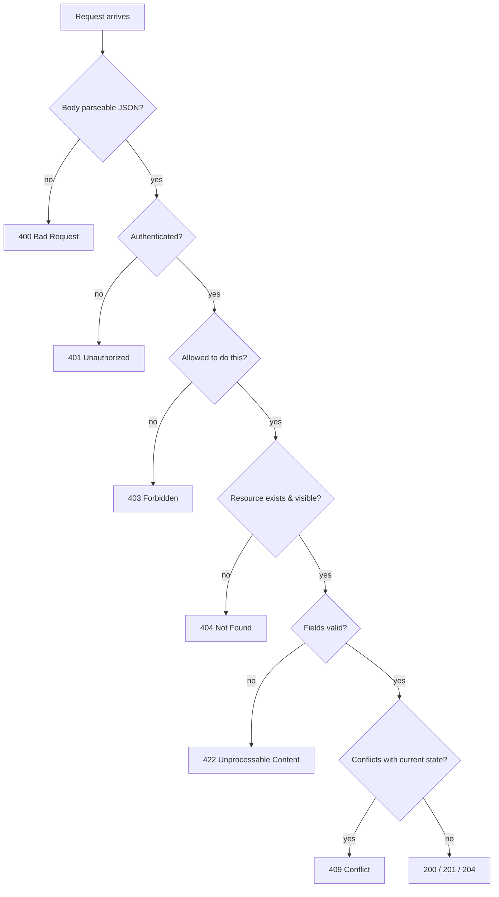

::part[Learn the Concept]{n="1"}

## 🎯 What you'll learn

- **Syntactic** vs **semantic** validation, and where each belongs
- marshmallow 4 schemas: fields, `required`, `load_default`, `allow_none`, `validate`, nested schemas, lists
- **Custom** and **cross-field** validators (`@validates`, `@validates_schema`), cleaning with `@pre_load`
- **Separate schemas** for input and output (`load` vs `dump`), `dump_only`/`load_only`
- Turning validation errors into a **consistent 422 response** with field paths
- A decision table for **HTTP status codes**

## 🔤 Key words

| Word | In simple words | Bahasa Indonesia |
|---|---|---|
| **Validation** | Checking incoming data before your code uses it | Pemeriksaan data masuk |
| **Syntactic check** | Is it the right shape and type? | Bentuk dan tipe benar? |
| **Semantic check** | Does it make sense for the business? | Masuk akal secara aturan? |
| **Schema** | A written description of what valid data looks like | Deskripsi data yang sah |
| **marshmallow** | The Python library used here for schemas | Pustaka validasi |
| **`load` / `dump`** | Reading incoming data / preparing outgoing data | Membaca masuk / menyiapkan keluar |
| **Cross-field rule** | A rule involving two fields (`max >= min`) | Aturan antar kolom |
| **`422`** | "I understood the request, but the data is invalid" | Data tidak valid |
| **Field errors** | Errors listed per field, so the UI can show them in place | Kesalahan per kolom |

## 🧠 The big idea

Validation is the **security guard at the entrance**. Everything arriving — JSON bodies, query strings, headers, uploaded files — is checked **before** it reaches your business logic. Once inside, your services can trust that `salary_min` really is a non-negative integer and `applied_on` really is a date.

:term[Schema validation]{bahasa="validasi skema — memeriksa bentuk, tipe dan aturan data masuk berdasarkan definisi yang jelas"} replaces dozens of hand-written `if` checks with one clear, reusable description of what valid data looks like.

## ❓ Why it matters

Clients send anything: missing fields, wrong types, `"12jt"` instead of `12000000`, 5 MB strings, dates like `31/02/2026`, extra fields (sometimes on purpose). Without validation you get crashes (`500`), corrupted data, or security holes. With it, the client gets a clear `422` saying **exactly** what to fix.

Without it:

```python
@bp.post("/applications")
def create():
    data = request.json
    salary = int(data["salary"])                          # KeyError / ValueError → 500
    if data["applied_on"] > str(date.today()): ...        # comparing strings, not dates
    application = Application(**data)                     # mass assignment
```

- Missing fields crash with `500 Internal Server Error`, waking your on-call engineer at night.
- Frontend developers get vague errors and start guessing.
- Values that break things later (negative salary, future dates) reach the database.

## 📖 Step by step

### 1. Two kinds of validation

| Kind | Question | Examples | Where |
|---|---|---|---|
| **Syntactic** (shape) | Is the data well-formed? | required fields, types, lengths, formats, allowed values | schema at the route layer |
| **Semantic** (business) | Does it make sense *now*? | company exists, no duplicate application, status transition allowed, quota not exceeded | service layer (often needs the database) |

Both return helpful errors — but semantic errors often map to `404`, `409` or domain-specific `422`s.

### 2. A marshmallow schema

```python
from marshmallow import Schema, fields, validate

class ApplicationCreateSchema(Schema):
    company = fields.String(required=True, validate=validate.Length(min=1, max=200))
    role_title = fields.String(required=True, validate=validate.Length(min=1, max=200))
    status = fields.String(load_default="applied", validate=validate.OneOf(["wishlist", "applied", "interview"]))
    applied_on = fields.Date(load_default=None, allow_none=True)
    contact_email = fields.Email(load_default=None, allow_none=True)
    tags = fields.List(fields.String(validate=validate.Length(min=1, max=30)), load_default=list, validate=validate.Length(max=10))

data = ApplicationCreateSchema().load(request.get_json())     # raises ValidationError with ALL problems
```

| Option | Meaning |
|---|---|
| `required=True` | must be present |
| `load_default=…` | value used when missing (use a callable like `list` for mutable defaults) |
| `allow_none=True` | `null` is accepted |
| `validate=` | extra rules: `Length`, `Range`, `OneOf`, `Regexp`, or your own function |
| `data_key="appliedOn"` | the JSON name differs from the Python name |

**Unknown fields raise an error by default** in marshmallow 4 (`unknown = RAISE`) — exactly what you want for write endpoints.

### 3. Cleaning and custom rules

```python
from datetime import date
from marshmallow import ValidationError, pre_load, validates, validates_schema

class ApplicationCreateSchema(Schema):
    ...

    @pre_load
    def strip_strings(self, data, **kwargs):
        if isinstance(data, dict):
            return {k: v.strip() if isinstance(v, str) else v for k, v in data.items()}
        return data

    @validates("applied_on")
    def not_in_future(self, value, **kwargs):
        if value is not None and value > date.today():
            raise ValidationError("can't be in the future")

    @validates_schema
    def salary_range(self, data, **kwargs):
        low, high = data.get("salary_min"), data.get("salary_max")
        if low is not None and high is not None and high < low:
            raise ValidationError("must be greater than or equal to salary_min", field_name="salary_max")
```

`@validates_schema` sees the whole object — use it for rules that involve several fields.

:::warning[Schema validators are skipped when fields fail]
By default, marshmallow **doesn't run** `@validates_schema` if any field already has an error (`skip_on_field_errors=True`). If you want clients to see every problem in one response, use `@validates_schema(skip_on_field_errors=False)` — and guard against missing keys, because invalid fields won't be in `data`.
:::

### 4. Nested objects and lists

```python
class SalarySchema(Schema):
    min = fields.Integer(required=True, validate=validate.Range(min=0))
    max = fields.Integer(required=True, validate=validate.Range(min=0))
    currency = fields.String(load_default="IDR", validate=validate.OneOf(["IDR", "USD", "SGD"]))

class ApplicationCreateSchema(Schema):
    salary = fields.Nested(SalarySchema, load_default=None, allow_none=True)
```

Errors come back nested too: `{"salary": {"max": ["…"]}, "tags": {"1": ["…"]}}`.

### 5. Separate input and output schemas

Incoming and outgoing data are different documents: the client may not set `id` or `user_id`, and must never receive `password_hash`. One schema for both always leaks something eventually.

```python
class ApplicationSchema(Schema):          # output
    id = fields.Integer(dump_only=True)
    company = fields.String()
    role_title = fields.String()
    status = fields.String()
    applied_on = fields.Date()
    created_at = fields.DateTime(dump_only=True)
    # NOT included: user_id, internal_score, private_notes
```

- `dump_only` fields are **output only** — sending them on load is an error ("Unknown field").
- `load_only` fields (like `password`) are **input only** — never serialized back.
- Output schemas are your protection against **accidentally leaking** internal columns when a model grows.

Updates: `ApplicationCreateSchema(partial=True)` makes every field optional for PATCH.

### 6. One consistent error response

Flatten marshmallow's nested messages into dot paths clients can map to form fields:

```python
def flatten(messages, prefix=""):
    flat = {}
    for key, value in messages.items():
        path = f"{prefix}.{key}" if prefix else str(key)
        if isinstance(value, dict):
            flat.update(flatten(value, path))
        else:
            flat[path] = value[0]                # first message per field
    return flat
```

```json
{
  "error": {
    "code": "validation_failed",
    "message": "Some fields are invalid",
    "fields": { "company": "Missing data for required field.", "salary.max": "must be greater than or equal to salary_min", "tags.1": "Length must be between 1 and 30." }
  }
}
```

### 7. Choosing status codes

Quick guide: 400 the request is malformed, 401 you're not logged in, 403 you're logged in but not allowed, 404 it doesn't exist, 409 it conflicts with what's there, 422 it's well-formed but invalid.



| Code | Use when | Example |
|---|---|---|
| `200 OK` | successful read/update | `GET`, `PATCH` |
| `201 Created` | resource created | `POST /applications` |
| `202 Accepted` | accepted for async processing | CV analysis job queued |
| `204 No Content` | success, nothing to return | `DELETE` |
| `400 Bad Request` | malformed request | invalid JSON, wrong content type |
| `401 Unauthorized` | not authenticated | missing/expired token |
| `403 Forbidden` | authenticated but not allowed | buyer editing a product |
| `404 Not Found` | doesn't exist **or** not visible to you | another user's application |
| `405 Method Not Allowed` | wrong method on a path | `DELETE /applications` |
| `409 Conflict` | state conflict | duplicate, invalid transition, version mismatch |
| `413 Content Too Large` | body/file too big | 20 MB CV upload |
| `415 Unsupported Media Type` | wrong `Content-Type` | form data sent to a JSON endpoint |
| `422 Unprocessable Content` | well-formed but invalid fields | salary max < min |
| `429 Too Many Requests` | rate limited | 100 logins/minute |
| `500 Internal Server Error` | a bug on the server | unhandled exception |
| `502/503/504` | upstream failure / unavailable / timeout | AI provider down |

Many teams use `400` for all client validation errors instead of `422` — the important part is to be **consistent** and document it.

### Choosing your setup

Every option here is a trade-off:

| Choice | ✅ | ❌ |
|---|---|---|
| Schema library (marshmallow, Pydantic) | declarative, reusable, complete error lists | another abstraction to learn |
| Hand-written `if` checks | no dependency | inconsistent, incomplete, verbose |
| Reject unknown fields | catches client bugs and attacks | clients must be updated when you remove fields |
| Ignore unknown fields | lenient for evolving clients | typos silently ignored |
| `422` for validation | precise meaning | some clients only expect `400` |
| Validating in the database only | always enforced | ugly errors, first failure only |

Use **all layers**: schema (friendly, complete errors) → service (business rules) → database constraints (last line of defense).

- ✅ Validate **every** input source: body, query, path, headers, files.
- ✅ Separate schemas for create, update (partial) and output.
- 🚫 Don't do semantic checks that need the database inside schema field validators — keep schemas fast and pure; do those in services.
- 🚫 Don't return raw exception messages or stack traces as validation errors.

## ⚠️ Common mistakes

- Validating only on the frontend.
- Returning `500` for bad input.
- One schema used for both input and output (leaks `password_hash`, accepts `id`).
- Only the first error returned — users fix one field at a time.
- Using `load_default=[]` (shared mutable default) instead of `load_default=list`.

:::revoshop
Open `app/schemas/product_schema.py` (and one more, like `user_schema.py`). For `CreateProductSchema`: which fields are `required`? Are there `Length`/`Range` limits on name, description and price? Is there a separate **response** schema (`ProductResponseSchema`) so internal fields can't leak? Then look at how flask-smorest turns a `ValidationError` into a response (`@blp.arguments(...)` → a `422` by default): what does your error body look like, and does it match your *Response Format* section in the README?
:::

## 🏆 Best practices

- [ ] Validate at the boundary with **schemas**; convert to proper types (dates, ints, enums) once.
- [ ] **Reject unknown fields** on writes; mark server-generated fields `dump_only`.
- [ ] Return **all** field errors at once, with **stable field paths** and a machine-readable `code`.
- [ ] Limit sizes: string lengths, list lengths, request body size (`MAX_CONTENT_LENGTH`), upload size.
- [ ] Use **output schemas** so internal/sensitive fields never leak.
- [ ] Keep business-rule validation in **services**, backed by **database constraints**.
- [ ] Pick status codes with the decision table and apply them **consistently** across the API.
- [ ] Normalize input deliberately (trim strings, lowercase emails) and document it.
- [ ] Test invalid inputs as thoroughly as valid ones (parametrized tests).

::part[Explain & Design]{n="2"}

## 🗣️ Explain it

Explain to a frontend developer the difference between `400`, `422` and `409` using three examples from a job application form.

## 📐 Design it

Write the marshmallow schemas (on paper) for CareerPilot's **"create interview"** endpoint: `type` (allowed values), `starts_at` and `ends_at` (timezone-aware datetimes; end after start; not more than 1 year ahead), optional `meeting_url` (https only), optional `interviewers` list (max 5, each with `name` 1–80 and optional `email`), optional `notes` (max 2000). Then list which checks must happen in the **service** instead, and their status codes.

:::quiz
Show a possible design

```python
class InterviewerSchema(Schema):
    name = fields.String(required=True, validate=validate.Length(min=1, max=80))
    email = fields.Email(load_default=None, allow_none=True)

class InterviewCreateSchema(Schema):
    type = fields.String(required=True, validate=validate.OneOf(["hr", "technical", "system_design", "final"]))
    starts_at = fields.AwareDateTime(required=True)
    ends_at = fields.AwareDateTime(required=True)
    meeting_url = fields.Url(load_default=None, allow_none=True, schemes={"https"})
    interviewers = fields.List(fields.Nested(InterviewerSchema), load_default=list, validate=validate.Length(max=5))
    notes = fields.String(load_default=None, allow_none=True, validate=validate.Length(max=2000))

    @validates_schema
    def time_window(self, data, **kwargs):
        if data["ends_at"] <= data["starts_at"]:
            raise ValidationError("must be after starts_at", field_name="ends_at")
        if data["starts_at"] > datetime.now(UTC) + timedelta(days=365):
            raise ValidationError("must be within one year", field_name="starts_at")
```

**Service checks:** the application exists and belongs to the user → `404`; the application's status allows interviews (not rejected/withdrawn) → `409`; the interview doesn't overlap another interview of the same user → `409`.
:::

### 📝 Self-review checklist

- [ ] Nested and list fields have their own limits
- [ ] Cross-field rules use `@validates_schema`
- [ ] Database-dependent rules live in the service
- [ ] Each service failure has a deliberate status code

::ai-review{task="design"}

::part[Toy Exercise]{n="3"}

:::exercise{path="exercises/m2/w5/03-validation" ai="no-ai" title="Schemas, error paths and status codes"}
Build marshmallow 4 schemas for creating, updating and returning applications (nested salary, tag lists, cross-field and date rules, input cleaning), a `flatten_errors` helper that produces dot-path field errors, and a tiny Flask endpoint that answers `400`, `422` or `201` correctly. No database needed.
:::

:::hints
- Use `load_default=list` (a callable) for `tags`, never `[]`.
- `@validates_schema` on the salary schema for `max >= min`, and raise with `field_name="max"`.
- Tags must be unique ignoring case — check in a `@validates("tags")` method.
- In `flatten_errors`, marshmallow puts non-field errors under `_schema`; map that to `"body"`.
:::

### 🏆 Stretch goal

Add `data_key="appliedOn"` to support camelCase JSON while keeping snake_case in Python, and make the output schema emit camelCase too.

## ✅ Quick check

:::quiz
What's the difference between syntactic and semantic validation?

Syntactic checks the shape and format of data (types, required fields, lengths) and belongs in schemas; semantic checks business meaning that often needs current state (duplicates, permissions, transitions) and belongs in services.
:::

:::quiz
Why keep separate input and output schemas?

Input schemas accept only editable fields (preventing mass assignment); output schemas control exactly what's exposed (preventing leaks of internal or sensitive fields).
:::

:::quiz
A client sends a well-formed JSON body where `salary_max` is smaller than `salary_min`. Which status code?

`422 Unprocessable Content` (or `400` if your API uses 400 for all validation errors) — with a field error on `salary_max`.
:::


## 📚 Keep learning

- [marshmallow documentation: Quickstart](https://marshmallow.readthedocs.io/en/stable/quickstart.html)
- [marshmallow: Upgrading to 4.0](https://marshmallow.readthedocs.io/en/latest/upgrading.html)
- [MDN: HTTP response status codes](https://developer.mozilla.org/en-US/docs/Web/HTTP/Status)
