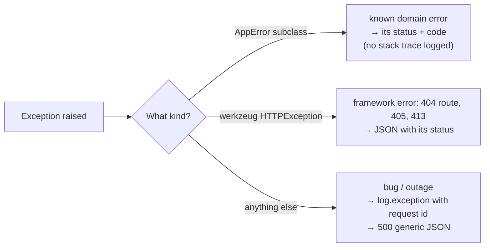

::part[Pelajari Konsepnya]{n="1"}

## 🎯 Yang akan kamu pelajari

- Desain **penangan kesalahan terpusat** untuk Flask API (domain error, HTTP error, unexpected error)
- Menerjemahkan **database error** (`IntegrityError`) menjadi response `409` yang berarti
- **Request ID**: melacak satu request dari laporan bug user hingga ke log-mu
- **Logging** error yang tidak terduga dengan konteks — tanpa membocorkan detail ke client
- Checklist **CRUD review** lengkap: apa yang harus ditangani setiap endpoint create, read, update dan delete

## 🔤 Istilah penting

| Istilah | Artinya (sederhana) |
|---|---|
| **Central error handler** | Satu tempat yang mengubah exception apa saja menjadi response yang tepat |
| **Domain error** | Tipe error milikmu sendiri dengan makna yang jelas ("tidak ditemukan", "tidak diizinkan") |
| **`IntegrityError`** | Database menolak write karena sebuah aturan dilanggar |
| **`409 Conflict`** | "Ini bertabrakan dengan data yang sudah ada" |
| **Request ID** | Nomor rujukan yang dilekatkan pada satu request dan log-nya |
| **Error envelope** | Bentuk JSON tetap dari setiap response error |
| **Stack trace** | Detail error internal — untuk log-mu, bukan untuk client |
| **Idempotent delete** | Menghapus dua kali tetap berakhir dengan "sudah hilang" |

## 🧠 Ide besarnya

Error adalah bagian dari **user interface** API-mu. Response error yang bagus seperti **catatan dokter yang baik**: menjelaskan **apa yang salah** (sebuah code), **apa yang harus dilakukan** (pesan dan field error), dan memberi **nomor rujukan** (request id) agar spesialis — kamu, membaca log — bisa menemukan riwayat lengkapnya.

Detail internal yang menakutkan (stack trace, SQL, path file) tetap ada di catatan medis, tidak pernah di catatan yang diserahkan ke pasien.

## ❓ Kenapa ini penting

- Client harus bereaksi berbeda terhadap "tidak ditemukan", "duplikat", "field tidak sah" dan "server rusak".
- Support perlu menghubungkan "aplikasi bilang ada error jam 10:32" dengan satu baris log yang pasti.
- Keamanan: exception mentah membuka nama tabel, versi library dan path file yang membantu penyerang.
- Konsistensi: satu format error di 80 endpoint berarti satu error handler di frontend.

Tanpa desain, inilah yang dilihat client:

```text
POST /api/v1/companies  →  500
<!doctype html><title>500 Internal Server Error</title>
psycopg.errors.UniqueViolation: duplicate key value violates unique constraint "ix_companies_name_lower"
DETAIL: Key (lower(name))=(kopi data) already exists.
```

HTML bukannya JSON, `500` untuk "sudah ada" yang normal saja, dan struktur database-mu di pesan. Support tidak bisa menemukan baris log karena tidak ada nomor rujukan, dan setiap endpoint gagal berbeda-beda.

## 📖 Langkah demi langkah

### 1. Tiga jenis error, tiga handler



```python
def register_error_handlers(app: Flask) -> None:
    @app.errorhandler(AppError)
    def handle_app_error(error: AppError):
        return error_body(error.code, str(error), getattr(error, "fields", None)), error.status_code

    @app.errorhandler(HTTPException)
    def handle_http_error(error: HTTPException):
        return error_body(snake_case(error.name), error.description), error.code

    @app.errorhandler(Exception)
    def handle_unexpected(error: Exception):
        app.logger.exception("Unhandled error [request_id=%s]", g.request_id)
        return error_body("internal_error", "Something went wrong"), 500
```

Flask memilih handler yang **paling spesifik** untuk class exception-nya.

### 2. Menerjemahkan database error

Repository tahu tentang database; sisa aplikasi berbicara bahasa domain:

```python
from sqlalchemy.exc import IntegrityError

def add(self, company: Company) -> Company:
    db.session.add(company)
    try:
        db.session.commit()
    except IntegrityError as error:
        db.session.rollback()                      # the session must be usable again
        raise CompanyAlreadyExists(company.name) from error
    return company
```

Untuk foreign-key restriction pada delete (`ON DELETE RESTRICT`):

```python
    except IntegrityError as error:
        db.session.rollback()
        raise CompanyInUse(company_id) from error      # 409: jobs still reference this company
```

:::tip
Ketika satu tabel bisa melanggar **beberapa** constraint, inspeksi `error.orig.diag.constraint_name` (psycopg) untuk memilih domain error yang tepat — alasan lain untuk **memberi nama constraint-mu**.
:::

### 3. Request ID

Bayangkan itu seperti nomor antrean di bank: customer mengucapkan nomornya, dan kamu bisa temukan persis apa yang terjadi di loket itu.

```python
import re, uuid
from flask import g, request

REQUEST_ID_PATTERN = re.compile(r"^[A-Za-z0-9-]{1,64}$")

@app.before_request
def assign_request_id():
    incoming = request.headers.get("X-Request-ID", "")
    g.request_id = incoming if REQUEST_ID_PATTERN.match(incoming) else uuid.uuid4().hex

@app.after_request
def return_request_id(response):
    response.headers["X-Request-ID"] = g.request_id
    return response
```

- Terima ID yang masuk dari load balancer atau frontend (divalidasi — jangan pernah percaya raw header masuk ke log), atau generate satu.
- Sertakan di **setiap baris log** dan **setiap error body**.
- Screenshot user "Ada error (ref: 8f3a…)" jadi pencarian log 10 detik.

### 4. Error envelope

```json
{
  "error": {
    "code": "company_exists",
    "message": "A company named 'Kopi Data' already exists",
    "fields": { "name": "already exists" },
    "request_id": "8f3a1c0e5b2d4c69a1f0e7b3d2c1a9e8"
  }
}
```

`code` untuk **program** (stabil, wording tidak pernah berubah); `message` untuk **manusia**; `fields` untuk form; `request_id` untuk support.

### 5. Logging dengan baik

| Lakukan | Jangan |
|---|---|
| `logger.exception(...)` untuk unexpected error (termasuk traceback) | log expected 4xx error dengan stack trace (noise) |
| sertakan request id, user id, route | log password, token, seluruh request body yang punya data pribadi |
| log sekali, di boundary | log error yang sama di setiap layer |
| pakai level: `warning` untuk perilaku client mencurigakan, `error` untuk server failure | `print()` |

Week 6 menambahkan structured (JSON) logging.

### 6. Checklist CRUD review

Jalankan daftar ini di setiap endpoint yang kamu tulis. Ide yang sama seperti checklist pilot — membosankan, cepat, dan menangkap hal yang hampir kamu lupa.

Untuk **setiap** resource, jalan melalui ini sebelum bilang selesai:

| Operasi | Harus menangani |
|---|---|
| **List** | pagination limit · filter divalidasi · sort stabil · hanya row yang terlihat caller · list kosong adalah `200 []` |
| **Read** | `404` untuk missing **dan** tidak-terlihat · tidak ada field internal di output |
| **Create** | schema validation (`422`) · field tidak dikenal/read-only ditolak · ownership dari token · duplikat → `409` · `201` + `Location` · idempotency di mana penting |
| **Update** | `404` · `422` · state conflict / invalid transition → `409` · lost update (version) · `updated_at` berubah |
| **Delete** | `404` · direferensi data lain → `409` atau soft delete · `204` · cascade rule dimaksudkan |
| **Semua** | `401`/`403` · JSON error dengan request id · parameterized query · satu commit per use case · test happy dan error path |

### Pilih setupmu

Setiap opsi di sini adalah trade-off:

| Pilihan | ✅ | ❌ |
|---|---|---|
| Central handler | konsisten, satu tempat untuk ubah | exception bepergian jauh; harus jaga error type teratur |
| Per-route try/except | kontrol lokal | duplikat, tidak konsisten |
| Pre-check duplikat dengan `SELECT` | pesan lebih bagus | race condition — tetap butuh constraint + `IntegrityError` handling |
| Andalkan constraint + translation | race-safe | butuh named constraint untuk bedakan error |
| Detail error message | client debug lebih mudah | bisa bocor info (e.g. "email ada" buka account enumeration) |
| Pesan generic | lebih aman | lebih sulit untuk client — seimbang per endpoint |

- ✅ Central handler + domain error di setiap API.
- ✅ Constraint-backed conflict detection untuk apa saja yang harus unik.
- 🚫 Jangan ubah setiap error jadi `500`, atau setiap error jadi `400`.
- 🚫 Jangan tunjukkan apakah email/username spesifik ada di login atau password reset endpoint (pakai pesan generic di sana).

## ⚠️ Kesalahan umum

- Lupa `db.session.rollback()` setelah tangkap `IntegrityError` → setiap query nanti gagal dengan `PendingRollbackError`.
- Pre-check uniqueness hanya dengan `SELECT` (race condition).
- Tangkap `Exception` di dalam route dan return `400`.
- Return HTML error page dari API.
- Log seluruh request body yang punya password atau token.

:::revoshop
Buka `app/errors.py` dan `app/utils/http.py` di RevoShop. (1) Exception type apa punya handler, dan apakah ada catch-all yang menyembunyikan detail internal? (2) Apakah error body sertakan **request id**? Kalau tidak, sketsa di mana `before_request`/`after_request` akan masuk di `create_app()`. (3) Temukan tempat duplikat bisa terjadi (user email, product slug, category name): apakah `IntegrityError` diterjemahkan menjadi clean `409`, dan session di-rollback? (4) Cek `app/logging_config.py`: apakah baris log `500` memberitahu kamu **request dan user mana** yang menyebabkannya?
:::

## 🏆 Praktik terbaik

- [ ] Register **tiga handler**: domain `AppError`, `HTTPException`, dan catch-all `Exception` → generic `500`.
- [ ] Setiap error body punya stable **`code`**, human **`message`**, optional **`fields`**, dan **`request_id`**.
- [ ] Generate atau terima (validated) **`X-Request-ID`**; return di response dan sertakan di log.
- [ ] **Terjemahkan `IntegrityError`** di repository (setelah `rollback()`) menjadi `409` domain error, pakai named constraint.
- [ ] Log unexpected error **sekali** dengan `logger.exception`; jangan pernah log secret atau token.
- [ ] Jangan pernah expose stack trace, SQL atau path internal ke client; disable debug mode di luar development.
- [ ] Pakai **CRUD checklist** di code review, dan test error path untuk setiap endpoint.
- [ ] Return `503` (bukan `500`) ketika dependency diketahui tidak tersedia, agar client dan load balancer bisa bereaksi.

::part[Jelaskan & Rancang]{n="2"}

## 🗣️ Jelaskan

Jelaskan ke kolega customer support apa itu request id dan cara memakainya ketika user bilang "aplikasi tampilkan error ketika aku simpan aplikasiku".

## 📐 Rancang

Daftar domain error CareerPilot untuk resource **companies** dan **applications** (nama class, status, code, kapan raise, layer mana raise), dan tentukan pesan mana yang **generic** karena alasan keamanan. Sertakan database-constraint translation.

:::quiz
Lihat desain yang mungkin

| Error | Status | Code | Raise ketika | Layer |
|---|---|---|---|---|
| `CompanyNotFound` | 404 | `company_not_found` | id hilang | service |
| `CompanyAlreadyExists` | 409 | `company_exists` | unique index `ix_companies_name_lower` dilanggar | repository (translated) |
| `CompanyInUse` | 409 | `company_in_use` | FK restrict pada delete | repository (translated) |
| `ApplicationNotFound` | 404 | `application_not_found` | hilang **atau user lain punya** | service |
| `DuplicateApplication` | 409 | `duplicate_application` | `uq_applications_user_company_role` | repository (translated) |
| `InvalidTransition` | 409 | `invalid_transition` | status rule | service |
| `ValidationFailed` | 422 | `validation_failed` | schema error | route/schema |
| `Unauthorized` / `Forbidden` | 401 / 403 | `unauthorized` / `forbidden` | token / role | route decorator |
| (unexpected) | 500 | `internal_error` | apapun lainnya | error handler |

**Generic dengan sengaja:** login fail ("email atau password tidak sah"), password reset ("jika email ada, kami kirim link"), dan 404 untuk resource user lain — agar penyerang tidak bisa cari akun atau resource id.
:::

### 📝 Checklist review mandiri

- [ ] Constraint violation jadi 409 di repository layer
- [ ] Ownership fail return 404
- [ ] Security-sensitive endpoint pakai generic message
- [ ] Setiap error punya stable code

::ai-review{task="design"}

::part[Latihan Kecil]{n="3"}

:::exercise{path="exercises/m2/w5/04-error-handling-crud" ai="no-ai" title="A complete CRUD resource with production-grade errors"}
Implement `errors.py` (domain errors, three central handlers, request ids) dan `companies.py` (full CRUD untuk companies) di PostgreSQL. Test-nya cover CRUD checklist, translated `409` untuk duplicate name dan untuk delete company yang masih direferensi job, request id di header/body/log, dan `500` yang tidak pernah bocor real exception message.
:::

:::hints
- `g.request_id` diatur di `before_request`; baca di setiap handler untuk tambah `"request_id"` ke error body.
- Duplicate name case-insensitive: model punya unique index di `lower(name)` — tangkap `IntegrityError` saat commit.
- `delete` company yang direferensi: commit gagal dengan `IntegrityError` karena `ON DELETE RESTRICT`.
- Test pakai `caplog` — log dengan `current_app.logger.exception(...)` dan sertakan request id di pesan.
:::

### 🏆 Stretch goal

Pakai `error.orig.diag.constraint_name` untuk bedakan dua kasus `IntegrityError` bukannya andalkan operasi mana kamu sedang lakukan.

## ✅ Cek cepat

:::quiz
Kenapa kamu harus panggil `db.session.rollback()` setelah tangkap `IntegrityError`?

Transaction yang gagal biarkan session dalam state tidak sah; tanpa rollback, setiap query nanti di session itu raise error.
:::

:::quiz
Kenapa cek `SELECT` saja tidak cukup untuk cegah duplicate company name?

Dua request bisa sama-sama lihat "tidak ada company bernama X" dan insert di waktu bersamaan. Hanya unique constraint yang jamin uniqueness; aplikasi tetap harus tangani pelanggaran-nya.
:::

:::quiz
Apa tujuan sertakan request id di error response?

Itu biarkan user dan support rujuk request yang tepat, agar engineer bisa cari matching log line (dengan stack trace) dengan cepat.
:::


## 📚 Lanjut belajar

- [Flask docs: Handling Application Errors](https://flask.palletsprojects.com/en/stable/errorhandling/)
- [RFC 9457 — Problem Details for HTTP APIs](https://www.rfc-editor.org/rfc/rfc9457)
- [OWASP: Error Handling Cheat Sheet](https://cheatsheetseries.owasp.org/cheatsheets/Error_Handling_Cheat_Sheet.html)
