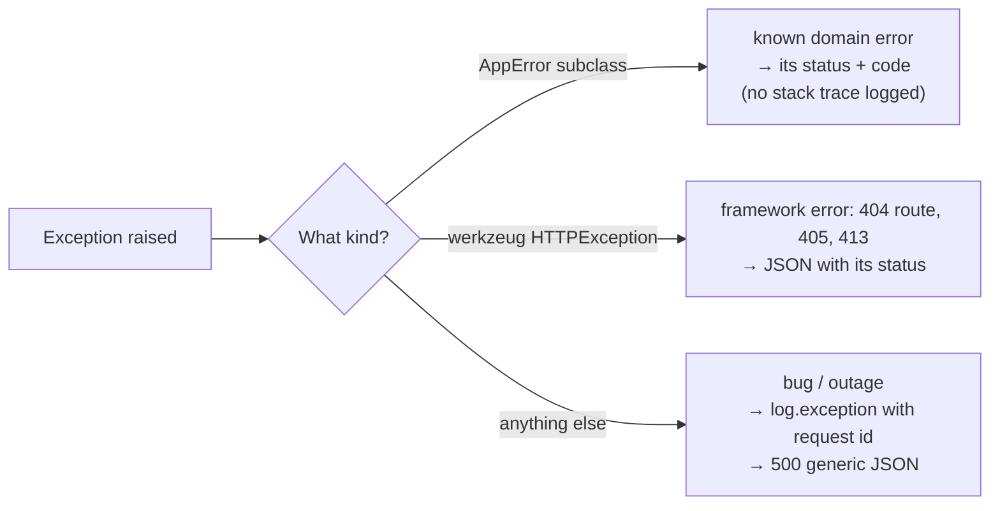

::part[Learn the Concept]{n="1"}

## 🎯 What you'll learn

- A **central error-handling** design for a Flask API (domain errors, HTTP errors, unexpected errors)
- Translating **database errors** (`IntegrityError`) into meaningful `409` responses
- **Request IDs**: tracing one request from a user's bug report to your logs
- **Logging** unexpected errors with context — without leaking details to clients
- A complete **CRUD review checklist**: what every create, read, update and delete endpoint must handle

## 🧠 The big idea

Errors are part of your API's **user interface**. A good error response is like a good doctor's note: it says clearly **what's wrong** (a code), **what to do** (a message, field errors), and gives a **reference number** (request id) so the specialist (you, reading logs) can find the full history.

Meanwhile, the scary internal details — stack traces, SQL, file paths — stay in the medical records (logs), never on the note handed to the patient.

## ❓ Why does this exist?

- Clients need to react differently to "not found", "duplicate", "invalid field" and "server broke".
- Support needs to connect "the app said something went wrong at 10:32" to the exact server log line.
- Security: raw exceptions reveal table names, library versions and file paths that help attackers.
- Consistency: one error format across 80 endpoints means one error handler in the frontend.

## 💥 What happens if we DON'T design it?

```text
POST /api/v1/companies  →  500
<!doctype html><title>500 Internal Server Error</title>
psycopg.errors.UniqueViolation: duplicate key value violates unique constraint "ix_companies_name_lower"
DETAIL: Key (lower(name))=(kopi data) already exists.
```

The client gets HTML (not JSON), a `500` for a perfectly normal "already exists" situation, and your database schema in the message. Support can't find the log line because there's no reference. Every endpoint handles errors differently.

## 📖 How it works, step by step

### 1. Three kinds of errors, three handlers



```python
def register_error_handlers(app: Flask) -> None:
    @app.errorhandler(AppError)
    def handle_app_error(error: AppError):
        return error_body(error.code, str(error), getattr(error, "fields", None)), error.status_code

    @app.errorhandler(HTTPException)
    def handle_http_error(error: HTTPException):
        return error_body(snake_case(error.name), error.description), error.code

    @app.errorhandler(Exception)
    def handle_unexpected(error: Exception):
        app.logger.exception("Unhandled error [request_id=%s]", g.request_id)
        return error_body("internal_error", "Something went wrong"), 500
```

Flask picks the **most specific** registered handler for an exception's class.

### 2. Translating database errors

The repository knows about the database; the rest of the app speaks domain language:

```python
from sqlalchemy.exc import IntegrityError

def add(self, company: Company) -> Company:
    db.session.add(company)
    try:
        db.session.commit()
    except IntegrityError as error:
        db.session.rollback()                      # the session must be usable again
        raise CompanyAlreadyExists(company.name) from error
    return company
```

For foreign-key restrictions on delete (`ON DELETE RESTRICT`):

```python
    except IntegrityError as error:
        db.session.rollback()
        raise CompanyInUse(company_id) from error      # 409: jobs still reference this company
```

:::tip
When one table can violate **several** constraints, inspect `error.orig.diag.constraint_name` (psycopg) to pick the right domain error — another reason to **name your constraints**.
:::

### 3. Request IDs

```python
import re, uuid
from flask import g, request

REQUEST_ID_PATTERN = re.compile(r"^[A-Za-z0-9-]{1,64}$")

@app.before_request
def assign_request_id():
    incoming = request.headers.get("X-Request-ID", "")
    g.request_id = incoming if REQUEST_ID_PATTERN.match(incoming) else uuid.uuid4().hex

@app.after_request
def return_request_id(response):
    response.headers["X-Request-ID"] = g.request_id
    return response
```

- Accept an incoming id from a load balancer or frontend (validated — never trust raw headers into logs), or generate one.
- Include it in **every log line** and **every error body**.
- A user screenshot of "Something went wrong (ref: 8f3a…)" becomes a 10-second log search.

### 4. The error envelope

```json
{
  "error": {
    "code": "company_exists",
    "message": "A company named 'Kopi Data' already exists",
    "fields": { "name": "already exists" },
    "request_id": "8f3a1c0e5b2d4c69a1f0e7b3d2c1a9e8"
  }
}
```

`code` is for **programs** (stable, never changes wording); `message` is for **humans**; `fields` for forms; `request_id` for support.

### 5. Logging well

| Do | Don't |
|---|---|
| `logger.exception(...)` for unexpected errors (includes traceback) | log expected 4xx errors with stack traces (noise) |
| include request id, user id, route | log passwords, tokens, full request bodies with personal data |
| log once, at the boundary | log the same error in every layer |
| use levels: `warning` for suspicious client behavior, `error` for server failures | `print()` |

Week 6 adds structured (JSON) logging.

### 6. CRUD review checklist

For **every** resource, walk through this before calling it done:

| Operation | Must handle |
|---|---|
| **List** | pagination limits · filters validated · stable sort · only caller-visible rows · empty list is `200 []` |
| **Read** | `404` for missing **and** not-visible · no internal fields in output |
| **Create** | schema validation (`422`) · unknown/read-only fields rejected · ownership from token · duplicates → `409` · `201` + `Location` · idempotency where it matters |
| **Update** | `404` · `422` · state conflicts / invalid transitions → `409` · lost updates (version) · `updated_at` changes |
| **Delete** | `404` · referenced by other data → `409` or soft delete · `204` · cascade rules intended |
| **All** | `401`/`403` · JSON errors with request id · parameterized queries · one commit per use case · tests for happy and error paths |

## ⚖️ Trade-offs

| Choice | ✅ | ❌ |
|---|---|---|
| Central handlers | consistent, one place to change | exceptions travel far; must keep error types organized |
| Per-route try/except | local control | duplicated, inconsistent |
| Pre-checking duplicates with a `SELECT` | nicer messages | race condition — still need the constraint + `IntegrityError` handling |
| Relying on constraints + translation | race-safe | need named constraints to tell errors apart |
| Detailed error messages | easier client debugging | may leak info (e.g. "email exists" enables account enumeration) |
| Generic messages | safer | harder for clients — balance per endpoint |

## ✅ When to use it / 🚫 When NOT to use it

- ✅ Central handlers + domain errors in every API.
- ✅ Constraint-backed conflict detection for anything that must be unique.
- 🚫 Don't turn every error into `500`, or every error into `400`.
- 🚫 Don't reveal whether a specific email/username exists on login or password reset endpoints (use generic messages there).

## 🏆 Best practices

- [ ] Register **three handlers**: domain `AppError`, `HTTPException`, and a catch-all `Exception` → generic `500`.
- [ ] Every error body has a stable **`code`**, a human **`message`**, optional **`fields`**, and the **`request_id`**.
- [ ] Generate or accept (validated) **`X-Request-ID`**; return it in responses and include it in logs.
- [ ] **Translate `IntegrityError`** in repositories (after `rollback()`) into `409` domain errors, using named constraints.
- [ ] Log unexpected errors **once** with `logger.exception`; never log secrets or tokens.
- [ ] Never expose stack traces, SQL or internal paths to clients; disable debug mode outside development.
- [ ] Use the **CRUD checklist** in code review, and test error paths for every endpoint.
- [ ] Return `503` (not `500`) when a dependency is known to be unavailable, so clients and load balancers can react.

## 🏭 How it's used in industry

- Error tracking (Sentry, Datadog) groups `500`s by stack trace and attaches the request id and user.
- API style guides (Google, Microsoft, Zalando) define standard error objects; RFC 9457 "Problem Details" is a formal standard some APIs adopt (`application/problem+json`).
- Customer support dashboards search logs by request id copied from the app.

## ⚠️ Common mistakes

- Forgetting `db.session.rollback()` after an `IntegrityError` → every later query fails with `PendingRollbackError`.
- Pre-checking uniqueness with `SELECT` only (race condition).
- Catching `Exception` inside routes and returning `400`.
- Returning HTML error pages from an API.
- Logging full request bodies containing passwords or tokens.

:::revoshop
Open `app/errors.py` and `app/utils/http.py` in RevoShop. (1) Which exception types have handlers, and is there a catch-all that hides internal details? (2) Do error bodies include a **request id**? If not, sketch where `before_request`/`after_request` would go in `create_app()`. (3) Find a place where a duplicate could happen (user email, product slug, category name): is `IntegrityError` translated into a clean `409`, and is the session rolled back? (4) Check `app/logging_config.py`: would a `500` log line tell you **which request and user** caused it?
:::

::part[Explain & Design]{n="2"}

## 🗣️ Explain it

Explain to a customer support colleague what a request id is and how to use it when a user reports "the app showed an error when I saved my application".

## 📐 Design it

List CareerPilot's domain errors for the **companies** and **applications** resources (class name, status, code, when raised, which layer raises it), and decide which messages must be **generic** for security reasons. Include database-constraint translations.

:::quiz
Show a possible design

| Error | Status | Code | Raised when | Layer |
|---|---|---|---|---|
| `CompanyNotFound` | 404 | `company_not_found` | id missing | service |
| `CompanyAlreadyExists` | 409 | `company_exists` | unique index `ix_companies_name_lower` violated | repository (translated) |
| `CompanyInUse` | 409 | `company_in_use` | FK restrict on delete | repository (translated) |
| `ApplicationNotFound` | 404 | `application_not_found` | missing **or other user's** | service |
| `DuplicateApplication` | 409 | `duplicate_application` | `uq_applications_user_company_role` | repository (translated) |
| `InvalidTransition` | 409 | `invalid_transition` | status rule | service |
| `ValidationFailed` | 422 | `validation_failed` | schema errors | route/schema |
| `Unauthorized` / `Forbidden` | 401 / 403 | `unauthorized` / `forbidden` | token / role | route decorator |
| (unexpected) | 500 | `internal_error` | anything else | error handler |

**Generic on purpose:** login failures ("invalid email or password"), password reset ("if the email exists, we sent a link"), and 404 for other users' resources — so attackers can't discover accounts or resource ids.
:::

### 📝 Self-review checklist

- [ ] Constraint violations become 409s in the repository layer
- [ ] Ownership failures return 404
- [ ] Security-sensitive endpoints use generic messages
- [ ] Every error has a stable code

::ai-review{task="design"}

::part[Toy Exercise]{n="3"}

:::exercise{path="exercises/m2/w5/04-error-handling-crud" ai="no-ai" title="A complete CRUD resource with production-grade errors"}
Implement `errors.py` (domain errors, three central handlers, request ids) and `companies.py` (full CRUD for companies) on PostgreSQL. The tests cover the CRUD checklist, translated `409`s for duplicate names and for deleting a company that jobs still reference, request ids in headers, bodies and logs, and a `500` that never leaks the real exception message.
:::

:::hints
- `g.request_id` is set in `before_request`; read it in every handler to add `"request_id"` to error bodies.
- Case-insensitive duplicate names: the model has a unique index on `lower(name)` — catch `IntegrityError` on commit.
- `delete` of a referenced company: commit fails with `IntegrityError` because of `ON DELETE RESTRICT`.
- Tests use `caplog` — log with `current_app.logger.exception(...)` and include the request id in the message.
:::

### 🏆 Stretch goal

Use `error.orig.diag.constraint_name` to distinguish the two `IntegrityError` cases instead of relying on which operation you were doing.

## ✅ Quick check

:::quiz
Why must you call `db.session.rollback()` after catching `IntegrityError`?

The failed transaction leaves the session in an invalid state; without a rollback, every subsequent query in that session raises an error.
:::

:::quiz
Why isn't a `SELECT` check enough to prevent duplicate company names?

Two requests can both see "no company named X" and insert at the same time. Only a unique constraint guarantees uniqueness; the app must still handle its violation.
:::

:::quiz
What's the purpose of including a request id in error responses?

It lets users and support reference the exact request, so engineers can find the matching log lines (with stack traces) quickly.
:::

## 📖 Kamus (glossary)

| Term | Bahasa Indonesia |
|---|---|
| Error handler | Penangan error terpusat |
| Request ID | Nomor referensi unik per permintaan |
| Constraint violation | Pelanggaran aturan database |
| Logging | Pencatatan kejadian aplikasi |
| Stack trace | Jejak tumpukan pemanggilan saat error |
| Account enumeration | Menebak akun yang terdaftar dari pesan error |

## 📚 Keep learning

- [Flask docs: Handling Application Errors](https://flask.palletsprojects.com/en/stable/errorhandling/)
- [RFC 9457 — Problem Details for HTTP APIs](https://www.rfc-editor.org/rfc/rfc9457)
- [OWASP: Error Handling Cheat Sheet](https://cheatsheetseries.owasp.org/cheatsheets/Error_Handling_Cheat_Sheet.html)
