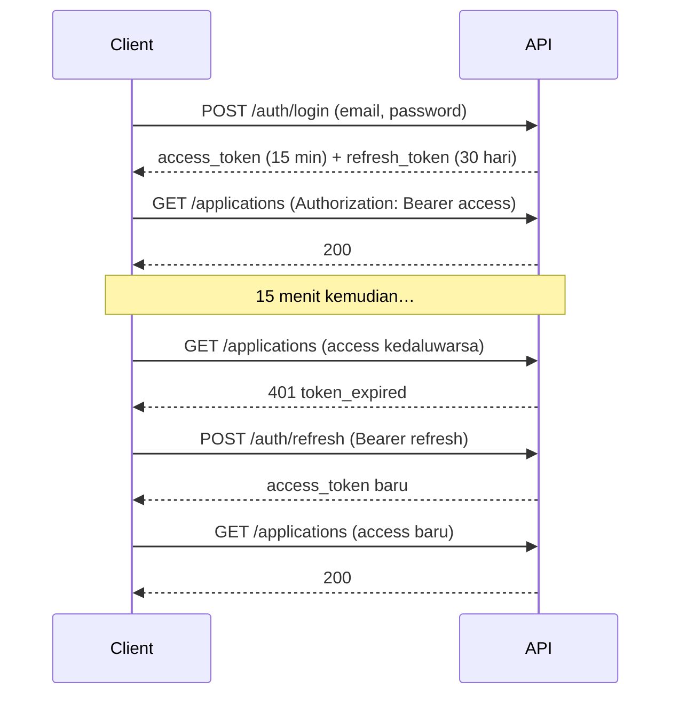

::part[Pelajari Konsepnya]{n="1"}

## 🎯 Yang akan kamu pelajari

- **Authentication** vs **authorization**
- Menyimpan password dengan aman: **hashing** dengan algoritma lambat dan tersalt (bukan enkripsi, bukan plaintext)
- Cara kerja **JWT**: header, payload (claim), signature — dan apa yang TIDAK dilindunginya
- **Access token** (berumur pendek) + **refresh token** (berumur lebih lama) dan kenapa kamu butuh keduanya
- **Revocation** (logout) dengan token blocklist
- Implementasi dengan **Flask-JWT-Extended**, dengan JSON error untuk token hilang, kedaluwarsa, tidak sah, dan dicabut
- JWT vs **server-side session**, dan di mana sebaiknya token disimpan di browser

## 🔤 Istilah penting

| Istilah | Artinya (sederhana) |
|---|---|
| **Authentication** | Membuktikan siapa identitasmu |
| **Authorization** | Menentukan apa yang boleh kamu lakukan |
| **Hashing** | Mengubah password menjadi sidik jari satu arah |
| **Salt** | Teks acak ditambahkan supaya password sama menghasilkan hash berbeda |
| **JWT** | Token yang ditandatangani berisi informasi tentang pengguna |
| **Claim** | Satu informasi di dalam token (mis. `sub`, `exp`) |
| **Access token** | Bukti berumur pendek yang dipakai di setiap request |
| **Refresh token** | Token berumur lama dipakai hanya untuk meminta access token baru |
| **Expiry (`exp`)** | Waktu setelah token tidak berlaku lagi |
| **Revocation / blocklist** | Membuat token berhenti bekerja sebelum kedaluwarsa (logout) |

## 🧠 Ide besarnya

Masuk ke aplikasi seperti **check-in di hotel**:

1. Di resepsi kamu membuktikan identitas (email + password) — **authentication**.
2. Kamu dapat **kartu kunci** (sebuah token) dengan tanggal berlaku. Kamu tidak perlu tunjukkan KTP di setiap pintu; pintunya cukup cek kartu sudah asli dan masih berlaku.
3. Kartu hanya buka **pintu-pintu tertentu** — kamarmu, gym — itu **authorization** (pelajaran berikutnya).
4. Kalau kartu hilang, resepsi bisa **nonaktifkan** — **revocation**.

:term[JWT]{bahasa="JSON Web Token — token berisi klaim (mis. id pengguna) yang ditandatangani server agar tidak bisa dipalsukan"} itu kartu kunci yang server bisa **cek tanpa cari data**, karena token ditandatangani dengan rahasia hanya server yang tahu.

## ❓ Kenapa ini penting

HTTP tidak ingat apa-apa (Modul 1): setiap request harus buktikan siapa yang membuat. Mengirim password setiap kali sangat berbahaya dan lambat — hashing password sengaja dibuat lambat. Jadi kamu masuk satu kali, dapat token yang buktikan identitasmu dalam waktu terbatas.

Kalau salah implementasi, inilah cara akun diambil:

| Kesalahan | Akibat |
|---|---|
| Password disimpan plaintext atau hash cepat (MD5/SHA-256) | satu kebocoran database = semua akun bocor, dan semua situs lain di mana pengguna ulang password |
| `JWT_SECRET_KEY = "secret"` atau default lama | siapa pun bisa palsu token untuk user mana saja, termasuk admin |
| Access token berlaku 30 hari | token yang dicuri jalan sebulan, logout tidak bermakna |
| Error berbeda untuk "email tidak ada" dan "password salah" | penyerang tahu email mana yang terdaftar |
| Tidak ada batas coba login | penyerang bisa coba password ribuan kali per menit |
| Data sensitif di dalam token | siapa pun yang punya token bisa baca — JWT hanya ditandatangani, bukan disembunyikan |

## 📖 Langkah demi langkah

### 1. Hashing password

Hash adalah **sidik jari satu arah**: kamu bisa cek password melawannya, tapi tidak bisa balik jadi password. Algoritma lambat dan tersalt (bcrypt, argon2) membuat menebak-nebak tidak praktis.

```python
from werkzeug.security import check_password_hash, generate_password_hash

hash_ = generate_password_hash("correct horse battery staple")   # 'scrypt:32768:8:1$<salt>$<hash>'
check_password_hash(hash_, "correct horse battery staple")         # True
```

- **Hash** adalah satu arah: kamu bisa cek password melawannya, tapi tidak bisa balik.
- **Salt** acak membuat password sama menghasilkan hash berbeda.
- Algoritma **lambat** (scrypt — default Werkzeug, **Argon2id** — rekomendasi OWASP pertama, bcrypt) membuat brute force mahal.
- Jangan tulis crypto sendiri; jangan "enkripsi" password (enkripsi bisa dibalik).

Aturan password yang benar-benar membantu: **panjang minimum** (mis. 12 karakter), izinkan passphrase panjang, blok password umum/bocor. Aturan kompleksitas paksa ("harus ada simbol") membantu lebih sedikit dari panjang.

### 2. Anatomi JWT

```text
eyJhbGciOiJIUzI1NiJ9 . eyJzdWIiOiI3Iiwicm9sZSI6InVzZXIiLCJleHAiOjE3NTg... . 3kX9…
└──── header ────┘     └────────────────── payload (claims) ─────────────┘   └ signature ┘
```

```json
{ "sub": "7", "role": "user", "type": "access", "jti": "5c1e…", "iat": 1757750000, "exp": 1757750900 }
```

| Claim | Artinya |
|---|---|
| `sub` | subject — id pengguna (harus **string**) |
| `exp` / `iat` / `nbf` | kedaluwarsa pada / dikeluarkan pada / jangan sebelum |
| `jti` | id unik token — dipakai untuk revocation |
| `type` | `access` atau `refresh` (Flask-JWT-Extended) |
| custom (`role`) | fakta kecil tidak sensitif yang kamu butuh di kebanyakan request |

:::danger[Ditandatangani ≠ disembunyikan]
Siapa pun bisa decode payload (coba di jwt.io). Signature hanya buktikan **tidak diubah**. Jangan taruh password, data pribadi, atau rahasia di JWT.
:::

### 3. Access + refresh token

Token access pendek, token refresh lebih lama: seperti kartu kunci yang kedaluwarsa setiap 15 menit, plus hak minta kartu baru ke resepsi tanpa tunjuk paspor lagi.



- **Token access pendek** membatasi kerusakan kalau ada yang bocor.
- **Token refresh** hindari login setiap 15 menit; dipakai hanya di satu endpoint, bisa dicabut, dan sebaiknya di-**rotate** (token refresh baru setiap kali dipakai).

### 4. Setup Flask-JWT-Extended

```python
from datetime import timedelta
from flask_jwt_extended import JWTManager

app.config["JWT_SECRET_KEY"] = os.environ["JWT_SECRET_KEY"]        # required — no default!
app.config["JWT_ACCESS_TOKEN_EXPIRES"] = timedelta(minutes=15)
app.config["JWT_REFRESH_TOKEN_EXPIRES"] = timedelta(days=30)
jwt = JWTManager(app)
```

Generate rahasia kuat: `python -c "import secrets; print(secrets.token_urlsafe(64))"`.

### 5. Login dan route terlindungi

```python
from flask_jwt_extended import create_access_token, create_refresh_token, get_jwt_identity, jwt_required

@auth_bp.post("/login")
def login():
    data = LoginSchema().load(request.get_json())
    user = users.find_by_email(data["email"])
    if user is None or not check_password_hash(user.password_hash, data["password"]):
        raise Unauthorized("Invalid email or password", code="invalid_credentials")   # same message for both
    return {
        "access_token": create_access_token(identity=str(user.id), additional_claims={"role": user.role}),
        "refresh_token": create_refresh_token(identity=str(user.id)),
        "token_type": "Bearer",
        "expires_in": 900,
    }

@auth_bp.get("/me")
@jwt_required()                         # access tokens only
def me():
    user = users.get(int(get_jwt_identity()))
    return {"data": UserSchema().dump(user)}

@auth_bp.post("/refresh")
@jwt_required(refresh=True)             # refresh tokens only
def refresh():
    return {"access_token": create_access_token(identity=get_jwt_identity())}
```

:::tip[Timing attack]
Kalau email tidak ada, cek tanpa hash membuat respon terukur lebih cepat. Kode production sering cek dengan dummy hash supaya dua jalan butuh waktu mirip.
:::

### 6. JSON error untuk masalah token

```python
@jwt.unauthorized_loader
def missing_token(reason):
    return {"error": {"code": "token_missing", "message": reason}}, 401

@jwt.expired_token_loader
def expired_token(jwt_header, jwt_payload):
    return {"error": {"code": "token_expired", "message": "Token has expired"}}, 401

@jwt.invalid_token_loader
def invalid_token(reason):
    return {"error": {"code": "token_invalid", "message": "Invalid token"}}, 401

@jwt.revoked_token_loader
def revoked_token(jwt_header, jwt_payload):
    return {"error": {"code": "token_revoked", "message": "Token has been revoked"}}, 401
```

Client pakai `token_expired` untuk trigger refresh, dan lainnya kirim pengguna balik ke login.

### 7. Logout: revocation dengan blocklist

JWT tidak bisa "dihapus" — tetap berlaku sampai `exp`. Untuk logout, simpan `jti`-nya di blocklist dan tolak:

```python
@jwt.token_in_blocklist_loader
def is_revoked(jwt_header, jwt_payload) -> bool:
    return revoked_tokens.exists(jwt_payload["jti"])

@auth_bp.post("/logout")
@jwt_required()
def logout():
    claims = get_jwt()
    revoked_tokens.add(jti=claims["jti"], expires_at=datetime.fromtimestamp(claims["exp"], UTC))
    return "", 204
```

Simpan kedaluwarsa supaya pekerjaan cleanup bisa hapus entry lama. Pada skala besar, blocklist sering hidup di **Redis** dengan TTL sesuai sisa umur token.

### 8. Muat pengguna di setiap request

Token sah untuk pengguna yang **dihapus atau dinonaktifkan** harus tidak jalan:

```python
@jwt.user_lookup_loader
def load_user(jwt_header, jwt_payload):
    return db.session.get(User, int(jwt_payload["sub"]))      # None → user_lookup_error_loader

@jwt.user_lookup_error_loader
def user_not_found(jwt_header, jwt_payload):
    return {"error": {"code": "user_not_found", "message": "User no longer exists"}}, 401
```

Lalu pakai `current_user` di route.

### 9. JWT vs session, dan di mana simpan token

| | Server-side session (cookie dengan id session) | JWT |
|---|---|---|
| State | disimpan di server (DB/Redis) | di dalam token |
| Revocation | instant (hapus session) | butuh blocklist atau kedaluwarsa pendek |
| Scaling | perlu session store bersama | server mana pun bisa verify |
| Terbaik untuk | web app klasik di satu domain | API, aplikasi mobile, banyak service |

Di **browser**, simpan token di `localStorage` buka mereka untuk bug XSS mana pun. Lebih aman: cookie **httpOnly, Secure, SameSite** (plus CSRF protection), atau simpan access token di memory dan refresh token di cookie httpOnly. Aplikasi mobile pakai penyimpanan aman platform. (Modul 4 bahas sisi frontend.)

### Pilih setup kamu

Setiap pilihan di sini ada trade-off:

| Pilihan | ✅ | ❌ |
|---|---|---|
| Access token pendek (5–15 min) | kerusakan kecil kalau bocor | sering minta token baru |
| Access token panjang | client sederhana | token yang dicuri tetap berguna; logout lemah |
| Blocklist check di setiap request | logout sungguhan | satu baca DB/Redis per request |
| JWT stateless saja | tidak ada lookup | tidak bisa cabut sebelum kedaluwarsa |
| Role di dalam token | tidak perlu DB lookup peran | perubahan peran hanya berlaku setelah token baru |
| Buat auth sendiri | kontrol penuh, pembelajaran bagus | mudah salah — di production pikir pakai penyedia terbukti (Auth0, Cognito, Clerk, Supabase Auth, Keycloak) |

- ✅ JWT access + refresh token untuk API yang dipakai SPA, aplikasi mobile, atau service lain.
- ✅ Server-side session untuk aplikasi server-render tradisional.
- 🚫 Jangan taruh izin yang harus berubah langsung **hanya** di token.
- 🚫 Jangan ciptakan format token atau crypto sendiri.

## ⚠️ Kesalahan umum

- Secret JWT default atau lemah di config.
- Access token yang tidak pernah (atau jarang) kedaluwarsa.
- Return `password_hash` di respon pengguna.
- Terima refresh token di endpoint normal.
- Buka apakah email terdaftar.
- Lupa token pengguna yang dihapus tetap verify secara cryptographic.

:::revoshop
Buka `config/base.py` di RevoShop: access token kedaluwarsa setelah `JWT_ACCESS_TOKEN_EXPIRES` jam (default 1) dan refresh token setelah 30 hari; `JWT_SECRET_KEY` jatuh balik ke `'super-secret-key-change-in-production'`. Lalu buka `app/routes/auth.py`, `app/services/auth_service.py` dan `app/auth.py`. Jawab: (1) Library hashing mana dipakai (`bcrypt` ada di `requirements.txt`)? (2) Error login sama untuk email tidak ada dan password salah? (3) Ada endpoint refresh, dan apakah refresh token bisa dipakai di route normal? (4) Ada **logout/revocation**? (5) Apa terjadi dengan token pengguna yang soft-delete (`is_active = False`)? Perbaiki setidaknya fallback secret-key di branch.
:::

## 🏆 Praktik terbaik

- [ ] Hash password dengan **Argon2id, scrypt atau bcrypt** lewat library; jangan pernah log password.
- [ ] Panjang password minimum **≥ 12**, izinkan passphrase, blok password umum/bocor.
- [ ] Muat `JWT_SECRET_KEY` dari lingkungan — **tidak ada default**; pakai nilai acak panjang; rotate kalau bocor.
- [ ] **Access token berumur pendek** (≈15 min) + **refresh token** (di-rotate dan bisa dicabut).
- [ ] Pakai string `sub`, unik `jti`, dan claim minimal tidak sensitif.
- [ ] Error sama untuk email tidak ada dan password salah (`invalid_credentials`).
- [ ] **Rate-limit** endpoint login, register, reset password; pikir account lockout/backoff.
- [ ] Return JSON **401** error dengan kode berbeda untuk token hilang, kedaluwarsa, tidak sah, dicabut.
- [ ] Cabut saat logout (blocklist dengan kedaluwarsa) dan **tolak token pengguna yang dihapus/dinonaktifkan**.
- [ ] Selalu pakai **HTTPS**; di browser lebih suka httpOnly Secure cookie atas `localStorage`.
- [ ] Pikir MFA dan penyedia identitas terpercaya untuk sistem production dengan data sensitif.

::part[Jelaskan & Rancang]{n="2"}

## 🗣️ Jelaskan

Jelaskan kepada bukan programmer kenapa website menyimpan "sidik jari yang diacak" password bukannya password sendiri, dan kenapa token login yang dicuri harus kedaluwarsa cepat. Pakai analogi kartu kunci hotel.

## 📐 Rancang

Rancang otentikasi CareerPilot: endpoint, masa berlaku token, di mana web app (Next.js) dan aplikasi mobile masa depan simpan token, apa yang ada di access token, cara kerja logout dan "keluar dari semua device", cara kerja reset password dengan aman, dan endpoint mana yang rate-limited.

:::quiz
Lihat rancangan mungkin

**Endpoint:** `POST /auth/register`, `POST /auth/login`, `POST /auth/refresh` (rotate refresh token), `POST /auth/logout`, `POST /auth/logout-all`, `POST /auth/password-reset/request`, `POST /auth/password-reset/confirm`, `GET /auth/me`.

**Token:** access 15 min (`sub`, `role`, `jti`); refresh 30 hari, disimpan server sebagai record hash (`user_id`, `family_id`, `expires_at`, `revoked_at`) supaya rotate dan deteksi reuse.

**Simpan:** web → refresh token di cookie httpOnly, Secure, SameSite=Lax scoped ke `/auth/refresh`; access token simpan di memory. Mobile → OS secure storage (Keychain/Keystore).

**Logout:** cabut refresh token sekarang + tolak `jti` access sekarang. **Logout semua:** cabut semua refresh token pengguna dan naikkan `token_version` di pengguna; access token bawa `ver` dan ditolak kalau tidak cocok.

**Reset password:** selalu jawab "kalau akun ada, email sudah dikirim"; token acak satu pakai (hash di DB), kedaluwarsa 30 menit; sukses revoke semua session.

**Rate limit:** login (per IP + per email), register, reset request, refresh.
:::

### 📝 Checklist review mandiri

- [ ] Access token berumur pendek; refresh token bisa dicabut dan di-rotate
- [ ] Tidak ada data sensitif di JWT claim
- [ ] Simpan token browser hindari `localStorage`
- [ ] Reset dan login tidak buka apakah akun ada
- [ ] Endpoint brute-force punya rate limit

::ai-review{task="design"}

::part[Latihan Kecil]{n="3"}

:::exercise{path="exercises/m2/w5/05-jwt-auth" ai="no-ai" title="Daftar, masuk, refresh, dan logout"}
Implementasi otentikasi dengan Flask-JWT-Extended di PostgreSQL: registrasi dengan password hash dan validasi, login dengan error sama, `/me` dengan pengguna sekarang, refresh token hanya jalan di `/refresh`, logout yang **cabut** token lewat blocklist, dan JSON error untuk token hilang, kedaluwarsa, tidak sah, dicabut, dan pengguna dihapus.
:::

:::hints
- `generate_password_hash` / `check_password_hash` dari `werkzeug.security`.
- `create_access_token(identity=str(user.id), additional_claims={"role": user.role})`.
- Daftar semua lima loader di `init_auth`: unauthorized, expired, invalid, revoked, dan blocklist check — plus `user_lookup_loader` dan `user_lookup_error_loader`.
- `get_jwt()["jti"]` dan `get_jwt()["exp"]` di dalam route terlindungi kasih apa yang kamu butuh untuk cabut.
:::

### 🏆 Tantangan lebih jauh

Implementasi **refresh token rotation**: `/refresh` cabut token refresh yang diterima dan return pasangan baru. Pakai kembali refresh token lama harus gagal dengan `token_revoked`.

## ✅ Cek cepat

:::quiz
Kenapa hash password dengan algoritma lambat seperti scrypt atau Argon2 bukannya SHA-256?

Hash cepat biarkan penyerang coba milyaran tebakan per detik setelah bocor. Algoritma lambat, tersalt, memory-hard membuat setiap tebakan mahal.
:::

:::quiz
Apakah siapa pun bisa baca isi JWT?

Ya — header dan payload hanya base64-encode. Signature cegah perubahan saja, bukan baca. Jangan taruh rahasia atau data pribadi.
:::

:::quiz
Bagaimana kamu "logout" JWT yang belum kedaluwarsa?

Simpan `jti`-nya di blocklist (database atau Redis, sampai kedaluwarsa) dan tolak token di sana di setiap request — atau simpan access token sangat pendek dan cabut refresh token.
:::


## 📚 Lanjut belajar

- [OWASP: Password Storage Cheat Sheet](https://cheatsheetseries.owasp.org/cheatsheets/Password_Storage_Cheat_Sheet.html)
- [OWASP: JSON Web Token Cheat Sheet](https://cheatsheetseries.owasp.org/cheatsheets/JSON_Web_Token_for_Java_Cheat_Sheet.html)
- [Flask-JWT-Extended documentation](https://flask-jwt-extended.readthedocs.io/)
- [jwt.io — decode a token to see its claims](https://jwt.io/)
