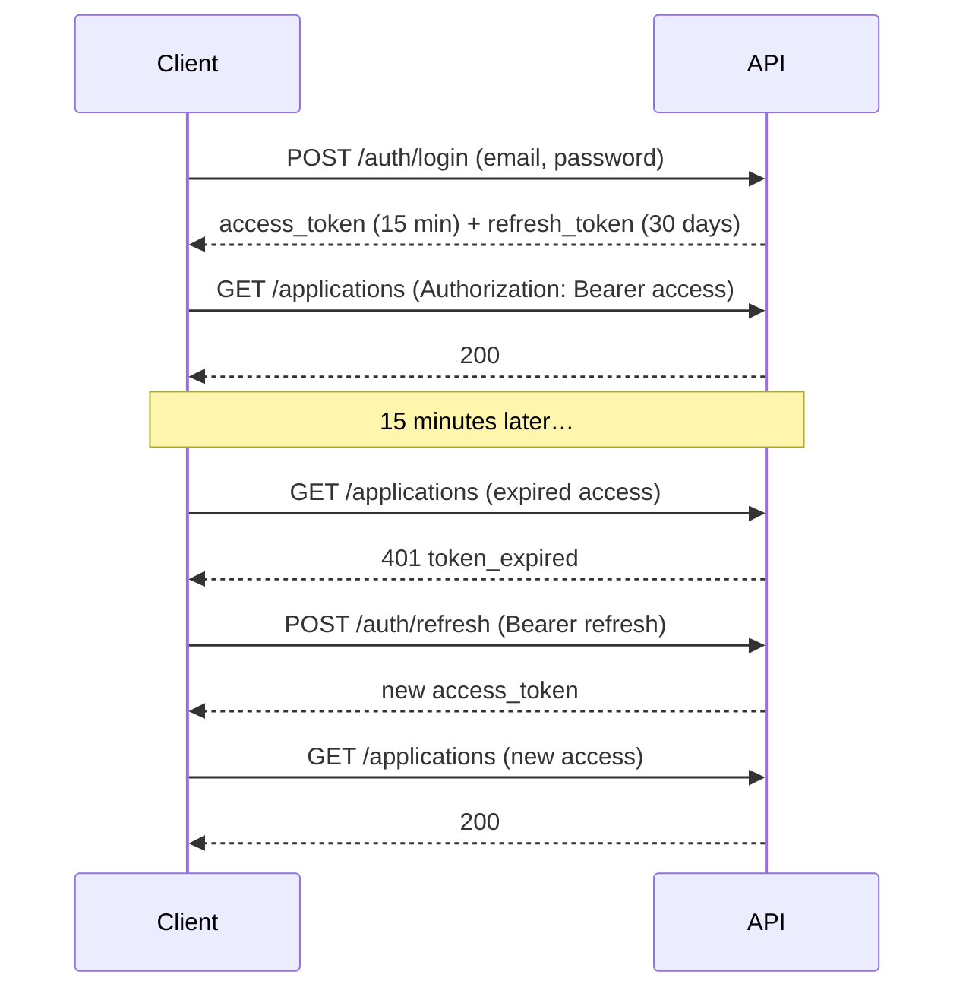

::part[Learn the Concept]{n="1"}

## 🎯 What you'll learn

- **Authentication** vs **authorization**
- Storing passwords safely: **hashing** with a slow, salted algorithm (never encryption, never plaintext)
- How a **JWT** works: header, payload (claims), signature — and what it does **not** protect
- **Access tokens** (short-lived) + **refresh tokens** (longer-lived) and why you need both
- **Revocation** (logout) with a token denylist
- Implementing it with **Flask-JWT-Extended**, with JSON errors for missing, expired, invalid and revoked tokens
- JWTs vs **server-side sessions**, and where tokens should live in a browser

## 🔤 Key words

| Word | In simple words | Bahasa Indonesia |
|---|---|---|
| **Authentication** | Proving who you are | Membuktikan identitas |
| **Authorization** | Deciding what you're allowed to do | Menentukan hak akses |
| **Hashing** | Turning a password into a one-way fingerprint | Mengubah jadi sidik satu arah |
| **Salt** | Random extra text so identical passwords hash differently | Tambahan acak pada hash |
| **JWT** | A signed token carrying facts about the user | Token bertanda tangan |
| **Claim** | One fact inside the token (`sub`, `exp`) | Isi keterangan token |
| **Access token** | Short-lived proof used on each request | Token akses berumur pendek |
| **Refresh token** | Longer-lived token used only to get a new access token | Token untuk memperbarui |
| **Expiry (`exp`)** | The time after which the token stops working | Waktu kedaluwarsa |
| **Revocation / denylist** | Making a token stop working before it expires (logout) | Mencabut token |

## 🧠 The big idea

Logging in is like checking into a **hotel**:

1. At reception you prove who you are (email + password) — **authentication**.
2. You get a **key card** (a token) with an expiry date. You don't show your ID at every door; the door just checks the card is genuine and still valid.
3. The card opens only **certain doors** — your room, the gym — which is **authorization** (next lesson).
4. If you lose the card, reception can **deactivate** it — **revocation**.

A :term[JWT]{bahasa="JSON Web Token — token berisi klaim (mis. id pengguna) yang ditandatangani server agar tidak bisa dipalsukan"} is a key card the server can check **without looking anything up**, because it's signed with a secret only the server knows.

## ❓ Why it matters

HTTP has no memory (Module 1): every request must prove who is making it. Sending the password every time would be dangerous and slow — password hashing is deliberately slow. So you log in once and receive a token that proves your identity for a limited time.

Done wrong, this is exactly how accounts get taken over:

| Mistake | Consequence |
|---|---|
| Passwords stored as plain text or with fast hashes (MD5/SHA-256) | one database leak = every account, and every other site where users reused that password |
| `JWT_SECRET_KEY = "secret"` or a leftover default | anyone can forge a token for any user, including admins |
| Access tokens valid for 30 days | a stolen token works for a month, and logout means nothing |
| Different errors for "unknown email" and "wrong password" | attackers learn which emails are registered |
| No rate limit on login | password guessing at thousands of tries per minute |
| Sensitive data inside the token | anyone holding it can read it — a JWT is only signed, not hidden |

## 📖 Step by step

### 1. Password hashing

A hash is a **one-way fingerprint**: you can check a password against it, but you can't turn it back into the password. Slow, salted algorithms (bcrypt, argon2) make mass guessing impractical.

```python
from werkzeug.security import check_password_hash, generate_password_hash

hash_ = generate_password_hash("correct horse battery staple")   # 'scrypt:32768:8:1$<salt>$<hash>'
check_password_hash(hash_, "correct horse battery staple")         # True
```

- A **hash** is one-way: you can check a password against it, but not reverse it.
- A random **salt** makes identical passwords produce different hashes.
- **Slow** algorithms (scrypt — Werkzeug's default, **Argon2id** — OWASP's first recommendation, bcrypt) make brute force expensive.
- Never write your own crypto; never "encrypt" passwords (encryption is reversible).

Password rules that actually help: a **minimum length** (e.g. 12), allow long passphrases, block very common/breached passwords. Forced complexity rules ("must include a symbol") help less than length.

### 2. Anatomy of a JWT

```text
eyJhbGciOiJIUzI1NiJ9 . eyJzdWIiOiI3Iiwicm9sZSI6InVzZXIiLCJleHAiOjE3NTg... . 3kX9…
└──── header ────┘     └────────────────── payload (claims) ─────────────┘   └ signature ┘
```

```json
{ "sub": "7", "role": "user", "type": "access", "jti": "5c1e…", "iat": 1757750000, "exp": 1757750900 }
```

| Claim | Meaning |
|---|---|
| `sub` | subject — the user id (a **string**) |
| `exp` / `iat` / `nbf` | expires at / issued at / not before |
| `jti` | unique token id — used for revocation |
| `type` | `access` or `refresh` (Flask-JWT-Extended) |
| custom (`role`) | small, non-sensitive facts you need on most requests |

:::danger[Signed ≠ encrypted]
Anyone can decode the payload (try jwt.io). The signature only proves **it wasn't changed**. Never put passwords, personal data or secrets in a JWT.
:::

### 3. Access + refresh tokens

Short access token, longer refresh token: like a key card that expires every 15 minutes, plus the right to ask reception for a new one without showing your passport again.



- **Short access tokens** limit the damage if one leaks.
- **Refresh tokens** avoid logging in every 15 minutes; they're used only at one endpoint, can be revoked, and ideally **rotated** (a new refresh token on each use).

### 4. Flask-JWT-Extended setup

```python
from datetime import timedelta
from flask_jwt_extended import JWTManager

app.config["JWT_SECRET_KEY"] = os.environ["JWT_SECRET_KEY"]        # required — no default!
app.config["JWT_ACCESS_TOKEN_EXPIRES"] = timedelta(minutes=15)
app.config["JWT_REFRESH_TOKEN_EXPIRES"] = timedelta(days=30)
jwt = JWTManager(app)
```

Generate a strong secret: `python -c "import secrets; print(secrets.token_urlsafe(64))"`.

### 5. Login and protected routes

```python
from flask_jwt_extended import create_access_token, create_refresh_token, get_jwt_identity, jwt_required

@auth_bp.post("/login")
def login():
    data = LoginSchema().load(request.get_json())
    user = users.find_by_email(data["email"])
    if user is None or not check_password_hash(user.password_hash, data["password"]):
        raise Unauthorized("Invalid email or password", code="invalid_credentials")   # same message for both
    return {
        "access_token": create_access_token(identity=str(user.id), additional_claims={"role": user.role}),
        "refresh_token": create_refresh_token(identity=str(user.id)),
        "token_type": "Bearer",
        "expires_in": 900,
    }

@auth_bp.get("/me")
@jwt_required()                         # access tokens only
def me():
    user = users.get(int(get_jwt_identity()))
    return {"data": UserSchema().dump(user)}

@auth_bp.post("/refresh")
@jwt_required(refresh=True)             # refresh tokens only
def refresh():
    return {"access_token": create_access_token(identity=get_jwt_identity())}
```

:::tip[Timing attacks]
If the email doesn't exist, checking no hash at all makes that response measurably faster. Production code often checks against a dummy hash so both paths take similar time.
:::

### 6. JSON errors for token problems

```python
@jwt.unauthorized_loader
def missing_token(reason):
    return {"error": {"code": "token_missing", "message": reason}}, 401

@jwt.expired_token_loader
def expired_token(jwt_header, jwt_payload):
    return {"error": {"code": "token_expired", "message": "Token has expired"}}, 401

@jwt.invalid_token_loader
def invalid_token(reason):
    return {"error": {"code": "token_invalid", "message": "Invalid token"}}, 401

@jwt.revoked_token_loader
def revoked_token(jwt_header, jwt_payload):
    return {"error": {"code": "token_revoked", "message": "Token has been revoked"}}, 401
```

Clients use `token_expired` to trigger a refresh, and the others to send the user back to login.

### 7. Logout: revocation with a denylist

A JWT can't be "deleted" — it stays valid until `exp`. To log out, store its `jti` in a denylist and reject it:

```python
@jwt.token_in_blocklist_loader
def is_revoked(jwt_header, jwt_payload) -> bool:
    return revoked_tokens.exists(jwt_payload["jti"])

@auth_bp.post("/logout")
@jwt_required()
def logout():
    claims = get_jwt()
    revoked_tokens.add(jti=claims["jti"], expires_at=datetime.fromtimestamp(claims["exp"], UTC))
    return "", 204
```

Store the expiry so a cleanup job can delete old entries. At scale, the denylist often lives in **Redis** with a TTL equal to the token's remaining life.

### 8. Load the user on each request

A valid token for a **deleted or disabled** user must not work:

```python
@jwt.user_lookup_loader
def load_user(jwt_header, jwt_payload):
    return db.session.get(User, int(jwt_payload["sub"]))      # None → user_lookup_error_loader

@jwt.user_lookup_error_loader
def user_not_found(jwt_header, jwt_payload):
    return {"error": {"code": "user_not_found", "message": "User no longer exists"}}, 401
```

Then use `current_user` in routes.

### 9. JWT vs sessions, and where to store tokens

| | Server-side session (cookie with session id) | JWT |
|---|---|---|
| State | stored on the server (DB/Redis) | inside the token |
| Revocation | instant (delete the session) | needs a denylist or short expiry |
| Scaling | shared session store needed | any server can verify |
| Best for | classic web apps on one domain | APIs, mobile apps, multiple services |

In **browsers**, storing tokens in `localStorage` exposes them to any XSS bug. Safer: an **httpOnly, Secure, SameSite** cookie (plus CSRF protection), or keep the access token in memory and the refresh token in an httpOnly cookie. Mobile apps use the platform's secure storage. (Module 4 covers the frontend side.)

### Choosing your setup

Every option here is a trade-off:

| Choice | ✅ | ❌ |
|---|---|---|
| Short access token (5–15 min) | small damage window | frequent refresh calls |
| Long access token | simple clients | stolen tokens stay useful; logout is weak |
| Denylist lookup on each request | real logout | a DB/Redis read per request |
| Stateless-only JWT | no lookups | can't revoke before expiry |
| Role inside the token | no DB lookup for role checks | role changes apply only after the token expires |
| Build auth yourself | full control, great learning | easy to get wrong — in production consider proven providers (Auth0, Cognito, Clerk, Supabase Auth, Keycloak) |

- ✅ JWT access + refresh tokens for APIs consumed by SPAs, mobile apps or other services.
- ✅ Server-side sessions for traditional server-rendered apps.
- 🚫 Don't put permissions that must change instantly **only** in the token.
- 🚫 Don't invent your own token format or crypto.

## ⚠️ Common mistakes

- Default or weak JWT secret in config.
- Access tokens that never (or rarely) expire.
- Returning `password_hash` in user responses.
- Accepting refresh tokens on normal endpoints.
- Revealing whether an email exists.
- Forgetting that deleted users' tokens still verify cryptographically.

:::revoshop
Open `config/base.py` in RevoShop: access tokens expire after `JWT_ACCESS_TOKEN_EXPIRES` hours (default 1) and refresh tokens after 30 days; `JWT_SECRET_KEY` falls back to `'super-secret-key-change-in-production'`. Then open `app/routes/auth.py`, `app/services/auth_service.py` and `app/auth.py`. Answer: (1) Which hashing library is used (`bcrypt` is in `requirements.txt`)? (2) Is the login error identical for unknown email and wrong password? (3) Is there a refresh endpoint, and can a refresh token be used on normal routes? (4) Is there **logout/revocation**? (5) What happens to a token of a user that was soft-deleted (`is_active = False`)? Fix at least the secret-key fallback in a branch.
:::

## 🏆 Best practices

- [ ] Hash passwords with **Argon2id, scrypt or bcrypt** via a library; never log passwords.
- [ ] Minimum password length **≥ 12**, allow passphrases, block common/breached passwords.
- [ ] Load `JWT_SECRET_KEY` from the environment — **no default**; use a long random value; rotate if leaked.
- [ ] **Short-lived access tokens** (≈15 min) + **refresh tokens** (rotated and revocable).
- [ ] Use string `sub`, a unique `jti`, and minimal, non-sensitive claims.
- [ ] Same generic error for unknown email and wrong password (`invalid_credentials`).
- [ ] **Rate-limit** login, register and password reset endpoints; consider account lockout/backoff.
- [ ] Return JSON **401** errors with distinct codes for missing, expired, invalid and revoked tokens.
- [ ] Revoke on logout (denylist with expiry) and **reject tokens of deleted/disabled users**.
- [ ] Always use **HTTPS**; in browsers prefer httpOnly Secure cookies over `localStorage`.
- [ ] Consider MFA and a managed identity provider for production systems with sensitive data.

::part[Explain & Design]{n="2"}

## 🗣️ Explain it

Explain to a non-programmer why websites store a "scrambled fingerprint" of your password instead of the password itself, and why a stolen login token should expire quickly. Use the hotel key card analogy.

## 📐 Design it

Design CareerPilot's authentication: endpoints, token lifetimes, where the web app (Next.js) and a future mobile app store tokens, what's inside the access token, how logout and "log out of all devices" work, how password reset works safely, and which endpoints are rate-limited.

:::quiz
Show a possible design

**Endpoints:** `POST /auth/register`, `POST /auth/login`, `POST /auth/refresh` (rotates refresh token), `POST /auth/logout`, `POST /auth/logout-all`, `POST /auth/password-reset/request`, `POST /auth/password-reset/confirm`, `GET /auth/me`.

**Tokens:** access 15 min (`sub`, `role`, `jti`); refresh 30 days, stored server-side as a hashed record (`user_id`, `family_id`, `expires_at`, `revoked_at`) to allow rotation and reuse detection.

**Storage:** web → refresh token in an httpOnly, Secure, SameSite=Lax cookie scoped to `/auth/refresh`; access token kept in memory. Mobile → OS secure storage (Keychain/Keystore).

**Logout:** revoke current refresh token + deny current access `jti`. **Logout all:** revoke all refresh tokens for the user and bump a `token_version` on the user; access tokens carry `ver` and are rejected when it doesn't match.

**Password reset:** always respond "if an account exists, we sent an email"; single-use random token (hashed in DB), 30-minute expiry; on success revoke all sessions.

**Rate limits:** login (per IP + per email), register, reset request, refresh.
:::

### 📝 Self-review checklist

- [ ] Access tokens are short-lived; refresh tokens are revocable and rotated
- [ ] No sensitive data in JWT claims
- [ ] Browser token storage avoids `localStorage`
- [ ] Reset and login don't reveal whether accounts exist
- [ ] Brute-force endpoints are rate-limited

::ai-review{task="design"}

::part[Toy Exercise]{n="3"}

:::exercise{path="exercises/m2/w5/05-jwt-auth" ai="no-ai" title="Register, login, refresh and logout"}
Implement authentication with Flask-JWT-Extended on PostgreSQL: registration with hashed passwords and validation, login with a generic error, `/me` with the current user, refresh tokens that only work on `/refresh`, logout that **revokes** tokens via a denylist, and JSON errors for missing, expired, invalid, revoked tokens and deleted users.
:::

:::hints
- `generate_password_hash` / `check_password_hash` from `werkzeug.security`.
- `create_access_token(identity=str(user.id), additional_claims={"role": user.role})`.
- Register all five loaders in `init_auth`: unauthorized, expired, invalid, revoked, and the blocklist check — plus `user_lookup_loader` and `user_lookup_error_loader`.
- `get_jwt()["jti"]` and `get_jwt()["exp"]` inside a protected route give what you need to revoke.
:::

### 🏆 Stretch goal

Implement **refresh token rotation**: `/refresh` revokes the refresh token it received and returns a new pair. Reusing an old refresh token should fail with `token_revoked`.

## ✅ Quick check

:::quiz
Why hash passwords with a slow algorithm like scrypt or Argon2 instead of SHA-256?

Fast hashes let attackers try billions of guesses per second after a leak. Slow, salted, memory-hard algorithms make each guess expensive.
:::

:::quiz
Can anyone read the contents of a JWT?

Yes — the header and payload are only base64-encoded. The signature prevents tampering, not reading. Don't put secrets or personal data in it.
:::

:::quiz
How do you "log out" a JWT that hasn't expired yet?

Store its `jti` in a denylist (database or Redis, until its expiry) and reject tokens found there on every request — or keep access tokens very short and revoke the refresh token.
:::


## 📚 Keep learning

- [OWASP: Password Storage Cheat Sheet](https://cheatsheetseries.owasp.org/cheatsheets/Password_Storage_Cheat_Sheet.html)
- [OWASP: JSON Web Token Cheat Sheet](https://cheatsheetseries.owasp.org/cheatsheets/JSON_Web_Token_for_Java_Cheat_Sheet.html)
- [Flask-JWT-Extended documentation](https://flask-jwt-extended.readthedocs.io/)
- [jwt.io — decode a token to see its claims](https://jwt.io/)
