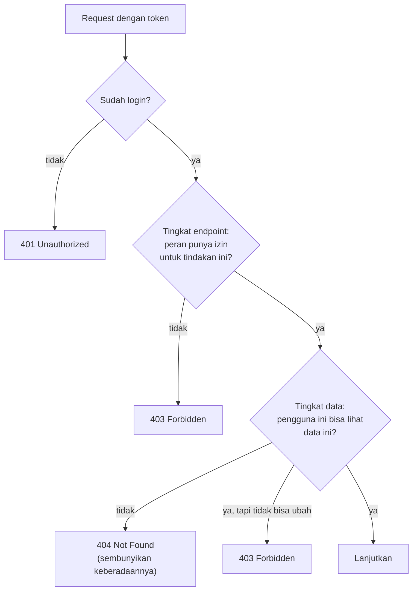

::part[Pelajari Konsepnya]{n="1"}

## 🎯 Yang akan kamu pelajari

- Dua tingkat otorisasi: **tingkat endpoint** (boleh kamu memanggil endpoint ini?) dan **tingkat data** (boleh kamu menyentuh **data ini**?)
- **RBAC**: peran dipetakan ke izin, dan kenapa memeriksa izin lebih baik daripada memeriksa nama peran
- Membuat decorator `@require_permission` di atas autentikasi JWT
- **Kepemilikan** dan aturan berbagi di service dan query
- Memilih kapan pakai **401 vs 403 vs 404**
- Kenapa **database**, bukan token, yang harus memutuskan peran saat ini

## 🔤 Istilah penting

| Istilah | Artinya (sederhana) |
|---|---|
| **Role** | Kelompok pengguna dengan nama (pembeli, penjual, admin) |
| **Permission** | Satu izin spesifik untuk berbuat sesuatu (`product:delete`) |
| **RBAC** | Peran dipetakan ke izin; kode memeriksa izin |
| **Function-level check** | "Boleh kamu memanggil endpoint ini?" |
| **Object-level check** | "Boleh kamu menyentuh *data* ini?" |
| **Ownership** | Aturan bahwa data milik satu pengguna |
| **BOLA** | Celah keamanan data — risiko keamanan API nomor satu |
| **401 vs 403** | Belum login vs sudah login tapi tidak berhak |
| **Scoped query** | Query yang hanya kembalikan data yang boleh dilihat pengguna ini |

## 🧠 Ide besarnya

Autentikasi memberi semua orang **kartu akses**. Otorisasi memutuskan **pintu mana** yang bisa dibuka:

- **Berbasis peran**: kartu karyawan buka ruang karyawan; kartu tamu tidak.
- **Tingkat data**: kartumu buka **kamar 312**, bukan semua kamar tamu — walaupun semua tamu punya peran yang sama.

Kebanyakan celah API di dunia nyata bukan karena password rusak. Ini terjadi saat pengguna yang sudah login mengubah id di URL (`/applications/41` → `/applications/42`) dan melihat data orang lain. OWASP sebutnya — **Broken Object Level Authorization** — sebagai **risiko nomor satu** keamanan API.

## ❓ Kenapa ini penting

Setiap sistem punya jenis pengguna berbeda (pencari kerja, mentor, admin; pembeli, penjual, admin) dan data pribadi. Tanpa aturan eksplisit di satu tempat, setiap endpoint memutuskan sendiri — dan satu pemeriksaan yang terlupakan bisa bocor data atau biarkan seseorang mengubah apa yang bukan miliknya.

```python
@bp.get("/applications/<int:app_id>")
@jwt_required()
def get_application(app_id):
    return {"data": serialize(db.session.get(Application, app_id))}   # any logged-in user, any id
```

Token membuktikan *siapa* mereka. Tidak ada yang memeriksa apakah aplikasi ini *milik mereka*.

## 📖 Langkah demi langkah

### 1. Dua tingkat pemeriksaan



### 2. RBAC: peran dipetakan ke izin

Periksa izin, bukan nama peran. `if role == "admin"` tersebar di 40 tempat jadi mustahil diubah; `require_permission("product:delete")` menyimpan aturan di satu tabel.

```python
ROLE_PERMISSIONS: dict[str, frozenset[str]] = {
    "user":   frozenset({"applications:read_own", "applications:write_own"}),
    "mentor": frozenset({"applications:read_shared", "comments:write"}),
    "admin":  frozenset({"applications:read_any", "applications:delete_any", "users:list"}),
}

def has_permission(role: str, permission: str) -> bool:
    return permission in ROLE_PERMISSIONS.get(role, frozenset())
```

Periksa **izin**, bukan nama peran, di kode:

| ❌ Pemeriksaan peran tersebar | ✅ Pemeriksaan izin |
|---|---|
| `if role in ("admin", "support")` di 30 tempat | `@require_permission("users:list")` |
| menambah peran "support" = ubah 30 file | menambah peran = satu baris di `ROLE_PERMISSIONS` |

### 3. Decorator untuk pemeriksaan tingkat endpoint

```python
import functools
from flask_jwt_extended import current_user, jwt_required

def require_permission(permission: str):
    def decorator(view):
        @functools.wraps(view)
        @jwt_required()                                   # 401 if not authenticated
        def wrapper(*args, **kwargs):
            if not has_permission(current_user.role, permission):
                raise Forbidden(f"missing permission {permission}")   # 403
            return view(*args, **kwargs)
        return wrapper
    return decorator

@admin_bp.get("/users")
@require_permission("users:list")
def list_users(): ...
```

(Stack decorator dari Minggu 3 — sekarang melindungi endpoint sungguhan.)

### 4. Aturan tingkat data hidup di sebelah datanya

```python
def can_view(user: User, application: Application) -> bool:
    return (
        application.user_id == user.id
        or (user.role == "mentor" and application.shared_with_mentor_id == user.id)
        or has_permission(user.role, "applications:read_any")
    )

def can_edit(user: User, application: Application) -> bool:
    return application.user_id == user.id                # mentors can view shared apps, never edit
```

Di service:

```python
def change_status(self, user: User, application_id: int, status: str) -> Application:
    application = self._repository.get(application_id)
    if application is None or not can_view(user, application):
        raise ApplicationNotFound(application_id)        # 404: don't reveal it exists
    if not can_edit(user, application):
        raise Forbidden("you can view but not edit this application")   # 403: they already know it exists
    ...
```

### 5. Saring daftar berdasarkan apa yang boleh dilihat pengguna

Pemeriksaan tingkat data paling aman adalah yang tidak bisa dilupakan: bangun pembatasan ke dalam query, sehingga data yang tidak boleh dilihat pengguna tidak pernah keluar dari database.

Otorisasi tingkat data berlaku untuk **daftar** juga — saring di **query**, bukan sesudah muat semuanya:

```python
def visible_applications(user: User):
    stmt = select(Application)
    if has_permission(user.role, "applications:read_any"):
        return stmt
    if user.role == "mentor":
        return stmt.where(Application.shared_with_mentor_id == user.id)
    return stmt.where(Application.user_id == user.id)
```

### 6. 401 vs 403 vs 404

| Kode | Arti | Contoh |
|---|---|---|
| `401` | "Aku tidak tahu siapa kamu" | tidak ada token, token kadaluarsa |
| `403` | "Aku tahu siapa kamu; kamu tidak boleh berbuat ini" | pengguna memanggil `/admin/users`; mentor mengubah aplikasi yang dibagikan |
| `404` | "Tidak ada di sini **untuk kamu**" | id aplikasi milik orang lain |

Mengirim `403` untuk data orang lain mengonfirmasi id ada (berguna untuk penyerang yang coba id). Mengirim `404` menyembunyikannya.

### 7. Percayai database untuk peran

Menempatkan `role` di JWT berguna untuk petunjuk UI, tapi keputusan otorisasi harus gunakan peran **terkini** dari database (dimuat sekali per request via `user_lookup_loader`). Jika tidak, admin yang didemosi tetap punya kekuatan admin sampai tokennya kadaluarsa.

### 8. Melampaui RBAC (pratinjau)

- **ABAC** (berbasis atribut): keputusan dari atribut — "penjual bisa ubah produk **di toko mereka** saat **jam bisnis**".
- **ReBAC** (berbasis relasi): "bisa lihat jika anggota tim yang punya proyek ini" (sistem gaya Google Zanzibar).
- Multi-tenant SaaS: setiap query dibatasi oleh `tenant_id`.

### Memilih pengaturan kamu

Setiap pilihan di sini punya trade-off:

| Pilihan | ✅ | ❌ |
|---|---|---|
| Pemeriksaan nama peran di route | cepat | tersebar, susah diubah, mudah lupa |
| Peta izin + decorator | terpusat, bisa audit | sedikit setup lebih banyak |
| Pemeriksaan objek di service | bisa dipakai ulang di API/CLI/jobs | harus ingat setiap kasus (tes!) |
| Saring query berdasarkan pemilik | aman secara baku, efisien | view admin/"berbagi" perlu varian eksplisit |
| Peran hanya di token | tanpa lookup DB | izin tertinggal sampai kadaluarsa |
| Peran dari DB setiap request | perubahan langsung | satu lookup per request (murah, sering di-cache) |
| 404 untuk objek terlarang | sembunyikan keberadaan | sedikit kurang berguna untuk debug sah |

- ✅ RBAC dengan izin untuk aplikasi bisnis paling banyak; tambah aturan kepemilikan untuk semua data pribadi.
- ✅ Saring query daftar berdasarkan apa yang boleh dilihat pengguna.
- 🚫 Jangan andalkan tombol frontend tersembunyi, id gelap, atau UUID sebagai "keamanan".
- 🚫 Jangan percaya peran atau id pengguna yang dikirim di body atau string query.

## ⚠️ Kesalahan umum

- Memeriksa peran tapi bukan kepemilikan.
- Saring berdasarkan pemilik di `GET /items/:id` tapi lupa di `PATCH` dan `DELETE`.
- Muat semua baris lalu saring di Python (bocor via bilangan pagination, lambat).
- Tanggapan `403` yang konfirmasi id orang lain ada.
- Biarkan klien pilih `role` saat daftar.

:::revoshop
RevoShop punya tiga peran — **buyer**, **seller**, **admin** — dan `@roles_required('seller', 'admin')` saat buat produk. Sekarang tes aturan tingkat data, bukan hanya peran: (1) Bisa seller A ubah atau hapus produk seller B (`PUT/DELETE /api/v1/products/<id>`)? Cari pemeriksaannya di `ProductService` — atau ketiadaannya. (2) Bisa buyer A baca pesanan buyer B dengan ubah id? (3) Apakah endpoint pemenuhan pesanan seller hanya tampilkan pesanan dengan **produk seller itu**? (4) Apakah `roles_required` baca peran dari token atau dari database? Tulis tabel matriks izin (peran × tindakan) untuk README-mu dan satu test per sel berisiko.
:::

## 🏆 Praktik terbaik

- [ ] **Tolak secara baku**: setiap endpoint butuh autentikasi kecuali eksplisit publik.
- [ ] Peta **peran → izin** di satu tempat; periksa **izin** di kode.
- [ ] Tegakkan **otorisasi tingkat data** untuk setiap baca, ubah, dan hapus — dan **saring daftar di query**.
- [ ] Kirim **404** untuk data yang tidak boleh dilihat pengguna; **403** saat bisa lihat tapi tidak boleh bertindak; **401** saat belum login.
- [ ] Muat **peran terkini dari database** per request; jangan percaya klaim token usang untuk keputusan.
- [ ] Simpan logika otorisasi di **service/policy**, bukan hanya di route atau frontend.
- [ ] Tulis **test untuk setiap peran × tindakan** (test matriks izin).
- [ ] Catat upaya ditolak di level `warning` (kemungkinan probing), tanpa data sensitif.
- [ ] Review otorisasi di setiap PR yang tambah endpoint.

::part[Jelaskan & Rancang]{n="2"}

## 🗣️ Jelaskan

Jelaskan perbedaan antara otorisasi "berbasis peran" dan "tingkat data" kepada orang bukan programmer pakai contoh gedung kantor: badge karyawan vs akses ke laci meja rekan kerja spesifik.

## 📐 Rancang

Tulis **matriks izin** CareerPilot untuk peran `user`, `mentor`, `admin` dan tindakan: daftar aplikasi, lihat satu, ubah status, tambah catatan pribadi, tambah komentar mentor, berbagi dengan mentor, hapus aplikasi, daftar semua pengguna, pura-pura jadi pengguna (support). Untuk setiap "ya", nyatakan kondisi tingkat data; untuk setiap "tidak", nyatakan apakah jawabannya 403 atau 404.

:::quiz
Lihat matriks yang mungkin

| Tindakan | user | mentor | admin |
|---|---|---|---|
| Daftar aplikasi | milik | dibagikan dengan mereka | semua |
| Lihat satu | milik (else 404) | dibagikan (else 404) | apa saja |
| Ubah status | milik | 403 jika dibagikan, 404 jika tidak | 403 (admin tidak ubah pipeline pengguna) |
| Tambah catatan pribadi | milik | 403 jika dibagikan | 403 |
| Tambah komentar mentor | 403 pada milik* | dibagikan | 403 |
| Berbagi dengan mentor | milik | 403 / 404 | 403 |
| Hapus aplikasi | milik | 403 / 404 | apa saja (audit log) |
| Daftar semua pengguna | 403 | 403 | ✅ |
| Pura-pura jadi pengguna | 403 | 403 | ✅ dengan izin `support:impersonate` terpisah, waktu terbatas, audit penuh |

*atau biarkan pengguna balas komentar — keputusan produk. Ide kunci: admin dapat izin **eksplisit** untuk persis apa yang support butuh, bukan "admin bisa berbuat semua".
:::

### 📝 Checklist review mandiri

- [ ] Setiap sel adalah kondisi eksplisit atau kode penolakan eksplisit
- [ ] 404 sembunyikan data yang tidak boleh dilihat; 403 saat bisa lihat tapi tidak boleh
- [ ] Kekuatan admin adalah izin eksplisit, bukan implicit "semua"
- [ ] Kekuatan sensitif adalah audit

::ai-review{task="design"}

::part[Latihan Kecil]{n="3"}

:::exercise{path="exercises/m2/w5/06-authorization" ai="no-ai" title="Peran, izin dan kepemilikan"}
Implementasikan `permissions.py` (peta peran → izin, decorator `require_permission`, aturan objek `can_view`/`can_edit`, query visibilitas) dan `applications.py` (route yang pakainya) di PostgreSQL. Test menjalankan **matriks izin** di seluruh pengguna, mentor, dan admin, periksa 401/403/404 untuk setiap kasus, verifikasi daftar disaring di query, dan konfirmasi bahwa admin **didemosi** langsung kehilangan akses walaupun punya token lama.
:::

:::hints
- Bangun `require_permission` dengan bungkus view dengan `jwt_required()` di dalam wrapper-mu.
- Pakai `current_user` (dimuat dari database oleh `user_lookup_loader` yang disediakan) — bukan `get_jwt()["role"]`.
- Untuk `GET /<id>`: tidak terlihat → 404. Untuk `PATCH`: tidak terlihat → 404; terlihat tapi tidak bisa ubah → 403.
- `visible_applications_query(user)` kembalikan `select(...)` — route tambah urutan dan jalankannya.
:::

### 🏆 Tantangan lanjut

Tambah audit log: setiap `403` yang ditolak dicatat (id pengguna, izin atau tindakan, id aplikasi, waktu) di tabel, dan endpoint hanya admin tampilkan 50 entri terakhir.

## ✅ Cek cepat

:::quiz
Apa itu Broken Object Level Authorization?

Saat API periksa pengguna sudah login (atau punya peran) tapi tidak periksa mereka boleh akses data spesifik yang diminta — misalnya ubah id di URL buka data orang lain.
:::

:::quiz
Kapan harus kirim 404 daripada 403?

Saat pengguna tidak boleh tahu data itu ada (misalnya aplikasi pribadi orang lain). Pakai 403 saat mereka bisa lihat tapi tidak boleh tindakan.
:::

:::quiz
Kenapa muat peran pengguna dari database daripada percaya klaim peran di JWT?

Token bisa tertinggal: kalau peran dihapus atau diubah, pemeriksaan berbasis klaim tetap punya izin lama sampai token kadaluarsa.
:::


## 📚 Lanjut belajar

- [OWASP API Security Top 10 — 2023](https://owasp.org/API-Security/editions/2023/en/0x11-t10/)
- [OWASP: Authorization Cheat Sheet](https://cheatsheetseries.owasp.org/cheatsheets/Authorization_Cheat_Sheet.html)
- [Flask-JWT-Extended: Automatic user loading](https://flask-jwt-extended.readthedocs.io/en/stable/automatic_user_loading/)
