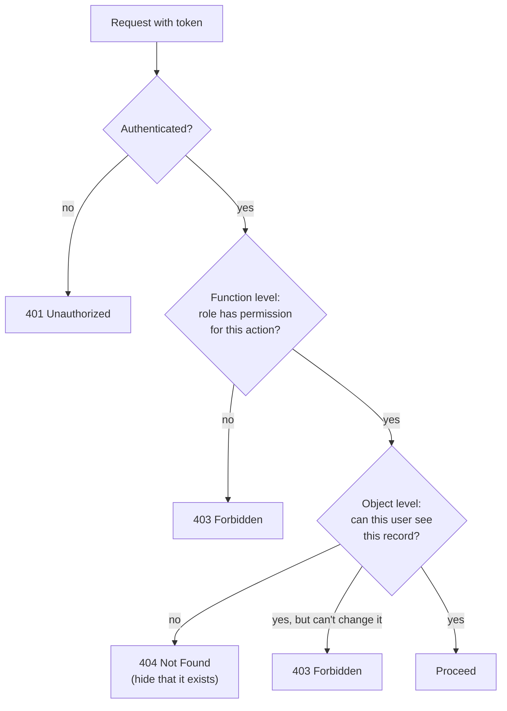

::part[Learn the Concept]{n="1"}

## 🎯 What you'll learn

- Authorization levels: **function-level** (may you call this endpoint?) and **object-level** (may you touch **this** record?)
- **RBAC**: roles → permissions, and why checking permissions beats checking role names
- Implementing a `@require_permission` decorator on top of JWT authentication
- **Ownership** and sharing rules in services and queries
- Choosing **401 vs 403 vs 404**
- Why the **database**, not the token, should decide the current role

## 🧠 The big idea

Authentication gave everyone a **key card**. Authorization decides **which doors** it opens:

- **Role-based**: staff cards open the staff room; guest cards don't.
- **Object-level**: your card opens **room 312**, not every guest room — even though all guests have the same role.

Most real breaches in APIs aren't about cracking passwords — they're about a logged-in user changing an id in the URL (`/applications/41` → `/applications/42`) and seeing someone else's data. OWASP lists this — **Broken Object Level Authorization** — as the **#1** API security risk.

## ❓ Why does this exist?

Every system has different kinds of users (job seekers, mentors, admins; buyers, sellers, admins) and private data. Without explicit, centralized rules, each endpoint makes its own decision — and one forgotten check leaks data or lets someone change what isn't theirs.

## 💥 What happens if we DON'T authorize properly?

```python
@bp.get("/applications/<int:app_id>")
@jwt_required()
def get_application(app_id):
    return {"data": serialize(db.session.get(Application, app_id))}   # any logged-in user, any id
```

```python
@bp.delete("/products/<int:product_id>")
@jwt_required()
def delete_product(product_id):
    if get_jwt()["role"] == "seller":                                  # any seller can delete ANY seller's product
        ...
```

```javascript
// frontend only
{user.role === "admin" && <DeleteButton />}      // hiding a button isn't security — the API is still open
```

## 📖 How it works, step by step

### 1. Two levels of checks



### 2. RBAC: roles map to permissions

```python
ROLE_PERMISSIONS: dict[str, frozenset[str]] = {
    "user":   frozenset({"applications:read_own", "applications:write_own"}),
    "mentor": frozenset({"applications:read_shared", "comments:write"}),
    "admin":  frozenset({"applications:read_any", "applications:delete_any", "users:list"}),
}

def has_permission(role: str, permission: str) -> bool:
    return permission in ROLE_PERMISSIONS.get(role, frozenset())
```

Check **permissions**, not role names, in code:

| ❌ Role checks scattered in code | ✅ Permission checks |
|---|---|
| `if role in ("admin", "support")` in 30 places | `@require_permission("users:list")` |
| adding a "support" role means editing 30 files | adding a role = one line in `ROLE_PERMISSIONS` |

### 3. A decorator for function-level checks

```python
import functools
from flask_jwt_extended import current_user, jwt_required

def require_permission(permission: str):
    def decorator(view):
        @functools.wraps(view)
        @jwt_required()                                   # 401 if not authenticated
        def wrapper(*args, **kwargs):
            if not has_permission(current_user.role, permission):
                raise Forbidden(f"missing permission {permission}")   # 403
            return view(*args, **kwargs)
        return wrapper
    return decorator

@admin_bp.get("/users")
@require_permission("users:list")
def list_users(): ...
```

(A stack of decorators from Week 3 — now protecting real endpoints.)

### 4. Object-level rules live next to the data

```python
def can_view(user: User, application: Application) -> bool:
    return (
        application.user_id == user.id
        or (user.role == "mentor" and application.shared_with_mentor_id == user.id)
        or has_permission(user.role, "applications:read_any")
    )

def can_edit(user: User, application: Application) -> bool:
    return application.user_id == user.id                # mentors can view shared apps, never edit
```

In services:

```python
def change_status(self, user: User, application_id: int, status: str) -> Application:
    application = self._repository.get(application_id)
    if application is None or not can_view(user, application):
        raise ApplicationNotFound(application_id)        # 404: don't reveal it exists
    if not can_edit(user, application):
        raise Forbidden("you can view but not edit this application")   # 403: they already know it exists
    ...
```

### 5. Filter lists by what the user may see

Object-level authorization applies to **lists** too — filter in the **query**, never after loading everything:

```python
def visible_applications(user: User):
    stmt = select(Application)
    if has_permission(user.role, "applications:read_any"):
        return stmt
    if user.role == "mentor":
        return stmt.where(Application.shared_with_mentor_id == user.id)
    return stmt.where(Application.user_id == user.id)
```

### 6. 401 vs 403 vs 404

| Code | Meaning | Example |
|---|---|---|
| `401` | "I don't know who you are" | no token, expired token |
| `403` | "I know who you are; you may not do this" | a user calling `/admin/users`; a mentor editing a shared application |
| `404` | "Nothing here **for you**" | another user's application id |

Returning `403` for other users' records confirms the id exists (useful for attackers scanning ids). Returning `404` hides it.

### 7. Trust the database for roles

Putting `role` in the JWT is handy for UI hints, but authorization decisions should use the **current** role from the database (loaded once per request via `user_lookup_loader`). Otherwise a demoted admin keeps admin powers until their token expires.

### 8. Beyond RBAC (a preview)

- **ABAC** (attribute-based): decisions from attributes — "sellers may edit products **in their store** during **business hours**".
- **ReBAC** (relationship-based): "can view if they're a member of the team that owns the project" (Google Zanzibar-style systems).
- Multi-tenant SaaS: every query scoped by `tenant_id`.

## ⚖️ Trade-offs

| Choice | ✅ | ❌ |
|---|---|---|
| Role-name checks in routes | quick | scattered, hard to change, easy to miss |
| Permission map + decorator | centralized, auditable | slightly more setup |
| Object checks in services | reusable across API/CLI/jobs | must remember for every use case (test it!) |
| Scoping queries by owner | safe by default, efficient | admin/"shared" views need explicit variants |
| Role in token only | no DB lookup | stale permissions until expiry |
| Role from DB each request | instant changes | one lookup per request (cheap, often cached) |
| 404 for forbidden objects | hides existence | slightly less helpful for legitimate debugging |

## ✅ When to use it / 🚫 When NOT to use it

- ✅ RBAC with permissions for most business apps; add ownership rules for all private data.
- ✅ Scope list queries by what the user may see.
- 🚫 Don't rely on hidden frontend buttons, obscure ids, or UUIDs as "security".
- 🚫 Don't trust role or user ids sent in request bodies or query strings.

## 🏆 Best practices

- [ ] **Deny by default**: every endpoint requires authentication unless explicitly public.
- [ ] Map **roles → permissions** in one place; check **permissions** in code.
- [ ] Enforce **object-level authorization** for every read, update and delete — and **filter lists in queries**.
- [ ] Return **404** for records the user can't see; **403** when they can see but not act; **401** when unauthenticated.
- [ ] Load the **current role from the database** per request; don't trust stale token claims for decisions.
- [ ] Keep authorization logic in **services/policies**, not only in routes or the frontend.
- [ ] Write **tests for every role × action** combination (a permission matrix test).
- [ ] Log denied attempts at `warning` level (possible probing), without sensitive data.
- [ ] Review authorization in every PR that adds an endpoint.

## 🏭 How it's used in industry

- OWASP API Security Top 10 (2023): #1 Broken Object Level Authorization, #3 Broken Object Property Level Authorization, #5 Broken Function Level Authorization — all this lesson.
- Many companies centralize rules in policy engines (Open Policy Agent, Cerbos, Oso) or managed services (e.g. Amazon Verified Permissions).
- Pen testers and bug bounty hunters try id swapping first — authorization bugs are among the most common paid findings.

## ⚠️ Common mistakes

- Checking roles but not ownership.
- Filtering by owner in `GET /items/:id` but forgetting it in `PATCH` and `DELETE`.
- Loading all rows then filtering in Python (leaks via pagination counts, slow).
- `403` responses that confirm other users' ids exist.
- Letting clients pick `role` during registration.

:::revoshop
RevoShop has three roles — **buyer**, **seller**, **admin** — and `@roles_required('seller', 'admin')` on product creation. Now test object-level rules, not just roles: (1) Can seller A update or delete seller B's product (`PUT/DELETE /api/v1/products/<id>`)? Find the check in `ProductService` — or its absence. (2) Can buyer A read buyer B's order by changing the id? (3) Does the seller order-fulfillment endpoint only show orders containing **that seller's** products? (4) Is `roles_required` reading the role from the token or from the database? Write a permission matrix table (role × action) for your README and one test per risky cell.
:::

::part[Explain & Design]{n="2"}

## 🗣️ Explain it

Explain the difference between "role-based" and "object-level" authorization to a non-programmer using an office building: employee badges vs. access to a specific colleague's desk drawer.

## 📐 Design it

Write CareerPilot's **permission matrix** for roles `user`, `mentor`, `admin` and actions: list applications, view one, change status, add private note, add mentor comment, share with a mentor, delete application, list all users, impersonate a user (support). For each "yes", state the object-level condition; for each "no", state whether the response is 403 or 404.

:::quiz
Show a possible matrix

| Action | user | mentor | admin |
|---|---|---|---|
| List applications | own | shared with them | all |
| View one | own (else 404) | shared (else 404) | any |
| Change status | own | 403 if shared, 404 otherwise | 403 (admins don't edit user pipelines) |
| Add private note | own | 403 if shared | 403 |
| Add mentor comment | 403 on own* | shared | 403 |
| Share with a mentor | own | 403 / 404 | 403 |
| Delete application | own | 403 / 404 | any (audit logged) |
| List all users | 403 | 403 | ✅ |
| Impersonate | 403 | 403 | ✅ with a separate `support:impersonate` permission, time-limited, fully audited |

*or allow users to reply to comments — a product decision. Key idea: admins get **explicit** permissions for exactly what support needs, not blanket "admin can do everything".
:::

### 📝 Self-review checklist

- [ ] Every cell is either an explicit condition or an explicit denial code
- [ ] 404 hides records users can't see; 403 when visible but not allowed
- [ ] Admin powers are explicit permissions, not implicit "everything"
- [ ] Sensitive powers are audited

::ai-review{task="design"}

::part[Toy Exercise]{n="3"}

:::exercise{path="exercises/m2/w5/06-authorization" ai="no-ai" title="Roles, permissions and ownership"}
Implement `permissions.py` (role → permission map, `require_permission` decorator, `can_view`/`can_edit` object rules, a visibility query) and `applications.py` (routes that use them) on PostgreSQL. The tests run a **permission matrix** across users, a mentor and an admin, check 401/403/404 for each case, verify lists are scoped in the query, and confirm that a **demoted** admin loses access immediately even with an old token.
:::

:::hints
- Build `require_permission` by wrapping the view with `jwt_required()` inside your wrapper.
- Use `current_user` (loaded from the database by the provided `user_lookup_loader`) — not `get_jwt()["role"]`.
- For `GET /<id>`: not visible → 404. For `PATCH`: not visible → 404; visible but not editable → 403.
- `visible_applications_query(user)` returns a `select(...)` — routes add ordering and execute it.
:::

### 🏆 Stretch goal

Add an audit log: every denied `403` is recorded (user id, permission or action, application id, timestamp) in a table, and an admin-only endpoint lists the last 50 entries.

## ✅ Quick check

:::quiz
What's Broken Object Level Authorization?

When an API checks that a user is logged in (or has a role) but not that they may access the specific record they requested — e.g. changing an id in the URL exposes someone else's data.
:::

:::quiz
When should you return 404 instead of 403?

When the user isn't allowed to know the record exists (e.g. another user's private application). Use 403 when they can see it but not perform the action.
:::

:::quiz
Why load the user's role from the database instead of trusting the role claim in the JWT?

Tokens can be stale: if a role is removed or changed, a claim-based check keeps the old permissions until the token expires.
:::

## 📖 Kamus (glossary)

| Term | Bahasa Indonesia |
|---|---|
| Authorization | Otorisasi — hak melakukan aksi |
| RBAC | Kontrol akses berbasis peran |
| Permission | Izin untuk satu aksi tertentu |
| Object-level authorization | Otorisasi per data/objek |
| Deny by default | Tolak kecuali diizinkan secara eksplisit |
| Permission matrix | Tabel peran × aksi |

## 📚 Keep learning

- [OWASP API Security Top 10 — 2023](https://owasp.org/API-Security/editions/2023/en/0x11-t10/)
- [OWASP: Authorization Cheat Sheet](https://cheatsheetseries.owasp.org/cheatsheets/Authorization_Cheat_Sheet.html)
- [Flask-JWT-Extended: Automatic user loading](https://flask-jwt-extended.readthedocs.io/en/stable/automatic_user_loading.html)
