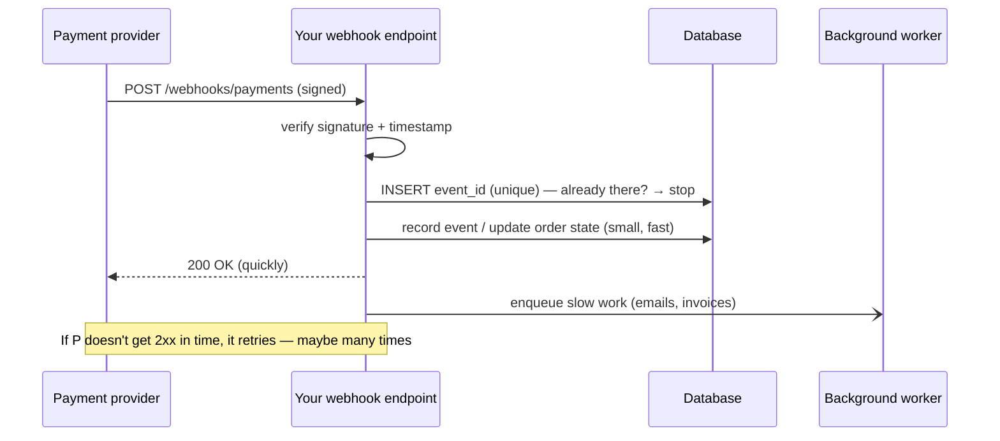

::part[Pelajari Konsepnya]{n="1"}

## 🎯 Yang akan kamu pelajari

- Integrasi **outbound**: memanggil API eksternal dengan **timeout**, **retry dengan backoff**, dan **idempotency key**
- **Inbound webhook**: apa itu dan kenapa provider memakainya
- Verifikasi webhook **signature** (HMAC) dan menolak **replay**
- Memproses webhook **idempotent**, menangani **duplikat** dan event **yang tidak terurut**
- Menjawab cepat dan memindahkan pekerjaan berat ke background
- Membungkus provider di balik **client/adapter** interface milikmu sendiri

## 🔤 Istilah penting

| Istilah | Artinya (sederhana) |
|---|---|
| **Outbound call** | Server-mu memanggil API milik orang lain |
| **Webhook** | Server mereka memanggil URL-mu saat ada sesuatu terjadi |
| **Timeout** | Menyerah setelah N detik, alih-alih menunggu selamanya |
| **Retry dengan backoff** | Coba lagi, menunggu lebih lama setiap kali |
| **Idempotency key** | ID agar retry tidak menagih atau membuat duplikat |
| **Signature (HMAC)** | Kode yang membuktikan pesan benar-benar dari provider |
| **Replay attack** | Seseorang mengirim ulang pesan lama yang valid |
| **Out-of-order event** | Event tiba dalam urutan yang salah |
| **Adapter / client** | Pembungkus milikmu di sekitar API provider |

## 🧠 Ide besarnya

Ada dua arah percakapan dengan sistem perusahaan lain:

- **Outbound — kamu memanggil mereka**: seperti menelepon supplier. Garisnya mungkin sibuk atau diam, jadi kamu tutup setelah beberapa saat (**timeout**), telepon lagi nanti (**retry**), dan pastikan menelepon dua kali tidak memesan dua kali (**idempotency key**).
- **Inbound webhook — mereka memanggil kamu**: seperti kurir mengetuk pintu. Sebelum membuka kamu periksa **ID** mereka (signature), kamu abaikan orang yang mengulangi pengiriman minggu lalu (**timestamp**), dan jika kurir yang sama mengetuk dua kali kamu tidak menandatangani paket dua kali (**idempotency**).

Sebuah :term[webhook]{bahasa="webhook — permintaan HTTP otomatis dari layanan lain ke server kita saat suatu kejadian terjadi (mis. pembayaran berhasil)"} adalah sekadar HTTP `POST` yang dikirim provider ke **URL milikmu** saat sesuatu terjadi.

## ❓ Kenapa ini penting

Produk nyata bergantung pada layanan lain: payment gateway (Midtrans, Xendit, Stripe), email dan WhatsApp, maps, AI model, identity provider. Event mereka terjadi **nanti** — pelanggan membayar di aplikasi perbankan mereka beberapa menit kemudian — jadi bertanya "sudah dibayar?" setiap detik akan sia-sia. Provider mengirimkan berita ke kamu sebaliknya.

Setiap satu integrasi ini bisa lambat, mati, diduplikat, dibuat-buat atau tidak terurut:

| Kesalahan | Akibatnya |
|---|---|
| Tanpa cek signature | siapa saja bisa `POST {"status": "paid"}` dan dapat pesanan gratis |
| Tanpa idempotency | provider coba ulang webhook → pelanggan dikreditkan dua kali, atau dapat lima email "dibayar" |
| Pekerjaan berat sebelum jawab | provider time out, coba ulang, dan kamu proses lagi |
| Percaya urutan event | event "pending" yang lambat menimpa "paid" → pesanan terlihat belum dibayar |
| Tanpa timeout di outbound call | satu provider yang hang menghabisi semua worker → seluruh API-mu jatuh |
| Retry tanpa idempotency key | blip jaringan menagih pelanggan dua kali |

## 📖 Langkah demi langkah

### 1. Outbound: client dengan timeout dan retry

```python
import time
import httpx

class PaymentClient:
    def __init__(self, base_url: str, api_key: str, http: httpx.Client | None = None, sleep=time.sleep):
        self._http = http or httpx.Client(base_url=base_url, timeout=httpx.Timeout(10.0, connect=3.0))
        self._api_key = api_key
        self._sleep = sleep

    def create_charge(self, order_id: str, amount: int) -> dict:
        idempotency_key = f"charge-{order_id}"            # SAME key on every retry
        for attempt in range(1, 4):
            try:
                response = self._http.post(
                    "/charges",
                    json={"order_id": order_id, "amount": amount},
                    headers={"Authorization": f"Bearer {self._api_key}", "Idempotency-Key": idempotency_key},
                )
            except httpx.TransportError:                   # timeouts, connection errors → retry
                if attempt == 3:
                    raise ProviderUnavailable()
            else:
                if response.status_code < 500:
                    response.raise_for_status()            # 4xx: our mistake, retrying won't help
                    return response.json()
                if attempt == 3:
                    raise ProviderUnavailable()
            self._sleep(0.5 * 2 ** (attempt - 1))          # exponential backoff: 0.5s, 1s
```

| Aturan | Kenapa |
|---|---|
| **Selalu set timeout** (connect + read) | default untuk banyak library HTTP adalah "tunggu selamanya" |
| **Retry hanya kegagalan sementara** (timeout, 5xx, 429) | 4xx tidak akan berhasil saat retry |
| **Exponential backoff + jitter** | jangan pukul provider yang kesulitan; hindari badai retry tersinkronisasi |
| **Idempotency key** untuk call yang tidak idempotent | retry tidak bisa duplikat tagihan |
| **Batasi total percobaan** | gagal dengan jelas, jangan-jangan hang |
| **Circuit breaker** untuk outage yang berlangsung | berhenti memanggil provider mati untuk sementara (Architecture Stage H) |
| **Bungkus provider di interface sendiri** | tukar provider, palsu di tes |

### 2. Inbound: lifecycle webhook



### 3. Verifikasi signature (HMAC)

Bandingkan signature dengan fungsi constant-time. Membandingkannya seperti string normal bocor, melalui timing, berapa banyak karakter yang benar — cukup untuk penyerang yang sabar.

Provider menandatangani **raw body yang tepat** dengan secret yang kamu bagikan. Skema tipikal:

```text
X-Signature: t=1757750000,v1=5f0c…a9
signed payload = "{t}.{raw_body}"
v1 = HMAC-SHA256(webhook_secret, signed payload) as hex
```

```python
import hashlib, hmac, time

def verify_signature(raw_body: bytes, header: str, secret: str, now: float, tolerance: int = 300) -> None:
    parts = dict(item.split("=", 1) for item in header.split(",") if "=" in item)
    timestamp, signature = int(parts["t"]), parts["v1"]
    if abs(now - timestamp) > tolerance:
        raise InvalidSignature("timestamp outside tolerance")           # blocks replays of old requests
    expected = hmac.new(secret.encode(), f"{timestamp}.".encode() + raw_body, hashlib.sha256).hexdigest()
    if not hmac.compare_digest(expected, signature):                    # constant-time comparison
        raise InvalidSignature("signature mismatch")
```

- Gunakan **raw byte** (`request.get_data()`), bukan JSON yang di-serialisasi ulang — perubahan whitespace apa pun merusak signature.
- **`hmac.compare_digest`** mencegah timing attack yang menebak signature byte demi byte.
- Simpan webhook secret di environment; rotate jika bocor.
- Setiap provider mendokumentasikan skemanya sendiri (Midtrans, misalnya, memakai SHA-512 `signature_key` yang dibuat dari order id, status code, gross amount dan server key-mu) — implementasikan **persis** apa yang dokumen katakan, dan tes dengan sandbox mereka.

### 4. Pemrosesan idempotent

Provider memberikan **minimal sekali**. Deduplikasi dengan **event id** provider:

```python
try:
    db.session.add(WebhookEvent(provider_event_id=event["id"], type=event["type"]))
    db.session.flush()                                   # UNIQUE constraint on provider_event_id
except IntegrityError:
    db.session.rollback()
    return {"status": "duplicate"}, 200                  # already processed: acknowledge, do nothing
```

Catat event dan terapkan efeknya **dalam transaksi yang sama**, jadi crash tidak bisa membiarkan "tercatat tapi tidak diterapkan".

### 5. Event yang tidak terurut

Event bisa tiba terlambat: `payment.pending` yang dikirim jam 10:00 mungkin tiba setelah `payment.paid` yang dikirim jam 10:01. Jangan sekadar salin statusnya — hanya gerak **maju**:

```python
ORDER = {"pending": 1, "paid": 2, "refunded": 3}

if ORDER[new_status] > ORDER[order.payment_status]:
    order.payment_status = new_status
# else: ignore stale event (but keep it recorded for audit)
```

Alternatif: bandingkan timestamp event provider, atau **ambil ulang status saat ini** dari API provider saat event tiba (webhook hanya mengatakan "ada yang berubah").

### 6. Jawab cepat, bekerja nanti

Jawab bel pintu dulu, buka kotak nanti: simpan event, jawab `200`, dan lakukan pekerjaan lambat di job. Provider menilaimu dari seberapa cepat kamu menjawab.

Targetkan menjawab dalam beberapa detik. Verifikasi, deduplikasi, update state kecil, **commit**, kembalikan `200`. Kirim email, buat invoice, panggil AI model di **background job** (Module 5 menambahkan queue).

Kode return: `2xx` = diproses atau dengan sengaja diabaikan (tipe event tidak dikenal juga — kalau tidak, provider coba ulang selamanya); `4xx` untuk signature tidak sah atau payload tidak terbentuk; `5xx` hanya ketika *kamu* gagal dan ingin retry.

### 7. Develop dan test lokal

- Gunakan **sandbox** dan test event dari provider.
- Buka localhost dengan tunnel (mis. ngrok, Cloudflare Tunnel) atau forwarding CLI provider.
- Simpan payload sampel nyata (tanpa secret) sebagai **test fixture**; unit-test verifikasi signature dan mesin state dengannya.

### Memilih setup-mu

Setiap pilihan di sini adalah trade-off:

| Pilihan | ✅ | ❌ |
|---|---|---|
| Webhook | real-time, efisien | harus public, diamankan, idempotent |
| Polling provider | sederhana, tidak perlu endpoint public | terlambat, sia-sia, batasan rate |
| Webhook + ambil ulang state | robust terhadap spoofing dan urutan | panggilan API ekstra per event |
| Proses inline | sederhana | jawaban lambat → retry → duplikat |
| Antri dan jawab | cepat, resilient | infrastruktur queue |
| Banyak retry | pulih dari blip | perkuat outage tanpa backoff/circuit breaker |

- ✅ Webhook untuk event asinkron: pembayaran, update pengiriman, bounce email, e-signature, hasil CI.
- ✅ Adapter (`PaymentClient`, `EmailClient`, `LLMClient`) di sekitar setiap provider eksternal.
- 🚫 Jangan bertindak pada data webhook tanpa verifikasi signature (atau ambil ulang dari provider).
- 🚫 Jangan panggil API eksternal di dalam transaksi database (materi Week 2 lesson 07).

## ⚠️ Kesalahan umum

- Verifikasi signature terhadap `json.dumps(request.json)` bukan raw body.
- Bandingkan signature dengan `==`.
- Kirim email/buat PDF sebelum kembalikan `200`.
- Perlakukan setiap duplikat sebagai error (`4xx/5xx`) → retry provider tanpa henti.
- Tanpa timeout di `requests.post(...)`.
- Memakai production key di development.

:::revoshop
RevoShop-mu punya integrasi Midtrans nyata: `app/integrations/midtrans.py`, `app/services/payment_service.py`, `app/routes/payments.py`, plus `docs/payment-testing-guide.md`. Telusuri satu notifikasi: (1) Di mana `signature_key` Midtrans diverifikasi, dan apakah perbandingannya constant-time? (2) Apa yang terjadi jika **notifikasi yang sama** tiba dua kali — apakah ada record event/transaksi yang unik? (3) Jika `settlement` tiba dan kemudian `pending` terlambat, apakah pesanan bisa mundur? (4) Apakah outbound call ke Midtrans punya **timeout**? (5) Apakah webhook melakukan pekerjaan lambat sebelum menjawab? Tulis setiap jawaban dengan nama file dan nomor baris — ini persis apa yang akan ditanya fintech interviewer tentang proyekmu.
:::

## 🏆 Praktik terbaik

- [ ] **Outbound:** explicit connect/read **timeout**, **retry hanya untuk error sementara** dengan **exponential backoff + jitter**, max attempt count, dan **idempotency key** pada write.
- [ ] Bungkus setiap provider di **adapter** dengan interface milikmu; inject; palsu di tes.
- [ ] **Inbound:** verifikasi **signature** di **raw body** dengan `hmac.compare_digest`; paksakan **timestamp tolerance** terhadap replay.
- [ ] Simpan **event id** yang diproses dengan **unique constraint**; akui duplikat dengan `2xx`.
- [ ] Terapkan perubahan state **forward-only** (atau ambil ulang state) untuk bertahan dengan delivery tidak terurut.
- [ ] Catat event dan efeknya di **satu transaksi**; jawab **cepat**; dorong pekerjaan lambat ke background job.
- [ ] Kembalikan `2xx` untuk ignored/unknown event type; `4xx` untuk signature/payload buruk; `5xx` hanya untuk kegagalan asli.
- [ ] Simpan API key dan webhook secret di environment variable; pakai sandbox dan production credential terpisah.
- [ ] Log event id dan hasil (jangan pernah card utuh atau data pribadi); monitor webhook failure rate.

::part[Jelaskan & Rancang]{n="2"}

## 🗣️ Jelaskan

Jelaskan ke non-programmer kenapa toko online perlu periksa "jabat tangan rahasia" di notifikasi payment, dan kenapa mendapat notifikasi sama dua kali tidak boleh tandai pesanan dibayar dua kali.

## 📐 Rancang

Rancang integrasi **email provider** CareerPilot untuk interview reminder: outbound client (interface, timeout, retry, idempotency), dan **inbound** webhook untuk delivery event (`delivered`, `bounced`, `complained`). Sertakan tabel, cek signature, deduplikasi, aturan urutan, apa yang terjadi pada `bounced` dan `complained`, dan bagaimana kamu tes tanpa provider nyata.

:::quiz
Lihat contoh rancangan

**Outbound — `EmailClient` (Protocol):** `send(to, template_id, data, idempotency_key) -> MessageId`. HTTP adapter dengan timeout connect 3s / read 10s, retry di timeout/429/5xx dengan backoff + jitter (max 3), idempotency key = `reminder-{interview_id}-{kind}`. Pengiriman terjadi di background job, tidak pernah di dalam request.

**Tabel:** `email_messages(id, provider_message_id UNIQUE, user_id, template, status, updated_at)` dan `email_webhook_events(provider_event_id UNIQUE, type, payload_json, received_at)`.

**Webhook `POST /webhooks/email`:** verifikasi HMAC di raw body + timestamp tolerance → insert event id (duplikat → 200) → cari message by provider id (tidak dikenal → 200, logged) → status forward-only: `sent < delivered < bounced/complained` (kegagalan terminal tidak ditimpa oleh `delivered` terlambat) → commit → 200.

**Efek:** `bounced` (hard) → tandai email user tidak terverifikasi dan hentikan reminder; `complained` → unsubscribe user dari email reminder segera (alasan legal dan reputasi).

**Test:** `FakeEmailClient` di service test; signature test dengan secret dikenal dan payload fixture; test duplikat dan tidak terurut; provider sandbox untuk final end-to-end check.
:::

### 📝 Checklist review mandiri

- [ ] Outbound call punya timeout, bounded retry dan idempotency
- [ ] Webhook verifikasi signature di raw body dan deduplikat by event id
- [ ] Urutan tidak bisa gerak state mundur
- [ ] Test tidak perlu provider nyata

::ai-review{task="design"}

::part[Latihan Kecil]{n="3"}

:::exercise{path="exercises/m2/w5/08-webhooks" ai="no-ai" title="Webhook payment yang aman dan client yang resilient"}
Untuk fictional provider **BayarKita**: implementasikan verifikasi signature dengan replay protection, idempotent webhook endpoint di PostgreSQL yang update pesanan forward-only, dan outbound `PaymentClient` yang pakai timeout, retry hanya kegagalan sementara dengan exponential backoff, dan pakai satu idempotency key di semua retry. Test membuat signature, replay event lama, kirim duplikat dan event tidak terurut, dan simulasi provider flaky — tidak perlu jaringan.
:::

:::hints
- Baca body dengan `request.get_data()` **sebelum** parse JSON.
- Header terlihat seperti `t=1757750000,v1=<hex>`; sign `f"{t}.".encode() + raw_body`.
- Pakai injected clock (`app.config["CLOCK"]`) untuk timestamp check.
- Untuk client, injected `transport` adalah fungsi `(method, url, json, headers, timeout) -> (status, body)` yang bisa raise `TimeoutError`.
:::

### 🏆 Stretch goal

Tambahkan **jitter** ke backoff (`random.uniform(0, delay)` dengan injected random function) dan tiny **circuit breaker**: setelah 5 kegagalan berturut-turut, gagal cepat selama 30 detik tanpa memanggil transport.

## ✅ Cek cepat

:::quiz
Kenapa webhook signature harus dihitung di raw request body?

Provider menandatangani byte yang tepat. Parse dan re-serialize JSON bisa ubah spacing atau key order, jadi signature yang dihitung tidak cocok (dan verifikasi body yang berubah bisa diexploit).
:::

:::quiz
Outbound failure mana yang harus retry, dan mana tidak?

Retry kegagalan sementara: timeout, connection error, `429` dan `5xx` — dengan backoff dan batasan. Jangan retry `4xx` seperti `400`/`401`/`422`; mereka akan gagal lagi.
:::

:::quiz
Bagaimana kamu handle duplicate webhook delivery?

Deteksi dengan event id provider (unique constraint), skip reprocessing, dan tetap kembalikan `2xx` agar provider berhenti retry.
:::


## 📚 Lanjut belajar

- [Dokumen Stripe: Terima webhook event (verifikasi signature, best practice)](https://docs.stripe.com/webhooks)
- [Dokumen Midtrans: HTTP(S) notification / webhook](https://docs.midtrans.com/docs/https-notification-webhooks)
- [AWS Builders' Library: Timeout, retry dan backoff dengan jitter](https://aws.amazon.com/builders-library/timeouts-retries-and-backoff-with-jitter/)
- [Dokumen Python: hmac.compare_digest](https://docs.python.org/3/library/hmac.html#hmac.compare_digest)

## 📣 Akhir Minggu 5 — bagikan progresmu

:::linkedin{type="weekly"}
🔐 Minggu 5: membangun API yang aman untuk diletakkan di internet.

- REST design dengan keyset pagination yang tetap cepat di halaman mana pun
- Validation dengan 422 error yang jelas, dan perbedaan 401, 403 dan 404
- JWT auth dengan refresh token dan logout nyata (token revocation)
- Permission matrix test yang membuktikan user tidak bisa baca data user lain
- Webhook pembayaran yang signed, idempotent, bertahan duplikat dan event tidak terurut

Pelajaran security yang paling mengagetkan aku: [jawab kamu sendiri].

Minggu depan: testing, performance, secret dan deploy API. 🚀

#API #Security #Python #Flask #LearningInPublic
:::
