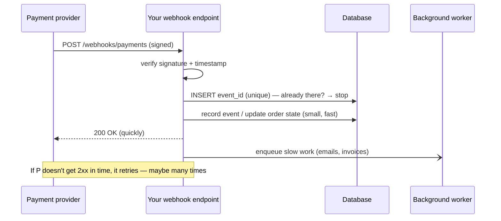

::part[Learn the Concept]{n="1"}

## 🎯 What you'll learn

- **Outbound** integrations: calling external APIs with **timeouts**, **retries with backoff**, and **idempotency keys**
- **Inbound** webhooks: what they are and why providers use them
- Verifying webhook **signatures** (HMAC) and rejecting **replays**
- Processing webhooks **idempotently**, handling **duplicates** and **out-of-order** events
- Responding fast and moving slow work to the background
- Wrapping providers behind your own **client/adapter** interface

## 🧠 The big idea

Two directions of conversation with other companies' systems:

- **Outbound (you call them):** like phoning a supplier. The line might be busy or silent. You need to hang up after a while (**timeout**), call back later (**retry**), and make sure calling twice doesn't order twice (**idempotency key**).
- **Inbound webhooks (they call you):** like a courier ringing your doorbell with a package notification. Before opening the door you check their **ID** (signature), you ignore someone replaying last week's delivery (**timestamp**), and if the same courier rings twice you don't sign for the package twice (**idempotency**).

A :term[webhook]{bahasa="webhook — permintaan HTTP otomatis dari layanan lain ke server kita saat suatu kejadian terjadi (mis. pembayaran berhasil)"} is simply an HTTP `POST` the provider sends to **your** URL when something happens.

## ❓ Why does this exist?

Real products depend on other services: payment gateways (Midtrans, Xendit, Stripe), email/WhatsApp, maps, AI models, identity providers. Their events happen **asynchronously** — a customer pays in their banking app minutes later — so polling "is it paid yet?" every second would be wasteful. Providers push events to you instead.

Every one of these integrations can be slow, down, duplicated, spoofed or out of order. Handling that is a core backend skill.

## 💥 What happens if we DON'T handle them carefully?

| Mistake | Consequence |
|---|---|
| No signature check | anyone can `POST {"status": "paid"}` and get free orders |
| No idempotency | the provider retries a webhook → the customer is credited twice, or receives five "paid" emails |
| Heavy processing before responding | the provider times out, retries, and you process it again |
| Trusting event order | a late "pending" event overwrites "paid" → the order looks unpaid |
| No timeout on outbound calls | a hanging provider blocks all your worker threads → your whole API goes down |
| Retrying non-idempotent calls without a key | a network blip charges the customer twice |

## 📖 How it works, step by step

### 1. Outbound: a client with timeouts and retries

```python
import time
import httpx

class PaymentClient:
    def __init__(self, base_url: str, api_key: str, http: httpx.Client | None = None, sleep=time.sleep):
        self._http = http or httpx.Client(base_url=base_url, timeout=httpx.Timeout(10.0, connect=3.0))
        self._api_key = api_key
        self._sleep = sleep

    def create_charge(self, order_id: str, amount: int) -> dict:
        idempotency_key = f"charge-{order_id}"            # SAME key on every retry
        for attempt in range(1, 4):
            try:
                response = self._http.post(
                    "/charges",
                    json={"order_id": order_id, "amount": amount},
                    headers={"Authorization": f"Bearer {self._api_key}", "Idempotency-Key": idempotency_key},
                )
            except httpx.TransportError:                   # timeouts, connection errors → retry
                if attempt == 3:
                    raise ProviderUnavailable()
            else:
                if response.status_code < 500:
                    response.raise_for_status()            # 4xx: our mistake, retrying won't help
                    return response.json()
                if attempt == 3:
                    raise ProviderUnavailable()
            self._sleep(0.5 * 2 ** (attempt - 1))          # exponential backoff: 0.5s, 1s
```

| Rule | Why |
|---|---|
| **Always set timeouts** (connect + read) | the default for many HTTP libraries is "wait forever" |
| **Retry only transient failures** (timeouts, 5xx, 429) | 4xx won't succeed on retry |
| **Exponential backoff + jitter** | don't hammer a struggling provider; avoid synchronized retry storms |
| **Idempotency key** for non-idempotent calls | retries can't duplicate charges |
| **Limit total attempts** | fail clearly instead of hanging |
| **Circuit breaker** for sustained outages | stop calling a dead provider for a while (Architecture Stage H) |
| **Wrap the provider in your own interface** | swap providers, fake them in tests |

### 2. Inbound: the webhook lifecycle



### 3. Signature verification (HMAC)

Providers sign the **exact raw body** with a secret you share. A typical scheme:

```text
X-Signature: t=1757750000,v1=5f0c…a9
signed payload = "{t}.{raw_body}"
v1 = HMAC-SHA256(webhook_secret, signed payload) as hex
```

```python
import hashlib, hmac, time

def verify_signature(raw_body: bytes, header: str, secret: str, now: float, tolerance: int = 300) -> None:
    parts = dict(item.split("=", 1) for item in header.split(",") if "=" in item)
    timestamp, signature = int(parts["t"]), parts["v1"]
    if abs(now - timestamp) > tolerance:
        raise InvalidSignature("timestamp outside tolerance")           # blocks replays of old requests
    expected = hmac.new(secret.encode(), f"{timestamp}.".encode() + raw_body, hashlib.sha256).hexdigest()
    if not hmac.compare_digest(expected, signature):                    # constant-time comparison
        raise InvalidSignature("signature mismatch")
```

- Use the **raw bytes** (`request.get_data()`), not re-serialized JSON — any whitespace change breaks the signature.
- **`hmac.compare_digest`** prevents timing attacks that guess signatures byte by byte.
- Keep the webhook secret in the environment; rotate it if leaked.
- Each provider documents its own scheme (Midtrans, for example, uses a SHA-512 `signature_key` built from order id, status code, gross amount and your server key) — implement **exactly** what the docs say, and test with their sandbox.

### 4. Idempotent processing

Providers deliver **at least once**. Deduplicate by the provider's **event id**:

```python
try:
    db.session.add(WebhookEvent(provider_event_id=event["id"], type=event["type"]))
    db.session.flush()                                   # UNIQUE constraint on provider_event_id
except IntegrityError:
    db.session.rollback()
    return {"status": "duplicate"}, 200                  # already processed: acknowledge, do nothing
```

Record the event and apply its effect **in the same transaction**, so a crash can't leave "recorded but not applied".

### 5. Out-of-order events

Events can arrive late: `payment.pending` sent at 10:00 may arrive after `payment.paid` sent at 10:01. Don't blindly copy the status — only move **forward**:

```python
ORDER = {"pending": 1, "paid": 2, "refunded": 3}

if ORDER[new_status] > ORDER[order.payment_status]:
    order.payment_status = new_status
# else: ignore stale event (but keep it recorded for audit)
```

Alternatives: compare the provider's event timestamp, or **re-fetch the current state** from the provider's API when an event arrives (the webhook just says "something changed").

### 6. Respond fast, work later

Aim to respond within a few seconds. Verify, deduplicate, update small state, **commit**, return `200`. Send emails, generate invoices, call AI models in a **background job** (Module 5 adds queues).

Return codes: `2xx` = processed or intentionally ignored (unknown event types too — otherwise the provider retries forever); `4xx` for invalid signatures or malformed payloads; `5xx` only when *you* failed and want a retry.

### 7. Develop and test locally

- Use the provider's **sandbox** and test events.
- Expose localhost with a tunnel (e.g. ngrok, Cloudflare Tunnel) or the provider's CLI forwarding.
- Save real sample payloads (without secrets) as **test fixtures**; unit-test signature verification and the state machine with them.

## ⚖️ Trade-offs

| Choice | ✅ | ❌ |
|---|---|---|
| Webhooks | real-time, efficient | must be public, secured, idempotent |
| Polling the provider | simple, no public endpoint | delayed, wasteful, rate limits |
| Webhook + re-fetch state | robust against spoofing and ordering | an extra API call per event |
| Processing inline | simple | slow responses → retries → duplicates |
| Enqueue and respond | fast, resilient | queue infrastructure |
| Many retries | recovers from blips | amplifies outages without backoff/circuit breakers |

## ✅ When to use it / 🚫 When NOT to use it

- ✅ Webhooks for asynchronous events: payments, shipping updates, email bounces, e-signatures, CI results.
- ✅ Adapters (`PaymentClient`, `EmailClient`, `LLMClient`) around every external provider.
- 🚫 Don't act on webhook data without verifying the signature (or re-fetching from the provider).
- 🚫 Don't call external APIs inside database transactions (Week 2 lesson 07).

## 🏆 Best practices

- [ ] **Outbound:** explicit connect/read **timeouts**, **retries only for transient errors** with **exponential backoff + jitter**, a max attempt count, and **idempotency keys** on writes.
- [ ] Wrap each provider in an **adapter** with your own interface; inject it; fake it in tests.
- [ ] **Inbound:** verify **signatures** on the **raw body** with `hmac.compare_digest`; enforce a **timestamp tolerance** against replays.
- [ ] Store processed **event ids** with a **unique constraint**; acknowledge duplicates with `2xx`.
- [ ] Apply state changes **forward-only** (or re-fetch state) to survive out-of-order delivery.
- [ ] Record the event and its effect in **one transaction**; respond **fast**; push slow work to background jobs.
- [ ] Return `2xx` for ignored/unknown event types; `4xx` for bad signatures/payloads; `5xx` only for genuine failures.
- [ ] Keep API keys and webhook secrets in environment variables; use separate sandbox and production credentials.
- [ ] Log event ids and outcomes (never full card or personal data); monitor webhook failure rates.

## 🏭 How it's used in industry

- Payment integrations (Midtrans, Xendit, Stripe) are **built** on signed webhooks and idempotency — interviewers at fintech and e-commerce companies ask about both.
- Platforms like GitHub, Slack and Shopify use signed webhooks; many companies also *send* webhooks to their own customers.
- AI features call LLM providers with exactly the outbound rules above: timeouts, retries on 429/5xx, fallbacks (Module 7).

## ⚠️ Common mistakes

- Verifying a signature against `json.dumps(request.json)` instead of the raw body.
- Comparing signatures with `==`.
- Doing email sending/PDF generation before returning `200`.
- Treating every duplicate as an error (`4xx/5xx`) → endless provider retries.
- No timeout on `requests.post(...)`.
- Using production keys in development.

:::revoshop
Your RevoShop has a real Midtrans integration: `app/integrations/midtrans.py`, `app/services/payment_service.py`, `app/routes/payments.py`, plus `docs/payment-testing-guide.md`. Trace one notification: (1) Where is Midtrans' `signature_key` verified, and is the comparison constant-time? (2) What happens if the **same** notification arrives twice — is there a unique event/transaction record? (3) If `settlement` arrives and then a delayed `pending`, can the order go backwards? (4) Do outbound calls to Midtrans have **timeouts**? (5) Does the webhook do slow work before responding? Write down each answer with the file and line number — this is exactly what a fintech interviewer will ask about your project.
:::

::part[Explain & Design]{n="2"}

## 🗣️ Explain it

Explain to a non-programmer why an online shop needs to check a "secret handshake" on payment notifications, and why getting the same notification twice must not mark the order as paid twice.

## 📐 Design it

Design CareerPilot's integration with an **email provider** for interview reminders: the outbound client (interface, timeouts, retries, idempotency), and the **inbound** webhook for delivery events (`delivered`, `bounced`, `complained`). Include the tables, the signature check, deduplication, ordering rules, what happens on `bounced` and `complained`, and how you test it without the real provider.

:::quiz
Show a possible design

**Outbound — `EmailClient` (Protocol):** `send(to, template_id, data, idempotency_key) -> MessageId`. HTTP adapter with 3 s connect / 10 s read timeouts, retries on timeouts/429/5xx with backoff + jitter (max 3), idempotency key = `reminder-{interview_id}-{kind}`. Sending happens in a background job, never inside the request.

**Tables:** `email_messages(id, provider_message_id UNIQUE, user_id, template, status, updated_at)` and `email_webhook_events(provider_event_id UNIQUE, type, payload_json, received_at)`.

**Webhook `POST /webhooks/email`:** verify HMAC over the raw body + timestamp tolerance → insert event id (duplicate → 200) → find message by provider id (unknown → 200, logged) → forward-only status: `sent < delivered < bounced/complained` (a terminal failure isn't overwritten by a late `delivered`) → commit → 200.

**Effects:** `bounced` (hard) → mark the user's email unverified and stop reminders; `complained` → unsubscribe the user from reminder emails immediately (legal and reputation reasons).

**Tests:** a `FakeEmailClient` in service tests; signature tests with a known secret and fixture payloads; duplicate and out-of-order tests; the provider sandbox for a final end-to-end check.
:::

### 📝 Self-review checklist

- [ ] Outbound calls have timeouts, bounded retries and idempotency
- [ ] Webhook verifies signatures on the raw body and deduplicates by event id
- [ ] Ordering can't move state backwards
- [ ] Tests don't need the real provider

::ai-review{task="design"}

::part[Toy Exercise]{n="3"}

:::exercise{path="exercises/m2/w5/08-webhooks" ai="no-ai" title="A secure payment webhook and a resilient client"}
For the fictional provider **BayarKita**: implement signature verification with replay protection, an idempotent webhook endpoint on PostgreSQL that updates orders forward-only, and an outbound `PaymentClient` that uses timeouts, retries only transient failures with exponential backoff, and reuses one idempotency key across retries. Tests forge signatures, replay old events, send duplicates and out-of-order events, and simulate a flaky provider — no network needed.
:::

:::hints
- Read the body with `request.get_data()` **before** parsing JSON.
- The header looks like `t=1757750000,v1=<hex>`; sign `f"{t}.".encode() + raw_body`.
- Use the injected clock (`app.config["CLOCK"]`) for the timestamp check.
- For the client, the injected `transport` is a function `(method, url, json, headers, timeout) -> (status, body)` that may raise `TimeoutError`.
:::

### 🏆 Stretch goal

Add **jitter** to the backoff (`random.uniform(0, delay)` with an injected random function) and a tiny **circuit breaker**: after 5 consecutive failures, fail fast for 30 seconds without calling the transport.

## ✅ Quick check

:::quiz
Why must webhook signatures be computed over the raw request body?

The provider signed exact bytes. Parsing and re-serializing JSON can change spacing or key order, so the computed signature wouldn't match (and verifying a transformed body could be exploited).
:::

:::quiz
Which outbound failures should you retry, and which not?

Retry transient failures: timeouts, connection errors, `429` and `5xx` — with backoff and a limit. Don't retry `4xx` like `400`/`401`/`422`; they'll fail again.
:::

:::quiz
How do you handle a duplicate webhook delivery?

Detect it by the provider's event id (unique constraint), skip reprocessing, and still return `2xx` so the provider stops retrying.
:::

## 📖 Kamus (glossary)

| Term | Bahasa Indonesia |
|---|---|
| Webhook | Notifikasi HTTP otomatis dari layanan lain |
| Signature (HMAC) | Tanda tangan digital untuk memastikan keaslian pesan |
| Replay attack | Serangan mengirim ulang permintaan lama yang valid |
| At-least-once delivery | Pengiriman minimal sekali (bisa duplikat) |
| Exponential backoff | Jeda percobaan ulang yang makin panjang |
| Adapter | Pembungkus layanan eksternal dengan antarmuka sendiri |

## 📚 Keep learning

- [Stripe docs: Receive webhook events (signature verification, best practices)](https://docs.stripe.com/webhooks)
- [Midtrans docs: HTTP(S) notification / webhooks](https://docs.midtrans.com/docs/https-notification-webhooks)
- [AWS Builders' Library: Timeouts, retries and backoff with jitter](https://aws.amazon.com/builders-library/timeouts-retries-and-backoff-with-jitter/)
- [Python docs: hmac.compare_digest](https://docs.python.org/3/library/hmac.html#hmac.compare_digest)

## 📣 End of Week 5 — share your progress

:::linkedin{type="weekly"}
🔐 Week 5: building APIs that are safe to put on the internet.

- REST design with keyset pagination that stays fast at any page
- Validation with clear 422 errors, and the difference between 401, 403 and 404
- JWT auth with refresh tokens and real logout (token revocation)
- A permission matrix test that proves users can't read each other's data
- Signed, idempotent payment webhooks that survive duplicates and out-of-order events

The security lesson that surprised me most: [your answer].

Next week: testing, performance, secrets and deploying the API. 🚀

#API #Security #Python #Flask #LearningInPublic
:::
