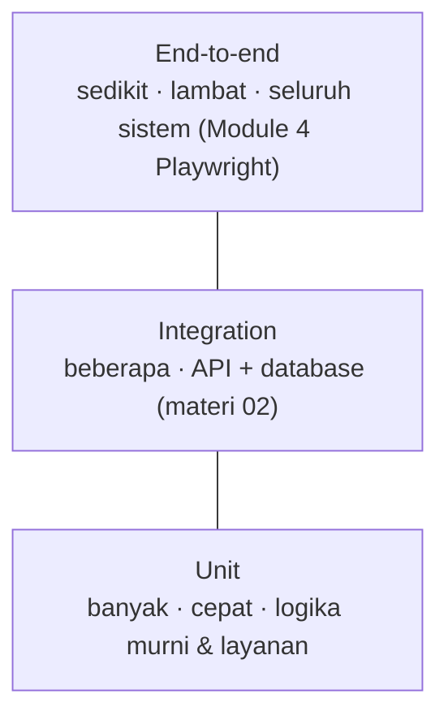

::part[Pelajari Konsepnya]{n="1"}

## 🎯 Yang akan kamu pelajari

- Mengapa tes otomatis membayar sendirinya, dan **piramida testing**
- Anatomi pytest: discovery, `assert`, `pytest.raises`, penamaan
- **Arrange–Act–Assert**, satu perilaku per tes
- **Fixture** (`@pytest.fixture`, scope, `tmp_path`, `monkeypatch`) dan **parametrization**
- Marker, menjalankan subset, dan membaca kegagalan
- **Coverage** — dan mengapa **mutation testing** memberitahu lebih banyak

## 🔤 Istilah penting

| Istilah | Artinya (sederhana) |
|---|---|
| **Automated test** | Kode yang mengecek kodemu, bisa dijalankan kapan saja |
| **pytest** | Alat pengujian Python yang kita pakai di sini |
| **Assertion** | Baris yang mengatakan apa yang harus benar |
| **Arrange–Act–Assert** | Siapkan, lakukan, periksa |
| **Fixture** | Persiapan yang bisa dipakai ulang, minta pakai nama |
| **Parametrize** | Menjalankan satu tes dengan banyak input berbeda |
| **Marker** | Penanda untuk jalankan atau lewati grup tes |
| **Coverage** | Berapa banyak kode yang dijalankan waktu tes |
| **Mutation testing** | Tambah bug kecil sengaja, lihat apakah tes tangkap |
| **Flaky test** | Tes yang terkadang lulus terkadang gagal tanpa perubahan kode |

## 🧠 Ide besarnya

Sebuah tes adalah **alarm asap** untuk kodemu. Kamu pasang sekali; mulai saat itu ia memantau **setiap perubahan**, siang malam, dan teriak saat sesuatu pecah — jauh sebelum pengguna tahu.

Alarm asap yang hilang tidak ada harganya hari ini. Kebakaran tanpa alarm itu mahal sekali. Sama seperti refactor yang akan kamu lakukan bulan depan tanpa tes.

## ❓ Kenapa ini penting

Kamu sudah menjalankan tes sejak Module 1 — setiap latihan dicek pakai pytest. Sekarang kamu tulis sendiri, karena:

- Cek manual tidak bisa diukur: 80 endpoint × 5 kasus masing-masing, setelah **setiap** perubahan.
- Tes biarkan kamu **refactor tanpa takut** (Architecture Stage A).
- Tes adalah **dokumentasi yang berjalan**: mereka tunjukkan bagaimana kode seharusnya bekerja.
- CI (materi 07) menjalankannya di setiap pull request, jadi bug tertangkap sebelum merge.
- Dengan kode yang dibuat AI, tes itu cara kamu **cek** ia benar-benar lakukan apa yang kamu minta.

Tes yang buruk adalah jebakan sendirinya:

- Perubahan "kecil" pembulatan diskon diam-diam membuat setiap pesanan kurang bayar seminggu.
- Tes ada tapi hanya cek fungsi tidak crash (`assert result is not None`) — coverage bilang 95%, bug nyata lolos begitu saja.
- Tes tergantung tanggal hari ini, jaringan, atau urutan satu sama lain → gagal acak, jadi tim mulai abaikan build merah.

## 📖 Langkah demi langkah

### 1. Piramida testing



Kebanyakan tes seharusnya **tes unit yang cepat**; lebih sedikit tes integrasi; segelintir tes end-to-end untuk perjalanan penting.

### 2. pytest dasar

```python
# test_pricing.py      ← files named test_*.py
from pricing import apply_discount
import pytest

def test_applies_percentage_discount_rounding_down():     # functions named test_*
    assert apply_discount(199_999, 10) == 179_999

def test_rejects_percent_above_100():
    with pytest.raises(ValueError, match="percent"):
        apply_discount(100, 101)
```

```bash
uv run pytest                      # everything
uv run pytest test_pricing.py -v   # one file, verbose
uv run pytest -k "discount and not rejects"
uv run pytest -x                   # stop at first failure
uv run pytest --lf                 # re-run last failures
```

`assert` biasa memberikan pesan kegagalan detail — pytest menulis ulangnya untuk tampilkan kedua sisi.

### 3. Arrange – Act – Assert

```python
def test_bulk_orders_get_ten_percent_off():
    # Arrange
    items = [(20_000, 50)]
    # Act
    total = cart_total(items, coupon=None)
    # Assert
    assert total == 900_000
```

Satu **perilaku** per tes, dan nama yang baca seperti kebutuhan. Saat gagal, nama saja seharusnya bilang apa yang pecah.

### 4. Parametrize: banyak kasus, satu tes

```python
@pytest.mark.parametrize(
    ("quantity", "expected_percent"),
    [(1, 0), (9, 0), (10, 5), (49, 5), (50, 10), (500, 10)],
)
def test_bulk_discount_tiers(quantity, expected_percent):
    assert bulk_discount_percent(quantity) == expected_percent
```

Batas (`9`, `10`, `49`, `50`) adalah tempat bug hidup — materi problem-solving Module 1, sekarang otomatis.

### 5. Fixture: persiapan pakai ulang

Sebuah fixture adalah **mise en place** pengujian: bahan-bahannya disiapkan dan diberikan kepada tes mana pun yang minta, jadi setiap tes mulai dari dapur yang bersih dan diketahui.

```python
@pytest.fixture
def sample_cart():
    return [(50_000, 2), (25_000, 1)]

def test_cart_total_without_coupon(sample_cart):     # pytest injects the fixture by name
    assert cart_total(sample_cart, coupon=None) == 140_000
```

| Built-in fixture | Pakai untuk |
|---|---|
| `tmp_path` | a fresh temporary directory per test |
| `monkeypatch` | temporarily set env vars, attributes, `sys.path` |
| `capsys` / `caplog` | capture printed output / log records |

Scope: `function` (default, fresh each test), `module`, `session` (contoh engine database). Letakkan fixture bersama di **`conftest.py`** — kamu sudah pakai fixture `db` handbook seminggu ini.

```python
def test_reads_secret_from_env(monkeypatch):
    monkeypatch.setenv("JWT_SECRET_KEY", "x" * 40)
    assert load_settings().jwt_secret_key == "x" * 40
```

### 6. Determinisme: tidak ada input tersembunyi

Inject hal-hal yang berubah: **jam**, **angka acak**, **klien jaringan**. Kamu buat ini pakai parameter `clock=` di cache TTL, reminder, dan latihan webhook — itulah kenapa tes itu tidak pernah unstable.

### 7. Coverage — berguna, tapi bukan tujuannya

Coverage bilang alarm asap punya daya. Ia tidak bilang ia bereaksi pada asap — itulah yang di-check mutation test.

```bash
uv run pytest --cov=pricing --cov-report=term-missing
```

Coverage tunjukkan baris mana yang **dijalankan** saat tes. Ia tidak bisa bilang kamu **cek** hasilnya:

```python
def test_cart_total_runs():
    cart_total([(100, 1)], None)     # 100% coverage of the happy path, zero assertions
```

### 8. Mutation testing: apakah tesmu akan tangkap bug?

Sebuah **mutant** adalah salinan kodemu dengan satu bug kecil (`>=` → `>`, `+ 1` dihapus, validasi dihapus). Tes yang bagus **gagal** di setiap mutant ("bunuh" dia). Mutant yang selamat tunjukkan perilaku yang tesmu tidak cek.

Tool seperti **mutmut** atau **cosmic-ray** buat mutant otomatis. Tes latihan ini dinilai persis dengan cara ini.

### 9. Test-driven development (TDD), ringkas

**Merah** (tulis tes gagal untuk perilaku kecil berikutnya) → **Hijau** (kode paling sederhana untuk lulus) → **Refactor** (rapihkan dengan tes hijau). Bagus untuk aturan bisnis dan perbaikan bug: reproduksi bug di tes duluan, lalu perbaiki.

### Pilih setup-mu

Setiap pilihan di sini adalah trade-off:

| Pilihan | ✅ | ❌ |
|---|---|---|
| Banyak tes unit | cepat, tangkap masalah tepat | bisa lewatkan masalah integrasi |
| Banyak tes E2E | realistis | lambat, tidak stabil, susah debug |
| Mock di mana-mana | terisolasi, cepat | tes mock, bukan perilaku; mudah rusak saat refactor |
| Dependency nyata (DB di Docker) | realistis | lebih lambat, butuh setup |
| Target coverage (contoh 80%) | progres terlihat | dorong tes tanpa assertion kalau pakai saja |
| TDD | desain lebih baik, sedikit bug | lebih lambat di awal; tidak ideal untuk spike eksplorasi |

- ✅ Tes unit untuk aturan bisnis, perhitungan, parsing, validasi, state machine.
- ✅ Satu tes regresi untuk **setiap** perbaikan bug.
- 🚫 Jangan tes framework internal atau getter trivial.
- 🚫 Jangan assert detail implementasi (method pribadi, string SQL tepat) — assert perilaku.

## ⚠️ Kesalahan umum

- Tes tanpa assertion, atau hanya `is not None`.
- Tes yang tergantung urutan eksekusi atau state global bersama.
- Pakai waktu nyata (`datetime.now()`) di dalam logika yang di-tes.
- Tes raksasa yang cek sepuluh perilaku sekaligus.
- Kejar 100% coverage daripada cek yang bermakna.

:::revoshop
README RevoShop bilang: *"Tes unit cepat (repository di-mock) dan tes integrasi (full HTTP stack di SQLite in-memory)"*. Buka `tests/unit/test_order_service.py`: (1) Pilih tiga tes — nama mereka jelaskan perilaku? (2) Mereka assert pada **hasil** atau kebanyakan pada "mock dipanggil"? (3) Jalankan `python -m pytest --cov=app --cov-report=term-missing` dan cari layanan yang paling sedikit di-cover. (4) Pilih satu aturan penting (contoh stok tidak boleh negatif, transisi status pesanan) dan tulis **mutant** — satu bug satu karakter — lalu cek apakah tes yang ada gagal. Kalau tidak, kamu sudah temukan tes pertamamu yang hilang.
:::

## 🏆 Praktik terbaik

- [ ] Beri nama tes sebagai **kebutuhan**: `test_rejects_expired_token`, bukan `test_1`.
- [ ] **Satu perilaku per tes**, Arrange–Act–Assert, assertion bermakna.
- [ ] **Parametrize** batas dan kasus tepi (kosong, satu, max, tidak sah).
- [ ] Jaga tes **determinismi**: inject jam, keacakan, klien eksternal; tidak ada jaringan nyata.
- [ ] Bagikan setup pakai **fixture** di `conftest.py`; jaga setiap tes bisa dibaca sendiri.
- [ ] Tes **jalur error** pakai `pytest.raises(..., match=...)`.
- [ ] Pakai coverage untuk cari **area tidak di-tes**, dan mutation testing untuk cek tes **benar-benar tangkap bug**.
- [ ] Tambah tes gagal **sebelum** perbaiki bug.
- [ ] Jalankan suite lengkap di **CI**; jaga cepat (detik untuk tes unit).

::part[Jelaskan & Rancang]{n="2"}

## 🗣️ Jelaskan

Jelaskan ke orang bukan programmer kenapa "100% kode dijalankan saat tes" tidak berarti kode itu benar. Pakai contoh seperti inspeksi restoran di mana inspektur jalan lewat setiap ruangan tapi tidak pernah cek suhu makanan.

## 📐 Rancang

Daftarkan kasus tes (nama + input + hasil diharapkan) yang akan kamu tulis untuk state machine `next_status(current, target)` CareerPilot dan untuk `salary_label(min, max)` yang format `"Rp 9–14 juta"`, `"Up to Rp 14 juta"`, `"From Rp 9 juta"` atau `"Not disclosed"`. Tandai batas dan kasus error.

:::quiz
Lihat kemungkinan kasus tes

**`next_status`** — parametrize setiap pasangan `(current, target)` (seperti latihan Week 3): pasangan yang diizinkan kembalikan `target`; semua lainnya raise `InvalidTransition`; plus `current` tidak dikenal dan `target` tidak dikenal; plus `interview → interview` (self-transition yang diizinkan).

**`salary_label`**
| Tes | Input | Diharapkan |
|---|---|---|
| `test_range_in_juta` | 9_000_000, 14_000_000 | `"Rp 9–14 juta"` |
| `test_only_max` | None, 14_000_000 | `"Up to Rp 14 juta"` |
| `test_only_min` | 9_000_000, None | `"From Rp 9 juta"` |
| `test_not_disclosed` | None, None | `"Not disclosed"` |
| `test_equal_min_max` | 10_000_000, 10_000_000 | `"Rp 10 juta"` (keputusan!) |
| `test_non_round_values` | 9_500_000, 12_250_000 | `"Rp 9.5–12.25 juta"` (tentukan format) |
| `test_rejects_min_above_max` | 15_000_000, 9_000_000 | `ValueError` |
| `test_rejects_negative` | -1, 5 | `ValueError` |

Menulis daftar itu tunjukkan dua keputusan produk (nilai sama, desimal) sebelum kode apa pun — efek samping yang bagus dari desain tes.
:::

### 📝 Checklist review mandiri

- [ ] Setiap batas dan kasus error punya tes
- [ ] Nama tes jelaskan perilaku
- [ ] Kebutuhan yang tidak jelas jadi keputusan eksplisit

::ai-review{task="design"}

::part[Latihan Kecil]{n="3"}

:::exercise{path="exercises/m2/w6/01-pytest-basics" ai="no-ai" title="Tes yang tangkap bug (dinilai pakai mutant)"}
Kali ini **kamu tulis tes**. `discounts.py` benar. Tulis `test_discounts.py` supaya tes **lulus** di atasnya — dan **gagal** di setiap 10 bug tersembunyi di `mutants/`. Penilai (`test_grader.py`) jalankan tes-mu lawan setiap mutant dan bilang bug mana yang selamat. Jangan baca mutant duluan — pikirkan batas dan kasus tepi, lalu cek.
:::

:::hints
- Baca docstring `discounts.py` dan tulis tes untuk **setiap aturan**, termasuk kasus error.
- Batas: quantity 9/10/49/50, batas pengiriman gratis ±1, persen diskon 0 dan 100.
- Pembulatan: pilih nilai di mana floor vs round beri jawaban berbeda.
- Kupon: sah, tidak dikenal (error), dan `None`.
- Jalankan `uv run pytest m2/w6/01-pytest-basics -k grader -v` untuk lihat mutant mana yang selamat.
:::

### 🏆 Tantangan

Pasang **mutmut** (`uv add --dev mutmut`) dan jalankan di `discounts.py`. Apakah ia temukan mutant yang selamat di tes-mu yang buatan tangan tidak?

## ✅ Cek cepat

:::quiz
Apa yang `@pytest.mark.parametrize` beri kamu?

Satu fungsi tes dijalankan dengan banyak pasangan input/diharapkan, masing-masing dilaporkan terpisah — ideal untuk batas dan kasus tepi tanpa tes yang di-copy.
:::

:::quiz
Apa itu mutant yang selamat?

Versi kode yang sengaja ada bug yang masih lulus semua tes — bukti tes tidak cek perilaku itu.
:::

:::quiz
Kenapa inject jam daripada panggil `datetime.now()` di dalam kode yang di-tes?

Supaya tes bisa pakai waktu tetap dan dapat hasil yang sama setiap kali (deterministik), termasuk tes kasus tepi seperti tengah malam atau batas kedaluwarsa.
:::


## 📚 Lanjut belajar

- [pytest documentation: Get started](https://docs.pytest.org/en/stable/getting-started.html)
- [pytest: How to use fixtures](https://docs.pytest.org/en/stable/how-to/fixtures.html)
- [mutmut — mutation testing for Python](https://mutmut.readthedocs.io/)
