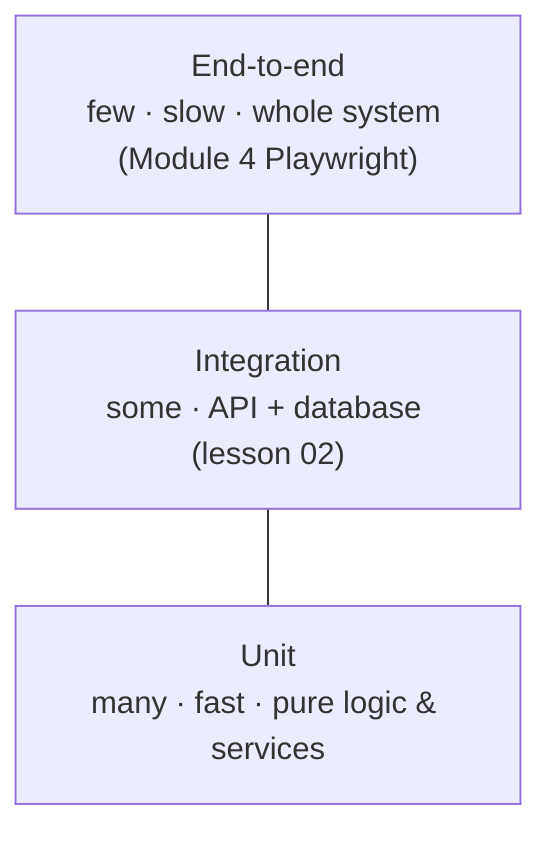

::part[Learn the Concept]{n="1"}

## 🎯 What you'll learn

- Why automated tests pay for themselves, and the **testing pyramid**
- pytest anatomy: discovery, `assert`, `pytest.raises`, naming
- **Arrange–Act–Assert**, one behavior per test
- **Fixtures** (`@pytest.fixture`, scopes, `tmp_path`, `monkeypatch`) and **parametrization**
- Markers, running subsets, and reading failures
- **Coverage** — and why **mutation testing** tells you more

## 🧠 The big idea

A test is a **smoke detector** for your code. You install it once; from then on it watches **every change**, day and night, and screams the moment something breaks — long before a user notices.

A missing smoke detector costs nothing today. A fire without one costs everything. The same is true for the refactor you do next month without tests.

## ❓ Why does this exist?

You've been running tests since Module 1 — every exercise was checked by pytest. Now you write them yourself because:

- Manual checking doesn't scale: 80 endpoints × 5 cases each, after **every** change.
- Tests let you **refactor fearlessly** (Architecture Stage A).
- Tests are **executable documentation**: they show how code is supposed to behave.
- CI (lesson 07) runs them on every pull request, so bugs are caught before merging.
- With AI-generated code, tests are how you **verify** it does what you asked.

## 💥 What happens if we DON'T test (or test badly)?

- A "small" change to discount rounding silently undercharges every order for a week.
- Tests exist but only check that functions **don't crash** (`assert result is not None`) — coverage is 95%, yet real bugs pass.
- Tests depend on today's date, the network, or each other's order → they fail randomly ("flaky"), so the team starts ignoring red builds.

## 📖 How it works, step by step

### 1. The testing pyramid



Most tests should be **fast unit tests**; fewer integration tests; a handful of end-to-end tests for critical journeys.

### 2. pytest basics

```python
# test_pricing.py      ← files named test_*.py
from pricing import apply_discount
import pytest

def test_applies_percentage_discount_rounding_down():     # functions named test_*
    assert apply_discount(199_999, 10) == 179_999

def test_rejects_percent_above_100():
    with pytest.raises(ValueError, match="percent"):
        apply_discount(100, 101)
```

```bash
uv run pytest                      # everything
uv run pytest test_pricing.py -v   # one file, verbose
uv run pytest -k "discount and not rejects"
uv run pytest -x                   # stop at first failure
uv run pytest --lf                 # re-run last failures
```

Plain `assert` gives detailed failure messages — pytest rewrites them to show both sides.

### 3. Arrange – Act – Assert

```python
def test_bulk_orders_get_ten_percent_off():
    # Arrange
    items = [(20_000, 50)]
    # Act
    total = cart_total(items, coupon=None)
    # Assert
    assert total == 900_000
```

One **behavior** per test, and a name that reads like a requirement. When it fails, the name alone should tell you what broke.

### 4. Parametrize: many cases, one test

```python
@pytest.mark.parametrize(
    ("quantity", "expected_percent"),
    [(1, 0), (9, 0), (10, 5), (49, 5), (50, 10), (500, 10)],
)
def test_bulk_discount_tiers(quantity, expected_percent):
    assert bulk_discount_percent(quantity) == expected_percent
```

Boundaries (`9`, `10`, `49`, `50`) are where bugs live — Module 1's problem-solving lesson, now automated.

### 5. Fixtures: reusable setup

```python
@pytest.fixture
def sample_cart():
    return [(50_000, 2), (25_000, 1)]

def test_cart_total_without_coupon(sample_cart):     # pytest injects the fixture by name
    assert cart_total(sample_cart, coupon=None) == 140_000
```

| Built-in fixture | Use |
|---|---|
| `tmp_path` | a fresh temporary directory per test |
| `monkeypatch` | temporarily set env vars, attributes, `sys.path` |
| `capsys` / `caplog` | capture printed output / log records |

Scopes: `function` (default, fresh each test), `module`, `session` (e.g. a database engine). Put shared fixtures in **`conftest.py`** — you've been using the handbook's `db` fixture all week.

```python
def test_reads_secret_from_env(monkeypatch):
    monkeypatch.setenv("JWT_SECRET_KEY", "x" * 40)
    assert load_settings().jwt_secret_key == "x" * 40
```

### 6. Determinism: no hidden inputs

Inject the things that change: the **clock**, **random numbers**, **network clients**. You did this with `clock=` parameters in the TTL cache, reminders and webhooks exercises — that's why those tests never flake.

### 7. Coverage — useful, but not the goal

```bash
uv run pytest --cov=pricing --cov-report=term-missing
```

Coverage shows which lines **ran** during tests. It can't tell whether you **checked** the results:

```python
def test_cart_total_runs():
    cart_total([(100, 1)], None)     # 100% coverage of the happy path, zero assertions
```

### 8. Mutation testing: would my tests catch a bug?

A **mutant** is a copy of your code with one small bug (`>=` → `>`, `+ 1` removed, a validation deleted). Good tests **fail** on every mutant ("kill" it). A surviving mutant shows a behavior your tests don't check.

Tools like **mutmut** or **cosmic-ray** generate mutants automatically. This lesson's exercise grades your tests exactly this way.

### 9. Test-driven development (TDD), briefly

**Red** (write a failing test for the next small behavior) → **Green** (simplest code to pass) → **Refactor** (clean up with tests green). Great for business rules and bug fixes: reproduce the bug in a test first, then fix it.

## ⚖️ Trade-offs

| Choice | ✅ | ❌ |
|---|---|---|
| Many unit tests | fast, pinpoint failures | can miss integration problems |
| Many E2E tests | realistic | slow, flaky, hard to debug |
| Mocks everywhere | isolated, fast | tests the mocks, not the behavior; brittle to refactors |
| Real dependencies (DB in Docker) | realistic | slower, needs setup |
| Coverage targets (e.g. 80%) | visible progress | encourages assertion-free tests if used alone |
| TDD | better design, fewer bugs | slower at first; not ideal for exploratory spikes |

## ✅ When to use it / 🚫 When NOT to use it

- ✅ Unit tests for business rules, calculations, parsing, validation, state machines.
- ✅ A regression test for **every** bug fix.
- 🚫 Don't test framework internals or trivial getters.
- 🚫 Don't assert on implementation details (private methods, exact SQL strings) — assert on behavior.

## 🏆 Best practices

- [ ] Name tests as **requirements**: `test_rejects_expired_token`, not `test_1`.
- [ ] **One behavior per test**, Arrange–Act–Assert, meaningful assertions.
- [ ] **Parametrize** boundaries and edge cases (empty, one, max, invalid).
- [ ] Keep tests **deterministic**: inject clocks, randomness and external clients; no real network.
- [ ] Share setup with **fixtures** in `conftest.py`; keep each test readable on its own.
- [ ] Test **error paths** with `pytest.raises(..., match=...)`.
- [ ] Use coverage to find **untested areas**, and mutation testing to check tests **actually catch bugs**.
- [ ] Add a failing test **before** fixing a bug.
- [ ] Run the full suite in **CI**; keep it fast (seconds for unit tests).

## 🏭 How it's used in industry

- Pull requests without tests for new behavior are usually sent back in review.
- CI blocks merging on red tests; flaky tests get quarantined and fixed quickly.
- Interviews increasingly include "write tests for this function" or "how would you test this endpoint?"
- AI coding agents are most reliable when a test suite tells them (and you) whether a change works.

## ⚠️ Common mistakes

- Tests with no assertions, or only `is not None`.
- Tests that depend on execution order or shared global state.
- Using real time (`datetime.now()`) inside logic under test.
- Huge tests checking ten behaviors at once.
- Chasing 100% coverage instead of meaningful checks.

:::revoshop
RevoShop's README says: *"Fast unit tests (repositories mocked) and integration tests (full HTTP stack on in-memory SQLite)"*. Open `tests/unit/test_order_service.py`: (1) Pick three tests — do their names describe behavior? (2) Do they assert on **results** or mostly on "mock was called"? (3) Run `python -m pytest --cov=app --cov-report=term-missing` and find the least-covered service. (4) Choose one important rule (e.g. stock can't go negative, order status transitions) and write down a **mutant** — a one-character bug — then check whether any existing test fails. If none does, you've found your first missing test.
:::

::part[Explain & Design]{n="2"}

## 🗣️ Explain it

Explain to a non-programmer why "100% of the code ran during tests" doesn't mean the code is correct. Use an example like a restaurant inspection where the inspector walks through every room but never checks the food temperature.

## 📐 Design it

List the test cases (names + inputs + expected results) you'd write for CareerPilot's `next_status(current, target)` state machine and for `salary_label(min, max)` which formats `"Rp 9–14 juta"`, `"Up to Rp 14 juta"`, `"From Rp 9 juta"` or `"Not disclosed"`. Mark boundaries and error cases.

:::quiz
Show possible test cases

**`next_status`** — parametrize every `(current, target)` pair (like Week 3's exercise): allowed pairs return `target`; all others raise `InvalidTransition`; plus unknown `current` and unknown `target`; plus `interview → interview` (a self-transition that's allowed).

**`salary_label`**
| Test | Input | Expected |
|---|---|---|
| `test_range_in_juta` | 9_000_000, 14_000_000 | `"Rp 9–14 juta"` |
| `test_only_max` | None, 14_000_000 | `"Up to Rp 14 juta"` |
| `test_only_min` | 9_000_000, None | `"From Rp 9 juta"` |
| `test_not_disclosed` | None, None | `"Not disclosed"` |
| `test_equal_min_max` | 10_000_000, 10_000_000 | `"Rp 10 juta"` (a decision!) |
| `test_non_round_values` | 9_500_000, 12_250_000 | `"Rp 9.5–12.25 juta"` (decide formatting) |
| `test_rejects_min_above_max` | 15_000_000, 9_000_000 | `ValueError` |
| `test_rejects_negative` | -1, 5 | `ValueError` |

Writing the list exposed two product decisions (equal values, decimals) before any code — a nice side effect of test design.
:::

### 📝 Self-review checklist

- [ ] Every boundary and error case has a test
- [ ] Test names describe behavior
- [ ] Unclear requirements became explicit decisions

::ai-review{task="design"}

::part[Toy Exercise]{n="3"}

:::exercise{path="exercises/m2/w6/01-pytest-basics" ai="no-ai" title="Tests that catch bugs (graded by mutants)"}
This time **you write the tests**. `discounts.py` is correct. Write `test_discounts.py` so that your tests **pass** on it — and **fail** on each of the 10 hidden bugs in `mutants/`. The grader (`test_grader.py`) runs your tests against every mutant and tells you which bugs survived. Don't read the mutants first — think about boundaries and error cases, then check.
:::

:::hints
- Read `discounts.py`'s docstrings and write tests for **every rule**, including error cases.
- Boundaries: quantities 9/10/49/50, the free-shipping threshold ±1, discount percent 0 and 100.
- Rounding: pick values where floor vs round gives different answers.
- Coupons: valid, unknown (error), and `None`.
- Run `uv run pytest m2/w6/01-pytest-basics -k grader -v` to see which mutants survive.
:::

### 🏆 Stretch goal

Install **mutmut** (`uv add --dev mutmut`) and run it on `discounts.py`. Does it find mutants that survive your tests that the handmade ones didn't?

## ✅ Quick check

:::quiz
What does `@pytest.mark.parametrize` give you?

One test function run with many input/expected pairs, each reported separately — ideal for boundaries and edge cases without copy-pasted tests.
:::

:::quiz
What's a surviving mutant?

A deliberately bugged version of the code that still passes all tests — evidence that the tests don't check that behavior.
:::

:::quiz
Why inject a clock instead of calling `datetime.now()` inside the code under test?

So tests can use a fixed time and get the same result every run (deterministic), including testing edge cases like midnight or expiry boundaries.
:::

## 📖 Kamus (glossary)

| Term | Bahasa Indonesia |
|---|---|
| Unit / Integration / E2E test | Tes satuan / integrasi / ujung-ke-ujung |
| Fixture | Penyedia data/objek persiapan untuk tes |
| Parametrize | Menjalankan satu tes dengan banyak input |
| Coverage | Cakupan baris kode yang dijalankan tes |
| Mutation testing | Menguji kualitas tes dengan bug buatan |
| Flaky test | Tes yang kadang lulus kadang gagal tanpa perubahan |

## 📚 Keep learning

- [pytest documentation: Get started](https://docs.pytest.org/en/stable/getting-started.html)
- [pytest: How to use fixtures](https://docs.pytest.org/en/stable/how-to/fixtures.html)
- [mutmut — mutation testing for Python](https://mutmut.readthedocs.io/)
