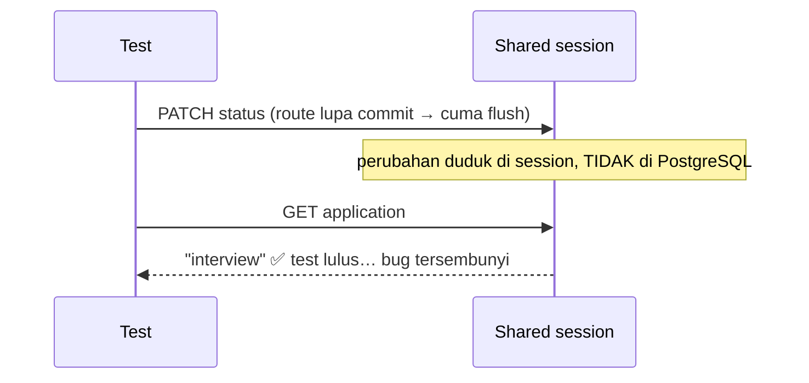

::part[Pelajari Konsepnya]{n="1"}

## 🎯 Yang akan kamu pelajari

- Unit vs integration test **untuk API**, dan kapan menulis masing-masing
- **Test client** Flask: request, JSON, header, membaca response
- Design fixture yang memberi setiap test **database bersih** dan berperilaku seperti production
- Kenapa test di **SQLite tapi production pakai PostgreSQL** itu berbahaya
- Test auth, validasi, format error, **data tersimpan**, dan "tidak ada yang berubah" saat gagal
- Mock: kapan membantu dan kapan berbohong

## 🔤 Istilah penting

| Istilah | Artinya (sederhana) |
|---|---|
| **Test client** | Browser palsu yang memanggil aplikasimu tanpa mulai server |
| **Unit test** | Tes satu bagian sendirian |
| **Integration test** | Tes bagian-bagian bekerja bersama, termasuk database |
| **Fixture** | Persiapan ulang-pakai, seperti database bersih tiap tes |
| **Isolation** | Data satu tes tidak menganggu tes lainnya |
| **Factory** | Pembantu yang membuat data tes dengan nilai default yang wajar |
| **Persistence check** | Membaca data kembali untuk buktikan benar tersimpan |
| **Mock** | Pengganti untuk sesuatu di luar aplikasimu |
| **Boundary** | Garis tepi sistemmu — satu-satunya tempat mock pantas ada |

## 🧠 Ide besarnya

Unit test memeriksa **mesinnya** di meja kerja. Integration test membawa **mobil untuk di-test jalan**: kemudi, rem, dan mesin bekerja bersama di jalan asli.

Untuk web API yang jalan itu murah: Flask memberi kamu browser palsu — **test client** — yang mengirim request HTTP asli lewat routing, validasi, service, SQLAlchemy, dan database, tanpa mulai server.

## ❓ Kenapa ini penting

Kebanyakan bug API tinggal **di antara** bagian-bagian: route lupa `commit()`, error handler kirim HTML padahal harus JSON, auth diterapkan ke `POST` tapi bukan `PATCH`, unique constraint beda di PostgreSQL. Unit test dengan repository yang di-mock tidak bisa lihat satupun dari itu.

Konkretnya:

- Mock `repository.save()` "terpanggil", tapi route asli tidak pernah commit — data hilang di production.
- Test lulus di SQLite, production pecah di hal yang cuma PostgreSQL lakukan (LIKE case-sensitive, panjang string ketat, `timestamptz`, `FOR UPDATE`).
- Tidak ada yang test path `401`, dan refactor diam-diam bikin endpoint admin terbuka untuk semua.

## 📖 Langkah demi langkah

### 1. Test client

```python
def test_create_application(client):
    response = client.post(
        "/api/v1/applications",
        json={"company": "Kopi Data", "role": "Backend Engineer"},   # sets body + Content-Type
        headers={"X-API-Key": "test-key"},
    )
    assert response.status_code == 201
    assert response.get_json()["data"]["status"] == "saved"
    assert response.headers["Location"].endswith("/api/v1/applications/1")
```

Tersedia juga: `client.get(url, query_string={"status": "applied"})`, `data=` untuk body mentah, `response.data` untuk byte.

### 2. Apa yang di-assert untuk setiap endpoint

| Cek | Kenapa |
|---|---|
| **Status code** | kontrak yang klien percabang |
| **Bentuk body** (`data` / `error.code`) | klien parse-nya |
| **Data tersimpan** — baca lagi di **request baru** | tangkap `commit()` yang ketinggalan |
| **Efek samping tidak terjadi** saat gagal | 401/409 tidak boleh ubah data |
| **Header** yang penting (`Location`, `Cache-Control`) | bagian dari kontrak |

### 3. Fixture: database bersih tiap tes

Setiap tes harus mulai dengan ruangan rapi: keadaan awal sama, apapun yang berjalan sebelumnya. Itulah yang bikin kegagalan punya makna.

Handbook punya fixture `pg_url` yang beri setiap tes schema PostgreSQL fresh. Di atasnya:

```python
@pytest.fixture
def app(pg_url):
    app = create_app(pg_url, api_key="test-key")
    with app.app_context():          # context ONLY for setup
        db.create_all()
    yield app                        # ← test runs here, with NO app context pushed
    with app.app_context():          # context ONLY for teardown
        db.session.remove()
        db.drop_all()
        db.engine.dispose()


@pytest.fixture
def client(app):
    return app.test_client()
```

### 4. Perangkap long-lived context

Kalau fixture lakukan `with app.app_context(): ... yield ...`, context tetap terdorong **saat** tes. Flask lalu **pakai ulang** untuk setiap request test-client, jadi semua request bagi **satu session SQLAlchemy**:



Di production setiap request punya **session sendiri**, dan perubahan akan di-rollback. Jaga context per request bikin test berperilaku seperti production. (Kamu ketemu sepupu bug ini di latihan authorization Minggu 5: role basi dari identity map.)

### 5. Strategi isolasi umum

| Strategi | ✅ | ❌ |
|---|---|---|
| Fresh schema / `create_all` + `drop_all` tiap tes (handbook ini) | sederhana, terisolasi sempurna | lebih lambat dengan banyak tabel |
| Satu schema per session + **transaction rollback** tiap tes | cepat | trickier dengan kode yang commit; butuh setup SAVEPOINT |
| `TRUNCATE ... RESTART IDENTITY CASCADE` tiap tes | cepat, realistis | harus sebut tabel; id restart |
| **Testcontainers** (container Postgres per test run) | bisa diulang di CI | butuh Docker |

Apapun yang kamu pilih: tes harus bisa jalan **dalam urutan apa saja**, sendiri atau bersama.

### 6. Factory daripada setup copy-paste

```python
def create(client, company="Kopi Data", role="Backend Engineer", headers=KEY):
    return client.post(API, json={"company": company, "role": role}, headers=headers)
```

Pembantu (atau library seperti **factory_boy**) jaga setiap tes fokus ke satu hal yang penting untuk dia.

### 7. Auth di tes

```python
@pytest.fixture
def auth_headers(app):
    with app.app_context():
        token = create_access_token(identity="1", additional_claims={"role": "admin"})
    return {"Authorization": f"Bearer {token}"}
```

Tes matriksnya: **tidak ada token → 401**, **role salah → 403**, **role tepat → 2xx** (materi Minggu 5 lekon 06).

### 8. Mock: di boundary saja

Mock payment provider, bukan repository milikmu sendiri. Mock kode milikmu itu tes asumsi tentang dia, bukan kodenya sendiri — latihan di mana kamu juga main aktor lain.

Mock benda yang **tidak kamu punya** dan tidak bisa jalan lokal: payment provider, email API, LLM. Jangan mock database layer milikmu di integration test — maka kamu tes mock-nya.

```python
def test_checkout_when_payment_provider_is_down(client, monkeypatch):
    monkeypatch.setattr("services.payments.client.create_charge", raise_provider_unavailable)
    response = client.post("/api/v1/orders/1/pay", headers=buyer)
    assert response.status_code == 503
```

Lebih baik: inject klien (`app.config["PAYMENT_CLIENT"] = FakeClient()`), seperti di latihan webhook Minggu 5.

### 9. Unit test masih penting

Business rule (hitung harga, transisi diizinkan) terbaik di-tes sebagai **pure function**: cepat, banyak kasus. Lalu **beberapa** integration test buktikan route wire-nya benar. Piramida berlaku di dalam API juga.

### Pilih setup-mu

Setiap opsi di sini adalah trade-off:

| Pilihan | ✅ | ❌ |
|---|---|---|
| SQLite in-memory untuk tes | nol setup, sangat cepat | dialek SQL beda & constraint → percaya diri palsu |
| PostgreSQL di Docker / CI service | mesin sama seperti production | butuh Docker, sedikit lebih lambat |
| Mock repository | paling cepat, isolasi service logic | hilang SQL, transaksi, commit |
| Integration test lengkap untuk segalanya | realistis | suite lambat, lebih sulit tunjuk letak gagal |

- ✅ Integration test untuk **happy path setiap endpoint, auth, dan error utama**.
- ✅ Unit test untuk logic rapat di balik endpoint.
- 🚫 Jangan cover setiap permutasi validasi lewat HTTP kalau unit test schema sudah lakukan.
- 🚫 Jangan panggil API pihak ketiga asli dari tes.

## ⚠️ Kesalahan umum

- Hanya assert `status_code == 200`.
- Bagi data antar tes (tes B hanya lulus setelah tes A).
- `os.environ[...] = ...` di atas `conftest.py` — pengaruhi setiap tes dan urutan import.
- Tes yang jaga satu session terbuka dan sembunyikan commit yang ketinggalan.

:::revoshop
Buka `tests/conftest.py` RevoShop: (1) Baris 4 set `DATABASE_URL` ke **SQLite in memory** sementara production pakai PostgreSQL. Sebut dua fitur RevoShop (search dengan `ILIKE`? harga `Numeric`? stock locking saat checkout?) yang bisa beda perilakunya. (2) Fixture `db` lakukan `with app.app_context(): ... yield _db` — perangkap **long-lived context** dari materi ini. Pilih satu route yang tulis data dan ganti `commit()`-nya jadi `flush()`: ada tes yang gagal? (3) Sketsa bagaimana kamu ubah suite ke PostgreSQL memakai `docker compose` dan ide `pg_url`.
:::

## 🏆 Praktik terbaik

- [ ] Tes terhadap **mesin database yang sama** seperti production (PostgreSQL lewat Docker/CI service).
- [ ] Setiap tes mulai dari **keadaan bersih, tahu**: tes lulus dalam urutan apa saja (`pytest -p randomly` bisa buktikan).
- [ ] Dorong app context hanya untuk **setup/teardown**, jadi setiap request dapat session-nya sendiri.
- [ ] Assert **status + body + persistence**; baca tulis ulang dengan request terpisah.
- [ ] Tes **jalan tidak bagus**: 401, 403, 404, 409, 422 — dan buktikan tidak ubah apa-apa.
- [ ] Pakai **factory helper** untuk data tes; jaga setiap tes fokus.
- [ ] Config aplikasi untuk tes lewat factory (`create_app(test_config)`), bukan ubah global atau env saat import.
- [ ] Mock hanya **boundary luar** (pembayaran, email, LLM); lebih suka fake yang di-inject.
- [ ] Jaga suite cepat cukup untuk jalan sebelum setiap push; jalankan di CI (materi 07).

::part[Jelaskan & Rancang]{n="2"}

## 🗣️ Jelaskan

Jelaskan ke rekan kerja kenapa test suite dengan repository yang di-mock lulus sementara production hilang setiap update status pesanan. Sebut session, commit, dan apa yang mock tidak cek.

## 📐 Rancang

Rancang rencana integration test untuk checkout gaya RevoShop: `POST /orders` (pembeli saja) ubah keranjang jadi pesanan, kurangi stock, dan gagal dengan `409 insufficient_stock` kalau ada barang kurang. Sebut fixture, nama tes, dan apa yang setiap tes buktikan (termasuk apa yang **harus tidak** berubah).

:::quiz
Lihat rencana yang mungkin

**Fixture:** `app` (schema PostgreSQL fresh), `client`, `buyer_headers` / `seller_headers` (JWT), factory `product(stock=...)`, pembantu `cart_with(product, qty)`.

| Tes | Buktikan |
|---|---|
| `test_checkout_creates_order_and_decreases_stock` | 201, item pesanan & total; stock produk berkurang (baca lewat GET); keranjang kosong |
| `test_checkout_requires_login` | 401; tidak ada pesanan; stock tidak berubah |
| `test_seller_cannot_checkout` | 403 |
| `test_empty_cart_is_422` | 422 `cart_empty` |
| `test_insufficient_stock_is_409_and_nothing_changes` | 409; **tidak ada** baris pesanan; **semua** stock tidak berubah (termasuk barang yang cukup); keranjang tidak berubah |
| `test_price_is_snapshotted` | ubah harga produk setelah checkout; total pesanan tidak berubah |
| `test_concurrent_checkout_of_last_item` | dua koneksi/thread: tepat satu 201, satu 409, stock = 0 (transaksi Minggu 2) |

Tambah unit test untuk kalkulasi total dan fungsi cek stock.
:::

### 📝 Checklist review mandiri

- [ ] Tes gagal cek bahwa tidak ada yang berubah
- [ ] Matrik auth tercakup (401/403/2xx)
- [ ] Paling tidak satu tes concurrency atau transaksi untuk uang/stock

::ai-review{task="design"}

::part[Latihan Kecil]{n="3"}

:::exercise{path="exercises/m2/w6/02-testing-flask-endpoints" ai="no-ai" title="Integration test dinilai oleh 11 API buggy"}
`api.py` adalah applications API benar (CareerPilot). Tulis `test_api.py` memakai Flask test client dan PostgreSQL. Grader jalankan test-mu di API yang benar (harus lulus) dan di 11 mutant — status code salah, auth check hilang, commit hilang, broken transition rule… — setiap mutant harus buat test-mu gagal.
:::

:::hints
- Mulai dari docstring di `api.py`: ubah setiap baris jadi paling sedikit satu tes.
- Untuk setiap tulis, baca hasil balik dengan **request GET terpisah**.
- Untuk setiap kegagalan (401, 409), cek data **tidak** berubah.
- Tes **hilang** dan API key **salah**.
- Kalau mutant "tidak di-commit" masih selamat, lihat fixture-mu — ada app context terdorong saat request jalan?
:::

### 🏆 Tujuan stretch

Tambah `pytest-randomly` (`uv add --dev pytest-randomly`) dan jalankan tes beberapa kali. Apakah lulus di setiap urutan?

## ✅ Cek cepat

:::quiz
Kenapa baca data balik dengan request terpisah setelah POST/PATCH?

Untuk buktikan benar di-commit ke database — response sendirian bisa tampil nilai in-memory walaupun transaksi tidak pernah di-commit.
:::

:::quiz
Kapan mock pantas di API test?

Untuk sistem luar yang tidak kamu kontrol (payment provider, email, LLM API) — di boundary. Bukan untuk database layer milikmu di integration test.
:::

:::quiz
Sebut satu risiko jalankan tes di SQLite sementara production pakai PostgreSQL.

Contoh: SQLite tidak enforce panjang `VARCHAR`, aturan LIKE case beda, tidak punya `ILIKE`, timezone/`timestamptz` beda, `SELECT ... FOR UPDATE` dan locking tidak didukung, perilaku constraint/`ON CONFLICT` beda.
:::


## 📚 Lanjut belajar

- [Flask: Testing Flask Applications](https://flask.palletsprojects.com/en/stable/testing/)
- [Flask-SQLAlchemy: Contexts and sessions](https://flask-sqlalchemy.readthedocs.io/en/stable/contexts/)
- [Testcontainers for Python](https://testcontainers-python.readthedocs.io/)
