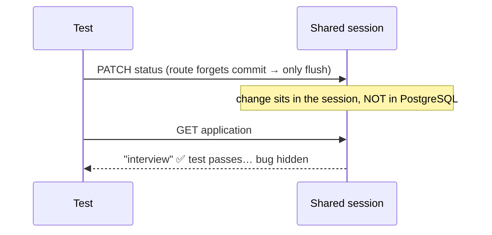

::part[Learn the Concept]{n="1"}

## 🎯 What you'll learn

- Unit vs integration tests **for an API**, and which to write when
- Flask's **test client**: requests, JSON, headers, reading responses
- A fixture design that gives every test a **clean database** and behaves like production
- Why testing on **SQLite while production runs PostgreSQL** is risky
- Testing auth, validation, error formats, **persistence** and "nothing changed" after failures
- Mocks: when they help and when they lie

## 🔤 Key words

| Word | In simple words | Bahasa Indonesia |
|---|---|---|
| **Test client** | A fake browser that calls your app without starting a server | Browser palsu untuk tes |
| **Unit test** | Tests one piece on its own | Uji satu bagian |
| **Integration test** | Tests pieces working together, including the database | Uji gabungan |
| **Fixture** | Reusable setup, like a clean database per test | Persiapan tiap tes |
| **Isolation** | One test's data never affects another's | Tes tidak saling mengganggu |
| **Factory** | A helper that creates test data with sensible defaults | Pembuat data uji |
| **Persistence check** | Reading the data back to prove it was really saved | Memastikan benar tersimpan |
| **Mock** | A stand-in for something outside your app | Pengganti layanan luar |
| **Boundary** | The edge of your system — the only place mocks belong | Batas sistem |

## 🧠 The big idea

Unit tests check the **engine** on a workbench. Integration tests take the **car for a drive**: steering, brakes and engine working together on a real road.

For a web API that drive is cheap: Flask gives you a fake browser — the **test client** — that sends real HTTP-shaped requests through routing, validation, services, SQLAlchemy and the database, without starting a server.

## ❓ Why it matters

Most API bugs live **between** the pieces: a route forgets `commit()`, an error handler returns HTML instead of JSON, auth is applied to `POST` but not `PATCH`, a unique constraint behaves differently in PostgreSQL. Unit tests with mocked repositories can't see any of that.

Concretely:

- A mocked `repository.save()` "was called", but the real route never commits — the data vanishes in production.
- Tests pass on SQLite, and production breaks on something only PostgreSQL does (case-sensitive `LIKE`, strict string lengths, `timestamptz`, `FOR UPDATE`).
- Nobody tested the `401` path, and a refactor quietly made an admin endpoint public.

## 📖 Step by step

### 1. The test client

```python
def test_create_application(client):
    response = client.post(
        "/api/v1/applications",
        json={"company": "Kopi Data", "role": "Backend Engineer"},   # sets body + Content-Type
        headers={"X-API-Key": "test-key"},
    )
    assert response.status_code == 201
    assert response.get_json()["data"]["status"] == "saved"
    assert response.headers["Location"].endswith("/api/v1/applications/1")
```

Also available: `client.get(url, query_string={"status": "applied"})`, `data=` for raw bodies, `response.data` for bytes.

### 2. What to assert for every endpoint

| Check | Why |
|---|---|
| **Status code** | the contract clients branch on |
| **Body shape** (`data` / `error.code`) | clients parse it |
| **Persistence** — read it back in a **new request** | catches missing `commit()` |
| **Side effects didn't happen** on failures | a 401/409 must not change data |
| **Headers** that matter (`Location`, `Cache-Control`) | part of the contract |

### 3. Fixtures: a clean database per test

Each test should start with a tidy room: same starting state, whatever ran before it. That's what makes a failure mean something.

The handbook's `pg_url` fixture gives each test a fresh PostgreSQL schema. On top of it:

```python
@pytest.fixture
def app(pg_url):
    app = create_app(pg_url, api_key="test-key")
    with app.app_context():          # context ONLY for setup
        db.create_all()
    yield app                        # ← test runs here, with NO app context pushed
    with app.app_context():          # context ONLY for teardown
        db.session.remove()
        db.drop_all()
        db.engine.dispose()


@pytest.fixture
def client(app):
    return app.test_client()
```

### 4. The long-lived context trap

If the fixture does `with app.app_context(): ... yield ...`, the context stays pushed **during** the test. Flask then **reuses** it for every test-client request, so all requests share **one SQLAlchemy session**:



In production each request has its **own** session, and the change would be rolled back. Keeping contexts per request makes tests behave like production. (You met a cousin of this bug in Week 5's authorization exercise: a stale role from the identity map.)

### 5. Common isolation strategies

| Strategy | ✅ | ❌ |
|---|---|---|
| Fresh schema / `create_all` + `drop_all` per test (this handbook) | simple, fully isolated | slower with many tables |
| One schema per session + **transaction rollback** per test | fast | trickier with code that commits; needs SAVEPOINT setup |
| `TRUNCATE ... RESTART IDENTITY CASCADE` per test | fast, realistic | must list tables; ids restart |
| **Testcontainers** (a Postgres container per test run) | reproducible in CI | needs Docker |

Whatever you choose: tests must be able to run **in any order**, alone or together.

### 6. Factories instead of copy-pasted setup

```python
def create(client, company="Kopi Data", role="Backend Engineer", headers=KEY):
    return client.post(API, json={"company": company, "role": role}, headers=headers)
```

Helpers (or libraries like **factory_boy**) keep each test focused on the one thing that matters for it.

### 7. Auth in tests

```python
@pytest.fixture
def auth_headers(app):
    with app.app_context():
        token = create_access_token(identity="1", additional_claims={"role": "admin"})
    return {"Authorization": f"Bearer {token}"}
```

Test the matrix: **no token → 401**, **wrong role → 403**, **right role → 2xx** (Week 5 lesson 06).

### 8. Mocks: at the boundary only

Mock the payment provider, not your own repository. A mock of your own code tests your assumptions about it, not the code itself — a rehearsal where you also play the other actor.

Mock things you **don't own** and can't run locally: the payment provider, an email API, an LLM. Don't mock your own database layer in integration tests — then you're testing the mock.

```python
def test_checkout_when_payment_provider_is_down(client, monkeypatch):
    monkeypatch.setattr("services.payments.client.create_charge", raise_provider_unavailable)
    response = client.post("/api/v1/orders/1/pay", headers=buyer)
    assert response.status_code == 503
```

Even better: inject the client (`app.config["PAYMENT_CLIENT"] = FakeClient()`), as in Week 5's webhook exercise.

### 9. Unit tests still matter

Business rules (price calculation, allowed transitions) are best tested as **pure functions**: fast, many cases. Then a **few** integration tests confirm routes wire them up correctly. The pyramid applies inside the API too.

### Choosing your setup

Every option here is a trade-off:

| Choice | ✅ | ❌ |
|---|---|---|
| SQLite in-memory for tests | zero setup, very fast | different SQL dialect & constraints → false confidence |
| PostgreSQL in Docker / CI service | same engine as production | needs Docker, slightly slower |
| Mocked repositories | fastest, isolates service logic | misses SQL, transactions, commits |
| Full integration tests for everything | realistic | slow suite, harder to pinpoint failures |

- ✅ Integration tests for every endpoint's **happy path, auth and main errors**.
- ✅ Unit tests for dense logic behind the endpoints.
- 🚫 Don't cover every validation permutation through HTTP if a schema unit test already does.
- 🚫 Don't call real third-party APIs from tests.

## ⚠️ Common mistakes

- Asserting only `status_code == 200`.
- Sharing data between tests (test B only passes after test A).
- `os.environ[...] = ...` at the top of `conftest.py` — affects every test and import order.
- Tests that keep one session open and hide missing commits.

:::revoshop
Open RevoShop's `tests/conftest.py`: (1) Line 4 sets `DATABASE_URL` to **SQLite in memory** while production uses PostgreSQL. List two RevoShop features (search with `ILIKE`? `Numeric` prices? stock locking during checkout?) that could behave differently. (2) The `db` fixture does `with app.app_context(): ... yield _db` — the **long-lived context trap** from this lesson. Pick one route that writes data and temporarily replace its `commit()` with `flush()`: does any test fail? (3) Sketch how you'd switch the suite to PostgreSQL using `docker compose` and the `pg_url` idea.
:::

## 🏆 Best practices

- [ ] Test against the **same database engine** as production (PostgreSQL via Docker/CI service).
- [ ] Each test starts from a **clean, known state**; tests pass in any order (`pytest -p randomly` can prove it).
- [ ] Push app contexts only for **setup/teardown**, so each request gets its own session.
- [ ] Assert **status + body + persistence**; read writes back with a separate request.
- [ ] Test the **unhappy paths**: 401, 403, 404, 409, 422 — and that they changed nothing.
- [ ] Use **factory helpers** for test data; keep each test focused.
- [ ] Configure the app for tests via the factory (`create_app(test_config)`), not by mutating globals or env at import time.
- [ ] Mock only **external boundaries** (payments, email, LLMs); prefer injected fakes.
- [ ] Keep the suite fast enough to run before every push; run it in CI (lesson 07).

::part[Explain & Design]{n="2"}

## 🗣️ Explain it

Explain to a teammate why a test suite with mocked repositories passed while production lost every order status update. Mention sessions, commit and what the mock didn't check.

## 📐 Design it

Design the integration test plan for RevoShop-style checkout: `POST /orders` (buyer only) converts the cart into an order, decreases stock, and fails with `409 insufficient_stock` if any item is short. List fixtures, test names, and what each asserts (including what must **not** change).

:::quiz
Show a possible plan

**Fixtures:** `app` (fresh PostgreSQL schema), `client`, `buyer_headers` / `seller_headers` (JWTs), `product(stock=...)` factory, `cart_with(product, qty)` helper.

| Test | Asserts |
|---|---|
| `test_checkout_creates_order_and_decreases_stock` | 201, order items & total; product stock reduced (read via GET); cart empty |
| `test_checkout_requires_login` | 401; no order; stock unchanged |
| `test_seller_cannot_checkout` | 403 |
| `test_empty_cart_is_422` | 422 `cart_empty` |
| `test_insufficient_stock_is_409_and_nothing_changes` | 409; **no** order row; **all** stocks unchanged (including items that had enough); cart unchanged |
| `test_price_is_snapshotted` | change product price after checkout; order total unchanged |
| `test_concurrent_checkout_of_last_item` | two connections/threads: exactly one 201, one 409, stock = 0 (Week 2 transactions) |

Plus unit tests for total calculation and the stock check function.
:::

### 📝 Self-review checklist

- [ ] Failure tests check that nothing changed
- [ ] Auth matrix covered (401/403/2xx)
- [ ] At least one concurrency or transaction test for money/stock

::ai-review{task="design"}

::part[Toy Exercise]{n="3"}

:::exercise{path="exercises/m2/w6/02-testing-flask-endpoints" ai="no-ai" title="Integration tests graded by 11 buggy APIs"}
`api.py` is a correct applications API (CareerPilot). Write `test_api.py` using the Flask test client and PostgreSQL. The grader runs your tests on the correct API (must pass) and on 11 mutants — a wrong status code, a missing auth check, a missing commit, a broken transition rule… — each must make your tests fail.
:::

:::hints
- Start from the docstring in `api.py`: turn every line into at least one test.
- For each write, read the result back with a **separate** GET.
- For each failure (401, 409), check the data **didn't** change.
- Test both a **missing** and a **wrong** API key.
- If the "not committed" mutants survive, look at your fixture — is an app context pushed while requests run?
:::

### 🏆 Stretch goal

Add `pytest-randomly` (`uv add --dev pytest-randomly`) and run your tests several times. Do they pass in every order?

## ✅ Quick check

:::quiz
Why read data back with a separate request after a POST/PATCH?

To prove it was actually committed to the database — the response alone can show in-memory values even if the transaction was never committed.
:::

:::quiz
When is mocking appropriate in API tests?

For external systems you don't control (payment providers, email, LLM APIs) — at the boundary. Not for your own database layer in integration tests.
:::

:::quiz
Name one risk of running tests on SQLite when production uses PostgreSQL.

Examples: SQLite doesn't enforce `VARCHAR` lengths, `LIKE` case rules differ, no `ILIKE`, different timezone/`timestamptz` handling, `SELECT ... FOR UPDATE` and locking not supported, different constraint/`ON CONFLICT` behavior.
:::


## 📚 Keep learning

- [Flask: Testing Flask Applications](https://flask.palletsprojects.com/en/stable/testing/)
- [Flask-SQLAlchemy: Contexts and sessions](https://flask-sqlalchemy.readthedocs.io/en/stable/contexts/)
- [Testcontainers for Python](https://testcontainers-python.readthedocs.io/)
