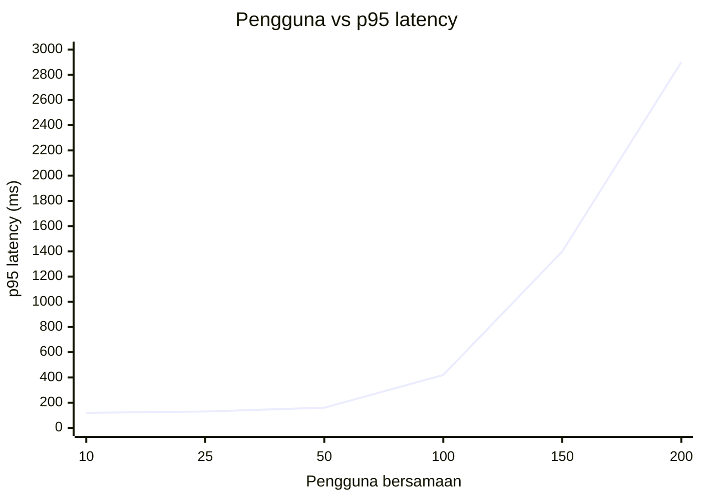

::part[Pelajari Konsepnya]{n="1"}

## 🎯 Yang akan kamu pelajari

- Uji beban, stress, spike, dan soak — dan pertanyaan apa yang dijawab masing-masing
- Metrik yang penting: **p50/p95/p99 latency**, **RPS**, **error rate**, kejenuhan
- Kenapa **rata-rata berbohong**
- Menulis pengguna Locust realistis: waktu jeda, bobot, `on_start`, `name=`, `catch_response`
- Menjalankan tanpa UI dengan output CSV dan mengubah angka jadi keputusan **SLO**
- Menemukan hambatan sesungguhnya, bukan menebak-nebak

## 🔤 Istilah penting

| Istilah | Artinya (sederhana) |
|---|---|
| **Load test** | Mengirim banyak pengguna tiruan untuk lihat sistem kuat berapa |
| **Stress test** | Dorong sampai batas untuk lihat di mana patah |
| **Soak test** | Jalankan berhari-hari untuk cari kebocoran lambat |
| **Latency** | Berapa lama satu request dimulai sampai selesai |
| **p95 / p99** | Paling lambat 5% / 1% request — apa yang dirasakan pengguna sial |
| **RPS / throughput** | Request ditangani per detik |
| **Error rate** | Berapa persen request gagal |
| **Bottleneck** | Satu bagian yang membatasi (biasanya database) |
| **SLO** | Target yang kamu janjikan, misalnya "p95 kurang dari 300 ms" |
| **Think time** | Jeda yang dibuat pengguna asli antara aksi |

## 🧠 Ide besarnya

Insinyur jembatan tidak menunggu jam sibuk untuk tahu berapa berat yang ditahan jembatan. Mereka **uji beban** dengan truk dulu, ukur berapa banyak dia bengkok, dan temukan balok terlemah.

Uji beban untuk API sama: banyak pengguna tiruan bersamaan, sambil kamu lihat response time dan error berubah saat traffic tumbuh.

## ❓ Kenapa ini penting

API-mu cepat dengan satu pengguna — kamu, di localhost. Dengan 200 pengguna bersamaan:

- koneksi database habis,
- satu query lambat blokir proses worker,
- semua bergerak tergesa ke database saat cache hangus,
- memory tumbuh sampai container dibunuh.

Semua itu tidak terlihat di functional test. Uji beban menampakkannya **sebelum** kampanye, peluncuran, atau flash sale.

Tanpa uji beban:

- Email marketing dikirim; API jatuh jam 8 pagi; tim namah server lebih banyak tapi tetap jatuh, karena batas asli hanya 20 koneksi database.
- Kamu atur Gunicorn 50 worker "untuk performa" lalu habis `max_connections` PostgreSQL.
- Dashboard tampil **rata-rata** latency 80 ms saat satu pengguna dari dua puluh tunggu tiga detik.

## 📖 Langkah demi langkah

### 1. Jenis uji performa

| Uji | Bentuk traffic | Pertanyaan |
|---|---|---|
| **Load** | puncak diharapkan, stabil | "Kita capai target di puncak normal?" |
| **Stress** | terus naik | "Di mana patah, dan bagaimana dia gagal?" |
| **Spike** | lompatan mendadak | "Kita selamat dari flash sale / postingan viral?" |
| **Soak** | beban normal berjam-jam | Memory leak? Koneksi leak? |

### 2. Metrik

Rata-rata berbohong seperti "rata-rata kedalaman air" untuk orang yang seberangi sungai: bagus rata-rata, tapi tenggelam di tengahnya. Selalu baca p95 dan p99.

- **Latency percentile**: p50 = setengah request lebih cepat dari ini; **p95** = 95% lebih cepat; p99 = 1% paling lambat mulai di sini.
- **Throughput (RPS)**: request ditangani per detik.
- **Error rate**: request gagal ÷ total.
- **Saturation**: CPU, memory, koneksi DB, panjang antrean di sisi server.

:::warning[Rata-rata berbohong]
99 request ambil 50 ms dan 1 request ambil 5.000 ms. Rata-rata ≈ 100 ms — terlihat bagus. Tapi pengguna itu tunggu 5 detik, dan di halaman yang buat 20 API call, kebanyakan page load kena request lambat. Pakai **p95/p99**.
:::

### 3. SLO: tetapkan "bagus cukup" dulu

**SLO (Service Level Objective)** itu target terukur, misalnya:

> 95% request `GET /jobs` selesai di bawah 300 ms, dan kurang dari 1% gagal, di 100 pengguna bersamaan.

Tanpa target, hasil uji beban hanya angka.

### 4. Pengguna Locust

```python
from locust import HttpUser, between, task

class JobSeeker(HttpUser):
    wait_time = between(1, 3)            # think time: real people pause

    def on_start(self):                  # once per simulated user
        token = self.client.post("/api/v1/login", json={...}).json()["token"]
        self.headers = {"Authorization": f"Bearer {token}"}

    @task(5)                              # weight: 5× as often as weight-1 tasks
    def browse_jobs(self):
        with self.client.get("/api/v1/jobs", catch_response=True) as response:
            if "data" not in response.json():
                response.failure("200 but error body")   # a "soft" failure

    @task(1)
    def view_job(self):
        job_id = random.randint(1, 50)
        self.client.get(f"/api/v1/jobs/{job_id}", name="/api/v1/jobs/[id]")   # group URLs
```

- **Bobot** model campuran asli (orang jelajahi jauh lebih banyak daripada beli).
- **`name=`** kelompokkan `/jobs/1`, `/jobs/2`, … jadi satu baris; kalau tidak, statistik meledak ribuan baris.
- **`catch_response`** biarkan kamu gagalkan request yang return 200 tapi body salah.

### 5. Menjalankannya

```bash
# Web UI (charts, live stats)
uv run locust -f locustfile.py --host http://127.0.0.1:5091 --web-port 8191

# Headless, e.g. in CI: 50 users, spawn 5/s, run 2 minutes, write CSV
uv run locust -f locustfile.py --host http://127.0.0.1:5091 \
  --headless -u 50 -r 5 -t 2m --csv results
```

`results_stats.csv` punya per-endpoint count, failure, percentile, dan RPS — latihan parse-nya.

### 6. Baca uji stress



**Knee** (di sini antara 50 dan 100 pengguna) adalah tempat sumber jenuh. RPS berhenti tumbuh sementara latency naik — request tunggu di antrean.

### 7. Temukan bottleneck

Ukur sebelum beli: lebih banyak server tidak membantu saat semuanya antre di database yang sama. Temukan gerbang sempit dulu.

Cek dalam urutan ini saat uji berjalan:

1. **Error app & log** — timeout? `QueuePool limit ... reached`?
2. **Database** — query lambat (`pg_stat_statements`), indeks hilang (`EXPLAIN ANALYZE`, Minggu 2), N+1 query (Minggu 4), lock wait.
3. **Worker** — semua Gunicorn worker sibuk? (materi 05)
4. **CPU / memory** app dan DB container (`docker stats`).
5. **Panggilan eksternal** — API pembayaran atau LLM tanpa timeout tahan worker sandera.

Ubah **satu** hal, jalankan **uji yang sama** lagi, bandingkan.

### 8. Kebersihan uji

- Uji di environment **mirip production** (konfigurasi Gunicorn sama, PostgreSQL, volume data realistis) — bukan dev server Flask.
- Jangan uji beban production atau API pihak ketiga tanpa izin (terlihat seperti serangan dan bisa biaya).
- Pakai akun test dan seed data; bersihkan record yang dibuat.
- Jalankan generator beban di **mesin berbeda** dari app kalau bisa — kalau tidak, mereka rebut CPU.

### Pilih setup-mu

Setiap pilihan di sini ada trade-off:

| Pilihan | ✅ | ❌ |
|---|---|---|
| Locust (Python) | skenario berbasis kode, mudah untuk tim Python, web UI, mode terdistribusi | generator Python pakai lebih banyak CPU per pengguna daripada k6/tool Go |
| k6 (JavaScript) | sangat efisien, threshold CI bagus | skenario JS; bahasa terpisah |
| JMeter | matang, GUI | test plan XML, berat |
| Think time realistis | perilaku asli | butuh pengguna lebih banyak untuk capai RPS tinggi |
| Tidak ada think time | test throughput maksimal | pola concurrency tidak realistis |

- ✅ Sebelum peluncuran, kampanye besar, atau perubahan infrastruktur (ukuran instance baru, pool setting).
- ✅ Setelah perubahan peka performa (cari, checkout, endpoint AI).
- ✅ Sebagai **smoke load test** kecil di CI dengan threshold.
- 🚫 Bukan pengganti profile satu request lambat (pakai `EXPLAIN`, profiler, tracing).
- 🚫 Jangan jalankan di dev server dan percaya angkanya.

## ⚠️ Kesalahan umum

- Ukur dev server atau build debug.
- Satu tipe pengguna hajar satu endpoint tanpa think time, terus panggil "realistis".
- Generator beban di laptop yang sama dengan app + DB, semua rebut CPU.
- Abaikan error ("p95 bagus!" — karena setengah request gagal cepat).

:::revoshop
RevoShop punya suite Locust asli: `locust/locustfile.py` (~300 baris) dengan `CustomerJourney` TaskSet. (1) Temukan bobot task: apakah campuran browse/view/cart/checkout terlihat realistis? (2) Cek dia pakai `name=` untuk URL dengan id dan `catch_response` — ya, misalnya `name="GET /products/:id (view details)"`. (3) README jalankan Locust lawan `http://127.0.0.1:5000` — **dev server Flask**. Jalankan lagi lawan setup Gunicorn (`docker-compose.prod.yml`) dan bandingkan p95. (4) Tulis SLO untuk `GET /products` dan checkout, jalankan uji headless 1 menit dengan `--csv`, dan pakai `analyze.py` pelajaran ini di hasilnya.
:::

## 🏆 Praktik terbaik

- [ ] Tulis **SLO** (p95 latency + error rate di N pengguna) sebelum uji.
- [ ] Model **perjalanan realistis**: think time, bobot task, login sekali per pengguna, data realistis.
- [ ] Kelompok URL dinamis dengan **`name=`**; deteksi kegagalan lembut dengan **`catch_response`**.
- [ ] Lapor **percentile** (p95/p99) dan error rate, tidak hanya rata-rata.
- [ ] Uji **stack mirip production** (Gunicorn, PostgreSQL, konfigurasi sama) dengan volume data mirip production.
- [ ] Naikkan perlahan; cari **knee**; pantau sumber daya server saat jalankan.
- [ ] Ubah **satu variabel** setiap kali dan simpan hasil (CSV) untuk bandingkan jalannya.
- [ ] Simpan skenario di repo (`locust/`), parameterkan dengan env var — jangan hardcode kredensial asli.
- [ ] Tambah jalannya headless pendek dengan threshold ke CI atau cek pre-release.

::part[Jelaskan & Rancang]{n="2"}

## 🗣️ Jelaskan

Jelaskan ke product manager kenapa "average response time 90 ms" tidak cukup untuk janjikan pengalaman bagus saat flash sale. Pakai percentile dan contoh konkret.

## 📐 Rancang

CareerPilot rencanakan hari job fair kampus: 2.000 siswa diharap, kebanyakan tiba dalam 30 menit setelah pengumuman. Rancang paket uji performa: SLO, tipe pengguna dan bobot, jenis uji (load/spike/…), environment, apa yang kamu pantau, dan apa artinya "lulus".

:::quiz
Lihat paket yang mungkin

**SLO:** `GET /jobs` & `GET /jobs/:id` p95 < 300 ms; `POST /applications` p95 < 800 ms; error rate < 1%; di 400 pengguna bersamaan (asumsikan ~20% dari 2.000 aktif sekaligus).

**Tipe pengguna:** `Student` (bobot 9): login sekali → jelajahi (5) → lihat job (4) → simpan (1) → lamar (0.5, CV upload dilewat atau dummy); `Recruiter` (bobot 1): list pelamar, ubah status.

**Uji:** 1) load: naikkan ke 400 pengguna dalam 5 menit, tahan 15 menit; 2) **spike**: 0 → 600 pengguna dalam 1 menit (pengumuman); 3) soak pendek: 200 pengguna selama 2 jam untuk tangkap kebocoran.

**Environment:** staging dengan ukuran instance sama, konfigurasi Gunicorn, PostgreSQL dengan copy data size production (misalnya 5.000 job); Locust di mesin terpisah (atau worker terdistribusi).

**Pantau:** p95/p99 per endpoint, error, Gunicorn worker sibuk, koneksi DB & slow query log, CPU/memory, cache hit rate.

**Lulus:** SLO terpenuhi saat load dan dalam 2 menit setelah spike, tidak ada storm 5xx, memory datar saat soak. **Gagal** → temukan bottleneck, perbaiki satu hal, jalankan lagi.
:::

### 📝 Checklist review mandiri

- [ ] SLO terukur (percentile + threshold + beban)
- [ ] Campuran pengguna dan think time dijustifikasi
- [ ] Termasuk perilaku spike, bukan hanya beban stabil
- [ ] Pemantauan sisi server terdaftar

::ai-review{task="design"}

::part[Latihan Kecil]{n="3"}

:::exercise{path="exercises/m2/w6/03-locust-performance" ai="ai-allowed" title="Pengguna Locust realistis dan analyzer hasil"}
Bagian 1: parse CSV statistik Locust dan laporkan pelanggaran SLO dan endpoint paling lambat. Bagian 2: tulis pengguna `JobSeeker` — login sekali, task berbobot, nama terkumpul, dan deteksi response 200 "rusak" — yang uji jalankan lawan server lokal asli.
:::

:::hints
- `csv.DictReader` beri kamu baris dengan kunci header (`"Request Count"`, `"95%"`).
- Jaga pembagian nol di `failure_rate`.
- `sorted(stats, key=lambda s: (-s.p95_ms, s.name))` sort p95 menurun, terus nama.
- Di locustfile, `self.client.get(url, name="...", catch_response=True)` dipakai sebagai blok `with`; panggil `response.failure("...")` untuk body buruk.
- Bobot: `@task(5)`, `@task(3)`, `@task(1)`.
:::

### 🏆 Tujuan stretch

Tambah endpoint sengaja lambat ke salinan `target_app.py` (`time.sleep(0.2)`), jalankan 50 pengguna dengan web UI, dan lihat p95 dan RPS berubah saat naikkan `threaded=False`/`True`. Tulis knee-nya.

## ✅ Cek cepat

:::quiz
Apa artinya "p95 = 400 ms"?

95% request selesai dalam 400 ms atau kurang; 5% paling lambat ambil waktu lebih lama.
:::

:::quiz
Kenapa pakai `name=` untuk URL dengan id?

Untuk kelompok `/jobs/1`, `/jobs/2`, … jadi satu baris statistik jadi percentile bermakna dan laporan tetap bisa dibaca.
:::

:::quiz
RPS berhenti naikkan sementara latency naik saat kamu tambah pengguna. Apa yang terjadi?

Sistem jenuh: satu sumber (worker, koneksi DB, CPU, lock, API eksternal) di kapasitas dan request antre.
:::


## 📚 Lanjut belajar

- [Dokumentasi Locust: Menulis locustfile](https://docs.locust.io/en/stable/writing-a-locustfile.html)
- [Locust: Jalankan tanpa web UI & output CSV](https://docs.locust.io/en/stable/retrieving-stats.html)
- [Google SRE Book — Service Level Objective](https://sre.google/sre-book/service-level-objectives/)
