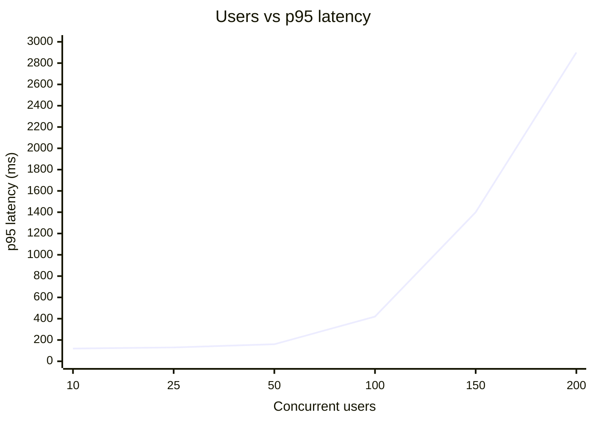

::part[Learn the Concept]{n="1"}

## 🎯 What you'll learn

- Load, stress, spike and soak tests — and what question each answers
- Metrics that matter: **p50/p95/p99 latency**, **RPS**, **error rate**, saturation
- Why **averages lie**
- Writing realistic Locust users: think time, weights, `on_start`, `name=`, `catch_response`
- Running headless with CSV output and turning numbers into **SLO** decisions
- Finding the bottleneck instead of guessing

## 🔤 Key words

| Word | In simple words | Bahasa Indonesia |
|---|---|---|
| **Load test** | Sending many simulated users to see how the system copes | Uji beban |
| **Stress test** | Pushing past the limit to find where it breaks | Uji sampai batas |
| **Soak test** | Running for hours to find slow leaks | Uji jangka panjang |
| **Latency** | How long one request takes | Waktu tanggap |
| **p95 / p99** | The slowest 5% / 1% of requests — what unlucky users feel | Persentil ke-95 / ke-99 |
| **RPS / throughput** | Requests handled per second | Permintaan per detik |
| **Error rate** | The share of requests that failed | Persentase gagal |
| **Bottleneck** | The one limiting part (usually the database) | Titik sempit |
| **SLO** | The target you promise, e.g. "p95 under 300 ms" | Target layanan |
| **Think time** | The pause a real user makes between actions | Jeda antar aksi pengguna |

## 🧠 The big idea

A bridge engineer doesn't wait for rush hour to learn how much weight the bridge can hold. They **load test** it with trucks first, measure how much it bends, and find the weakest beam.

A load test does the same to your API: many simulated users at once, while you watch response times and errors change as the traffic grows.

## ❓ Why it matters

Your API is fast with one user — you, on localhost. With 200 users at once:

- database connections run out,
- one slow query blocks worker processes,
- everything rushes the database when a cache expires,
- memory grows until the container is killed.

None of that shows up in functional tests. Load tests reveal it **before** a campaign, a launch or a payday sale.

Without them:

- A marketing email goes out; the API falls over at 8 a.m.; the team adds more servers and it still falls over, because the real limit was 20 database connections.
- You set Gunicorn to 50 workers "for performance" and exhaust PostgreSQL's `max_connections`.
- A dashboard shows an **average** latency of 80 ms while one user in twenty waits three seconds.

## 📖 Step by step

### 1. Kinds of performance tests

| Test | Shape of traffic | Question |
|---|---|---|
| **Load** | expected peak, steady | "Do we meet our targets at normal peak?" |
| **Stress** | keep increasing | "Where does it break, and how does it fail?" |
| **Spike** | sudden jump | "Do we survive a flash sale / viral post?" |
| **Soak** | normal load for hours | "Memory leaks? Connection leaks?" |

### 2. Metrics

Averages lie the way "average water depth" lies to someone crossing a river: fine on average, drowning in the middle. Always read p95 and p99.

- **Latency percentiles**: p50 = half the requests were faster than this; **p95** = 95% were faster; p99 = the slowest 1% start here.
- **Throughput (RPS)**: requests handled per second.
- **Error rate**: failed requests ÷ total.
- **Saturation**: CPU, memory, DB connections, queue length on the server side.

:::warning[Averages lie]
99 requests take 50 ms and 1 request takes 5,000 ms. Average ≈ 100 ms — looks fine. But that one user waited 5 seconds, and in a page that makes 20 API calls, most page loads hit a slow request. Use **p95/p99**.
:::

### 3. SLOs: define "good enough" first

An **SLO (Service Level Objective)** is a measurable target, e.g.:

> 95% of `GET /jobs` requests finish under 300 ms, and fewer than 1% fail, at 100 concurrent users.

Without a target, a load test result is just numbers.

### 4. A Locust user

```python
from locust import HttpUser, between, task

class JobSeeker(HttpUser):
    wait_time = between(1, 3)            # think time: real people pause

    def on_start(self):                  # once per simulated user
        token = self.client.post("/api/v1/login", json={...}).json()["token"]
        self.headers = {"Authorization": f"Bearer {token}"}

    @task(5)                              # weight: 5× as often as weight-1 tasks
    def browse_jobs(self):
        with self.client.get("/api/v1/jobs", catch_response=True) as response:
            if "data" not in response.json():
                response.failure("200 but error body")   # a "soft" failure

    @task(1)
    def view_job(self):
        job_id = random.randint(1, 50)
        self.client.get(f"/api/v1/jobs/{job_id}", name="/api/v1/jobs/[id]")   # group URLs
```

- **Weights** model the real mix (people browse far more than they buy).
- **`name=`** groups `/jobs/1`, `/jobs/2`, … into one row; otherwise statistics explode into thousands of rows.
- **`catch_response`** lets you fail requests that returned 200 with a wrong body.

### 5. Running it

```bash
# Web UI (charts, live stats)
uv run locust -f locustfile.py --host http://127.0.0.1:5091 --web-port 8191

# Headless, e.g. in CI: 50 users, spawn 5/s, run 2 minutes, write CSV
uv run locust -f locustfile.py --host http://127.0.0.1:5091 \
  --headless -u 50 -r 5 -t 2m --csv results
```

`results_stats.csv` has per-endpoint counts, failures, percentiles and RPS — the exercise parses it.

### 6. Reading a stress test



The **knee** (here between 50 and 100 users) is where some resource saturates. RPS stops growing while latency climbs — requests are waiting in a queue.

### 7. Finding the bottleneck

Measure before you buy: more servers don't help when every one of them queues at the same database. Find the narrow gate first.

Check in this order while the test runs:

1. **App errors & logs** — timeouts? `QueuePool limit ... reached`?
2. **Database** — slow queries (`pg_stat_statements`), missing indexes (`EXPLAIN ANALYZE`, Week 2), N+1 queries (Week 4), lock waits.
3. **Workers** — all Gunicorn workers busy? (lesson 05)
4. **CPU / memory** of app and DB containers (`docker stats`).
5. **External calls** — a payment or LLM API with no timeout holds a worker hostage.

Change **one** thing, re-run the **same** test, compare.

### 8. Test hygiene

- Test a **production-like** environment (same Gunicorn config, PostgreSQL, realistic data volume) — never the Flask dev server.
- Don't load test production or third-party APIs without permission (it looks like an attack and may cost money).
- Use test accounts and seed data; clean up created records.
- Run the load generator on a **different machine** than the app when possible — otherwise they compete for CPU.

### Choosing your setup

Every option here is a trade-off:

| Choice | ✅ | ❌ |
|---|---|---|
| Locust (Python) | code-based scenarios, easy for Python teams, web UI, distributed mode | Python generator uses more CPU per user than k6/Go tools |
| k6 (JavaScript) | very efficient, great CI thresholds | JS scenarios; separate language |
| JMeter | mature, GUI | XML test plans, heavy |
| Realistic think time | real behavior | need more users to reach high RPS |
| No think time | max throughput test | unrealistic concurrency pattern |

- ✅ Before launches, big campaigns, or infrastructure changes (new instance size, pool settings).
- ✅ After performance-sensitive changes (search, checkout, AI endpoints).
- ✅ As a small **smoke load test** in CI with thresholds.
- 🚫 Not a replacement for profiling a single slow request (use `EXPLAIN`, a profiler, tracing).
- 🚫 Don't run it against the dev server and trust the numbers.

## ⚠️ Common mistakes

- Measuring the dev server or a debug build.
- One user type hammering one endpoint with no think time, then calling it "realistic".
- Load generator on the same laptop as app + DB, all fighting for CPU.
- Ignoring errors ("p95 is great!" — because half the requests failed fast).

:::revoshop
RevoShop has a real Locust suite: `locust/locustfile.py` (~300 lines) with a `CustomerJourney` TaskSet. (1) Find the task weights: does the browse/view/cart/checkout mix look realistic? (2) Check it uses `name=` for URLs with ids and `catch_response` — yes, e.g. `name="GET /products/:id (view details)"`. (3) The README runs Locust against `http://127.0.0.1:5000` — the **Flask dev server**. Re-run against the Gunicorn setup (`docker-compose.prod.yml`) and compare p95. (4) Write an SLO for `GET /products` and for checkout, run a 1-minute headless test with `--csv`, and use this lesson's `analyze.py` on the result.
:::

## 🏆 Best practices

- [ ] Write down the **SLO** (p95 latency + error rate at N users) before testing.
- [ ] Model **realistic journeys**: think time, task weights, login once per user, realistic data.
- [ ] Group dynamic URLs with **`name=`**; detect soft failures with **`catch_response`**.
- [ ] Report **percentiles** (p95/p99) and error rate, never only averages.
- [ ] Test a **production-like** stack (Gunicorn, PostgreSQL, same config) with production-like data volume.
- [ ] Ramp up gradually; find the **knee**; monitor server resources during the run.
- [ ] Change **one variable** at a time and keep results (CSV) to compare runs.
- [ ] Keep scenarios in the repo (`locust/`), parameterized by env vars — never hardcode real credentials.
- [ ] Add a short headless run with thresholds to CI or pre-release checks.

::part[Explain & Design]{n="2"}

## 🗣️ Explain it

Explain to a product manager why "average response time is 90 ms" is not enough to promise a good experience during a flash sale. Use percentiles and a concrete example.

## 📐 Design it

CareerPilot plans a campus job-fair day: 2,000 students expected, most arriving within 30 minutes after an announcement. Design the performance test plan: SLOs, user types and weights, test types (load/spike/…), environment, what you'll monitor, and what "pass" means.

:::quiz
Show a possible plan

**SLOs:** `GET /jobs` & `GET /jobs/:id` p95 < 300 ms; `POST /applications` p95 < 800 ms; error rate < 1%; at 400 concurrent users (assume ~20% of 2,000 active at once).

**User types:** `Student` (weight 9): login once → browse (5) → view job (4) → save (1) → apply (0.5, with CV upload skipped or stubbed); `Recruiter` (weight 1): list applicants, update status.

**Tests:** 1) load: ramp to 400 users over 5 min, hold 15 min; 2) **spike**: 0 → 600 users in 1 min (the announcement); 3) short soak: 200 users for 2 h to catch leaks.

**Environment:** staging with the same instance size, Gunicorn config, PostgreSQL with a copy of anonymized production-size data (e.g. 5,000 jobs); Locust on a separate machine (or distributed workers).

**Monitor:** p95/p99 per endpoint, errors, Gunicorn busy workers, DB connections & slow query log, CPU/memory, cache hit rate.

**Pass:** SLOs met during load and within 2 minutes after the spike, no 5xx storm, memory flat during soak. **Fail** → find the bottleneck, fix one thing, re-run.
:::

### 📝 Self-review checklist

- [ ] SLOs are measurable (percentile + threshold + load)
- [ ] User mix and think time are justified
- [ ] Includes spike behavior, not just steady load
- [ ] Server-side monitoring listed

::ai-review{task="design"}

::part[Toy Exercise]{n="3"}

:::exercise{path="exercises/m2/w6/03-locust-performance" ai="ai-allowed" title="A realistic Locust user and a results analyzer"}
Part 1: parse a Locust stats CSV and report SLO violations and the slowest endpoints. Part 2: write a `JobSeeker` user — login once, weighted tasks, grouped names, and detection of "degraded" 200 responses — that the tests run against a real local server.
:::

:::hints
- `csv.DictReader` gives you rows keyed by the header names (`"Request Count"`, `"95%"`).
- Guard against division by zero in `failure_rate`.
- `sorted(stats, key=lambda s: (-s.p95_ms, s.name))` sorts by p95 descending, then name.
- In the locustfile, `self.client.get(url, name="...", catch_response=True)` used as a `with` block; call `response.failure("...")` for bad bodies.
- Weights: `@task(5)`, `@task(3)`, `@task(1)`.
:::

### 🏆 Stretch goal

Add a deliberately slow endpoint to a copy of `target_app.py` (`time.sleep(0.2)`), run 50 users with the web UI, and watch p95 and RPS change as you raise `threaded=False`/`True`. Write down the knee.

## ✅ Quick check

:::quiz
What does "p95 = 400 ms" mean?

95% of requests finished in 400 ms or less; the slowest 5% took longer.
:::

:::quiz
Why use `name=` for URLs with ids?

To group `/jobs/1`, `/jobs/2`, … into one statistics row so percentiles are meaningful and the report stays readable.
:::

:::quiz
RPS stops increasing while latency climbs as you add users. What happened?

The system saturated: a resource (workers, DB connections, CPU, locks, an external API) is at capacity and requests queue up.
:::


## 📚 Keep learning

- [Locust documentation: Writing a locustfile](https://docs.locust.io/en/stable/writing-a-locustfile.html)
- [Locust: Running without the web UI & CSV output](https://docs.locust.io/en/stable/retrieving-stats.html)
- [Google SRE Book — Service Level Objectives](https://sre.google/sre-book/service-level-objectives/)
