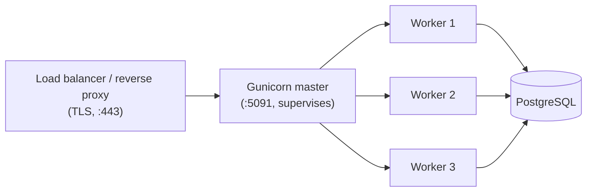
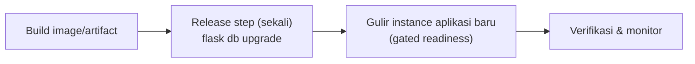

::part[Pelajari Konsepnya]{n="1"}

## 🎯 Yang akan kamu pelajari

- Apa yang production butuhkan yang `flask run` tidak berikan
- **WSGI** dan **Gunicorn**: master, worker, thread, timeout, graceful shutdown
- Menghitung jumlah worker — dan **matematika koneksi database**
- **Reverse proxy / load balancer**, TLS, dan `ProxyFix`
- **Liveness vs readiness** health check
- Migrasi sebagai **release step**, rolling deploy, **rollback**
- Pilihan host: PaaS, VPS, container — dan checklist pre-launch

## 🔤 Istilah penting

| Istilah | Artinya (sederhana) |
|---|---|
| **WSGI** | Standar penghubung antara server dan aplikasi web Python |
| **Gunicorn** | Server production yang menjalankan aplikasi Flask |
| **Worker** | Satu proses yang menangani request; beberapa berjalan bersamaan |
| **Graceful shutdown** | Berhenti setelah selesai melayani request yang sedang berlangsung |
| **Reverse proxy** | Server di depan yang menangani HTTPS dan teruskan request |
| **TLS / HTTPS** | Enkripsi lalu lintas antara user dan server |
| **Liveness check** | Cek "apakah proses masih hidup?" — restart kalau tidak |
| **Readiness check** | Cek "apakah siap melayani traffic sekarang?" — tahan atau teruskan traffic |
| **Release step** | Pekerjaan dilakukan sekali per deploy, seperti migrasi |
| **Rollback** | Kembali ke versi sebelumnya |

## 🧠 Ide besarnya

Laptop mu adalah **dapur rumahan**: satu juru masak, santai, semuanya kamu cek. Production adalah **dapur restoran**:

- beberapa juru masak bekerja bersamaan (**worker**),
- kepala koki yang mengganti juru masak yang pingsan (master **Gunicorn**),
- seorang pelayan di pintu yang urus pelanggan dan keamanan (**reverse proxy**),
- dan inspektur yang menutup stasiun yang tidak siap (**health check**).

Resep yang sama — operasi yang sangat berbeda.

## ❓ Kenapa ini penting

`flask run` menjalankan server **development** Werkzeug: dibuat untuk reload dan debugging, bukan untuk banyak user, koneksi lambat, crash, atau keamanan. Production butuh

- beberapa proses, untuk pakai semua CPU dan selamat kalau satu crash,
- timeout, jadi satu request yang macet tidak menghalangi selamanya,
- restart yang halus, jadi deploy tidak hilang request,
- TLS, kompresi dan batas ukuran request,
- dan cara platform tahu apakah aplikasi sehat.

Tanpa itu:

- `app.run(debug=True)` di production → debugger interaktif adalah lubang eksekusi kode jarak jauh.
- Satu proses menangani satu request lambat sekaligus, sisanya tunggu.
- Sepuluh container semua jalankan `flask db upgrade` saat startup → migrasi balapan atau kunci tabel.
- Load balancer kirim traffic ke container yang koneksi database belum siap → ledakan 500 setiap deploy.

## 📖 Langkah demi langkah

### 1. WSGI: kontrak antara server dan aplikasi

**WSGI** adalah standar Python: server memanggil aplikasi kamu sebagai fungsi dengan lingkungan request dan dapat response balik. Flask **adalah** aplikasi WSGI; Gunicorn, uWSGI dan Waitress adalah **server** WSGI.

```python
# wsgi.py — the entry point the server imports
from app import create_app

app = create_app()
```

```bash
gunicorn -c gunicorn.conf.py wsgi:app      # module:variable
```

:::fastapi
FastAPI adalah aplikasi **ASGI** (async). Kamu layani dengan **Uvicorn** — langsung (`uvicorn main:app --workers 4`) atau Gunicorn yang urus Uvicorn worker. Ide yang sama: worker, timeout, graceful shutdown, health check.
:::

### 2. Arsitektur Gunicorn



- **Master** ikat port, mulai worker, restart yang mati, tangani signal.
- Setiap **worker** adalah proses terpisah dengan salinan aplikasi sendiri dan **pool koneksi DB** sendiri.
- `SIGTERM` → berhenti terima koneksi baru, selesai request yang sedang berjalan (sampai `graceful_timeout`), keluar.

### 3. Konfigurasi dari environment

```python
# gunicorn.conf.py
import multiprocessing, os

bind = f"0.0.0.0:{os.environ.get('PORT', '5091')}"
workers = int(os.environ.get("WEB_CONCURRENCY", min(multiprocessing.cpu_count() * 2 + 1, 8)))
threads = int(os.environ.get("GUNICORN_THREADS", "1"))
worker_class = "gthread" if threads > 1 else "sync"
timeout = 30               # kill a worker silent for 30 s
graceful_timeout = 30
max_requests = 1000        # recycle workers to contain memory leaks
max_requests_jitter = 100
accesslog = errorlog = "-" # stdout/stderr, collected by the platform
```

Gunicorn baca `WEB_CONCURRENCY` menurut konvensi, dan banyak platform aturnya untuk kamu.

### 4. Tipe worker dan penghitungan

Lakukan hitung koneksi sebelum pilih jumlah: worker × pool size × container harus di bawah batas database. Lebih banyak juru masak tidak membantu kalau pintu pantry hanya muat dua puluh orang.

| Tipe worker | Bagus untuk | Catatan |
|---|---|---|
| `sync` (default) | API yang ringan CPU, sederhana & bisa diprediksi | 1 request per proses |
| `gthread` | API yang terikat I/O (DB, HTTP call) | thread per worker bagikan memori |
| `gevent` | banyak koneksi I/O lambat | monkey-patching; kompatibilitas library |
| Uvicorn worker | ASGI app (FastAPI) | async end-to-end |

**Awal**: `(2 × CPU) + 1` worker — lalu **load test** (materi 03) dan sesuaikan.

:::warning[Matematika koneksi]
Setiap worker (× thread) bisa pegang koneksi DB. Dengan pool bawaan SQLAlchemy dari **5 + 10 overflow**:
3 container × 5 worker × 15 koneksi = **225** koneksi mungkin — tapi PostgreSQL terkelola kecil mungkin hanya ~100. Atur `pool_size`, worker dan replika bersama-sama, atau pasang **PgBouncer** di depan database.
:::

### 5. Reverse proxy, TLS dan header terpercaya

Di production, client bicara ke **reverse proxy** atau **load balancer** (Nginx, Caddy, AWS ALB, platform router). Dia hentikan **TLS**, buffer client lambat dan teruskan HTTP biasa ke Gunicorn.

Aplikasi kamu lihat IP proxy dan `http`. Proxy tambah `X-Forwarded-For` / `X-Forwarded-Proto`; bilang Flask percayai mereka — **hanya** saat proxy sungguhan di depan:

```python
from werkzeug.middleware.proxy_fix import ProxyFix
app.wsgi_app = ProxyFix(app.wsgi_app, x_for=1, x_proto=1, x_host=1)   # 1 = one proxy hop
```

Tanpa proxy, percaya header ini biarkan siapa pun spoof IP mereka (patahkan rate limit dan audit log).

### 6. Health check: liveness vs readiness

| Cek | Pertanyaan | Cek dependency? | Kalau gagal… |
|---|---|---|---|
| **Liveness** `/health/live` | "Apakah proses hidup dan tidak macet?" | ❌ tidak | platform **restart** container |
| **Readiness** `/health/ready` | "Apakah siap melayani traffic sekarang?" | ✅ DB (cepat `SELECT 1`) | load balancer **berhenti kirim traffic** sampai pulih |

Kenapa pisah? Kalau liveness cek database, blip database 30 detik akan restart **setiap** container sekaligus — ubah outage kecil jadi besar. Endpoint health: cepat, tidak butuh autentikasi, tidak ada detail sensitif, `Cache-Control: no-store`.

### 7. Migrasi: release step, bukan startup step

Atur dapur sekali, sebelum shift mulai — bukan setiap juru masak saat tiba.



- Jalankan migrasi **sekali per deploy** (job CI, task sekali jalan, platform "pre-deploy command").
- Buat migrasi **backward-compatible** (expand → migrate → contract, Week 4) karena versi aplikasi lama dan baru jalan bersamaan saat rolling deploy.

### 8. Strategi deploy & rollback

| Strategi | Cara | ✅ | ❌ |
|---|---|---|---|
| Recreate | stop lama, mulai baru | sederhana | downtime |
| **Rolling** | ganti instance secara bertahap, gated readiness | tidak ada downtime, default di kebanyakan platform | dua versi hidup singkat |
| Blue-green | lingkungan baru penuh, switch traffic | instant rollback | double resource |
| Canary | kirim 5% traffic ke versi baru dulu | batasi ledakan | butuh metrik bagus |

**Rencana rollback:** redeploy image/commit sebelumnya (jaga artifact terversi, misal tag image = git SHA). Rollback database sulit — makanya migrasi backward-compatible.

### 9. Di mana host

| Pilihan | Contoh | ✅ | ❌ |
|---|---|---|---|
| **PaaS** | Render, Railway, Fly.io, Koyeb, Heroku | push-to-deploy, TLS, log sudah ada | kurang kontrol; free tier terbatas dan berubah (instance tidur, database kadaluarsa) |
| **Container di cloud** | AWS App Runner / ECS, Google Cloud Run | skalabel, standar industri | lebih banyak konsep, manajemen biaya (Module 5) |
| **VPS** | Linux VM dengan Docker + Caddy/Nginx | murah, kontrol penuh, belajar bagus | kamu patch, aman, backup dan monitor semuanya |
| **Kubernetes** | EKS, GKE | orkestrasi powerful | berat untuk tim kecil (konsep Module 5) |

Untuk proyek portfolio: PaaS atau VPS kecil dengan Docker sudah cukup. Selalu cek batas free-tier **sekarang** sebelum pilih.

### 10. Checklist pre-launch

- [ ] `DEBUG` mati, production config, secret kuat dari environment (materi 04)
- [ ] Gunicorn (bukan `flask run`), worker/timeout bijak
- [ ] HTTPS lewat proxy/platform; `ProxyFix` hanya kalau ada proxy
- [ ] Migrasi jalan sebagai release step
- [ ] Endpoint liveness + readiness terwiring ke platform
- [ ] Log ke stdout (materi 08), error tracking (misal Sentry)
- [ ] Backup database on dan restore **diuji**
- [ ] CORS terbatas ke origin frontend; batas ukuran request
- [ ] Langkah rollback ditulis

### Pilih setup-mu

Setiap pilihan di sini adalah trade-off:

| Pilihan | ✅ | ❌ |
|---|---|---|
| Lebih banyak worker | lebih banyak request bersamaan | lebih banyak memori, lebih banyak koneksi DB |
| Thread (`gthread`) | concurrency lebih murah untuk I/O | shared state harus thread-safe |
| `timeout` panjang | laporan lambat berhasil | worker macet blok kapasitas lebih lama — pindah pekerjaan lambat ke background job |
| Migrasi saat container start | sederhana | balapan dengan replika banyak; start lambat |
| PaaS | jalan paling cepat | batas & harga platform |

- ✅ Gunicorn (atau server production lain) untuk **setiap** lingkungan deploy, termasuk staging.
- ✅ Readiness check setiap kali load balancer atau orchestrator rute traffic.
- 🚫 Jangan pakai `flask run` / `app.run()` di luar laptop.
- 🚫 Jangan buat liveness bergantung pada service eksternal.
- 🚫 Jangan buat pekerjaan panjang (kirim 1.000 email, LLM batch job) dalam request — pakai queue/worker (Module 5).

## ⚠️ Kesalahan umum

- Ikat ke `127.0.0.1` dalam container (tidak bisa dijangkau dari luar) daripada `0.0.0.0`.
- Hardcode port saat platform sediakan `PORT`.
- Config yang ada di `docker-compose` tapi command abaikan.
- Health check yang return 200 walaupun database turun — atau yang restart semuanya saat database turun.

:::revoshop
Lihat file deploy RevoShop: (1) `Procfile` jalankan `gunicorn run:application` tanpa atur `FLASK_ENV`, dan `create_app` default ke `'development'` — config apa (DEBUG? SQL echo?) yang PaaS deploy pakai? (2) `docker-compose.prod.yml` atur `GUNICORN_WORKERS`, tapi Dockerfile `CMD` hardcode `--workers 3`. Apakah variabel dapat pengaruh? (3) `docker/entrypoint.sh` jalankan `flask db upgrade` setiap container menyala — apa yang terjadi dengan 3 replika? (4) `/api/v1/health` cek database dan return 503 saat turun: apakah liveness atau readiness check, dan endpoint liveness terpisah seperti apa? (5) Tulis `gunicorn.conf.py` untuk RevoShop pakai materi latihan ini.
:::

## 🏆 Praktik terbaik

- [ ] Layani dengan **Gunicorn** lewat entry point `wsgi.py`; atur di `gunicorn.conf.py` didorong oleh **env var**.
- [ ] Mulai dengan `(2 × CPU) + 1` worker, lalu **load test**; jaga **total koneksi DB** di bawah batas database.
- [ ] Set `timeout`, `graceful_timeout`, `max_requests` + jitter; log ke **stdout/stderr**.
- [ ] Hentikan **TLS** di proxy/load balancer; pakai `ProxyFix` dengan jumlah hop terpercaya yang tepat.
- [ ] Pisah **liveness** (tidak ada dependency) dan **readiness** (cek dependency cepat), tanpa autentikasi dan tidak di-cache.
- [ ] Jalankan **migrasi sekali per rilis**; jaga backward-compatible untuk rolling deploy.
- [ ] Deploy **artifact immutable, terversi** (tag image = git SHA); jaga **rollback** terdokumentasi.
- [ ] Aktifkan **backup** dan praktik restore; tambah error tracking dan monitoring uptime.
- [ ] Otomatisasi deploy dari CI setelah test lulus (materi 07); tidak ada `scp` manual ke server.

::part[Jelaskan & Rancang]{n="2"}

## 🗣️ Jelaskan

Jelaskan ke rekan kerja kenapa health check yang restart container **tidak boleh** cek database, pakai timeline outage konkret (database tidak tersedia 45 detik).

## 📐 Rancang

Rancang deployment production pertama CareerPilot di PaaS atau VPS kecil: gambar request path (browser → … → PostgreSQL), spesifik setting Gunicorn dan alasannya, health check dan bagaimana platform pakainya, release step (termasuk migrasi), budget koneksi (database max 50 koneksi), dan rencana rollback.

:::quiz
Lihat contoh rancangan

**Request path:** Browser → HTTPS → platform router / Caddy (TLS, gzip, 10 MB body limit) → Gunicorn `:5091` dalam container (2 replika) → PostgreSQL terkelola (max 50 koneksi).

**Gunicorn:** 1 vCPU per replika → `WEB_CONCURRENCY=3`, `gthread` dengan `GUNICORN_THREADS=2` (API terikat I/O), `timeout=30`, `graceful_timeout=30`, `max_requests=1000±100`, log ke stdout. `ProxyFix(x_for=1, x_proto=1)` karena persis satu router di depan.

**Budget koneksi:** 2 replika × 3 worker × pool (`pool_size=3`, `max_overflow=2` → 5) = **30** koneksi aplikasi + migrasi/admin (5) ≤ 50 ✅. Naikkan replika ke 4 butuh PgBouncer atau pool lebih kecil.

**Health:** `/health/live` → container restart policy; `/health/ready` (`SELECT 1`, 2 s timeout) → router hanya kirim traffic ke instance siap; instance baru harus siap sebelum lama berhenti (rolling).

**Release:** CI test lulus → build image tag dengan git SHA → jalankan `flask db upgrade` sekali sebagai pre-deploy job (migrasi backward-compatible) → rolling deploy → smoke test `GET /health/ready` dan satu endpoint asli → catat error rate 10 menit.

**Rollback:** redeploy tag image sebelumnya (satu perintah/tombol); migrasi expand-only jadi versi lama masih kerja dengan schema baru; restore database dari backup hanya terakhir sekali.
:::

### 📝 Checklist review mandiri

- [ ] Matematika koneksi sesuai
- [ ] Liveness dan readiness terpisah, tanggung jawab benar
- [ ] Migrasi jalan sekali, kompatibel dengan rolling deploy
- [ ] Rollback tidak bergantung balik database

::ai-review{task="design"}

::part[Latihan Kecil]{n="3"}

:::exercise{path="exercises/m2/w6/05-deploy-flask" ai="no-ai" title="Gunicorn config, health check dan jalankan server asli"}
Tulis endpoint liveness dan readiness, `gunicorn.conf.py` didorong environment dan entry point `wsgi.py`. Test cek nilai config, simulasi outage database, verifikasi perilaku `ProxyFix`, lalu mulai Gunicorn asli dengan dua worker, panggil lewat HTTP dan hentikan dengan halus.
:::

:::hints
- `runpy.run_path("gunicorn.conf.py")` adalah cara test baca config — ini hanya modul Python variable.
- `os.environ.get("PORT", "5091")` return string; konversi saat perlu.
- Readiness: `db.session.execute(text("SELECT 1"))` dalam `try/except Exception`, lalu `logger.exception(...)` dan `db.session.rollback()`.
- Return `(json, status, headers)` dari Flask view untuk atur `Cache-Control`.
:::

### 🏆 Tantangan lebih jauh

Mulai Gunicorn dengan `WEB_CONCURRENCY=1` dan route yang tidur 2 detik. Pukul dengan 5 `curl` panggilan bersamaan dan waktu mereka. Lalu coba `WEB_CONCURRENCY=5` dan `GUNICORN_THREADS=4`. Jelaskan perbedaannya.

## ✅ Cek cepat

:::quiz
Apa bedanya Gunicorn master dan worker?

Master ikat socket dan supervisi (mulai, restart, signal) proses worker; worker sungguh-sungguh jalankan aplikasi dan tangani request.
:::

:::quiz
Kenapa tidak setiap container jalankan `flask db upgrade` saat startup?

Replika banyak akan jalankan migrasi bersamaan (balapan/kunci), start jadi lebih lambat, dan migrasi gagal crash setiap instance. Jalankan migrasi sekali per rilis sebagai langkah terpisah.
:::

:::quiz
Kapan pakai `ProxyFix`?

Hanya saat aplikasi di balik trusted reverse proxy, dengan jumlah hop yang tepat — kalau tidak, client bisa spoof header `X-Forwarded-*`.
:::

## 📚 Lanjut belajar

- [Flask: Deploying to Production](https://flask.palletsprojects.com/en/stable/deploying/)
- [Gunicorn: Design (master & worker)](https://docs.gunicorn.org/en/stable/design.html)
- [Gunicorn: Settings](https://docs.gunicorn.org/en/stable/settings.html)
- [Kubernetes: Liveness, Readiness and Startup Probes](https://kubernetes.io/docs/concepts/configuration/liveness-readiness-startup-probes/)
