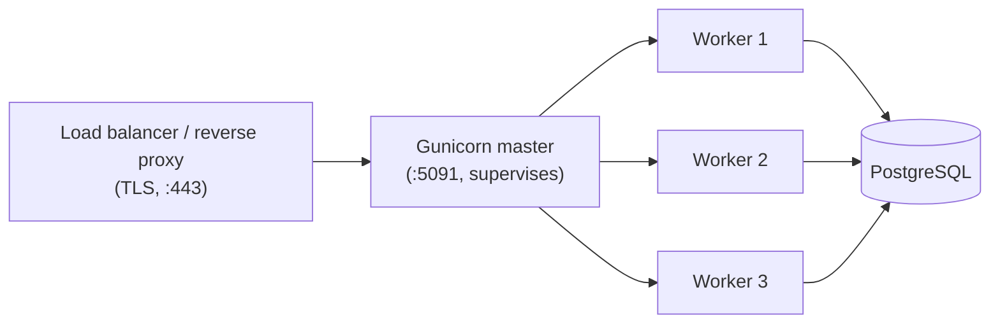
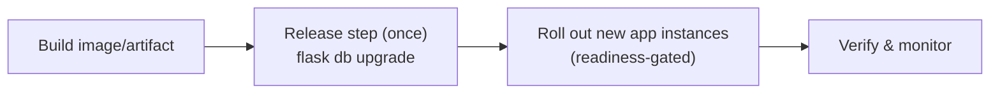

::part[Learn the Concept]{n="1"}

## 🎯 What you'll learn

- What "production" needs that `flask run` doesn't give you
- **WSGI** and **Gunicorn**: master, workers, threads, timeouts, graceful shutdown
- Sizing workers — and the **database connection math**
- **Reverse proxy / load balancer**, TLS, and `ProxyFix`
- **Liveness vs readiness** health checks
- Migrations as a **release step**, rolling deploys, **rollback**
- Hosting options: PaaS, VPS, containers — and a deploy checklist

## 🔤 Key words

| Word | In simple words | Bahasa Indonesia |
|---|---|---|
| **WSGI** | The agreement that lets any Python web app run on any Python web server | Standar penghubung server–aplikasi |
| **Gunicorn** | The production server that runs your Flask app | Server production Python |
| **Worker** | One process handling requests; several run in parallel | Proses pekerja |
| **Graceful shutdown** | Finishing current requests before stopping | Berhenti setelah selesai melayani |
| **Reverse proxy** | The server in front that handles HTTPS and forwards requests | Perantara di depan aplikasi |
| **TLS / HTTPS** | Encrypting traffic between user and server | Enkripsi lalu lintas |
| **Liveness check** | "Is the process alive?" — restart it if not | Cek proses hidup |
| **Readiness check** | "Can it serve traffic now?" — send or hold traffic | Cek siap melayani |
| **Release step** | Work done once per deploy, like migrations | Langkah sekali per rilis |
| **Rollback** | Going back to the previous version | Kembali ke versi lama |

## 🧠 The big idea

Your laptop is the **home kitchen**: one cook, no rush, you taste everything. Production is a **restaurant kitchen**:

- several cooks working in parallel (**workers**),
- a head chef who replaces a cook who faints (the **Gunicorn master**),
- a waiter at the door handling customers and security (**reverse proxy**),
- and an inspector who closes a station that isn't ready (**health checks**).

Same recipes — a very different operation.

## ❓ Why it matters

`flask run` starts Werkzeug's **development server**: built for reloading and debugging, not for many users, slow connections, crashes or security. Production needs

- several processes, to use all CPUs and survive one crashing,
- timeouts, so one stuck request doesn't block forever,
- graceful restarts, so deploys don't drop requests,
- TLS, compression and request size limits,
- and a way for the platform to know whether the app is healthy.

Without those:

- `app.run(debug=True)` in production → the interactive debugger is a remote-code-execution hole.
- A single process handles one slow request at a time, and everyone else waits.
- Ten containers all run `flask db upgrade` at startup at once → migrations race or lock the table.
- The load balancer sends traffic to a container whose database connection isn't ready → a burst of 500s on every deploy.

## 📖 Step by step

### 1. WSGI: the contract between server and app

**WSGI** is a Python standard: a server calls your app as a function with the request environment and gets a response back. Flask **is** a WSGI app; Gunicorn, uWSGI and Waitress are WSGI **servers**.

```python
# wsgi.py — the entry point the server imports
from app import create_app

app = create_app()
```

```bash
gunicorn -c gunicorn.conf.py wsgi:app      # module:variable
```

:::fastapi
FastAPI is an **ASGI** app (async). You serve it with **Uvicorn** — directly (`uvicorn main:app --workers 4`) or with Gunicorn managing Uvicorn workers. Same ideas: workers, timeouts, graceful shutdown, health checks.
:::

### 2. Gunicorn's architecture



- The **master** binds the port, starts workers, restarts dead ones, handles signals.
- Each **worker** is a separate process with its own copy of the app and its own **DB connection pool**.
- `SIGTERM` → stop accepting new connections, finish in-flight requests (up to `graceful_timeout`), exit.

### 3. Configuration from the environment

```python
# gunicorn.conf.py
import multiprocessing, os

bind = f"0.0.0.0:{os.environ.get('PORT', '5091')}"
workers = int(os.environ.get("WEB_CONCURRENCY", min(multiprocessing.cpu_count() * 2 + 1, 8)))
threads = int(os.environ.get("GUNICORN_THREADS", "1"))
worker_class = "gthread" if threads > 1 else "sync"
timeout = 30               # kill a worker silent for 30 s
graceful_timeout = 30
max_requests = 1000        # recycle workers to contain memory leaks
max_requests_jitter = 100
accesslog = errorlog = "-" # stdout/stderr, collected by the platform
```

Gunicorn reads `WEB_CONCURRENCY` by convention, and many platforms set it for you.

### 4. Worker types and sizing

Do the connection maths before choosing a number: workers × pool size × containers must stay below the database's limit. More cooks don't help if the pantry door only fits twenty people.

| Worker class | Good for | Note |
|---|---|---|
| `sync` (default) | CPU-light APIs, simple & predictable | 1 request per process |
| `gthread` | I/O-bound APIs (DB, HTTP calls) | threads per worker share memory |
| `gevent` | many slow I/O connections | monkey-patching; library compatibility |
| Uvicorn workers | ASGI apps (FastAPI) | async end-to-end |

**Starting point**: `(2 × CPU) + 1` workers — then **load test** (lesson 03) and adjust.

:::warning[Connection math]
Every worker (× thread) can hold DB connections. With SQLAlchemy's default pool of **5 + 10 overflow**:
3 containers × 5 workers × 15 connections = **225** possible connections — but a small managed PostgreSQL may allow only ~100. Size `pool_size`, workers and replicas together, or put **PgBouncer** in front of the database.
:::

### 5. Reverse proxy, TLS and trusted headers

In production, clients talk to a **reverse proxy** or **load balancer** (Nginx, Caddy, AWS ALB, a platform router). It terminates **TLS**, buffers slow clients and forwards plain HTTP to Gunicorn.

Your app then sees the proxy's IP and `http`. The proxy adds `X-Forwarded-For` / `X-Forwarded-Proto`; tell Flask to trust them — **only** when a proxy is really in front:

```python
from werkzeug.middleware.proxy_fix import ProxyFix
app.wsgi_app = ProxyFix(app.wsgi_app, x_for=1, x_proto=1, x_host=1)   # 1 = one proxy hop
```

Without a proxy, trusting these headers lets anyone spoof their IP (breaking rate limits and audit logs).

### 6. Health checks: liveness vs readiness

| Check | Question | Checks dependencies? | If it fails… |
|---|---|---|---|
| **Liveness** `/health/live` | "Is the process alive and not stuck?" | ❌ no | platform **restarts** the container |
| **Readiness** `/health/ready` | "Can it serve traffic now?" | ✅ DB (fast `SELECT 1`) | load balancer **stops sending traffic** until it recovers |

Why separate? If liveness checked the database, a 30-second database blip would restart **every** container at once — turning a small outage into a big one. Health endpoints: fast, unauthenticated, no sensitive details, `Cache-Control: no-store`.

### 7. Migrations: a release step, not a startup step

Rearrange the kitchen once, before the shift starts — not by every cook as they arrive.



- Run migrations **once per deploy** (a CI job, a one-off task, a platform "pre-deploy command").
- Make migrations **backward-compatible** (expand → migrate → contract, Week 4) because old and new app versions run side by side during a rolling deploy.

### 8. Deploy strategies & rollback

| Strategy | How | ✅ | ❌ |
|---|---|---|---|
| Recreate | stop old, start new | simple | downtime |
| **Rolling** | replace instances gradually, gated by readiness | no downtime, default on most platforms | two versions live briefly |
| Blue-green | full new environment, switch traffic | instant rollback | double resources |
| Canary | send 5% of traffic to new version first | limits blast radius | needs good metrics |

**Rollback plan:** redeploy the previous image/commit (keep artifacts versioned, e.g. image tag = git SHA). Database rollbacks are hard — hence backward-compatible migrations.

### 9. Where to host

| Option | Examples | ✅ | ❌ |
|---|---|---|---|
| **PaaS** | Render, Railway, Fly.io, Koyeb, Heroku | push-to-deploy, TLS, logs included | less control; free tiers are limited and change often (sleeping instances, expiring databases) |
| **Containers on a cloud** | AWS App Runner / ECS, Google Cloud Run | scalable, industry standard | more concepts, cost management (Module 5) |
| **VPS** | a Linux VM with Docker + Caddy/Nginx | cheap, full control, great learning | you patch, secure, back up and monitor everything |
| **Kubernetes** | EKS, GKE | powerful orchestration | heavy for small teams (Module 5 concepts) |

For a portfolio project: a PaaS or a small VPS with Docker is enough. Always check the **current** free-tier limits before choosing.

### 10. The pre-launch checklist

- [ ] `DEBUG` off, production config, strong secrets from the environment (lesson 04)
- [ ] Gunicorn (not `flask run`), sensible workers/timeouts
- [ ] HTTPS via proxy/platform; `ProxyFix` only if behind a proxy
- [ ] Migrations run as a release step
- [ ] Liveness + readiness endpoints wired into the platform
- [ ] Logs to stdout (lesson 08), error tracking (e.g. Sentry)
- [ ] Database backups enabled and a restore **tested**
- [ ] CORS limited to your frontend origin(s); request size limits
- [ ] Rollback steps written down

### Choosing your setup

Every option here is a trade-off:

| Choice | ✅ | ❌ |
|---|---|---|
| More workers | more parallel requests | more memory, more DB connections |
| Threads (`gthread`) | cheaper concurrency for I/O | shared state must be thread-safe |
| Long `timeout` | slow reports succeed | stuck workers block capacity longer — move slow work to background jobs instead |
| Migrations at container start | simple | races with multiple replicas; slow starts |
| PaaS | fastest path to live | platform limits & pricing |

- ✅ Gunicorn (or another production server) for **every** deployed environment, including staging.
- ✅ Readiness checks whenever a load balancer or orchestrator routes traffic.
- 🚫 Don't use `flask run` / `app.run()` outside your laptop.
- 🚫 Don't make liveness depend on external services.
- 🚫 Don't do long work (sending 1,000 emails, LLM batch jobs) inside a request — use a queue/worker (Module 5).

## ⚠️ Common mistakes

- Binding to `127.0.0.1` inside a container (unreachable from outside) instead of `0.0.0.0`.
- Hardcoding the port while the platform provides `PORT`.
- Config that exists in `docker-compose` but the command ignores it.
- A health check that returns 200 even when the database is down — or one that restarts everything when it is.

:::revoshop
Look at RevoShop's deployment files: (1) The `Procfile` runs `gunicorn run:application` without setting `FLASK_ENV`, and `create_app` defaults to `'development'` — which config (DEBUG? SQL echo?) would a PaaS deploy use? (2) `docker-compose.prod.yml` sets `GUNICORN_WORKERS`, but the Dockerfile `CMD` hardcodes `--workers 3`. Does the variable do anything? (3) `docker/entrypoint.sh` runs `flask db upgrade` every time a container starts — what happens with 3 replicas? (4) `/api/v1/health` checks the database and returns 503 when it's down: is it a liveness or readiness check, and what would a separate liveness endpoint look like? (5) Write a `gunicorn.conf.py` for RevoShop using this lesson's exercise.
:::

## 🏆 Best practices

- [ ] Serve with **Gunicorn** via a `wsgi.py` entry point; configure it in `gunicorn.conf.py` driven by **env vars**.
- [ ] Start with `(2 × CPU) + 1` workers, then **load test**; keep **total DB connections** under the database limit.
- [ ] Set `timeout`, `graceful_timeout`, `max_requests` + jitter; log to **stdout/stderr**.
- [ ] Terminate **TLS** at a proxy/load balancer; use `ProxyFix` with the exact number of trusted hops.
- [ ] Separate **liveness** (no dependencies) and **readiness** (fast dependency checks), unauthenticated and non-cached.
- [ ] Run **migrations once per release**; keep them backward-compatible for rolling deploys.
- [ ] Deploy **immutable, versioned artifacts** (image tag = git SHA); keep a documented **rollback**.
- [ ] Enable **backups** and practice a restore; add error tracking and uptime monitoring.
- [ ] Automate deploys from CI after tests pass (lesson 07); no manual `scp` to servers.

::part[Explain & Design]{n="2"}

## 🗣️ Explain it

Explain to a teammate why the health check that restarts containers should **not** check the database, using a concrete outage timeline (the database is unavailable for 45 seconds).

## 📐 Design it

Design CareerPilot's first production deployment on a PaaS or small VPS: draw the request path (browser → … → PostgreSQL), specify the Gunicorn settings and why, the health checks and how the platform uses them, the release steps (including migrations), the connection budget (database max 50 connections), and the rollback plan.

:::quiz
Show a possible design

**Request path:** Browser → HTTPS → platform router / Caddy (TLS, gzip, 10 MB body limit) → Gunicorn `:5091` in a container (2 replicas) → managed PostgreSQL (max 50 connections).

**Gunicorn:** 1 vCPU per replica → `WEB_CONCURRENCY=3`, `gthread` with `GUNICORN_THREADS=2` (I/O-bound API), `timeout=30`, `graceful_timeout=30`, `max_requests=1000±100`, logs to stdout. `ProxyFix(x_for=1, x_proto=1)` because exactly one router is in front.

**Connection budget:** 2 replicas × 3 workers × pool (`pool_size=3`, `max_overflow=2` → 5) = **30** app connections + migrations/admin (5) ≤ 50 ✅. Raising replicas to 4 would need PgBouncer or a smaller pool.

**Health:** `/health/live` → container restart policy; `/health/ready` (`SELECT 1`, 2 s timeout) → router only sends traffic to ready instances; new instances must be ready before old ones stop (rolling).

**Release:** CI tests pass → build image tagged with git SHA → run `flask db upgrade` once as a pre-deploy job (backward-compatible migrations) → rolling deploy → smoke test `GET /health/ready` and one real endpoint → watch error rate for 10 minutes.

**Rollback:** redeploy the previous image tag (one command/button); migrations are expand-only, so the old version still works with the new schema; database restores from backup only as a last resort.
:::

### 📝 Self-review checklist

- [ ] Connection math adds up
- [ ] Liveness and readiness are separate, with correct responsibilities
- [ ] Migrations run once, and are compatible with a rolling deploy
- [ ] Rollback doesn't depend on reversing the database

::ai-review{task="design"}

::part[Toy Exercise]{n="3"}

:::exercise{path="exercises/m2/w6/05-deploy-flask" ai="no-ai" title="Gunicorn config, health checks and a real server run"}
Write the liveness and readiness endpoints, an environment-driven `gunicorn.conf.py` and the `wsgi.py` entry point. The tests check your config values, simulate a database outage, verify `ProxyFix` behavior, then start a real Gunicorn with two workers, call it over HTTP and shut it down gracefully.
:::

:::hints
- `runpy.run_path("gunicorn.conf.py")` is how the test reads your config — it's just Python module variables.
- `os.environ.get("PORT", "5091")` returns a string; convert where needed.
- Readiness: `db.session.execute(text("SELECT 1"))` inside `try/except Exception`, then `logger.exception(...)` and `db.session.rollback()`.
- Return `(json, status, headers)` from a Flask view to set `Cache-Control`.
:::

### 🏆 Stretch goal

Start your Gunicorn with `WEB_CONCURRENCY=1` and a route that sleeps 2 seconds. Hit it with 5 parallel `curl` calls and time them. Then try `WEB_CONCURRENCY=5` and `GUNICORN_THREADS=4`. Explain the difference.

## ✅ Quick check

:::quiz
What's the difference between a Gunicorn master and a worker?

The master binds the socket and supervises (starts, restarts, signals) worker processes; workers actually run the app and handle requests.
:::

:::quiz
Why shouldn't every container run `flask db upgrade` at startup?

Multiple replicas would run migrations concurrently (races/locks), starts get slower, and a failed migration crashes every instance. Run migrations once per release as a separate step.
:::

:::quiz
When should you use `ProxyFix`?

Only when the app is behind trusted reverse proxies, with the exact number of hops — otherwise clients can spoof `X-Forwarded-*` headers.
:::


## 📚 Keep learning

- [Flask: Deploying to Production](https://flask.palletsprojects.com/en/stable/deploying/)
- [Gunicorn: Design (master & workers)](https://docs.gunicorn.org/en/stable/design.html)
- [Gunicorn: Settings](https://docs.gunicorn.org/en/stable/settings.html)
- [Kubernetes: Liveness, Readiness and Startup Probes](https://kubernetes.io/docs/concepts/configuration/liveness-readiness-startup-probes/)
