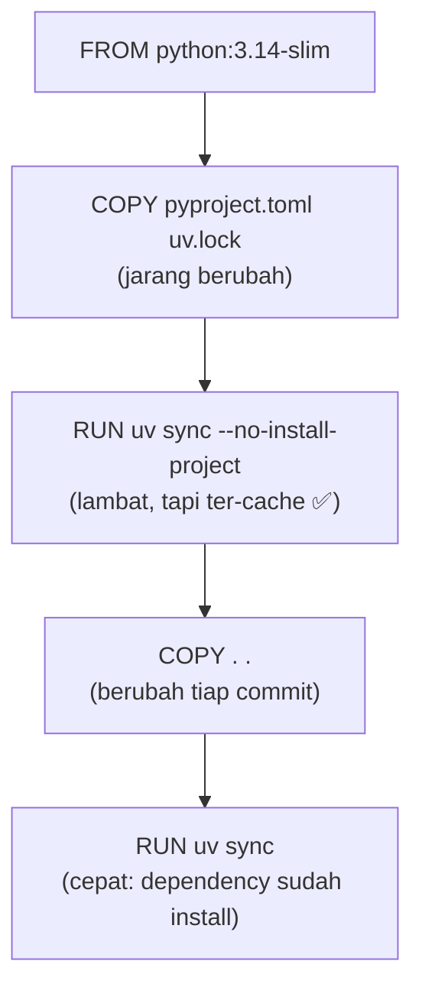

::part[Pelajari Konsepnya]{n="1"}

## 🎯 Yang akan kamu pelajari

- Kenapa image production berbeda dengan image "asal jalan"
- **Layer cache**: atur instruksi supaya rebuild hanya butuh beberapa detik
- **Multi-stage build** dengan **uv**: alat build tidak masuk ke image final
- Keamanan: **pengguna non-root**, base yang dikunci versi, tanpa secret di layer, `.dockerignore`, scanning image
- `HEALTHCHECK`, **exec-form** `CMD`, signal dan PID 1
- Stack **Compose** yang mirip production dengan secret yang wajib dan startup berdasarkan health

Pelajaran ini melanjutkan Docker dasar dari Module 2 Week 1 — buka lagi kalau `FROM`, `COPY` dan `docker compose up` masih samar-samar.

## 🔤 Istilah penting

| Istilah | Artinya (sederhana) |
|---|---|
| **Layer cache** | Docker memakai ulang langkah build yang tidak berubah |
| **Build context** | Berkas yang dikirim ke Docker saat build |
| **Multi-stage build** | Build bertahap, hanya copy hasil ke image final |
| **Base image** | Image awal (`python:3.12-slim`) |
| **Non-root user** | Jalankan app tanpa hak admin di container |
| **`.dockerignore`** | Daftar file yang dikeluarkan dari build |
| **Exec form `CMD`** | `CMD ["gunicorn", …]` — tanpa shell, sinyal sampai ke app |
| **PID 1** | Proses pertama di container; ia menerima sinyal henti |
| **`HEALTHCHECK`** | Perintah Docker untuk cek apakah container sehat |

## 🧠 Ide besarnya

Container image itu seperti **kotak bekal untuk app-mu**. Pemula memakai seluruh dapur: pisau, terigu, catatan resep, dan kunci rumah di lid. Profesional hanya memaak makanan jadi — tertutup, berlabel, tidak ada yang berbahaya di dalamnya.

**Tahap builder** adalah dapurnya; **tahap runtime** adalah kotak bekalnya.

## ❓ Kenapa ini penting

- **Artifact yang sama di mana saja**: image yang kamu test di CI persis sama dengan yang jalan di production.
- **Deploy cepat** butuh image kecil dan build yang ter-cache.
- **Keamanan**: paket lebih sedikit = lubang keamanan lebih sedikit, dan pengguna non-root membatasi kerusakan kalau app di-exploit.
- Setiap platform modern (ECS, Cloud Run, Kubernetes, Render, Fly.io) jalankan image.

Ini contoh yang ceroboh:

```dockerfile
FROM python:latest
COPY . .
RUN pip install flask flask-sqlalchemy "psycopg[binary]" gunicorn
ENV JWT_SECRET_KEY=super-secret-key-change-in-production
CMD flask --app wsgi run --host 0.0.0.0
```

Image yang base-nya berubah tanpa peringatan, rebuild setiap dependency tiap kode berubah, secret yang dibakar ke layer (siapa saja bisa baca), dan dev server di production.

## 📖 Langkah demi langkah

### 1. Layer dan cache build

Atur koper dengan benar: dependency di bawah (jarang berubah), kode di atas. Kalau satu file berubah, hanya yang atas aja yang di-atur ulang.

Setiap instruksi membuat satu **layer**. Docker pakai cache layer kalau instruksi **dan input-nya** tidak berubah. Begitu satu layer berubah, **setiap layer sesudahnya** di-rebuild.



**Aturan:** urut dari **jarang berubah** ke **sering berubah**.

### 2. Multi-stage build dengan uv

```dockerfile
# syntax=docker/dockerfile:1

# ---------- builder ----------
FROM python:3.14-slim AS builder
COPY --from=ghcr.io/astral-sh/uv:0.11.29 /uv /bin/uv
ENV UV_COMPILE_BYTECODE=1 UV_LINK_MODE=copy UV_PYTHON_DOWNLOADS=0
WORKDIR /app

COPY pyproject.toml uv.lock ./
RUN --mount=type=cache,target=/root/.cache/uv \
    uv sync --locked --no-dev --no-install-project

COPY . .
RUN --mount=type=cache,target=/root/.cache/uv \
    uv sync --locked --no-dev

# ---------- runtime ----------
FROM python:3.14-slim AS runtime
ENV PYTHONUNBUFFERED=1 PYTHONDONTWRITEBYTECODE=1 PATH="/app/.venv/bin:$PATH" PORT=5091
RUN groupadd --system --gid 10001 app \
 && useradd --system --uid 10001 --gid app --no-create-home --shell /usr/sbin/nologin app
WORKDIR /app
COPY --from=builder --chown=app:app /app /app
USER app
EXPOSE 5091
HEALTHCHECK --interval=15s --timeout=3s --start-period=10s --retries=3 \
  CMD ["python", "-c", "import os, urllib.request; urllib.request.urlopen(f\"http://127.0.0.1:{os.environ['PORT']}/health/live\", timeout=2)"]
CMD ["gunicorn", "-c", "gunicorn.conf.py", "--no-control-socket", "wsgi:app"]
```

| Baris | Kenapa |
|---|---|
| `uv:0.11.29` dikunci | build yang dapat diulang (cek rilis uv terbaru) |
| `--locked` | gagal kalau `uv.lock` tidak sesuai `pyproject.toml` — dapat versi yang sudah ditest |
| `--no-dev` | pytest, mypy, dll. tidak masuk production |
| `--mount=type=cache` | Cache BuildKit untuk download antar build, tidak disimpan di image |
| `UV_COMPILE_BYTECODE=1` | Precompile `.pyc` untuk startup lebih cepat |
| builder & runtime **base sama** | Python path di venv harus cocok |
| `--chown=app:app` + `USER app` | Proses tidak bisa ubah file sistem atau jalan sebagai root |

Hasil untuk app di latihan: ~210 MB (sebagian besar dari Python base image), rebuild setelah kode berubah hanya dalam hitungan detik.

### 3. Pilih base image

| Base | ✅ | ❌ |
|---|---|---|
| `python:3.14` (Debian penuh) | semua ada | ~1 GB, permukaan serangan lebih luas |
| **`python:3.14-slim`** | kecil, glibc — wheel "langsung jalan" | alat lebih sedikit (tidak ada curl, compiler) |
| `python:3.14-alpine` | paling kecil | musl libc: beberapa wheel harus compile, perbedaan halus |
| Distroless / Chainguard | minimal, tanpa shell | lebih susah di-debug; pelajari nanti |

Kunci minimal di minor version (`3.14-slim`); tim sering kunci di digest (`@sha256:…`) dan biarkan Dependabot/Renovate update-nya.

### 4. `.dockerignore`: kontrol build context

```text
.git
.venv
__pycache__/
.env
.env.*
!.env.example
tests/
```

Semua yang tidak diabaikan dikirim ke builder dan bisa masuk ke `COPY . .`. Abaikan `.venv` juga supaya venv **macOS** tidak menimpa yang **Linux** di container.

### 5. Exec form, PID 1 dan signal

Kalau shell duduk di antara Docker dan gunicorn, permintaan "tolong berhenti" tidak pernah sampai ke app — dan `docker stop` berakhir dengan paksa matikan setelah 10 detik.

```dockerfile
CMD gunicorn wsgi:app                 # shell form → /bin/sh -c "gunicorn …" is PID 1
CMD ["gunicorn", "wsgi:app"]          # exec form → gunicorn is PID 1 ✅
```

Saat `docker stop` (dan tiap deploy), platform mengirim **SIGTERM** ke PID 1. Dengan shell form, `sh` mungkin tidak teruskan; setelah timeout container di-paksa matikan ditengah request. Exec form biarkan Gunicorn matikan dengan terhormat (pelajaran 05).

### 6. HEALTHCHECK

Docker (dan Compose's `depends_on: condition: service_healthy`) pakai untuk tandai container `healthy`/`unhealthy`. Orchestrator seperti ECS dan Kubernetes pakai konfigurasi health check **mereka sendiri**, tapi endpoint sama: `/health/live` untuk "restart saya", `/health/ready` untuk "kasih saya traffic".

### 7. Secret: jangan pernah di image

- ❌ `ENV SECRET=…`, `ARG TOKEN=…`, `COPY .env` — terlihat di layer/history.
- ✅ Inject di **runtime** sebagai environment variable (Compose, ECS task definition, pengaturan platform).
- ✅ Kalau build **butuh** secret (index paket private): `RUN --mount=type=secret,id=pip_token …` — tidak disimpan di layer.

### 8. Stack Compose yang mirip production

```yaml
services:
  api:
    build: .
    environment:
      DATABASE_URL: postgresql+psycopg://careerpilot:${POSTGRES_PASSWORD:?set POSTGRES_PASSWORD}@db:5432/careerpilot
      JWT_SECRET_KEY: ${JWT_SECRET_KEY:?set JWT_SECRET_KEY}
    ports: ["${API_PORT:-5093}:5091"]
    depends_on:
      db: { condition: service_healthy }
    restart: unless-stopped
    read_only: true          # the container filesystem can't be modified…
    tmpfs: [/tmp]            # …except a small in-memory /tmp (Gunicorn heartbeat files)
  db:
    image: postgres:17-alpine
    environment:
      POSTGRES_PASSWORD: ${POSTGRES_PASSWORD:?set POSTGRES_PASSWORD}
    volumes: [pgdata:/var/lib/postgresql/data]
    healthcheck:
      test: ["CMD-SHELL", "pg_isready -U careerpilot -d careerpilot"]
    restart: unless-stopped
    # no ports: only reachable inside the Compose network
volumes:
  pgdata:
```

- `${VAR:?message}` membuat Compose **tolak start** kalau variabel tidak ada — gagal cepat (pelajaran 04).
- `docker compose up -d --wait` balik hanya saat service sehat — berguna di script dan CI.

:::note[Compose di production?]
Compose di satu VPS adalah cara sah menjalankan proyek kecil. Untuk banyak mesin, autoscaling dan deploy tanpa downtime, tim pindah ke ECS, Cloud Run atau Kubernetes (Module 5) — **image** tetap sama.
:::

### 9. Scanning dan inspeksi image

```bash
docker image ls careerpilot-api           # size
docker history careerpilot-api:local      # layers (and any leaked ENV!)
docker scout quickview careerpilot-api:local   # or: trivy image careerpilot-api:local
docker compose exec api id                # uid=10001(app) — not root
```

### Pilih setup-mu

Setiap pilihan di sini adalah trade-off:

| Pilihan | ✅ | ❌ |
|---|---|---|
| Multi-stage | kecil, tidak ada alat build di runtime | Dockerfile sedikit lebih panjang |
| Slim vs Alpine | slim: wheel kompatibel | Alpine: lebih kecil tapi musl kejutan |
| `read_only` filesystem | blok banyak serangan & tulis tidak sengaja | harus deklarasi path yang bisa ditulis (`tmpfs`, volume) |
| Kunci digest | fully reproducible | harus otomatisasi update atau miss patch keamanan |
| Migrasi di image entrypoint | sederhana | balapan dengan replika (pelajaran 05) — lebih baik satu-kali `docker compose run --rm api flask db upgrade` |

- ✅ Setiap service yang kamu deploy ke container; juga untuk test lokal yang mirip production.
- ✅ Multi-stage kapan saja ada langkah build (install dependency, build frontend, compile).
- 🚫 Jangan pakai image production untuk dev lokal dengan hot reload — pakai dev Compose file atau jalankan lokal dengan uv.
- 🚫 Jangan jalankan database di container di PaaS tanpa persistent volume dan backup — pakai database yang dikelola.

## ⚠️ Kesalahan umum

- `COPY . .` sebelum install dependency.
- Lupa `.dockerignore` → `.env` dan `.git` di dalam image.
- Versi Python berbeda di builder dan runtime — venv rusak.
- Bind Gunicorn ke `127.0.0.1` di dalam container.
- `EXPOSE` dikira publish port (ini hanya dokumentasi; `ports:` / `-p` publish).

:::revoshop
Bandingkan `Dockerfile` RevoShop dengan pelajaran ini: (1) Single-stage `FROM python:3.12-slim` — base slim yang dikunci versi bagus. (2) Copy `requirements.txt` dan install sebelum `COPY . .` — urut cache bagus. Direct dependency dikunci dengan `==` ✅ — tapi apakah **transitive** dependency-nya juga dikunci? Apa yang ditambahkan lockfile (`uv.lock`)? (3) Buat `appuser` dan switch `USER appuser` ✅. (4) `CMD` adalah exec form ✅, tapi `ENTRYPOINT ["entrypoint.sh"]` jalankan script shell — cek kalau berakhir dengan `exec "$@"` (memang) supaya Gunicorn tetap jadi PID 1. (5) Tidak ada `HEALTHCHECK`, dan `netcat` install hanya untuk tunggu DB — bisakah `depends_on: condition: service_healthy` gantiin? (6) `docker-compose.prod.yml` tidak publikasikan port DB dan pakai `${VAR:?}` ✅. Build-nya dan jalankan `docker history` dan `docker scout quickview` di image.
:::

## 🏆 Praktik terbaik

- [ ] Kunci base image tag (atau digest) dan versi alat (uv); jangan pernah `latest`.
- [ ] Pakai **multi-stage** build; install dengan **lockfile** (`uv sync --locked --no-dev`).
- [ ] Urut layer untuk **cache**: manifest dependency → install → source.
- [ ] Jaga build context kecil dan tanpa secret dengan **`.dockerignore`**.
- [ ] Jalankan sebagai **pengguna non-root**; pertimbangkan filesystem `read_only` dengan `tmpfs` eksplisit.
- [ ] **Exec-form** `CMD`/`ENTRYPOINT` supaya sinyal sampai ke app; production server (Gunicorn), bukan `flask run`.
- [ ] `PYTHONUNBUFFERED=1`, log ke stdout/stderr.
- [ ] Tambah **HEALTHCHECK** (liveness); pakai readiness di orchestrator.
- [ ] Tanpa secret di `ENV`/`ARG`/layer — inject di runtime; pakai BuildKit secret mount untuk secret waktu build.
- [ ] Tandai image dengan **git SHA**; **scan** (Docker Scout / Trivy) di CI.

::part[Jelaskan & Rancang]{n="2"}

## 🗣️ Jelaskan

Jelaskan ke rekan kerja kenapa ubah satu baris `app.py` bikin Docker rebuild setiap dependency selama 3 menit, dan cara diperbaiki. Pakai ide layer cache.

## 📐 Rancang

CareerPilot akan punya tiga yang bisa di-deploy: Flask API, background worker (kode sama, perintah berbeda, proses CV parsing job) dan React frontend (file statis disajikan Nginx/Caddy). Rancang strategi image: berapa Dockerfile/image, tahap, base image, API dan worker bagimana share kode, tag, dan apa jalan sebagai non-root.

:::quiz
Lihat contoh rancangan

**Backend image (satu Dockerfile, satu image):** builder (`python:3.14-slim` + uv, `uv sync --locked --no-dev`) → runtime slim, pengguna non-root `app`. Image sama, perintah berbeda:
- API: `CMD ["gunicorn", "-c", "gunicorn.conf.py", "wsgi:app"]`
- worker: ovveride di Compose/ECS: `command: ["python", "-m", "careerpilot.worker"]`
Satu image = satu build, satu scan, kode identik di keduanya — tidak ada version drift antara API dan worker.

**Frontend image:** tahap 1 `node:22-alpine` → `npm ci && npm run build`; tahap 2 `caddy:2-alpine` (atau `nginxinc/nginx-unprivileged`) sajikan hanya `dist/` sebagai pengguna non-root. Node dan `node_modules` tidak pernah sampai runtime. Build-time public config via `VITE_*` arg (tidak ada secret — kode frontend public anyway).

**Tag:** `careerpilot-api:<git-sha>` dan `careerpilot-web:<git-sha>`, plus `:main` tunjuk ke latest main build. Deploy by SHA, rollback by SHA.

**Health:** API `/health/live` + `/health/ready`; worker tidak ada HTTP → health lewat heartbeat file atau queue metric; web → Caddy respond di `/`.

**CI:** build kedua image dengan cache (`cache-from` registry), Trivy/Scout scan, push ke GHCR/ECR, lalu deploy.
:::

### 📝 Checklist review mandiri

- [ ] Tidak ada alat build atau dev dependency di runtime image
- [ ] API dan worker tidak bisa drift versi terpisah
- [ ] Setiap runtime jalankan sebagai non-root
- [ ] Image bisa dilacak ke sebuah commit

::ai-review{task="design"}

::part[Latihan Kecil]{n="3"}

:::exercise{path="exercises/m2/w6/06-dockerize-flask" ai="ai-allowed" title="Dari Dockerfile naif ke image production"}
Tulis ulang `Dockerfile`, `.dockerignore` dan `compose.prod.yaml` yang naif untuk app pelajaran 05: multi-stage uv build dengan urut cache benar, pengguna non-root, health check, Gunicorn exec-form, tanpa secret di bakar, dan stack Compose dengan secret wajib, database sehat sebelum API, dan port database tidak publik. Static test selalu jalan; set `RUN_DOCKER_TESTS=1` untuk benar-benar build, jalankan dan hentikan.
:::

:::hints
- Mulai dari contoh multi-stage uv Docker guide, lalu cek setiap baris dengan README.
- Test cari "source copy" sebagai `COPY . …` di tahap **pertama** — `RUN uv sync` dependency-mu harus sebelumnya.
- `HEALTHCHECK` + `CMD [...]` di baris instruksi yang sama: `HEALTHCHECK --interval=15s CMD ["python", "-c", "..."]`.
- Di Compose, `environment:` sebagai mapping (`KEY: value`), dan `${VAR:?message}` untuk nilai wajib.
:::

### 🏆 Tantangan lebih

Build image dua kali: sekali apa adanya, sekali setelah ubah hanya `health.py`. Bandingkan waktu build (`docker build --progress=plain`). Lalu swap urut `COPY . .` dan `uv sync` pertama, ubah `health.py` lagi, dan ukur.

## ✅ Cek cepat

:::quiz
Kenapa copy `pyproject.toml` dan `uv.lock` sebelum sisa source?

Supaya layer install dependency yang lambat tetap ter-cache sampai dependency berubah; kode yang berubah hanya rebuild layer cepat sesudahnya.
:::

:::quiz
Apa manfaat multi-stage build?

Image final hanya punya yang perlu untuk jalankan (app + venv), bukan alat build, cache atau dev dependency — lebih kecil dan lebih aman.
:::

:::quiz
Kenapa exec-form `CMD ["gunicorn", ...]`?

App jadi PID 1 dan terima `SIGTERM` langsung, matang dengan terhormat; shell form membungkus dengan `/bin/sh`, yang mungkin tidak teruskan sinyal.
:::


## 📚 Lanjut belajar

- [uv: Using uv in Docker](https://docs.astral.sh/uv/guides/integration/docker/)
- [Docker: Building best practices](https://docs.docker.com/build/building/best-practices/)
- [Docker: Multi-stage builds](https://docs.docker.com/build/building/multi-stage/)
- [OWASP Docker Security Cheat Sheet](https://cheatsheetseries.owasp.org/cheatsheets/Docker_Security_Cheat_Sheet.html)
