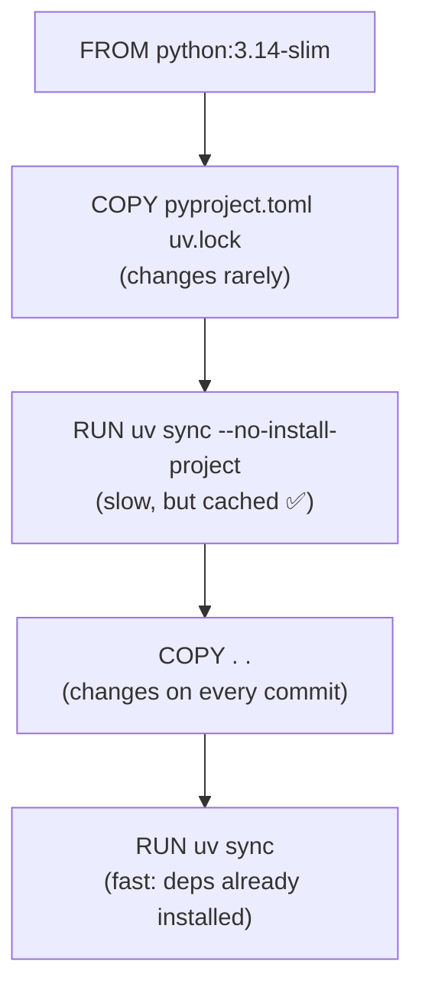

::part[Learn the Concept]{n="1"}

## 🎯 What you'll learn

- Why production images differ from "it runs" images
- **Layer caching**: order instructions so rebuilds take seconds
- **Multi-stage builds** with **uv**: build tools stay out of the final image
- Security: **non-root user**, pinned bases, no secrets in layers, `.dockerignore`, image scanning
- `HEALTHCHECK`, **exec-form** `CMD`, signals and PID 1
- A production-like **Compose** stack with required secrets and health-based startup

This lesson builds on Module 2 Week 1's Docker basics — revisit it if `FROM`, `COPY` and `docker compose up` feel fuzzy.

## 🔤 Key words

| Word | In simple words | Bahasa Indonesia |
|---|---|---|
| **Layer cache** | Docker reusing unchanged steps of a previous build | Penggunaan ulang langkah build |
| **Build context** | The files sent to Docker when building | Berkas yang dikirim ke Docker |
| **Multi-stage build** | Building in one stage, copying only the result into the final image | Build bertahap |
| **Base image** | The starting image (`python:3.12-slim`) | Image dasar |
| **Non-root user** | Running the app without administrator rights inside the container | Pengguna tanpa hak penuh |
| **`.dockerignore`** | The list of files that must not enter the build | Daftar file yang dikecualikan |
| **Exec form `CMD`** | `CMD ["gunicorn", …]` — no shell in between, so signals arrive | Bentuk perintah langsung |
| **PID 1** | The first process in the container; it receives stop signals | Proses utama container |
| **`HEALTHCHECK`** | A command Docker runs to see if the container is healthy | Perintah cek kesehatan |

## 🧠 The big idea

A container image is a **packed lunch box** for your app. A beginner packs the whole kitchen: knives, flour, recipe notes, and the house key taped to the lid. A professional packs only the finished meal — sealed, labelled, nothing dangerous inside.

The **builder stage** is the kitchen; the **runtime stage** is the lunch box.

## ❓ Why it matters

- **The same artifact everywhere**: the image you tested in CI is exactly what runs in production.
- **Fast deploys** need small images and cached builds.
- **Security**: fewer packages means fewer vulnerabilities, and a non-root user limits the damage if the app is exploited.
- Every modern platform (ECS, Cloud Run, Kubernetes, Render, Fly.io) runs images.

Here's what the careless version looks like:

```dockerfile
FROM python:latest
COPY . .
RUN pip install flask flask-sqlalchemy "psycopg[binary]" gunicorn
ENV JWT_SECRET_KEY=super-secret-key-change-in-production
CMD flask --app wsgi run --host 0.0.0.0
```

An image whose base changes without warning, a rebuild of every dependency on every code change, a secret baked into a layer anyone can read, and the development server in production.

## 📖 Step by step

### 1. Layers and the build cache

Pack the suitcase in the right order: dependencies at the bottom (they rarely change), your code on top. Then editing one file repacks only the top.

Each instruction creates a **layer**. Docker reuses a cached layer if the instruction **and its inputs** didn't change. Once one layer changes, **every layer after it** rebuilds.



**Rule:** order from *least* frequently changed to *most* frequently changed.

### 2. Multi-stage build with uv

```dockerfile
# syntax=docker/dockerfile:1

# ---------- builder ----------
FROM python:3.14-slim AS builder
COPY --from=ghcr.io/astral-sh/uv:0.11.29 /uv /bin/uv
ENV UV_COMPILE_BYTECODE=1 UV_LINK_MODE=copy UV_PYTHON_DOWNLOADS=0
WORKDIR /app

COPY pyproject.toml uv.lock ./
RUN --mount=type=cache,target=/root/.cache/uv \
    uv sync --locked --no-dev --no-install-project

COPY . .
RUN --mount=type=cache,target=/root/.cache/uv \
    uv sync --locked --no-dev

# ---------- runtime ----------
FROM python:3.14-slim AS runtime
ENV PYTHONUNBUFFERED=1 PYTHONDONTWRITEBYTECODE=1 PATH="/app/.venv/bin:$PATH" PORT=5091
RUN groupadd --system --gid 10001 app \
 && useradd --system --uid 10001 --gid app --no-create-home --shell /usr/sbin/nologin app
WORKDIR /app
COPY --from=builder --chown=app:app /app /app
USER app
EXPOSE 5091
HEALTHCHECK --interval=15s --timeout=3s --start-period=10s --retries=3 \
  CMD ["python", "-c", "import os, urllib.request; urllib.request.urlopen(f\"http://127.0.0.1:{os.environ['PORT']}/health/live\", timeout=2)"]
CMD ["gunicorn", "-c", "gunicorn.conf.py", "--no-control-socket", "wsgi:app"]
```

| Line | Why |
|---|---|
| `uv:0.11.29` pinned | reproducible builds (check for the current uv release) |
| `--locked` | fail if `uv.lock` is out of date with `pyproject.toml` — you get exactly the tested versions |
| `--no-dev` | pytest, mypy etc. stay out of production |
| `--mount=type=cache` | BuildKit cache for downloads across builds, not stored in the image |
| `UV_COMPILE_BYTECODE=1` | precompile `.pyc` for faster startup |
| builder & runtime **same base** | the venv's Python path must match |
| `--chown=app:app` + `USER app` | the process can't modify system files or run as root |

Result for the exercise app: ~210 MB (most of it is the Python base image), rebuilds after a code change in seconds.

### 3. Choosing a base image

| Base | ✅ | ❌ |
|---|---|---|
| `python:3.14` (Debian full) | everything included | ~1 GB, larger attack surface |
| **`python:3.14-slim`** | small, glibc — wheels "just work" | fewer tools (no curl, no compilers) |
| `python:3.14-alpine` | smallest | musl libc: some wheels must compile, subtle differences |
| Distroless / Chainguard | minimal, no shell | harder to debug; learn later |

Pin at least the minor version (`3.14-slim`); teams often pin a digest (`@sha256:…`) and let Dependabot/Renovate update it.

### 4. `.dockerignore`: control the build context

```text
.git
.venv
__pycache__/
.env
.env.*
!.env.example
tests/
```

Everything not ignored is sent to the builder and can end up in `COPY . .`. Ignoring `.venv` also prevents your **macOS** venv from overwriting the container's **Linux** one.

### 5. Exec form, PID 1 and signals

If a shell sits between Docker and gunicorn, the polite "please stop" never reaches your app — and `docker stop` ends with a forced kill ten seconds later.

```dockerfile
CMD gunicorn wsgi:app                 # shell form → /bin/sh -c "gunicorn …" is PID 1
CMD ["gunicorn", "wsgi:app"]          # exec form → gunicorn is PID 1 ✅
```

On `docker stop` (and every deploy), the platform sends **SIGTERM** to PID 1. With shell form, `sh` may not forward it; after a timeout the container is **killed** mid-request. Exec form lets Gunicorn shut down gracefully (lesson 05).

### 6. HEALTHCHECK

Docker (and Compose's `depends_on: condition: service_healthy`) uses it to mark the container `healthy`/`unhealthy`. Orchestrators like ECS and Kubernetes use their **own** health check configuration, but the endpoint is the same: `/health/live` for "restart me", `/health/ready` for "send me traffic".

### 7. Secrets: never in the image

- ❌ `ENV SECRET=…`, `ARG TOKEN=…`, `COPY .env` — visible in layers/history.
- ✅ Inject at **runtime** as environment variables (Compose, ECS task definition, platform settings).
- ✅ If a **build** needs a secret (private package index): `RUN --mount=type=secret,id=pip_token …` — not stored in layers.

### 8. A production-like Compose stack

```yaml
services:
  api:
    build: .
    environment:
      DATABASE_URL: postgresql+psycopg://careerpilot:${POSTGRES_PASSWORD:?set POSTGRES_PASSWORD}@db:5432/careerpilot
      JWT_SECRET_KEY: ${JWT_SECRET_KEY:?set JWT_SECRET_KEY}
    ports: ["${API_PORT:-5093}:5091"]
    depends_on:
      db: { condition: service_healthy }
    restart: unless-stopped
    read_only: true          # the container filesystem can't be modified…
    tmpfs: [/tmp]            # …except a small in-memory /tmp (Gunicorn heartbeat files)
  db:
    image: postgres:17-alpine
    environment:
      POSTGRES_PASSWORD: ${POSTGRES_PASSWORD:?set POSTGRES_PASSWORD}
    volumes: [pgdata:/var/lib/postgresql/data]
    healthcheck:
      test: ["CMD-SHELL", "pg_isready -U careerpilot -d careerpilot"]
    restart: unless-stopped
    # no ports: only reachable inside the Compose network
volumes:
  pgdata:
```

- `${VAR:?message}` makes Compose **refuse to start** if the variable is missing — fail fast (lesson 04).
- `docker compose up -d --wait` returns only when services are healthy — handy in scripts and CI.

:::note[Compose in production?]
Compose on a single VPS is a legitimate way to run small projects. For multiple machines, autoscaling and zero-downtime deploys, teams move to ECS, Cloud Run or Kubernetes (Module 5) — the **image** stays the same.
:::

### 9. Scanning and inspecting images

```bash
docker image ls careerpilot-api           # size
docker history careerpilot-api:local      # layers (and any leaked ENV!)
docker scout quickview careerpilot-api:local   # or: trivy image careerpilot-api:local
docker compose exec api id                # uid=10001(app) — not root
```

### Choosing your setup

Every option here is a trade-off:

| Choice | ✅ | ❌ |
|---|---|---|
| Multi-stage | small, no build tools in runtime | slightly longer Dockerfile |
| Slim vs Alpine | slim: compatible wheels | Alpine: smaller but musl surprises |
| `read_only` filesystem | blocks many attacks & accidental writes | must declare writable paths (`tmpfs`, volumes) |
| Pin digests | fully reproducible | must automate updates or you'll miss security patches |
| Migrations inside the image entrypoint | simple | races with replicas (lesson 05) — prefer a one-off `docker compose run --rm api flask db upgrade` |

- ✅ Every service you deploy to containers; also for consistent local "production-like" testing.
- ✅ Multi-stage whenever you have build steps (dependency install, frontend build, compiling).
- 🚫 Don't use the production image for local development with hot reload — use a dev Compose file or run locally with uv.
- 🚫 Don't run databases in containers on a PaaS without persistent volumes and backups — use a managed database.

## ⚠️ Common mistakes

- `COPY . .` before installing dependencies.
- Forgetting `.dockerignore` → `.env` and `.git` inside the image.
- Different Python versions in builder and runtime stages → broken venv.
- Binding Gunicorn to `127.0.0.1` inside the container.
- `EXPOSE` thinking it publishes a port (it's documentation; `ports:` / `-p` publishes).

:::revoshop
Compare RevoShop's `Dockerfile` with this lesson: (1) It's single-stage `FROM python:3.12-slim` — good pinned slim base. (2) It copies `requirements.txt` and installs before `COPY . .` — good cache order. Its direct dependencies are pinned with `==` ✅ — but are their **transitive** dependencies pinned too? What does a lockfile (`uv.lock`) add? (3) It creates `appuser` and switches `USER appuser` ✅. (4) `CMD` is exec form ✅, but `ENTRYPOINT ["entrypoint.sh"]` runs a shell script — check that it ends with `exec "$@"` (it does) so Gunicorn still becomes PID 1. (5) There's no `HEALTHCHECK`, and `netcat` is installed only for waiting on the DB — could `depends_on: condition: service_healthy` replace it? (6) `docker-compose.prod.yml` doesn't publish the DB port and uses `${VAR:?}` ✅. Build it and run `docker history` and `docker scout quickview` on the image.
:::

## 🏆 Best practices

- [ ] Pin base image tags (or digests) and tool versions (uv); never `latest`.
- [ ] Use **multi-stage** builds; install with a **lockfile** (`uv sync --locked --no-dev`).
- [ ] Order layers for **cache**: dependency manifests → install → source.
- [ ] Keep the build context small and secret-free with **`.dockerignore`**.
- [ ] Run as a **non-root user**; consider `read_only` filesystem with explicit `tmpfs`.
- [ ] **Exec-form** `CMD`/`ENTRYPOINT` so signals reach the app; production server (Gunicorn), not `flask run`.
- [ ] `PYTHONUNBUFFERED=1`, logs to stdout/stderr.
- [ ] Add a **HEALTHCHECK** (liveness); use readiness in the orchestrator.
- [ ] No secrets in `ENV`/`ARG`/layers — inject at runtime; use BuildKit secret mounts for build-time secrets.
- [ ] Tag images with the **git SHA**; **scan** them (Docker Scout / Trivy) in CI.

::part[Explain & Design]{n="2"}

## 🗣️ Explain it

Explain to a teammate why changing one line of `app.py` made their Docker build reinstall every dependency for 3 minutes, and how to fix it. Use the layer cache idea.

## 📐 Design it

CareerPilot will have three deployables: the Flask API, a background worker (same code, different command, processes CV parsing jobs) and a React frontend (static files served by Nginx/Caddy). Design the image strategy: how many Dockerfiles/images, stages, base images, how the API and worker share code, tags, and what runs as non-root.

:::quiz
Show a possible design

**Backend image (one Dockerfile, one image):** builder (`python:3.14-slim` + uv, `uv sync --locked --no-dev`) → runtime slim, non-root `app` user. Same image, different commands:
- API: `CMD ["gunicorn", "-c", "gunicorn.conf.py", "wsgi:app"]`
- worker: overridden in Compose/ECS: `command: ["python", "-m", "careerpilot.worker"]`
One image = one build, one scan, identical code in both — no version drift between API and worker.

**Frontend image:** stage 1 `node:22-alpine` → `npm ci && npm run build`; stage 2 `caddy:2-alpine` (or `nginxinc/nginx-unprivileged`) serving only `dist/` as a non-root user. Node and `node_modules` never reach runtime. Build-time public config via `VITE_*` args (no secrets — frontend code is public anyway).

**Tags:** `careerpilot-api:<git-sha>` and `careerpilot-web:<git-sha>`, plus `:main` pointing to the latest main build. Deploy by SHA, roll back by SHA.

**Health:** API `/health/live` + `/health/ready`; worker has no HTTP → health via a heartbeat file or queue metrics; web → Caddy responds on `/`.

**CI:** build both images with cache (`cache-from` registry), Trivy/Scout scan, push to GHCR/ECR, then deploy.
:::

### 📝 Self-review checklist

- [ ] No build tools or dev dependencies in runtime images
- [ ] API and worker can't drift apart in versions
- [ ] Every runtime runs as non-root
- [ ] Images are traceable to a commit

::ai-review{task="design"}

::part[Toy Exercise]{n="3"}

:::exercise{path="exercises/m2/w6/06-dockerize-flask" ai="ai-allowed" title="From a naive Dockerfile to a production image"}
Rewrite a naive `Dockerfile`, `.dockerignore` and `compose.prod.yaml` for the lesson 05 app: multi-stage uv build with correct cache order, non-root user, health check, exec-form Gunicorn, no baked secrets, and a Compose stack with required secrets, a healthy database before the API, and no public database port. Static tests always run; set `RUN_DOCKER_TESTS=1` to really build, run and stop it.
:::

:::hints
- Start from the uv Docker guide's multi-stage example, then check every line against the README.
- The test finds "the source copy" as a `COPY . …` in the **first** stage — your dependency `RUN uv sync` must come before it.
- `HEALTHCHECK` + `CMD [...]` on the same instruction line: `HEALTHCHECK --interval=15s CMD ["python", "-c", "..."]`.
- In Compose, `environment:` as a mapping (`KEY: value`), and `${VAR:?message}` for required values.
:::

### 🏆 Stretch goal

Build the image twice: once as is, and once after changing only `health.py`. Compare build times (`docker build --progress=plain`). Then swap the order of `COPY . .` and the first `uv sync`, change `health.py` again, and measure.

## ✅ Quick check

:::quiz
Why copy `pyproject.toml` and `uv.lock` before the rest of the source?

So the slow dependency-install layer stays cached until dependencies change; code changes only rebuild the fast layers after it.
:::

:::quiz
What's the benefit of a multi-stage build?

The final image contains only what's needed to run (app + venv), not build tools, caches or dev dependencies — smaller and more secure.
:::

:::quiz
Why exec-form `CMD ["gunicorn", ...]`?

The app becomes PID 1 and receives `SIGTERM` directly, enabling graceful shutdown; shell form wraps it in `/bin/sh`, which may not forward signals.
:::


## 📚 Keep learning

- [uv: Using uv in Docker](https://docs.astral.sh/uv/guides/integration/docker/)
- [Docker: Building best practices](https://docs.docker.com/build/building/best-practices/)
- [Docker: Multi-stage builds](https://docs.docker.com/build/building/multi-stage/)
- [OWASP Docker Security Cheat Sheet](https://cheatsheetseries.owasp.org/cheatsheets/Docker_Security_Cheat_Sheet.html)
