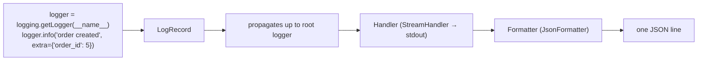

::part[Pelajari Konsepnya]{n="1"}

## 🎯 Yang akan kamu pelajari

- Kenapa log production harus **terstruktur** (JSON), bukan prosa bebas
- **Log level** dan apa yang layak untuk setiap level
- **Request ID** / correlation ID dengan `contextvars`
- **Log ke stdout** — biarkan platform mengumpulkannya (Twelve-Factor)
- Apa yang **jangan pernah** dicatat: secret, token, data pribadi — dan cara menyensornya
- Bagaimana log terhubung dengan **metrik** dan **trace** (observability)

## 🔤 Istilah penting

| Istilah | Artinya (sederhana) |
|---|---|
| **Structured log** | Baris log berformat JSON dengan field tetap, bukan teks bebas |
| **Log level** | Seberapa serius pesannya (DEBUG → ERROR) |
| **Request ID** | Nomor yang mengikat setiap baris log satu permintaan jadi satu kesatuan |
| **Correlation ID** | Ide yang sama melintas beberapa service |
| **`contextvars`** | Fitur Python yang membawa ID ini melewati kode |
| **stdout** | Stream keluaran tempat platform mengumpulkan log |
| **Redaction** | Menghapus secret dan data pribadi sebelum mencatat |
| **Access log** | Satu baris per permintaan: method, path, status, durasi |
| **Observability** | Log + metrik + trace: kemampuan mengamati apa yang dilakukan sistem |

## 🧠 Ide besarnya

Log teks biasa adalah **buku diary**: enak dibaca satu halaman, mustahil dicari di sejuta halaman. Log terstruktur adalah **spreadsheet**: setiap baris punya kolom sama (waktu, level, request ID, path, status), jadi kamu bisa tanya "semua 500 di `/checkout` sejam terakhir?" dan dapat jawaban dalam detik.

**Request ID** adalah **nomor urut di food court**: setiap pos — API, service, database call, background job — tuliskan nomor itu di tiketnya, jadi kamu bisa ikuti satu pesanan dari mulai sampai selesai.

## ❓ Kenapa ini penting

Di production tidak bisa attach debugger atau tambahin `print()` lalu jalankan lagi. Log adalah cara menjawab:

- *"User bilang checkout gagal jam 14:02 — apa yang terjadi?"*
- *"Berapa webhook pembayaran gagal verifikasi signature hari ini?"*
- *"Permintaan mana yang lambat, dan mereka sedang apa?"*

Platform log (CloudWatch Logs, Grafana Loki, Datadog, Elastic, Google Cloud Logging) indeks field JSON, dan itulah yang membuat pertanyaan itu terjawab.

Log tidak terstruktur tidak menjawab satu pun — dan kadang bocor:

```text
2026-09-13 14:02:11 [ERROR] app: integrity error: (psycopg.errors.UniqueViolation) duplicate key … [parameters: {'email': 'siti@example.com', 'password_hash': '$2b$12$…'}]
2026-09-13 14:02:11 [INFO] app: order created
2026-09-13 14:02:11 [ERROR] app: midtrans HTTP 401: …
```

Pesanan mana? User siapa? Dipicu permintaan apa? Dan hash password sudah sitting di penyimpanan log-mu.

## 📖 Langkah demi langkah

### 1. Satu JSON object per baris

```json
{"timestamp": "2026-09-13T07:02:11.482Z", "level": "ERROR", "logger": "http", "message": "request completed", "request_id": "9f1c2e…", "method": "POST", "path": "/api/v1/orders", "status": 500, "duration_ms": 812.4}
```

- Nama field konsisten lintas service (`request_id`, bukan `requestId` di sini dan `req` di sana).
- Timestamp **UTC** dalam format ISO 8601.
- **Pesan stabil** (`"request completed"`) + **field** untuk data yang berubah — bukan `f"request to {path} took {ms}"`. Pesan stabil mudah dihitung dan di-alert.

### 2. Python logging dalam satu gambar



- Buat logger per module: `logger = logging.getLogger(__name__)`.
- Atur handler **sekali saja**, saat startup, di **root** logger — lalu log dari kode, Flask, SQLAlchemy dan Gunicorn semuanya dapat format sama.
- Kirim data dengan `extra={...}`; pakai `logger.exception(...)` di dalam `except` untuk sertakan traceback.

### 3. Level yang berarti

Kalau semuanya ERROR, tidak ada yang benar-benar error. Reserve ERROR untuk "manusia harus lihat ini", dan letakkan cerita rutin di INFO.

| Level | Untuk apa | Contoh |
|---|---|---|
| `DEBUG` | detail untuk developer; mati di production | "cache miss for key jobs:page:2" |
| `INFO` | event normal, penting | "request completed", "order created", "job import finished" |
| `WARNING` | tidak terduga tapi ditangani; mungkin perlu perhatian | spike 4xx, retry provider call, pakai API deprecated |
| `ERROR` | operasi gagal | unhandled exception, payment provider tidak bisa diakses setelah retry |
| `CRITICAL` | service tidak bisa jalan | tidak bisa koneksi database saat startup |

Kalau semuanya `ERROR`, tidak ada yang benar. Alert biasanya menyala pada rate `ERROR`, jadi kesalahgunaan menyebabkan alert fatigue.

### 4. Request ID dengan `contextvars`

```python
request_id_var: ContextVar[str | None] = ContextVar("request_id", default=None)

@app.before_request
def assign_request_id():
    incoming = request.headers.get("X-Request-ID", "")
    request_id = incoming if VALID_ID.match(incoming) else uuid.uuid4().hex
    g.token = request_id_var.set(request_id)

# JsonFormatter adds request_id_var.get() to every line — even from deep inside services.
```

- **`ContextVar`** aman dengan thread **dan** async code: setiap permintaan lihat nilai sendiri (beda dengan global variable).
- Reuse ID masuk dari load balancer/frontend kalau **well-formed** (validasi — kalau tidak, attacker bisa inject konten log palsu).
- Kembalikan di response header `X-Request-ID`, dan tampilkan di halaman error/JSON: *"Something went wrong (ref: 9f1c2e…)"* — support bisa cari log persis.
- Teruskan ke downstream call (payment API, background job) jadi cerita terus berlanjut.

### 5. Baris access log

Satu baris per permintaan dengan `method`, `path`, `status`, `duration_ms`, `request_id` (dan sering `user_id`, jangan token). Ini yang kuatkan dashboard: request rate, error rate, latency percentile.

:::warning[Query string]
Catat `request.path`, bukan `request.full_path` atau `request.url`: query string sering bawa token (`?token=…`, password reset link, OAuth code).
:::

### 6. Jangan pernah catat secret atau data pribadi yang tidak perlu

Log pergi lebih jauh dari pikiran — screenshot, support ticket, platform pihak ketiga. Treat setiap baris log seperti bisa dibaca orang di luar tim.

| Jangan pernah | Hati-hati (mask/kurangi) | Biasanya ok |
|---|---|---|
| password, password hash | email, nomor telepon | id (user_id, order_id) |
| token, API key, cookie, header `Authorization` | alamat IP | status code, durasi |
| nomor kartu penuh, CVV | nama, alamat | feature flag, count |
| request body penuh dengan credential | LLM prompt berisi user content (Module 7) | error type |

Pertahanan berlapis:
1. Jangan kirim data sensitif ke logger sejak awal.
2. **Redact** berdasarkan nama key di formatter (`password`, `token`, `authorization`…).
3. Hati-hati dengan `str(exception)` untuk error database — SQLAlchemy include **parameter query**.
4. Batasi akses log dan set **retention period**.

### 7. Log ke stdout

Container dan platform menangkap stdout/stderr dan kirim ke sistem log. Menulis ke file di dalam container berarti log hilang saat restart, disk penuh, dan error filesystem read-only (lesson 06). Rotation dan retention jadi tanggung jawab platform.

### 8. Log, metrik, trace

| Signal | Menjawab | Contoh tool |
|---|---|---|
| **Logs** | "Apa persis terjadi di permintaan ini?" | CloudWatch Logs, Loki |
| **Metrics** | "Berapa / seberapa cepat, seiring waktu?" | Prometheus, CloudWatch Metrics |
| **Traces** | "Waktu habis ke mana lintas service?" | OpenTelemetry + Jaeger/Tempo/X-Ray |

**OpenTelemetry** adalah standar industri untuk ketiganya; trace ID-nya main role seperti request ID lintas service. Untuk AI app, tool seperti Langfuse trace setiap LLM call (Module 7). Mulai dari log bagus — itu fondasi.

### Pilih setup-mu

Setiap opsi di sini ada trade-off:

| Pilihan | ✅ | ❌ |
|---|---|---|
| JSON log | queryable, konsisten | lebih sulit dibaca raw di terminal (pakai `jq` atau pretty-printer dev) |
| Plain text | user-friendly lokal | menyakitkan di skala besar |
| Log setiap request body | debugging mudah | risiko privacy, volume besar & biaya |
| DEBUG di production | detail lebih | biaya, noise, mungkin bocor — enable sementara dan targeted |
| stdlib `logging` + custom formatter | no dependency, kamu paham | kode lebih banyak dari library |
| `structlog` / `python-json-logger` | batteries included | satu dependency lagi untuk pelajari |

- ✅ Log terstruktur untuk setiap deployed service, termasuk worker dan cron job.
- ✅ Request ID untuk setiap HTTP request dan setiap background job.
- 🚫 Jangan pakai log sebagai sistem metrik (hitung via query log jadi mahal) — emit metrik juga seiring berkembang.
- 🚫 Jangan log di dalam tight loop per item untuk batch besar; catat ringkasan.

## ⚠️ Kesalahan umum

- `print()` debugging tertinggal di kode production.
- Atur `app.logger` saja, jadi logger SQLAlchemy/Gunicorn/module pakai format beda (atau tidak ada).
- Catat `str(error)` untuk DB error → parameter dengan data pribadi di log.
- Stack trace multi-line dipecah jadi banyak baris log.
- Global variable untuk request ID → salah ID saat concurrency.

:::revoshop
Buka RevoShop's `app/logging_config.py` dan `app/errors.py`: (1) Ia atur hanya `flask_app.logger` dengan `propagate = False` — format apa yang dapat log dari `logging.getLogger(__name__)` di service, SQLAlchemy atau Gunicorn? (2) `LOG_TO_FILE` default `true` dengan `TimedRotatingFileHandler` — apa yang terjadi file-file itu saat container diganti, dan dengan `read_only: true`? (3) `current_app.logger.error('integrity error: %s', error)` — trigger duplicate email di register dan lihat baris log: data user mana yang muncul? (4) Ada cara apa buat connect keluhan user ke baris log permintaan mereka? Ganti setup dengan `configure_logging` + `init_request_logging` pelajaran ini, dan include request ID di JSON error response.
:::

## 🏆 Praktik terbaik

- [ ] Atur logging **sekali** saat startup di **root** logger; pakai `getLogger(__name__)` di mana-mana.
- [ ] Emit **satu JSON object per baris** ke **stdout**; timestamp UTC ISO 8601.
- [ ] Pakai **pesan stabil + field** (`extra=`), nama field konsisten lintas service.
- [ ] Pilih **level** dengan sengaja; alert pada rate ERROR, bukan setiap WARNING.
- [ ] Tambah **request ID** tervalidasi ke setiap baris, kembalikan di `X-Request-ID`, teruskan ke downstream.
- [ ] Log satu baris **access** per permintaan dengan method, path (tanpa query string), status, durasi.
- [ ] Pakai `logger.exception()` untuk failure jadi stack trace terekam — di entry JSON yang sama.
- [ ] **Jangan pernah** catat secret atau credential; kurangi data pribadi; redact by key sebagai safety net.
- [ ] Set log **retention** dan access control; buat level configurable dengan `LOG_LEVEL`.
- [ ] Lanjut ke **OpenTelemetry** trace dan metrik seiring sistem berkembang.

::part[Jelaskan & Rancang]{n="2"}

## 🗣️ Jelaskan

Jelaskan ke teammate kenapa `logger.info(f"user {email} bought {product} for {price}")` lebih buruk daripada `logger.info("order created", extra={"user_id": ..., "product_id": ..., "amount": ...})` — sebutkan query, privacy dan alerting.

## 📐 Rancang

CareerPilot punya API, background worker yang parse CV upload dengan LLM, dan webhook receiver untuk email provider. Rancang standar logging: common field, event untuk dicatat (dengan level) untuk CV upload dari HTTP request lewat worker sampai LLM call, bagaimana request ID mengalir lintas queue, apa yang jangan pernah dicatat, retention, dan dua contoh query alert.

:::quiz
Lihat standar yang mungkin

**Common field (setiap baris):** `timestamp` (UTC), `level`, `service` (`api` / `worker` / `webhooks`), `env`, `version` (git SHA), `logger`, `message`, `request_id`, dan saat diketahui `user_id`, `job_id`.

**Cerita CV upload:**
| Di mana | Level | Pesan | Field |
|---|---|---|---|
| API | INFO | `cv upload accepted` | `user_id`, `file_size_kb`, `content_type` (jangan filename kalau mungkin berisi nama) |
| API | INFO | `request completed` | method, path, status 202, duration_ms |
| Pesan queue | — | bawa `request_id` di metadatanya | |
| Worker | INFO | `cv parse started` | `request_id` (dari pesan), `job_id`, `attempt` |
| Worker → LLM | INFO | `llm call completed` | `model`, `input_tokens`, `output_tokens`, `latency_ms`, `cost_usd` — **tanpa prompt atau teks CV** |
| Worker | WARNING | `llm call retrying` | `attempt`, `error_type` (e.g. `RateLimitError`) |
| Worker | ERROR | `cv parse failed` | `job_id`, `exc_type`, stack |
| Worker | INFO | `cv parse finished` | `skills_found`, `duration_ms` |

**Jangan pernah catat:** isi CV, LLM prompt/output dengan data pribadi (pakai alat tracing akses-terbatas dengan redaction kalau perlu), email/phone, token, provider API key, webhook signature/secret.

**Retention:** 30 hari untuk application log, 1 tahun untuk security/audit event (login, perubahan role) dengan akses terbatas.

**Alert:** (1) `service = "api" and message = "request completed" and status >= 500` rate > 2% lebih dari 5 min; (2) `message = "cv parse failed"` count > 10 dalam 15 min, atau `llm call retrying` dengan `error_type = "RateLimitError"` melonjak.
:::

### 📝 Checklist review mandiri

- [ ] Request ID selamat melintas queue jump
- [ ] Tanpa data pribadi atau prompt di log
- [ ] Level bermakna dan bisa di-alert
- [ ] Pesan stabil; detail adalah field

::ai-review{task="design"}

::part[Latihan Kecil]{n="3"}

:::exercise{path="exercises/m2/w6/08-structured-logging" ai="no-ai" title="JSON log, redaction dan request ID untuk Flask"}
Bangun `JsonFormatter` (timestamp UTC, extras, redaction, exception satu baris), `configure_logging` idempotent, dan Flask hook yang assign atau reuse validated request ID, tambah ke setiap baris log dan response header, dan tulis satu baris access log per permintaan dengan level yang benar.
:::

:::hints
- Attribute record standard: `set(vars(logging.LogRecord("", 0, "", 0, "", (), None)))` — tambah `message`, `asctime` dan `taskName`.
- `json.dumps(entry, default=str)` handle tanggal dan desimal.
- `datetime.fromtimestamp(record.created, UTC).isoformat(timespec="milliseconds")`.
- `ContextVar.set()` return token; `var.reset(token)` restore nilai sebelumnya. Simpan token di `g`.
- Buat `configure_logging` idempotent, mark handler (e.g. attribute) dan hapus yang lama dulu.
:::

### 🏆 Stretch goal

Tambah ini ke aplikasi lesson 05, jalankan dengan Gunicorn, dan pipe output lewat `jq`: `... | jq 'select(.status >= 400)'`. Lalu atur `logconfig_dict` Gunicorn jadi error log Gunicorn juga JSON.

## ✅ Cek cepat

:::quiz
Kenapa pakai `ContextVar` untuk request ID daripada global variable?

Permintaan concurrent (thread atau async task) masing-masing butuh nilai sendiri; `ContextVar` isolated per context, sedangkan global dibagi dan ketebus.
:::

:::quiz
Kenapa log ke stdout di container?

Platform mengumpulkan stdout/stderr dan kirim log terpusat; file di dalam container hilang saat diganti, isi disk dan break filesystem read-only.
:::

:::quiz
Sebutkan tiga hal yang jangan pernah muncul di log.

Password/hash, token/API key/cookie/header Authorization, dan data kartu pembayaran penuh (juga kurangi data pribadi seperti email dan nomor telepon).
:::


## 📚 Lanjut belajar

- [Python docs — Logging HOWTO](https://docs.python.org/3/howto/logging.html)
- [The Twelve-Factor App — Logs](https://12factor.net/logs)
- [OWASP Logging Cheat Sheet](https://cheatsheetseries.owasp.org/cheatsheets/Logging_Cheat_Sheet.html)
- [OpenTelemetry — Python](https://opentelemetry.io/docs/languages/python/)
