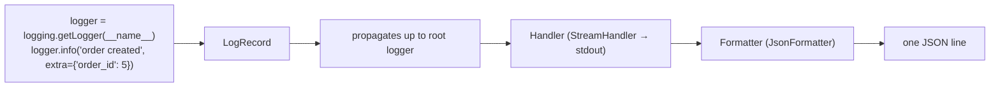

::part[Learn the Concept]{n="1"}

## 🎯 What you'll learn

- Why production logs must be **structured** (JSON), not prose
- Log **levels** and what deserves each one
- **Request ids** / correlation ids with `contextvars`
- **Logs to stdout** — let the platform collect them (Twelve-Factor)
- What **never** to log: secrets, tokens, personal data — and redaction
- How logs relate to **metrics** and **traces** (observability)

## 🔤 Key words

| Word | In simple words | Bahasa Indonesia |
|---|---|---|
| **Structured log** | A log line as JSON with fixed fields, not free text | Log berformat tetap |
| **Log level** | How serious the message is (DEBUG → ERROR) | Tingkat keseriusan log |
| **Request id** | A number tying every log line of one request together | Penanda satu permintaan |
| **Correlation id** | The same idea across several services | Penanda lintas layanan |
| **`contextvars`** | The Python feature that carries that id through your code | Pembawa nilai antar fungsi |
| **stdout** | The output stream the platform collects logs from | Keluaran standar |
| **Redaction** | Removing secrets and personal data before logging | Menyensor data sensitif |
| **Access log** | One line per request: method, path, status, duration | Log tiap permintaan |
| **Observability** | Logs + metrics + traces: knowing what your system is doing | Kemampuan mengamati sistem |

## 🧠 The big idea

Plain-text logs are a **diary**: pleasant to read one page, impossible to search across a million pages. Structured logs are a **spreadsheet**: every entry has the same columns (time, level, request id, path, status), so you can ask for "all 500s on `/checkout` in the last hour" and get an answer in seconds.

A **request id** is the **order number at a food court**: every station — API, service, database call, background job — writes it on its ticket, so you can follow one order from start to finish.

## ❓ Why it matters

In production you can't attach a debugger or add a `print()` and run it again. Logs are how you answer:

- *"A user says checkout failed at 14:02 — what happened?"*
- *"How many payment webhooks failed their signature check today?"*
- *"Which requests were slow, and what were they doing?"*

Log platforms (CloudWatch Logs, Grafana Loki, Datadog, Elastic, Google Cloud Logging) index JSON fields, which is what makes those questions answerable.

Unstructured logs answer none of them — and sometimes leak:

```text
2026-09-13 14:02:11 [ERROR] app: integrity error: (psycopg.errors.UniqueViolation) duplicate key … [parameters: {'email': 'siti@example.com', 'password_hash': '$2b$12$…'}]
2026-09-13 14:02:11 [INFO] app: order created
2026-09-13 14:02:11 [ERROR] app: midtrans HTTP 401: …
```

Which order? For which user? Caused by which request? And a password hash is now sitting in your log storage.

## 📖 Step by step

### 1. One JSON object per line

```json
{"timestamp": "2026-09-13T07:02:11.482Z", "level": "ERROR", "logger": "http", "message": "request completed", "request_id": "9f1c2e…", "method": "POST", "path": "/api/v1/orders", "status": 500, "duration_ms": 812.4}
```

- Consistent field names across services (`request_id`, not `requestId` here and `req` there).
- **UTC** timestamps in ISO 8601.
- A **stable message** (`"request completed"`) + **fields** for variable data — not `f"request to {path} took {ms}"`. Stable messages are easy to count and alert on.

### 2. Python logging in one picture



- Create loggers per module: `logger = logging.getLogger(__name__)`.
- Configure handlers **once**, at startup, on the **root** logger — then logs from your code, Flask, SQLAlchemy and Gunicorn all get the same format.
- Pass data with `extra={...}`; use `logger.exception(...)` inside `except` to include the traceback.

### 3. Levels that mean something

If everything is an ERROR, nothing is. Reserve ERROR for "a human must look at this", and put the routine story at INFO.

| Level | Use for | Example |
|---|---|---|
| `DEBUG` | detail for developers; off in production | "cache miss for key jobs:page:2" |
| `INFO` | normal, noteworthy events | "request completed", "order created", "job import finished" |
| `WARNING` | unexpected but handled; might need attention | 4xx spikes, retrying a provider call, deprecated API use |
| `ERROR` | an operation failed | unhandled exception, payment provider unavailable after retries |
| `CRITICAL` | the service can't function | can't connect to the database at startup |

If everything is `ERROR`, nothing is. Alerts usually fire on `ERROR` rates, so misuse causes alert fatigue.

### 4. Request ids with `contextvars`

```python
request_id_var: ContextVar[str | None] = ContextVar("request_id", default=None)

@app.before_request
def assign_request_id():
    incoming = request.headers.get("X-Request-ID", "")
    request_id = incoming if VALID_ID.match(incoming) else uuid.uuid4().hex
    g.token = request_id_var.set(request_id)

# JsonFormatter adds request_id_var.get() to every line — even from deep inside services.
```

- **`ContextVar`** is safe with threads **and** async code: each request sees its own value (unlike a global variable).
- Reuse an incoming id from the load balancer/frontend if it's **well-formed** (validate it — otherwise attackers inject fake log content).
- Return it in the `X-Request-ID` response header, and show it in error pages/JSON: *"Something went wrong (ref: 9f1c2e…)"* — support can find the exact logs.
- Pass it on to downstream calls (payment API, background jobs) so the story continues.

### 5. The access log line

One line per request with `method`, `path`, `status`, `duration_ms`, `request_id` (and often `user_id`, never tokens). It powers dashboards: request rate, error rate, latency percentiles.

:::warning[Query strings]
Log `request.path`, not `request.full_path` or `request.url`: query strings often carry tokens (`?token=…`, password reset links, OAuth codes).
:::

### 6. Never log secrets or unnecessary personal data

Logs travel further than you think — screenshots, support tickets, third-party platforms. Treat every log line as something that may be read by someone outside your team.

| Never | Be careful (mask/minimize) | Usually fine |
|---|---|---|
| passwords, password hashes | emails, phone numbers | ids (user_id, order_id) |
| tokens, API keys, cookies, `Authorization` headers | IP addresses | status codes, durations |
| full card numbers, CVV | names, addresses | feature flags, counts |
| full request bodies with credentials | LLM prompts containing user content (Module 7) | error types |

Defense in depth:
1. Don't pass sensitive data to loggers in the first place.
2. **Redact** by key name in the formatter (`password`, `token`, `authorization`…).
3. Be careful with `str(exception)` for database errors — SQLAlchemy includes **query parameters**.
4. Restrict log access and set **retention** periods.

### 7. Logs go to stdout

Containers and platforms capture stdout/stderr and ship it to the log system. Writing to files inside a container means lost logs on restart, full disks, and read-only filesystem errors (lesson 06). Rotation and retention become the platform's job.

### 8. Logs, metrics, traces

| Signal | Answers | Example tool |
|---|---|---|
| **Logs** | "What exactly happened in this request?" | CloudWatch Logs, Loki |
| **Metrics** | "How many / how fast, over time?" | Prometheus, CloudWatch Metrics |
| **Traces** | "Where did the time go across services?" | OpenTelemetry + Jaeger/Tempo/X-Ray |

**OpenTelemetry** is the industry standard for all three; its trace id plays the role of your request id across services. For AI apps, tools like Langfuse trace every LLM call (Module 7). Start with good logs — they're the foundation.

### Choosing your setup

Every option here is a trade-off:

| Choice | ✅ | ❌ |
|---|---|---|
| JSON logs | queryable, consistent | harder to read raw in a terminal (use `jq` or a dev pretty-printer) |
| Plain text | human-friendly locally | painful at scale |
| Log every request body | easy debugging | privacy risk, huge volume & cost |
| DEBUG in production | more detail | cost, noise, may leak data — enable temporarily and targeted |
| stdlib `logging` + custom formatter | no dependency, you understand it | more code than libraries |
| `structlog` / `python-json-logger` | batteries included | another dependency to learn |

- ✅ Structured logs for every deployed service, including workers and cron jobs.
- ✅ Request ids for every HTTP request and every background job.
- 🚫 Don't use logs as your metrics system (counting via log queries gets expensive) — emit metrics too as you grow.
- 🚫 Don't log inside tight loops per item for large batches; log a summary.

## ⚠️ Common mistakes

- `print()` debugging left in production code.
- Configuring `app.logger` only, so SQLAlchemy/Gunicorn/module loggers use different formats (or none).
- Logging `str(error)` for DB errors → parameters with personal data in logs.
- Multi-line stack traces split into many log entries.
- A global variable for the request id → wrong ids under concurrency.

:::revoshop
Open RevoShop's `app/logging_config.py` and `app/errors.py`: (1) It configures only `flask_app.logger` with `propagate = False` — what format do logs from `logging.getLogger(__name__)` in a service, SQLAlchemy or Gunicorn get? (2) `LOG_TO_FILE` defaults to `true` with a `TimedRotatingFileHandler` — what happens to those files when the container is replaced, and with `read_only: true`? (3) `current_app.logger.error('integrity error: %s', error)` — trigger a duplicate email on register and look at the log line: which user data appears? (4) Is there any way to connect a user's complaint to the log lines of their request? Replace the setup with this lesson's `configure_logging` + `init_request_logging`, and include the request id in the JSON error response.
:::

## 🏆 Best practices

- [ ] Configure logging **once** at startup on the **root** logger; use `getLogger(__name__)` everywhere.
- [ ] Emit **one JSON object per line** to **stdout**; UTC ISO 8601 timestamps.
- [ ] Use **stable messages + fields** (`extra=`), consistent field names across services.
- [ ] Choose **levels** deliberately; alert on ERROR rates, not on every WARNING.
- [ ] Add a validated **request id** to every line, return it in `X-Request-ID`, propagate it downstream.
- [ ] Log one **access line** per request with method, path (no query string), status, duration.
- [ ] Use `logger.exception()` for failures so the stack trace is captured — in the same JSON entry.
- [ ] **Never** log secrets or credentials; minimize personal data; redact by key as a safety net.
- [ ] Set log **retention** and access controls; make levels configurable with `LOG_LEVEL`.
- [ ] Graduate to **OpenTelemetry** traces and metrics as the system grows.

::part[Explain & Design]{n="2"}

## 🗣️ Explain it

Explain to a teammate why `logger.info(f"user {email} bought {product} for {price}")` is worse than `logger.info("order created", extra={"user_id": ..., "product_id": ..., "amount": ...})` — mention querying, privacy and alerting.

## 📐 Design it

CareerPilot has an API, a background worker that parses uploaded CVs with an LLM, and a webhook receiver for an email provider. Design the logging standard: common fields, events to log (with levels) for a CV upload from HTTP request through the worker to the LLM call, how the request id flows across the queue, what must never be logged, retention, and two example alert queries.

:::quiz
Show a possible standard

**Common fields (every line):** `timestamp` (UTC), `level`, `service` (`api` / `worker` / `webhooks`), `env`, `version` (git SHA), `logger`, `message`, `request_id`, and when known `user_id`, `job_id`.

**CV upload story:**
| Where | Level | Message | Fields |
|---|---|---|---|
| API | INFO | `cv upload accepted` | `user_id`, `file_size_kb`, `content_type` (no filename if it may contain names) |
| API | INFO | `request completed` | method, path, status 202, duration_ms |
| Queue message | — | carries `request_id` in its metadata | |
| Worker | INFO | `cv parse started` | `request_id` (from message), `job_id`, `attempt` |
| Worker → LLM | INFO | `llm call completed` | `model`, `input_tokens`, `output_tokens`, `latency_ms`, `cost_usd` — **no prompt or CV text** |
| Worker | WARNING | `llm call retrying` | `attempt`, `error_type` (e.g. `RateLimitError`) |
| Worker | ERROR | `cv parse failed` | `job_id`, `exc_type`, stack |
| Worker | INFO | `cv parse finished` | `skills_found`, `duration_ms` |

**Never log:** CV contents, LLM prompts/outputs with personal data (use an access-controlled tracing tool with redaction if needed), emails/phones, tokens, provider API keys, webhook signatures/secrets.

**Retention:** 30 days for application logs, 1 year for security/audit events (logins, role changes) with restricted access.

**Alerts:** (1) `service = "api" and message = "request completed" and status >= 500` rate > 2% over 5 min; (2) `message = "cv parse failed"` count > 10 in 15 min, or `llm call retrying` with `error_type = "RateLimitError"` spiking.
:::

### 📝 Self-review checklist

- [ ] The request id survives the jump across the queue
- [ ] No personal data or prompts in logs
- [ ] Levels are meaningful and alertable
- [ ] Messages are stable; details are fields

::ai-review{task="design"}

::part[Toy Exercise]{n="3"}

:::exercise{path="exercises/m2/w6/08-structured-logging" ai="no-ai" title="JSON logs, redaction and request ids for Flask"}
Build a `JsonFormatter` (UTC timestamps, extras, redaction, exceptions on one line), an idempotent `configure_logging`, and Flask hooks that assign or reuse a validated request id, add it to every log line and response header, and write one access log line per request with the right level.
:::

:::hints
- Standard record attributes: `set(vars(logging.LogRecord("", 0, "", 0, "", (), None)))` — plus `message`, `asctime` and `taskName`.
- `json.dumps(entry, default=str)` handles dates and decimals.
- `datetime.fromtimestamp(record.created, UTC).isoformat(timespec="milliseconds")`.
- `ContextVar.set()` returns a token; `var.reset(token)` restores the previous value. Store the token on `g`.
- To make `configure_logging` idempotent, mark your handler (e.g. an attribute) and remove the old one first.
:::

### 🏆 Stretch goal

Add this to the lesson 05 app, run it with Gunicorn, and pipe the output through `jq`: `... | jq 'select(.status >= 400)'`. Then configure Gunicorn's `logconfig_dict` so Gunicorn's own error logs are JSON too.

## ✅ Quick check

:::quiz
Why use a `ContextVar` for the request id instead of a global variable?

Concurrent requests (threads or async tasks) each need their own value; a `ContextVar` is isolated per context, while a global is shared and gets overwritten.
:::

:::quiz
Why log to stdout in containers?

The platform collects stdout/stderr and ships logs centrally; files inside containers are lost on replacement, fill disks and break read-only filesystems.
:::

:::quiz
Name three things that should never appear in logs.

Passwords/hashes, tokens/API keys/cookies/Authorization headers, and full payment card data (also minimize personal data like emails and phone numbers).
:::


## 📚 Keep learning

- [Python docs — Logging HOWTO](https://docs.python.org/3/howto/logging.html)
- [The Twelve-Factor App — Logs](https://12factor.net/logs)
- [OWASP Logging Cheat Sheet](https://cheatsheetseries.owasp.org/cheatsheets/Logging_Cheat_Sheet.html)
- [OpenTelemetry — Python](https://opentelemetry.io/docs/languages/python/)
