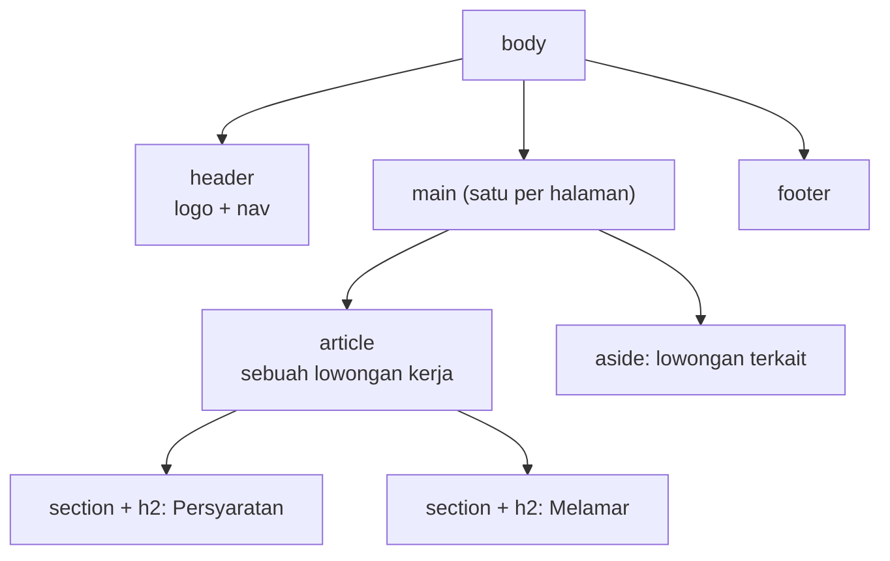

::part[Pelajari Konsepnya]{n="1"}

## 🎯 Yang akan kamu pelajari

- Untuk apa HTML: menyatakan konten itu **apa**, bukan tampilannya
- Kerangka dasar halaman
- Area utama halaman (`header`, `nav`, `main`, `footer`) dan heading
- Menulis list, link, gambar, dan form dengan benar
- Bagaimana browser mengubah HTML menjadi sesuatu yang dipakai JavaScript dan screen reader

## 🔤 Istilah penting

| Istilah | Artinya (sederhana) |
|---|---|
| **Element** | Satu balok penyusun halaman, seperti `<button>` atau `<h1>` |
| **Semantic HTML** | Memilih elemen yang sesuai maknanya (tombol ya pakai `<button>`) |
| **Landmark** | Area besar halaman yang punya nama: header, navigasi, konten utama, footer |
| **Screen reader** | Software yang membacakan halaman untuk pengguna tunanetra |
| **Accessibility (a11y)** | Membuat halaman bisa dipakai semua orang, termasuk penyandang disabilitas |
| **DOM** | Halaman dalam bentuk pohon object yang bisa dibaca dan diubah JavaScript |
| **Attribute** | Informasi tambahan pada elemen, seperti `href` atau `alt` |

## 🧠 Ide besarnya

HTML itu seperti **label di rak supermarket**. Raknya boleh cantik, tapi kalau tidak ada label, orang tersesat. Kalau "tombol" sebenarnya `<div>`, halaman mungkin terlihat baik, tapi keyboard, screen reader, dan Google tidak tahu itu apa.

HTML semantik = pasang label yang benar di setiap bagian halaman.

## ❓ Kenapa ini penting

Flask API-mu mengembalikan JSON. Orang butuh data itu ditampilkan sebagai halaman yang:
- bisa dipakai **semua orang** (sekitar 16% orang hidup dengan disabilitas — WHO),
- dipahami Google,
- mendapat bantuan gratis dari browser (dukungan keyboard, pengecekan form),
- nanti dihasilkan oleh component React-mu (React juga menghasilkan HTML).

Halaman dengan elemen yang salah rusak diam-diam:

```html
<div class="btn" onclick="submitForm()">Send</div>
<div class="big-title">Backend Engineer</div>
Email <input id="email">
```

- Pengguna keyboard tidak bisa mencapai atau menekan "tombol" itu.
- Screen reader tidak tahu "Backend Engineer" adalah judul halaman.
- Mengeklik kata "Email" tidak memfokuskan input.
- Ponsel tidak menampilkan keyboard `@`, dan browser tidak mengecek email-nya.

## 📖 Langkah demi langkah

### 1. Kerangka halaman

Setiap halaman dimulai dengan cara yang sama — seperti rangka rumah sebelum dindingnya dipasang.

```html
<!doctype html>                    <!-- standards mode -->
<html lang="en">                   <!-- pronunciation, translation, hyphenation -->
  <head>
    <meta charset="utf-8" />       <!-- "Rp 9–14 juta" shows correctly -->
    <meta name="viewport" content="width=device-width, initial-scale=1" />  <!-- mobile scaling -->
    <title>Backend Engineer at Kopi Data · CareerPilot</title>              <!-- tab, bookmarks, search results -->
  </head>
  <body>…</body>
</html>
```

- `lang` memberi tahu screen reader bahasa apa yang dibacakan.
- `viewport` membuat halaman pas di layar ponsel.
- `title` adalah teks di tab browser dan di hasil pencarian Google.

### 2. Area utama (landmark)

Bayangkan koran: ada kepala di atas, berita utama, catatan samping, dan kaki di bawah. HTML punya elemen untuk setiap area itu.



| Elemen | Dipakai untuk |
|---|---|
| `header` / `footer` | bagian atas dan bawah halaman (atau sebuah article) |
| `nav` | kumpulan link navigasi utama |
| `main` | konten utama — hanya **satu** per halaman |
| `article` | sesuatu yang bermakna walau berdiri sendiri (kartu lowongan, post) |
| `section` | kelompok konten yang saling terkait **dengan heading** |
| `aside` | konten tambahan yang kurang penting |
| `div` / `span` | tanpa makna — hanya untuk styling |

Pengguna screen reader melompat antar area ini seperti memakai daftar isi.

### 3. Heading adalah kerangka isi

Heading bekerja seperti daftar isi buku: satu `h1` (topik halaman), lalu `h2` untuk bagian-bagian, `h3` di dalamnya. **Jangan melompati level** hanya demi teks yang lebih kecil — ubah ukurannya dengan CSS.

### 4. List, link, gambar, dan teks

```html
<ul><li>Python</li><li>PostgreSQL</li></ul>                     <!-- unordered list -->
<ol><li>Apply</li><li>Interview</li><li>Offer</li></ol>          <!-- steps in order -->
<a href="/companies/kopi-data">Kopi Data company profile</a>    <!-- descriptive link text -->

                                <!-- decorative: empty alt -->
Posted <time datetime="2026-09-01">1 September 2026</time>
<data value="14000000">Rp 14 juta</data>
<strong>Required</strong> vs <em>preferred</em>                  <!-- importance vs emphasis -->
```

- `alt` = deskripsi singkat gambar, dibacakan saat gambar tidak bisa dilihat. Pakai `alt=""` untuk hiasan saja.
- **Link** membawamu ke tempat lain (`href`). **Button** melakukan sesuatu di halaman ini. Seperti pintu vs saklar lampu.
- Teks link harus bermakna walau dibaca sendiri. "Kopi Data company profile" bagus; "klik di sini" tidak.

### 5. Form

```html
<form action="/applications" method="post">
  <label for="email">Email</label>
  <input id="email" name="email" type="email" autocomplete="email" required />

  <fieldset>
    <legend>Work type</legend>
    <label><input type="radio" name="type" value="remote" /> Remote</label>
    <label><input type="radio" name="type" value="onsite" /> On-site</label>
  </fieldset>

  <button type="submit">Send application</button>
</form>
```

- `label for="email"` terhubung ke `id="email"` — seperti label nama di sebuah kotak. Mengeklik label memfokuskan input.
- `type="email"` memberi ponsel keyboard yang tepat dan membuat browser mengecek nilainya.
- `name` adalah key yang diterima server Flask-mu (`request.form["email"]`).
- Di dalam form, button **otomatis men-submit**. Pakai `type="button"` untuk aksi lain.

### 6. Dari HTML ke DOM

Browser membaca HTML-mu dan membangun **DOM** — pohon object yang bisa diubah JavaScript (materi 05). Dari pohon yang sama, browser membangun apa yang dibaca screen reader. Elemen yang benar otomatis mendapat role yang benar: `<button>` dibacakan sebagai "button".

:::note[🐍 Datang dari Flask]
Template Jinja juga menghasilkan HTML. Semua yang dibahas di sini berlaku untuk Jinja, React, dan Next.js — semuanya berakhir sebagai HTML di browser.
:::

## ⚠️ Kesalahan umum

- `div` dan `span` yang bisa diklik, bukan `<button>` atau `<a>`.
- Teks placeholder sebagai pengganti `<label>` sungguhan.
- `alt="image"` atau nama file sebagai teks alt.
- Banyak `h1`, atau heading yang dipilih hanya karena ukurannya.
- Menambahkan role ARIA ke elemen yang sudah punya role itu (`<button role="button">`).
- Lupa `type="button"`, sehingga tombol men-submit form tanpa sengaja.

## 🏆 Praktik terbaik

- [ ] Setiap halaman punya `lang`, `charset`, viewport, dan `title` yang jelas.
- [ ] Pakai landmark; tepat satu `main` dan satu `h1`; jangan melompati level heading.
- [ ] Link untuk berpindah tempat, button untuk aksi; teks link yang bermakna walau berdiri sendiri.
- [ ] `alt` yang berguna untuk gambar sungguhan, `alt=""` untuk hiasan; set `width` dan `height`.
- [ ] Setiap field form punya `label` yang terlihat, `type` yang tepat, `name`, dan `autocomplete`.
- [ ] Tanpa `style` atau `onclick` inline — pisahkan HTML, CSS, dan JavaScript.
- [ ] Cek halamanmu dengan W3C validator dan panel accessibility di browser.

::part[Jelaskan & Rancang]{n="2"}

## 🗣️ Jelaskan

Rekan tim backend bilang: "Tombol `<div>`-ku jalan kok kalau diklik." Jelaskan dengan ide label supermarket kenapa itu tetap rusak bagi pengguna keyboard dan screen reader, dan apa yang diberikan `<button>` secara gratis.

## 📐 Rancang

Tulis kerangka HTML (elemen saja, tanpa CSS) untuk **halaman detail lamaran** CareerPilot: navigasi atas, judul lowongan dan perusahaan, daftar status (saved → applied → interview…), daftar catatan dengan form "tambah catatan", kotak samping berisi info perusahaan, dan footer.

:::quiz
Tampilkan contoh kerangkanya

```html
<body>
  <header>
    <a href="/">CareerPilot</a>
    <nav aria-label="Main"><ul><li><a href="/applications">Applications</a></li>…</ul></nav>
  </header>
  <main>
    <article>
      <header>
        <h1>Backend Engineer</h1>
        <p><a href="/companies/3">Kopi Data</a> · Applied <time datetime="2026-09-02">2 Sep 2026</time></p>
      </header>
      <section aria-labelledby="pipeline-title">
        <h2 id="pipeline-title">Status</h2>
        <ol>                                   <!-- ordered: stages have an order -->
          <li>Saved</li><li aria-current="step">Applied</li><li>Interview</li>…
        </ol>
      </section>
      <section>
        <h2>Notes</h2>
        <ul><li><article><p>Recruiter call on Monday</p><time datetime="…">…</time></article></li></ul>
        <form>
          <label for="note">Add a note</label>
          <textarea id="note" name="body" required></textarea>
          <button type="submit">Save note</button>
        </form>
      </section>
    </article>
    <aside aria-labelledby="company-title">
      <h2 id="company-title">About Kopi Data</h2>
      …
    </aside>
  </main>
  <footer><small>© 2026 CareerPilot</small></footer>
</body>
```

Alasan pilihannya: `ol` karena langkah status punya urutan; `aria-current="step"` menandai status saat ini; `aside` karena info perusahaan hanya tambahan; `form` sungguhan untuk catatan.
:::

### 📝 Checklist self-review

- [ ] Satu `main`, satu `h1`, tidak ada level heading yang dilompati
- [ ] List untuk konten berbentuk daftar; `ol` saat urutan penting
- [ ] Setiap field form punya label; submit berupa `button`

::ai-review{task="design"}

::part[Latihan Kecil]{n="3"}

:::exercise{path="exercises/web/m4/w1/01-html-semantics" ai="no-ai" title="Selamatkan halaman lowongan penuh div"}
Sebuah halaman lowongan dibangun hanya dari `<div>`. Tulis ulang dengan elemen yang tepat: kerangka halaman, area utama, heading yang benar, list, `time`/`data`, teks `alt` dan link yang berguna, serta form yang setiap field-nya punya label — tanpa style atau handler inline. Tes akan membaca HTML-mu dan mengecek setiap aturan.
:::

:::hints
- Mulai dari kerangka di langkah 1, lalu bungkus konten dengan `header`, `main > article`, dan `footer`.
- "Posted 1 September 2026" → `Posted <time datetime="2026-09-01">1 September 2026</time>`.
- Untuk link bertuliskan "here", tulis ulang kalimatnya agar teks link menyebutkan tujuannya.
:::

## ✅ Cek cepat

:::quiz
Kapan sebuah gambar sebaiknya memakai `alt=""`?

Saat gambar itu hanya hiasan dan tidak menambah informasi. Alt kosong memberi tahu screen reader untuk melewatinya.
:::

:::quiz
Apa beda link dan button?

Link pergi ke halaman atau tempat lain (`<a href>`). Button melakukan aksi di halaman saat ini, seperti submit, membuka, atau toggle.
:::

## 📚 Lanjut belajar

- [MDN: HTML elements reference](https://developer.mozilla.org/en-US/docs/Web/HTML/Element)
- [MDN: HTML — a good basis for accessibility](https://developer.mozilla.org/en-US/docs/Learn_web_development/Core/Accessibility/HTML)
- [W3C Markup Validation Service](https://validator.w3.org/)
