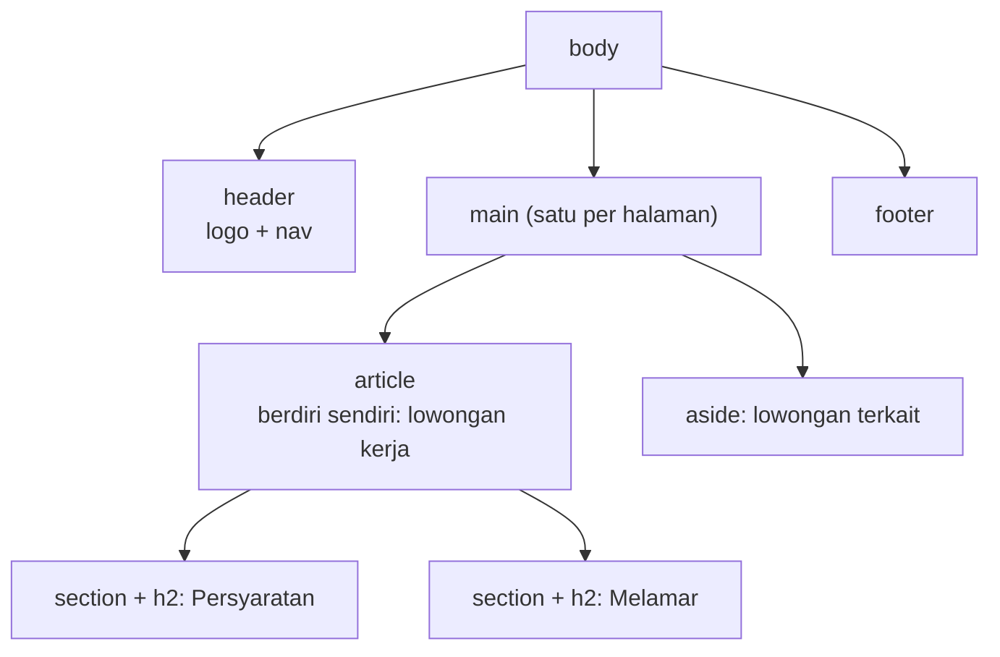

::part[Pelajari Konsepnya]{n="1"}

## 🎯 Yang akan kamu pelajari

- Untuk apa HTML: **makna**, bukan tampilan
- Kerangka dokumen: `doctype`, `lang`, `charset`, viewport, `title`
- **Landmark** (`header`, `nav`, `main`, `footer`, `aside`), `article` vs `section`, hierarki heading
- Semantik level teks: list, link, gambar dengan `alt`, `time`, `data`
- Form yang aksesibel: `label`, tipe input, `required`, `button type`
- Bagaimana browser mengubah HTML menjadi **DOM** dan accessibility tree

## 🧠 Ide besarnya

HTML adalah **kerangka dan label** sebuah halaman; CSS adalah pakaiannya; JavaScript adalah ototnya. Kalau kerangkanya salah — "tombol" yang sebenarnya `<div>` — pakaian sebagus apa pun tidak akan memperbaikinya bagi pengguna keyboard, screen reader, mesin pencari, atau AI agent yang menjelajahi situsmu.

:term[Semantic HTML]{bahasa="HTML semantik — memakai elemen sesuai maknanya, bukan hanya tampilannya"} berarti memilih elemen berdasarkan konten itu **apa**.

## ❓ Kenapa ini ada?

Flask API-mu mengembalikan JSON. Manusia butuh data itu diubah menjadi halaman yang:
- bisa dipakai **semua orang** (≈16% orang hidup dengan disabilitas — WHO),
- bisa diindeks mesin pencari,
- bisa ditingkatkan browser secara gratis (validasi form, dukungan keyboard, reader mode),
- akan dihasilkan oleh component React-mu (Minggu 3) — React juga menghasilkan HTML.

## 💥 Apa yang terjadi kalau TIDAK?

```html
<div class="btn" onclick="submitForm()">Send</div>
<div class="big-title">Backend Engineer</div>
Email <input id="email">
```

- Pengguna keyboard tidak bisa mencapai atau menekan "tombol" itu.
- Screen reader membacakan "Backend Engineer" sebagai teks biasa, bukan heading utama halaman.
- Mengeklik kata "Email" tidak memfokuskan input; screen reader hanya bilang "edit text".
- Keyboard ponsel tidak menampilkan `@` untuk email; browser tidak memvalidasi.

## 📖 Cara kerjanya, langkah demi langkah

### 1. Kerangka dokumen

```html
<!doctype html>                    <!-- standards mode -->
<html lang="en">                   <!-- pronunciation, translation, hyphenation -->
  <head>
    <meta charset="utf-8" />       <!-- "Rp 9–14 juta" shows correctly -->
    <meta name="viewport" content="width=device-width, initial-scale=1" />  <!-- mobile scaling -->
    <title>Backend Engineer at Kopi Data · CareerPilot</title>              <!-- tab, bookmarks, search results -->
  </head>
  <body>…</body>
</html>
```

### 2. Landmark dan section



| Elemen | Dipakai untuk |
|---|---|
| `header` / `footer` | pembuka/penutup halaman (atau sebuah article) |
| `nav` | blok navigasi utama |
| `main` | konten utama yang unik — tepat satu |
| `article` | konten yang bermakna walau berdiri sendiri (post, kartu lowongan, komentar) |
| `section` | kelompok tematik **dengan heading** |
| `aside` | konten terkait tapi sekunder |
| `div` / `span` | tanpa makna — hanya untuk kait styling |

Pengguna screen reader melompat antar landmark dan heading seperti daftar isi.

### 3. Heading adalah kerangka tulisan

Satu `h1` per halaman (topik halaman), lalu `h2` untuk section, `h3` di dalamnya. **Jangan melompati level** hanya demi teks yang lebih kecil — itu tugas CSS.

### 4. Semantik teks

```html
<ul><li>Python</li><li>PostgreSQL</li></ul>                     <!-- unordered list -->
<ol><li>Apply</li><li>Interview</li><li>Offer</li></ol>          <!-- steps in order -->
<a href="/companies/kopi-data">Kopi Data company profile</a>    <!-- descriptive link text -->

                                <!-- decorative: empty alt -->
Posted <time datetime="2026-09-01">1 September 2026</time>
<data value="14000000">Rp 14 juta</data>
<strong>Required</strong> vs <em>preferred</em>                  <!-- importance vs emphasis -->
```

- `alt` menjelaskan **tujuan** gambar; `alt=""` yang kosong menyembunyikan gambar dekoratif.
- Link **pergi ke suatu tempat** (`href`); button **melakukan sesuatu**.
- Teks link harus bermakna di luar konteks — screen reader bisa menampilkan daftar semua link.

### 5. Form

```html
<form action="/applications" method="post">
  <label for="email">Email</label>
  <input id="email" name="email" type="email" autocomplete="email" required />

  <fieldset>
    <legend>Work type</legend>
    <label><input type="radio" name="type" value="remote" /> Remote</label>
    <label><input type="radio" name="type" value="onsite" /> On-site</label>
  </fieldset>

  <button type="submit">Send application</button>
</form>
```

- `label for` ↔ `id`: klik label untuk memfokuskan input; screen reader membacakan label.
- `type="email" | "tel" | "number" | "date" | "search"` → keyboard ponsel yang tepat + validasi bawaan.
- `name` adalah yang diterima server (`request.form["email"]` di Flask-mu).
- `autocomplete` memungkinkan browser dan password manager mengisi field.
- Di dalam form, button default-nya `type="submit"` — set `type="button"` untuk aksi yang bukan submit.

### 6. Dari HTML ke DOM

Browser mem-parse HTML menjadi **DOM** (pohon objek yang bisa diubah JavaScript — materi 05) dan membangun **accessibility tree** darinya (role, nama, state). Elemen semantik otomatis mendapat role yang benar: `<button>` → role *button*, `<nav>` → *navigation*.

:::note[🐍 Datang dari Flask]
Template Jinja me-render HTML di server. Semua yang dibahas di sini berlaku sama untuk Jinja, JSX React, dan Next.js — semuanya berakhir sebagai HTML di browser.
:::

## ⚖️ Trade-off

| Pilihan | ✅ | ❌ |
|---|---|---|
| Elemen semantik | aksesibilitas, SEO, perilaku browser gratis | perlu belajar elemen mana yang cocok |
| `div` + role ARIA | bisa dipakai saat tidak ada elemen native | mudah salah; "tanpa ARIA lebih baik daripada ARIA yang buruk" |
| Validasi form native | gratis, aksesibel | styling/pesan terbatas → sering dikombinasikan dengan validasi custom (Minggu 5) |
| Banyak `section` | struktur | `section` tanpa heading hanya menambah noise |

## ✅ Kapan dipakai / 🚫 Kapan TIDAK dipakai

- ✅ Selalu mulai dari elemen semantik native.
- ✅ `article` untuk item berulang yang berdiri sendiri (kartu lowongan).
- 🚫 Jangan pakai heading untuk ukuran, `<br>` untuk jarak, atau table untuk layout.
- 🚫 Jangan tambahkan role ARIA ke elemen yang sudah punya role itu (`<button role="button">`).

## 🏆 Praktik terbaik

- [ ] Sertakan `lang`, `charset`, viewport, dan `title` yang deskriptif di setiap halaman.
- [ ] Pakai landmark; tepat satu `main` dan satu `h1`; jangan pernah melompati level heading.
- [ ] Link untuk navigasi, button untuk aksi; teks link yang deskriptif.
- [ ] `alt` yang bermakna untuk gambar informatif, `alt=""` untuk gambar dekoratif; set `width`/`height` untuk mencegah layout shift.
- [ ] Setiap kontrol form punya `label` yang terlihat; pakai `type`, `name`, `autocomplete`, `required` yang tepat.
- [ ] Tanpa `style` atau `onclick` inline — pisahkan struktur, tampilan, dan perilaku.
- [ ] Validasi dengan W3C validator dan cek dengan screen reader atau accessibility inspector di browser.

## 🏭 Cara dipakai di industri

- Situs sektor publik dan enterprise harus memenuhi **WCAG 2.2 AA**; gugatan dan regulasi aksesibilitas (misalnya European Accessibility Act, berlaku Juni 2025) menjadikan semantik sebagai kebutuhan bisnis.
- Tim SEO mengandalkan heading, `title`, structured data, dan markup semantik.
- Component library (shadcn/ui, Radix — Minggu 5) dibangun di atas HTML semantik plus pola ARIA.
- AI browsing agent juga membaca accessibility tree — situs yang aksesibel lebih mudah dipakai agent.

## ⚠️ Kesalahan umum

- `div` dan `span` yang bisa diklik.
- Teks placeholder sebagai pengganti label.
- `alt="image"` atau nama file sebagai teks alt.
- Banyak `h1` yang dipakai untuk styling.
- Lupa `type="button"` sehingga form ter-submit tanpa sengaja.

::part[Jelaskan & Rancang]{n="2"}

## 🗣️ Jelaskan

Jelaskan ke rekan tim backend kenapa `<div>` yang di-styling seperti tombol "jalan di komputerku" tapi rusak untuk pengguna lain. Sebutkan keyboard, screen reader, dan apa yang diberikan browser secara gratis.

## 📐 Rancang

Buat sketsa kerangka HTML (elemen saja, tanpa CSS) untuk **halaman detail lamaran** CareerPilot: navigasi atas, judul lamaran dan perusahaan, pipeline status (saved → applied → interview…), daftar catatan dengan form "tambah catatan", sidebar berisi info perusahaan, dan footer.

:::quiz
Tampilkan contoh kerangkanya

```html
<body>
  <header>
    <a href="/">CareerPilot</a>
    <nav aria-label="Main"><ul><li><a href="/applications">Applications</a></li>…</ul></nav>
  </header>
  <main>
    <article>
      <header>
        <h1>Backend Engineer</h1>
        <p><a href="/companies/3">Kopi Data</a> · Applied <time datetime="2026-09-02">2 Sep 2026</time></p>
      </header>
      <section aria-labelledby="pipeline-title">
        <h2 id="pipeline-title">Status</h2>
        <ol>                                   <!-- ordered: stages have an order -->
          <li>Saved</li><li aria-current="step">Applied</li><li>Interview</li>…
        </ol>
      </section>
      <section>
        <h2>Notes</h2>
        <ul><li><article><p>Recruiter call on Monday</p><time datetime="…">…</time></article></li></ul>
        <form>
          <label for="note">Add a note</label>
          <textarea id="note" name="body" required></textarea>
          <button type="submit">Save note</button>
        </form>
      </section>
    </article>
    <aside aria-labelledby="company-title">
      <h2 id="company-title">About Kopi Data</h2>
      …
    </aside>
  </main>
  <footer><small>© 2026 CareerPilot</small></footer>
</body>
```

Pilihan yang layak dipertahankan: `ol` untuk pipeline (urutan penting), `aria-current="step"` untuk status saat ini, `aside` untuk info perusahaan yang sekunder, `form` sungguhan untuk catatan.
:::

### 📝 Checklist self-review

- [ ] Satu `main`, satu `h1`, tidak ada level yang dilompati
- [ ] List dipakai untuk konten berbentuk daftar; ordered list saat urutan penting
- [ ] Kontrol form punya label, submit berupa `button`

::ai-review{task="design"}

::part[Latihan Kecil]{n="3"}

:::exercise{path="exercises/web/m4/w1/01-html-semantics" ai="no-ai" title="Selamatkan halaman lowongan penuh div"}
Tulis ulang halaman lowongan kerja yang dibangun dari `<div>` menjadi HTML semantik: dasar dokumen, landmark, kerangka heading yang benar, list, `time`/`data`, teks `alt` dan link yang bermakna, serta form yang semua field-nya berlabel — tanpa style atau handler inline. Tes akan mem-parse HTML-mu dan mengecek setiap aturan.
:::

:::hints
- Mulai dari kerangka di bagian 1, lalu bungkus konten dengan `header`, `main > article`, `footer`.
- "Posted 1 September 2026" → `Posted <time datetime="2026-09-01">1 September 2026</time>`.
- Link bertuliskan "here": tulis ulang kalimatnya agar teks link menyebutkan tujuannya.
:::

## ✅ Cek cepat

:::quiz
Kapan sebuah gambar sebaiknya memakai `alt=""`?

Saat gambar itu murni dekoratif dan tidak menambah informasi — alt kosong memberi tahu screen reader untuk melewatinya.
:::

:::quiz
Apa bedanya link dan button?

Link berpindah ke sebuah URL (`<a href>`); button melakukan aksi di halaman saat ini (submit, buka, toggle).
:::

## 📖 Kamus (glosarium)

| Istilah | Bahasa Indonesia |
|---|---|
| Semantic HTML | HTML semantik |
| Landmark | Penanda wilayah halaman (header, nav, main…) |
| Accessibility (a11y) | Aksesibilitas |
| Screen reader | Pembaca layar |
| DOM | Model objek dokumen — pohon elemen halaman |
| Alt text | Teks alternatif gambar |

## 📚 Lanjut belajar

- [MDN: HTML elements reference](https://developer.mozilla.org/en-US/docs/Web/HTML/Element)
- [MDN: HTML — a good basis for accessibility](https://developer.mozilla.org/en-US/docs/Learn_web_development/Core/Accessibility/HTML)
- [W3C Markup Validation Service](https://validator.w3.org/)
