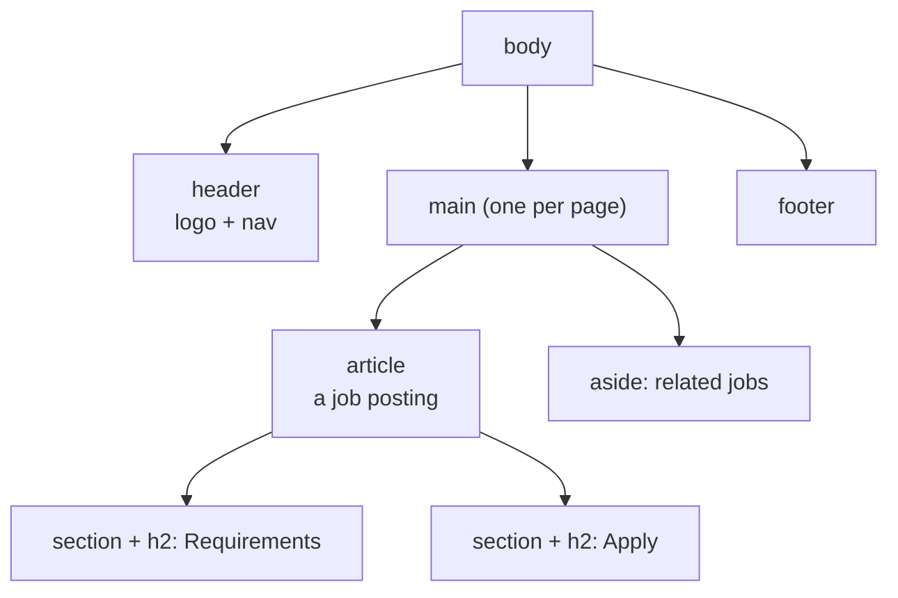

::part[Learn the Concept]{n="1"}

## 🎯 What you'll learn

- What HTML is for: saying what content **is**, not how it looks
- The basic page skeleton
- The main page areas (`header`, `nav`, `main`, `footer`) and headings
- Lists, links, images and forms written the right way
- How the browser turns HTML into something JavaScript and screen readers use

## 🔤 Key words

| Word | In simple words | Bahasa Indonesia |
|---|---|---|
| **Element** | One building block of a page, like `<button>` or `<h1>` | Elemen |
| **Semantic HTML** | Choosing the element that matches the meaning (a button is a `<button>`) | HTML semantik |
| **Landmark** | A big named area of the page: header, navigation, main content, footer | Wilayah halaman |
| **Screen reader** | Software that reads the page aloud for blind users | Pembaca layar |
| **Accessibility (a11y)** | Making the page usable for everyone, including people with disabilities | Aksesibilitas |
| **DOM** | The page as a tree of objects that JavaScript can read and change | Pohon elemen halaman |
| **Attribute** | Extra information on an element, like `href` or `alt` | Atribut |

## 🧠 The big idea

HTML is like the **labels in a supermarket**. The shelves can look beautiful, but if nothing is labeled, people get lost. When a "button" is really a `<div>`, the page may look fine, but keyboards, screen readers and Google can't tell what it is.

Semantic HTML = put the right label on every part of the page.

## ❓ Why it matters

Your Flask API returns JSON. People need that data shown as a page that:
- **everyone** can use (about 16% of people live with a disability — WHO),
- Google can understand,
- gets free help from the browser (keyboard support, form checks),
- your React components will produce later (React also outputs HTML).

A page built with the wrong elements breaks quietly:

```html
<div class="btn" onclick="submitForm()">Send</div>
<div class="big-title">Backend Engineer</div>
Email <input id="email">
```

- Keyboard users can't reach or press the "button".
- Screen readers don't know "Backend Engineer" is the page title.
- Clicking the word "Email" doesn't focus the input.
- Phones don't show the `@` keyboard, and the browser doesn't check the email.

## 📖 Step by step

### 1. The page skeleton

Every page starts the same way — like the frame of a house before the walls.

```html
<!doctype html>                    <!-- standards mode -->
<html lang="en">                   <!-- pronunciation, translation, hyphenation -->
  <head>
    <meta charset="utf-8" />       <!-- "Rp 9–14 juta" shows correctly -->
    <meta name="viewport" content="width=device-width, initial-scale=1" />  <!-- mobile scaling -->
    <title>Backend Engineer at Kopi Data · CareerPilot</title>              <!-- tab, bookmarks, search results -->
  </head>
  <body>…</body>
</html>
```

- `lang` tells screen readers which language to speak.
- `viewport` makes the page fit phone screens.
- `title` is the text in the browser tab and in Google results.

### 2. Main areas (landmarks)

Think of a newspaper: a header at the top, the main story, side notes, and a footer. HTML has an element for each area.



| Element | Use it for |
|---|---|
| `header` / `footer` | top and bottom of the page (or of an article) |
| `nav` | a group of main navigation links |
| `main` | the main content — only **one** per page |
| `article` | something that makes sense alone (a job card, a post) |
| `section` | a group of related content **with a heading** |
| `aside` | extra, less important content |
| `div` / `span` | no meaning — only for styling |

Screen reader users jump between these areas like using a table of contents.

### 3. Headings are the outline

Headings work like a book's table of contents: one `h1` (the page topic), then `h2` for sections, `h3` inside them. **Don't skip levels** just to get smaller text — change the size with CSS.

### 4. Lists, links, images and text

```html
<ul><li>Python</li><li>PostgreSQL</li></ul>                     <!-- unordered list -->
<ol><li>Apply</li><li>Interview</li><li>Offer</li></ol>          <!-- steps in order -->
<a href="/companies/kopi-data">Kopi Data company profile</a>    <!-- descriptive link text -->

                                <!-- decorative: empty alt -->
Posted <time datetime="2026-09-01">1 September 2026</time>
<data value="14000000">Rp 14 juta</data>
<strong>Required</strong> vs <em>preferred</em>                  <!-- importance vs emphasis -->
```

- `alt` = a short description of the image, read aloud when the image can't be seen. Use `alt=""` for pure decoration.
- A **link** takes you somewhere (`href`). A **button** does something on this page. Like a door vs a light switch.
- Link text must make sense alone. "Kopi Data company profile" is good; "click here" is not.

### 5. Forms

```html
<form action="/applications" method="post">
  <label for="email">Email</label>
  <input id="email" name="email" type="email" autocomplete="email" required />

  <fieldset>
    <legend>Work type</legend>
    <label><input type="radio" name="type" value="remote" /> Remote</label>
    <label><input type="radio" name="type" value="onsite" /> On-site</label>
  </fieldset>

  <button type="submit">Send application</button>
</form>
```

- `label for="email"` connects to `id="email"` — like a name tag on a box. Clicking the label focuses the input.
- `type="email"` gives phones the right keyboard and lets the browser check the value.
- `name` is the key your Flask server receives (`request.form["email"]`).
- Inside a form, a button **submits by default**. Use `type="button"` for other actions.

### 6. From HTML to DOM

The browser reads your HTML and builds the **DOM** — a tree of objects that JavaScript can change (lesson 05). From the same tree, it builds what screen readers read. Correct elements get correct roles for free: `<button>` is announced as "button".

:::note[🐍 Coming from Flask]
Jinja templates also produce HTML. Everything here applies to Jinja, React and Next.js — they all end up as HTML in the browser.
:::

## ⚠️ Common mistakes

- Clickable `div`s and `span`s instead of `<button>` or `<a>`.
- Placeholder text instead of a real `<label>`.
- `alt="image"` or a file name as alt text.
- Many `h1`s, or headings chosen only for their size.
- Adding ARIA roles to elements that already have them (`<button role="button">`).
- Forgetting `type="button"`, so a button submits the form by accident.

## 🏆 Best practices

- [ ] Every page has `lang`, `charset`, viewport and a clear `title`.
- [ ] Use landmarks; exactly one `main` and one `h1`; don't skip heading levels.
- [ ] Links for going somewhere, buttons for actions; link text that makes sense alone.
- [ ] Useful `alt` for real images, `alt=""` for decoration; set `width` and `height`.
- [ ] Every form field has a visible `label`, the right `type`, a `name` and `autocomplete`.
- [ ] No inline `style` or `onclick` — keep HTML, CSS and JavaScript separate.
- [ ] Check your page with the W3C validator and your browser's accessibility panel.

::part[Explain & Design]{n="2"}

## 🗣️ Explain it

A backend teammate says: "My `<div>` button works when I click it." Explain, using the supermarket-label idea, why it is still broken for keyboard and screen reader users, and what `<button>` gives for free.

## 📐 Design it

Write the HTML outline (elements only, no CSS) for CareerPilot's **application detail page**: top navigation, job title and company, a status list (saved → applied → interview…), a notes list with an "add note" form, a side box with company info, and a footer.

:::quiz
Show a possible outline

```html
<body>
  <header>
    <a href="/">CareerPilot</a>
    <nav aria-label="Main"><ul><li><a href="/applications">Applications</a></li>…</ul></nav>
  </header>
  <main>
    <article>
      <header>
        <h1>Backend Engineer</h1>
        <p><a href="/companies/3">Kopi Data</a> · Applied <time datetime="2026-09-02">2 Sep 2026</time></p>
      </header>
      <section aria-labelledby="pipeline-title">
        <h2 id="pipeline-title">Status</h2>
        <ol>                                   <!-- ordered: stages have an order -->
          <li>Saved</li><li aria-current="step">Applied</li><li>Interview</li>…
        </ol>
      </section>
      <section>
        <h2>Notes</h2>
        <ul><li><article><p>Recruiter call on Monday</p><time datetime="…">…</time></article></li></ul>
        <form>
          <label for="note">Add a note</label>
          <textarea id="note" name="body" required></textarea>
          <button type="submit">Save note</button>
        </form>
      </section>
    </article>
    <aside aria-labelledby="company-title">
      <h2 id="company-title">About Kopi Data</h2>
      …
    </aside>
  </main>
  <footer><small>© 2026 CareerPilot</small></footer>
</body>
```

Why these choices: `ol` because the status steps have an order; `aria-current="step"` marks the current status; `aside` because company info is extra; a real `form` for notes.
:::

### 📝 Self-review checklist

- [ ] One `main`, one `h1`, no skipped heading levels
- [ ] Lists for list content; `ol` when the order matters
- [ ] Every form field has a label; submit is a `button`

::ai-review{task="design"}

::part[Toy Exercise]{n="3"}

:::exercise{path="exercises/web/m4/w1/01-html-semantics" ai="no-ai" title="Rescue a div-soup job page"}
A job page is built only from `<div>`s. Rewrite it with the right elements: page skeleton, main areas, correct headings, lists, `time`/`data`, useful `alt` and link text, and a form where every field has a label — with no inline styles or handlers. The tests read your HTML and check each rule.
:::

:::hints
- Start from the skeleton in step 1, then wrap the content in `header`, `main > article` and `footer`.
- "Posted 1 September 2026" → `Posted <time datetime="2026-09-01">1 September 2026</time>`.
- For "here" links, rewrite the sentence so the link text says where it goes.
:::

## ✅ Quick check

:::quiz
When should an image have `alt=""`?

When it is only decoration and adds no information. Empty alt tells screen readers to skip it.
:::

:::quiz
What's the difference between a link and a button?

A link goes to another page or place (`<a href>`). A button does an action on the current page, like submit, open or toggle.
:::

## 📚 Keep learning

- [MDN: HTML elements reference](https://developer.mozilla.org/en-US/docs/Web/HTML/Element)
- [MDN: HTML — a good basis for accessibility](https://developer.mozilla.org/en-US/docs/Learn_web_development/Core/Accessibility/HTML)
- [W3C Markup Validation Service](https://validator.w3.org/)
