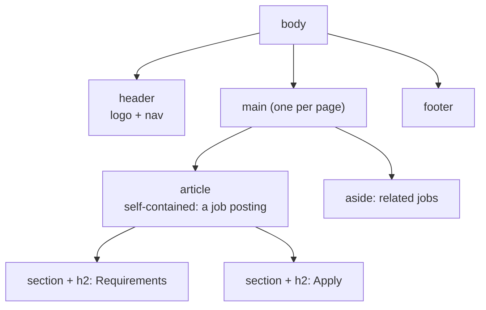

::part[Learn the Concept]{n="1"}

## 🎯 What you'll learn

- What HTML is for: **meaning**, not appearance
- The document skeleton: `doctype`, `lang`, `charset`, viewport, `title`
- **Landmarks** (`header`, `nav`, `main`, `footer`, `aside`), `article` vs `section`, heading hierarchy
- Text-level semantics: lists, links, images with `alt`, `time`, `data`
- Accessible forms: `label`, input types, `required`, `button type`
- How the browser turns HTML into the **DOM** and the accessibility tree

## 🧠 The big idea

HTML is the **skeleton and labels** of a page; CSS is the clothes; JavaScript is the muscles. If the skeleton is wrong — a "button" that's really a `<div>` — no amount of clothing fixes it for keyboard users, screen readers, search engines or AI agents browsing your site.

:term[Semantic HTML]{bahasa="HTML semantik — memakai elemen sesuai maknanya, bukan hanya tampilannya"} means choosing elements for what content **is**.

## ❓ Why does this exist?

Your Flask API returns JSON. Humans need that data turned into a page that:
- **everyone** can use (≈16% of people live with a disability — WHO),
- search engines can index,
- browsers can enhance for free (form validation, keyboard support, reader mode),
- your React components (Week 3) will output — React produces HTML too.

## 💥 What happens if we DON'T?

```html
<div class="btn" onclick="submitForm()">Send</div>
<div class="big-title">Backend Engineer</div>
Email <input id="email">
```

- Keyboard users can't reach or press the "button".
- Screen readers announce "Backend Engineer" as plain text, not the page's main heading.
- Clicking the word "Email" doesn't focus the input; the reader just says "edit text".
- Mobile keyboards don't show `@` for email; the browser doesn't validate.

## 📖 How it works, step by step

### 1. The document skeleton

```html
<!doctype html>                    <!-- standards mode -->
<html lang="en">                   <!-- pronunciation, translation, hyphenation -->
  <head>
    <meta charset="utf-8" />       <!-- "Rp 9–14 juta" shows correctly -->
    <meta name="viewport" content="width=device-width, initial-scale=1" />  <!-- mobile scaling -->
    <title>Backend Engineer at Kopi Data · CareerPilot</title>              <!-- tab, bookmarks, search results -->
  </head>
  <body>…</body>
</html>
```

### 2. Landmarks and sections



| Element | Use for |
|---|---|
| `header` / `footer` | intro/outro of the page (or of an article) |
| `nav` | major navigation blocks |
| `main` | the unique main content — exactly one |
| `article` | content that makes sense on its own (post, job card, comment) |
| `section` | a thematic group **with a heading** |
| `aside` | related but secondary content |
| `div` / `span` | no meaning — for styling hooks only |

Screen reader users jump between landmarks and headings like a table of contents.

### 3. Headings are an outline

One `h1` per page (the page's topic), then `h2` for sections, `h3` inside those. **Don't skip levels** to get smaller text — that's CSS's job.

### 4. Text semantics

```html
<ul><li>Python</li><li>PostgreSQL</li></ul>                     <!-- unordered list -->
<ol><li>Apply</li><li>Interview</li><li>Offer</li></ol>          <!-- steps in order -->
<a href="/companies/kopi-data">Kopi Data company profile</a>    <!-- descriptive link text -->

                                <!-- decorative: empty alt -->
Posted <time datetime="2026-09-01">1 September 2026</time>
<data value="14000000">Rp 14 juta</data>
<strong>Required</strong> vs <em>preferred</em>                  <!-- importance vs emphasis -->
```

- `alt` describes the image's **purpose**; empty `alt=""` hides decorative images.
- Links **go somewhere** (`href`); buttons **do something**.
- Link text must make sense out of context — screen readers can list all links.

### 5. Forms

```html
<form action="/applications" method="post">
  <label for="email">Email</label>
  <input id="email" name="email" type="email" autocomplete="email" required />

  <fieldset>
    <legend>Work type</legend>
    <label><input type="radio" name="type" value="remote" /> Remote</label>
    <label><input type="radio" name="type" value="onsite" /> On-site</label>
  </fieldset>

  <button type="submit">Send application</button>
</form>
```

- `label for` ↔ `id`: click the label to focus; screen readers read the label.
- `type="email" | "tel" | "number" | "date" | "search"` → right mobile keyboard + built-in validation.
- `name` is what the server receives (your Flask `request.form["email"]`).
- `autocomplete` lets browsers and password managers fill fields.
- Buttons default to `type="submit"` inside forms — set `type="button"` for non-submit actions.

### 6. From HTML to DOM

The browser parses HTML into the **DOM** (a tree of objects JavaScript can change — lesson 05) and builds an **accessibility tree** from it (roles, names, states). Semantic elements get correct roles automatically: `<button>` → role *button*, `<nav>` → *navigation*.

:::note[🐍 Coming from Flask]
Jinja templates render HTML on the server. Everything here applies to Jinja, React JSX and Next.js alike — they all end up as HTML in the browser.
:::

## ⚖️ Trade-offs

| Choice | ✅ | ❌ |
|---|---|---|
| Semantic elements | accessibility, SEO, free browser behavior | need to learn which element fits |
| `div` + ARIA roles | possible when no native element exists | easy to get wrong; "no ARIA is better than bad ARIA" |
| Native form validation | free, accessible | limited styling/messages → often combined with custom validation (Week 5) |
| Many `section`s | structure | a `section` without a heading adds noise |

## ✅ When to use it / 🚫 When NOT to use it

- ✅ Always start from native semantic elements.
- ✅ `article` for repeated self-contained items (job cards).
- 🚫 Don't use headings for size, `<br>` for spacing, or tables for layout.
- 🚫 Don't add ARIA roles to elements that already have them (`<button role="button">`).

## 🏆 Best practices

- [ ] Include `lang`, `charset`, viewport and a descriptive `title` on every page.
- [ ] Use landmarks; exactly one `main` and one `h1`; never skip heading levels.
- [ ] Links for navigation, buttons for actions; descriptive link text.
- [ ] Meaningful `alt` for informative images, `alt=""` for decorative ones; set `width`/`height` to avoid layout shift.
- [ ] Every form control has a visible `label`; use the right `type`, `name`, `autocomplete`, `required`.
- [ ] No inline `style` or `onclick` — keep structure, presentation and behavior separate.
- [ ] Validate with the W3C validator and check with a screen reader or the browser's accessibility inspector.

## 🏭 How it's used in industry

- Public-sector and enterprise sites must meet **WCAG 2.2 AA**; accessibility lawsuits and regulations (e.g. the European Accessibility Act, effective June 2025) make semantics a business requirement.
- SEO teams rely on headings, `title`, structured data and semantic markup.
- Component libraries (shadcn/ui, Radix — Week 5) are built on semantic HTML plus ARIA patterns.
- AI browsing agents read the accessibility tree too — accessible sites are easier for agents to use.

## ⚠️ Common mistakes

- Clickable `div`s and `span`s.
- Placeholder text instead of labels.
- `alt="image"` or file names as alt text.
- Multiple `h1`s used for styling.
- Forgetting `type="button"` and accidentally submitting forms.

::part[Explain & Design]{n="2"}

## 🗣️ Explain it

Explain to a backend teammate why a `<div>` styled like a button "works for me" but is broken for other users. Mention keyboard, screen readers and what the browser gives you for free.

## 📐 Design it

Sketch the HTML outline (elements only, no CSS) for CareerPilot's **application detail page**: top navigation, application title and company, status pipeline (saved → applied → interview…), notes list with an "add note" form, a sidebar with company info, and a footer.

:::quiz
Show a possible outline

```html
<body>
  <header>
    <a href="/">CareerPilot</a>
    <nav aria-label="Main"><ul><li><a href="/applications">Applications</a></li>…</ul></nav>
  </header>
  <main>
    <article>
      <header>
        <h1>Backend Engineer</h1>
        <p><a href="/companies/3">Kopi Data</a> · Applied <time datetime="2026-09-02">2 Sep 2026</time></p>
      </header>
      <section aria-labelledby="pipeline-title">
        <h2 id="pipeline-title">Status</h2>
        <ol>                                   <!-- ordered: stages have an order -->
          <li>Saved</li><li aria-current="step">Applied</li><li>Interview</li>…
        </ol>
      </section>
      <section>
        <h2>Notes</h2>
        <ul><li><article><p>Recruiter call on Monday</p><time datetime="…">…</time></article></li></ul>
        <form>
          <label for="note">Add a note</label>
          <textarea id="note" name="body" required></textarea>
          <button type="submit">Save note</button>
        </form>
      </section>
    </article>
    <aside aria-labelledby="company-title">
      <h2 id="company-title">About Kopi Data</h2>
      …
    </aside>
  </main>
  <footer><small>© 2026 CareerPilot</small></footer>
</body>
```

Choices worth defending: `ol` for the pipeline (order matters), `aria-current="step"` for the current status, `aside` for secondary company info, a real `form` for notes.
:::

### 📝 Self-review checklist

- [ ] One `main`, one `h1`, no skipped levels
- [ ] Lists where content is a list; ordered where order matters
- [ ] Form controls labeled, submit is a `button`

::ai-review{task="design"}

::part[Toy Exercise]{n="3"}

:::exercise{path="exercises/web/m4/w1/01-html-semantics" ai="no-ai" title="Rescue a div-soup job page"}
Rewrite a job posting built from `<div>`s into semantic HTML: document basics, landmarks, a correct heading outline, lists, `time`/`data`, meaningful `alt` and link text, and a fully labeled form — without inline styles or handlers. The tests parse your HTML and check each rule.
:::

:::hints
- Start from the skeleton in section 1, then wrap content in `header`, `main > article`, `footer`.
- "Posted 1 September 2026" → `Posted <time datetime="2026-09-01">1 September 2026</time>`.
- "here" links: rewrite the sentence so the link text says where it goes.
:::

## ✅ Quick check

:::quiz
When should an image have `alt=""`?

When it's purely decorative and adds no information — empty alt tells screen readers to skip it.
:::

:::quiz
What's the difference between a link and a button?

A link navigates to a URL (`<a href>`); a button performs an action on the current page (submit, open, toggle).
:::

## 📖 Kamus (glossary)

| Term | Bahasa Indonesia |
|---|---|
| Semantic HTML | HTML semantik |
| Landmark | Penanda wilayah halaman (header, nav, main…) |
| Accessibility (a11y) | Aksesibilitas |
| Screen reader | Pembaca layar |
| DOM | Model objek dokumen — pohon elemen halaman |
| Alt text | Teks alternatif gambar |

## 📚 Keep learning

- [MDN: HTML elements reference](https://developer.mozilla.org/en-US/docs/Web/HTML/Element)
- [MDN: HTML — a good basis for accessibility](https://developer.mozilla.org/en-US/docs/Learn_web_development/Core/Accessibility/HTML)
- [W3C Markup Validation Service](https://validator.w3.org/)
