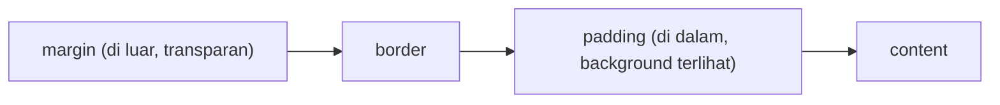

::part[Pelajari Konsepnya]{n="1"}

## 🎯 Yang akan kamu pelajari

- Rule, selector, dan declaration
- **Cascade**: origin, specificity, urutan — dan inheritance
- **Box model** dan `box-sizing: border-box`
- Unit (`px`, `rem`, `em`, `%`, `vw`, `ch`) dan kapan memakai masing-masing
- Warna, tipografi, **custom property** (design token)
- State: `:hover`, `:focus-visible`, `:disabled`
- Konvensi penamaan (BEM) dan posisi Tailwind nanti (Minggu 2)

## 🧠 Ide besarnya

CSS adalah kumpulan **aturan yang saling bersaing**. Banyak rule bisa ingin mengatur warna tombol yang sama; browser menggelar turnamen — **cascade** — untuk menentukan pemenangnya. Kebanyakan momen "CSS-nya rusak!" sebenarnya adalah "aku tidak tahu rule mana yang menang dan kenapa".

## ❓ Kenapa ini ada?

Memisahkan **tampilan** (CSS) dari **struktur** (HTML) berarti satu stylesheet bisa mengubah gaya ribuan halaman, pengguna bisa menerapkan style mereka sendiri (font lebih besar, kontras tinggi), dan HTML yang sama bisa terlihat benar di ponsel, laptop, maupun saat dicetak.

## 💥 Apa yang terjadi kalau TIDAK memahaminya?

```css
#job-list .card .title { color: navy; }
.title { color: indigo !important; }          /* fighting back */
.card-title-new-final { color: purple !important; }  /* escalation */
```

Perang specificity dan `!important` terus memanas sampai tidak ada yang berani mengubah apa pun. `#4f46e5` yang di-hardcode di 60 tempat berarti rebranding makan waktu seminggu. `font-size: 12px` di mana-mana mengabaikan pengguna yang memperbesar ukuran font browser mereka.

## 📖 Cara kerjanya, langkah demi langkah

### 1. Anatomi sebuah rule

```css
.card__title {            /* selector */
  font-size: 1.25rem;     /* declaration: property: value; */
  margin: 0;
}
```

| Selector | Cocok dengan | Specificity (id, class, type) |
|---|---|---|
| `h2` | setiap h2 | 0,0,1 |
| `.card` | class | 0,1,0 |
| `.card h2` | h2 di dalam .card | 0,1,1 |
| `.button:hover` | pseudo-class dihitung sebagai class | 0,2,0 |
| `#main` | id | 1,0,0 |
| `style="..."` | inline | mengalahkan semua selector |

### 2. Cascade, berurutan

1. **Origin & importance**: default browser < style-mu; `!important` membalik urutannya (hindari).
2. **Specificity**: yang lebih tinggi menang (bandingkan id, lalu class, lalu type).
3. **Urutan**: specificity sama → rule yang **lebih akhir** menang.

Ditambah **inheritance**: property teks (`color`, `font-family`, `line-height`) mengalir dari parent ke child; property kotak (`margin`, `border`) tidak.

Jaga specificity tetap **rendah dan datar** (satu class saja) agar urutan dan maksudnya tetap mudah ditebak. `:where()` memberi selector specificity nol — berguna untuk style dasar.

### 3. Box model



```css
*, *::before, *::after { box-sizing: border-box; }
```

Dengan default `content-box`, `width: 300px; padding: 20px` menghasilkan kotak 340 px. `border-box` menjaganya tetap 300 px — itulah alasan setiap reset modern menyertakan baris ini.

Margin vertikal antar blok **collapse** (yang lebih besar menang); padding tidak pernah.

### 4. Unit

| Unit | Relatif terhadap | Dipakai untuk |
|---|---|---|
| `rem` | ukuran font root (biasanya 16px) | ukuran font, spacing — menghormati pengaturan pengguna |
| `em` | ukuran font elemen saat ini | padding yang ikut membesar bersama teks component |
| `px` | pixel CSS | border, shadow, garis tipis |
| `%` | ukuran parent | lebar yang fleksibel |
| `vw` / `vh` / `dvh` | viewport | section layar penuh (`dvh` menangani toolbar ponsel) |
| `ch` | lebar karakter "0" | panjang baris yang nyaman dibaca: `max-width: 65ch` |

### 5. Warna dan tipografi

```css
body {
  font-family: "Inter", system-ui, sans-serif;  /* fallback stack ends with a generic family */
  line-height: 1.5;                              /* unitless: scales with font size */
  color: #0f172a;
}
.muted { color: rgb(100 116 139); }
.overlay { background: rgb(15 23 42 / 0.6); }   /* alpha channel */
```

Cek **kontras**: WCAG AA mensyaratkan 4.5:1 untuk teks normal.

### 6. Custom property (design token)

```css
:root {
  --color-primary: #4f46e5;
  --radius: 0.75rem;
  --space-4: 1rem;
}
.button { background: var(--color-primary); border-radius: var(--radius); padding: var(--space-4); }

@media (prefers-color-scheme: dark) {
  :root { --color-surface: #0f172a; }          /* dark mode = change tokens, not components */
}
```

Token adalah jembatan ke design system dan ke Tailwind v4, yang menghasilkan utility-nya dari variabel CSS.

### 7. State

```css
.button:hover { filter: brightness(1.1); }
.button:focus-visible { outline: 3px solid var(--color-primary); outline-offset: 2px; }
.button:disabled { opacity: 0.5; cursor: not-allowed; }
```

`:focus-visible` menampilkan focus ring untuk pengguna **keyboard** tanpa memunculkannya setiap kali mouse diklik. Jangan pernah `outline: none` tanpa penggantinya.

### 8. Penamaan: BEM

`block__element--modifier`: `.card`, `.card__title`, `.badge--remote`. Selector class yang datar, hubungan yang jelas, tanpa perang nesting. (Minggu 2 menggantinya dengan utility class Tailwind — kamu akan tahu apa yang dihasilkannya.)

## ⚖️ Trade-off

| Pilihan | ✅ | ❌ |
|---|---|---|
| CSS biasa + BEM | tanpa tooling, kontrol penuh | butuh disiplin penamaan; CSS yang tak terpakai menumpuk |
| Utility-first (Tailwind) | cepat, konsisten, tanpa pusing penamaan | daftar class panjang; harus mempelajari utility |
| CSS Modules / scoped styles | tanpa tabrakan global | butuh build step |
| Custom property | theming saat runtime, token | tidak ada pengecekan typo saat compile |
| `!important` | override cepat | merusak cascade; memicu eskalasi |

## ✅ Kapan dipakai / 🚫 Kapan TIDAK dipakai

- ✅ Token untuk warna, spacing, radius, dan font sejak hari pertama.
- ✅ Selector satu class untuk component.
- 🚫 ID untuk styling (simpan untuk anchor dan `label for`).
- 🚫 `!important`, kecuali untuk meng-override inline style dari pihak ketiga atau "jalan darurat" utility.

## 🏆 Praktik terbaik

- [ ] Mulai dengan reset kecil: `box-sizing: border-box`, `margin: 0` pada body, `img { max-width: 100% }`.
- [ ] Definisikan **design token** di `:root`; jangan pernah hardcode warna brand di component.
- [ ] Jaga specificity tetap datar; hindari ID dan rantai descendant yang dalam.
- [ ] Pakai `rem` untuk tipografi dan spacing, `line-height` tanpa unit, dan font stack dengan fallback.
- [ ] Selalu styling `:focus-visible`; cek kontras warna (DevTools menampilkan rasionya).
- [ ] Hormati preferensi pengguna: `prefers-color-scheme`, `prefers-reduced-motion`.
- [ ] Pakai panel **Computed** dan **Styles** di DevTools untuk melihat rule mana yang menang.

## 🏭 Cara dipakai di industri

- Design system (Material, Radix Themes, UI kit perusahaan) dibangun di atas token yang diedit desainer di Figma dan dipakai developer sebagai variabel CSS.
- Tailwind CSS mendominasi proyek React/Next.js baru — memahami cascade membuat utility-nya mudah ditebak.
- CSS modern (`:has()`, container query, nesting, `@layer`) didukung semua browser evergreen dan menggantikan banyak JavaScript lama.

## ⚠️ Kesalahan umum

- Lupa `border-box`, lalu bergulat dengan lebar elemen.
- Memakai ukuran font `px` yang mengabaikan pengaturan browser pengguna.
- Menghapus outline fokus demi estetika.
- Teks abu-abu berkontras rendah di atas putih.
- Styling dengan ID, lalu butuh `!important` untuk meng-override.

::part[Jelaskan & Rancang]{n="2"}

## 🗣️ Jelaskan

Seorang rekan bertanya: "Aku menulis `.title { color: red }` di bagian bawah file, kenapa masih biru?" Jelaskan cascade dan bagaimana dia bisa menemukan rule pemenangnya di DevTools.

## 📐 Rancang

Rancang kumpulan token untuk UI CareerPilot: warna (termasuk warna status untuk saved/applied/interview/offer/rejected), skala spacing, radius, ukuran font, dan cara kerja dark mode — sebagai CSS custom property.

:::quiz
Tampilkan contoh kumpulan tokennya

```css
:root {
  /* brand & neutrals */
  --color-primary: #4f46e5;  --color-primary-contrast: #ffffff;
  --color-text: #0f172a;     --color-muted: #64748b;
  --color-surface: #ffffff;  --color-background: #f8fafc;  --color-border: #e2e8f0;

  /* semantic status colors (used by badges and the pipeline) */
  --status-saved: #64748b;   --status-applied: #2563eb;  --status-interview: #d97706;
  --status-offer: #16a34a;   --status-rejected: #dc2626;

  /* spacing scale (4px base) */
  --space-1: 0.25rem; --space-2: 0.5rem; --space-3: 0.75rem; --space-4: 1rem; --space-6: 1.5rem; --space-8: 2rem;

  --radius-sm: 0.375rem; --radius: 0.75rem; --radius-full: 999px;
  --text-sm: 0.875rem; --text-base: 1rem; --text-lg: 1.125rem; --text-2xl: 1.5rem;
  --font-sans: "Inter", system-ui, sans-serif;
}

@media (prefers-color-scheme: dark) {
  :root {
    --color-text: #e2e8f0; --color-muted: #94a3b8;
    --color-surface: #0f172a; --color-background: #020617; --color-border: #1e293b;
  }
}
```

Component hanya mereferensikan token **semantik** (`--status-offer`, `--color-surface`), jadi dark mode dan rebranding cukup mengubah token. Jangan pernah menyampaikan status hanya lewat warna — badge juga menampilkan teks.
:::

### 📝 Checklist self-review

- [ ] Nama semantik (untuk apa), bukan nama literal (`--blue`)
- [ ] Skala spacing yang konsisten
- [ ] Dark mode mengubah token, bukan component
- [ ] Status tidak pernah hanya bergantung pada warna

::ai-review{task="design"}

::part[Latihan Kecil]{n="3"}

:::exercise{path="exercises/web/m4/w1/02-css-fundamentals" ai="no-ai" title="Styling kartu lowongan dengan design token"}
Tulis stylesheet dari nol untuk halaman yang disediakan: token di `:root`, reset border-box, tipografi body yang nyaman dibaca, component kartu dan badge ala BEM, state hover dan focus-visible — tanpa ID, `!important`, atau ukuran font pixel. Tes akan mem-parse rule CSS-mu.
:::

:::hints
- Mulai dari token dan reset, lalu `body`, lalu component dari atas ke bawah.
- Pakai token dengan `var(--name)` di setiap rule component.
- `.badge--remote` hanya meng-override bagian yang berbeda dari `.badge`.
:::

## ✅ Cek cepat

:::quiz
Dua rule dengan specificity sama mengatur `color`. Mana yang menang?

Yang muncul lebih akhir di stylesheet (urutan sumber).
:::

:::quiz
Kenapa lebih baik memakai `rem` daripada `px` untuk ukuran font?

`rem` mengikuti ukuran font root, jadi menghormati pengguna yang memperbesar ukuran teks default browser mereka.
:::

## 📖 Kamus (glosarium)

| Istilah | Bahasa Indonesia |
|---|---|
| Cascade | Kaskade — aturan menentukan style mana yang menang |
| Specificity | Spesifisitas — "kekuatan" selector |
| Box model | Model kotak (content, padding, border, margin) |
| Custom property / design token | Variabel CSS / token desain |
| Inheritance | Pewarisan style dari elemen induk |
| Contrast ratio | Rasio kontras warna |

## 📚 Lanjut belajar

- [MDN: Cascade, specificity, and inheritance](https://developer.mozilla.org/en-US/docs/Learn_web_development/Core/Styling_basics/Handling_conflicts)
- [MDN: Using CSS custom properties](https://developer.mozilla.org/en-US/docs/Web/CSS/Using_CSS_custom_properties)
- [WebAIM contrast checker](https://webaim.org/resources/contrastchecker/)
