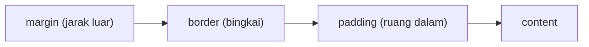

::part[Pelajari Konsepnya]{n="1"}

## 🎯 Yang akan kamu pelajari

- Cara menulis sebuah rule CSS
- Bagaimana browser memutuskan **rule mana yang menang** kalau rule-rule saling bertentangan
- Box model: content, padding, border, margin
- Satuan mana yang dipakai (`rem`, `px`, `%`…)
- Variabel CSS untuk warna dan jarak
- Style untuk hover, fokus keyboard, dan tombol nonaktif

## 🔤 Istilah penting

| Istilah | Artinya (sederhana) |
|---|---|
| **Selector** | Bagian yang memilih elemen mana yang diberi style, misalnya `.card` |
| **Declaration** | Satu baris style: `color: navy;` |
| **Cascade** | Cara browser memilih rule pemenang |
| **Specificity** | Seberapa "kuat" sebuah selector — id mengalahkan class, class mengalahkan tag |
| **Box model** | Setiap elemen adalah kotak: content, padding, border, margin |
| **`rem`** | Ukuran yang mengikuti ukuran font dasar halaman (biasanya 16px) |
| **CSS variable** | Nilai bernama yang dipakai berulang, misalnya `--color-primary` |

## 🧠 Ide besarnya

Rule CSS itu seperti **beberapa orang memberi perintah** untuk baju yang sama: ibumu bilang biru, temanmu bilang merah. Kamu ikut siapa? CSS punya aturan tetap untuk ini, namanya **cascade**. Kebanyakan momen "CSS-nya rusak!" sebenarnya artinya "aku tidak tahu rule mana yang menang".

## ❓ Kenapa ini penting

Memisahkan tampilan (CSS) dari struktur (HTML) berarti satu stylesheet bisa mengubah tampilan seluruh situs, dan pengguna bisa memakai font lebih besar atau kontras tinggi.

Kalau rule-nya berantakan, tidak ada yang berani mengubah apa pun:

```css
#job-list .card .title { color: navy; }
.title { color: indigo !important; }          /* fighting back */
.card-title-new-final { color: purple !important; }  /* escalation */
```

- Rule terus "bertengkar", dan `!important` membuatnya makin parah.
- Warna brand yang disalin ke 60 tempat membuat desain ulang makan waktu seminggu.
- `font-size: 12px` di mana-mana mengabaikan pengguna yang memperbesar teks browser-nya.

## 📖 Langkah demi langkah

### 1. Bentuk sebuah rule

```css
.card__title {            /* selector */
  font-size: 1.25rem;     /* declaration: property: value; */
  margin: 0;
}
```

Selector dari yang lemah ke yang kuat:

| Selector | Memilih | Kekuatan (id, class, tag) |
|---|---|---|
| `h2` | setiap h2 | 0,0,1 |
| `.card` | elemen dengan class `card` | 0,1,0 |
| `.card h2` | h2 di dalam `.card` | 0,1,1 |
| `.button:hover` | tombol yang sedang di-hover (`:hover` dihitung seperti class) | 0,2,0 |
| `#main` | elemen dengan id `main` | 1,0,0 |
| `style="..."` | style inline | mengalahkan semua selector |

### 2. Rule mana yang menang?

Seperti turnamen sepak bola dengan babak yang tetap:

1. **`!important`** menang atas rule biasa (hindari — memicu pertengkaran).
2. **Selector yang lebih kuat** menang (bandingkan id, lalu class, lalu tag).
3. Kalau sama kuat, **rule yang ditulis belakangan** menang.

Beberapa property **diwariskan**, seperti sifat keluarga: style teks (`color`, `font-family`) turun dari parent ke child. Style kotak (`margin`, `border`) tidak.

Tips: jaga selector tetap **lemah dan sederhana** (satu class saja). Dengan begitu kamu cukup ingat "yang belakangan menang".

### 3. Box model

Setiap elemen adalah kotak, seperti **foto berbingkai**: fotonya (content), ruang putih di sekelilingnya (padding), bingkainya (border), dan jarak ke foto berikutnya di dinding (margin).



```css
*, *::before, *::after { box-sizing: border-box; }
```

Tanpa baris ini, `width: 300px; padding: 20px` menghasilkan kotak 340 px (padding ditambahkan di luar lebar). Dengan `border-box`, kotaknya tetap 300 px. Itulah kenapa hampir setiap proyek dimulai dengan baris ini.

### 4. Satuan ukuran

| Satuan | Mengikuti | Dipakai untuk |
|---|---|---|
| `rem` | ukuran font dasar halaman | ukuran font dan jarak — menghormati pengaturan pengguna |
| `em` | ukuran font elemen ini | padding yang ikut membesar bersama teks |
| `px` | pixel layar yang tetap | border dan garis tipis |
| `%` | ukuran parent | lebar yang fleksibel |
| `vw` / `dvh` | ukuran layar | section layar penuh |
| `ch` | lebar karakter "0" | lebar baca yang nyaman: `max-width: 65ch` |

### 5. Warna dan teks

```css
body {
  font-family: "Inter", system-ui, sans-serif;  /* fallback stack ends with a generic family */
  line-height: 1.5;                              /* unitless: scales with font size */
  color: #0f172a;
}
.muted { color: rgb(100 116 139); }
.overlay { background: rgb(15 23 42 / 0.6); }   /* alpha channel */
```

Cek **kontras** (seberapa beda warna teks dan latar belakangnya): teks normal butuh minimal 4.5:1. DevTools browser menampilkan angka ini.

### 6. Variabel CSS (design token)

Variabel CSS itu seperti **kontak di HP-mu**: nomornya disimpan sekali dengan nama "Ibu" lalu dipakai di mana-mana. Kalau nomornya berubah, cukup ubah di satu tempat.

```css
:root {
  --color-primary: #4f46e5;
  --radius: 0.75rem;
  --space-4: 1rem;
}
.button { background: var(--color-primary); border-radius: var(--radius); padding: var(--space-4); }

@media (prefers-color-scheme: dark) {
  :root { --color-surface: #0f172a; }          /* dark mode = change tokens, not components */
}
```

Dark mode jadi mudah: ubah variabelnya, bukan setiap component. Tailwind (Minggu 2) juga dibangun di atas variabel CSS.

### 7. Hover, fokus, dan nonaktif

```css
.button:hover { filter: brightness(1.1); }
.button:focus-visible { outline: 3px solid var(--color-primary); outline-offset: 2px; }
.button:disabled { opacity: 0.5; cursor: not-allowed; }
```

- `:hover` — mouse sedang berada di atasnya.
- `:focus-visible` — pengguna sampai ke elemen itu dengan **keyboard** (Tab). Muncul cincin agar mereka tahu posisinya, seperti kursor.
- Jangan pernah menulis `outline: none` tanpa menambahkan style fokus lain yang terlihat.

### 8. Memberi nama class: BEM

BEM adalah kebiasaan penamaan: `block__element--modifier`, misalnya `.card`, `.card__title`, `.badge--remote`. Namanya menunjukkan bagian mana milik siapa, dan setiap selector tetap satu class sederhana. (Di Minggu 2, Tailwind menggantikan sebagian besar cara ini.)

## ⚠️ Kesalahan umum

- Lupa `box-sizing: border-box`, lalu bergulat dengan lebar elemen.
- Ukuran font `px` yang mengabaikan pengaturan browser pengguna.
- Menghapus outline fokus karena "terlihat jelek".
- Teks abu-abu muda di atas putih (kontras rendah).
- Styling dengan id, lalu butuh `!important` untuk menimpanya.

## 🏆 Praktik terbaik

- [ ] Mulai dengan reset kecil: `box-sizing: border-box`, `margin: 0` pada body, `img { max-width: 100% }`.
- [ ] Taruh warna, jarak, dan radius di variabel CSS di `:root`; jangan salin warna brand ke component.
- [ ] Jaga selector tetap sederhana (satu class); hindari id dan rantai panjang.
- [ ] Pakai `rem` untuk teks dan jarak, dan `line-height` tanpa satuan.
- [ ] Selalu beri style `:focus-visible`; cek kontras warna.
- [ ] Hormati pengaturan pengguna: `prefers-color-scheme`, `prefers-reduced-motion`.
- [ ] Kalau style tidak berlaku, buka DevTools → **Styles** untuk melihat rule mana yang menang dan kenapa.

::part[Jelaskan & Rancang]{n="2"}

## 🗣️ Jelaskan

Rekan tim bertanya: "Aku menulis `.title { color: red }` di bagian bawah file. Kenapa masih biru?" Jelaskan aturan "siapa yang menang" dan cara menemukan rule pemenangnya di DevTools.

## 📐 Rancang

Rencanakan variabel CSS untuk CareerPilot: warna (termasuk warna untuk setiap status: saved, applied, interview, offer, rejected), skala jarak, radius sudut, ukuran font, dan cara kerja dark mode.

:::quiz
Tampilkan contoh kumpulan variabelnya

```css
:root {
  /* brand & neutrals */
  --color-primary: #4f46e5;  --color-primary-contrast: #ffffff;
  --color-text: #0f172a;     --color-muted: #64748b;
  --color-surface: #ffffff;  --color-background: #f8fafc;  --color-border: #e2e8f0;

  /* semantic status colors (used by badges and the pipeline) */
  --status-saved: #64748b;   --status-applied: #2563eb;  --status-interview: #d97706;
  --status-offer: #16a34a;   --status-rejected: #dc2626;

  /* spacing scale (4px base) */
  --space-1: 0.25rem; --space-2: 0.5rem; --space-3: 0.75rem; --space-4: 1rem; --space-6: 1.5rem; --space-8: 2rem;

  --radius-sm: 0.375rem; --radius: 0.75rem; --radius-full: 999px;
  --text-sm: 0.875rem; --text-base: 1rem; --text-lg: 1.125rem; --text-2xl: 1.5rem;
  --font-sans: "Inter", system-ui, sans-serif;
}

@media (prefers-color-scheme: dark) {
  :root {
    --color-text: #e2e8f0; --color-muted: #94a3b8;
    --color-surface: #0f172a; --color-background: #020617; --color-border: #1e293b;
  }
}
```

- Nama menjelaskan **kegunaannya** (`--status-offer`), bukan warnanya (`--green`). Jadi desain ulang cukup mengubah nilainya.
- Dark mode hanya mengubah variabel.
- Jangan pernah menampilkan status hanya dengan warna — badge juga menampilkan teks.
:::

### 📝 Checklist self-review

- [ ] Nama menjelaskan kegunaan, bukan warna
- [ ] Satu skala jarak yang konsisten
- [ ] Dark mode mengubah variabel, bukan component
- [ ] Status tidak pernah hanya ditunjukkan dengan warna

::ai-review{task="design"}

::part[Latihan Kecil]{n="3"}

:::exercise{path="exercises/web/m4/w1/02-css-fundamentals" ai="no-ai" title="Styling kartu lowongan dengan design token"}
Tulis stylesheet dari nol untuk halaman yang disediakan: variabel di `:root`, reset `border-box`, teks body yang nyaman dibaca, style kartu dan badge ala BEM, serta state hover dan focus-visible — tanpa id, tanpa `!important`, dan tanpa ukuran font `px`. Tes akan membaca rule CSS-mu.
:::

:::hints
- Mulai dari variabel dan reset, lalu `body`, lalu component dari atas ke bawah.
- Pakai variabel dengan `var(--name)` di setiap rule component.
- `.badge--remote` hanya mengubah bagian yang berbeda dari `.badge`.
:::

## ✅ Cek cepat

:::quiz
Dua rule yang sama kuat mengatur `color`. Mana yang menang?

Yang ditulis belakangan di stylesheet.
:::

:::quiz
Kenapa memakai `rem` dan bukan `px` untuk ukuran font?

`rem` mengikuti ukuran font dasar halaman, jadi menghormati pengguna yang memperbesar teks browser-nya.
:::

## 📚 Lanjut belajar

- [MDN: Cascade, specificity, and inheritance](https://developer.mozilla.org/en-US/docs/Learn_web_development/Core/Styling_basics/Handling_conflicts)
- [MDN: Using CSS custom properties](https://developer.mozilla.org/en-US/docs/Web/CSS/Using_CSS_custom_properties)
- [WebAIM contrast checker](https://webaim.org/resources/contrastchecker/)
