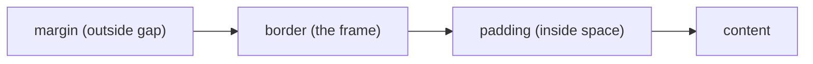

::part[Learn the Concept]{n="1"}

## 🎯 What you'll learn

- How a CSS rule is written
- How the browser decides **which rule wins** when rules disagree
- The box model: content, padding, border, margin
- Which units to use (`rem`, `px`, `%`…)
- CSS variables for colors and spacing
- Styles for hover, keyboard focus and disabled buttons

## 🔤 Key words

| Word | In simple words | Bahasa Indonesia |
|---|---|---|
| **Selector** | The part that picks which elements a rule styles, like `.card` | Pemilih elemen |
| **Declaration** | One style line: `color: navy;` | Deklarasi |
| **Cascade** | The browser's way of choosing the winning rule | Aturan pemenang |
| **Specificity** | How "strong" a selector is — an id beats a class, a class beats a tag | Kekuatan selector |
| **Box model** | Every element is a box: content, padding, border, margin | Model kotak |
| **`rem`** | A size based on the page's base font size (usually 16px) | Satuan relatif |
| **CSS variable** | A named value you reuse, like `--color-primary` | Variabel CSS / token |

## 🧠 The big idea

CSS rules are like **several people giving you instructions** for the same shirt: your mom says blue, your friend says red. Who do you listen to? CSS has fixed rules for this, called the **cascade**. Most "CSS is broken!" moments really mean "I don't know which rule won".

## ❓ Why it matters

Keeping looks (CSS) separate from structure (HTML) means one stylesheet can restyle a whole site, and users can use bigger fonts or high contrast.

When the rules get messy, nobody dares to change anything:

```css
#job-list .card .title { color: navy; }
.title { color: indigo !important; }          /* fighting back */
.card-title-new-final { color: purple !important; }  /* escalation */
```

- Rules keep "fighting", and `!important` makes it worse.
- A brand color copied into 60 places makes a redesign take a week.
- `font-size: 12px` everywhere ignores users who made their browser text bigger.

## 📖 Step by step

### 1. How a rule looks

```css
.card__title {            /* selector */
  font-size: 1.25rem;     /* declaration: property: value; */
  margin: 0;
}
```

Selectors from weak to strong:

| Selector | Picks | Strength (id, class, tag) |
|---|---|---|
| `h2` | every h2 | 0,0,1 |
| `.card` | elements with class `card` | 0,1,0 |
| `.card h2` | h2 inside `.card` | 0,1,1 |
| `.button:hover` | a hovered button (`:hover` counts like a class) | 0,2,0 |
| `#main` | the element with id `main` | 1,0,0 |
| `style="..."` | inline style | beats all selectors |

### 2. Which rule wins?

Like a football tournament with fixed rounds:

1. **`!important`** wins over normal rules (avoid it — it starts fights).
2. **Stronger selector** wins (compare ids, then classes, then tags).
3. If equally strong, the **rule written later** wins.

Some properties are **inherited**, like a family trait: text styles (`color`, `font-family`) pass from parent to child. Box styles (`margin`, `border`) do not.

Tip: keep selectors **weak and simple** (one class each). Then "later wins" is all you need to remember.

### 3. The box model

Every element is a box, like a **framed photo**: the photo (content), the white space around it (padding), the frame (border), and the gap to the next photo on the wall (margin).



```css
*, *::before, *::after { box-sizing: border-box; }
```

Without this line, `width: 300px; padding: 20px` makes a 340 px box (padding is added on top). With `border-box`, the box stays 300 px. That's why almost every project starts with this line.

### 4. Units

| Unit | Based on | Use for |
|---|---|---|
| `rem` | the page's base font size | font sizes and spacing — respects the user's settings |
| `em` | this element's font size | padding that grows with the text |
| `px` | a fixed screen pixel | borders and thin lines |
| `%` | the parent's size | flexible widths |
| `vw` / `dvh` | the screen size | full-screen sections |
| `ch` | the width of a "0" | comfortable reading width: `max-width: 65ch` |

### 5. Colors and text

```css
body {
  font-family: "Inter", system-ui, sans-serif;  /* fallback stack ends with a generic family */
  line-height: 1.5;                              /* unitless: scales with font size */
  color: #0f172a;
}
.muted { color: rgb(100 116 139); }
.overlay { background: rgb(15 23 42 / 0.6); }   /* alpha channel */
```

Check **contrast** (how different the text and background colors are): normal text needs at least 4.5:1. The browser's DevTools shows this number.

### 6. CSS variables (design tokens)

A CSS variable is like a **contact in your phone**: you save the number once as "Mom" and use the name everywhere. If the number changes, you update it in one place.

```css
:root {
  --color-primary: #4f46e5;
  --radius: 0.75rem;
  --space-4: 1rem;
}
.button { background: var(--color-primary); border-radius: var(--radius); padding: var(--space-4); }

@media (prefers-color-scheme: dark) {
  :root { --color-surface: #0f172a; }          /* dark mode = change tokens, not components */
}
```

Dark mode becomes easy: change the variables, not every component. Tailwind (Week 2) is also built on CSS variables.

### 7. Hover, focus and disabled

```css
.button:hover { filter: brightness(1.1); }
.button:focus-visible { outline: 3px solid var(--color-primary); outline-offset: 2px; }
.button:disabled { opacity: 0.5; cursor: not-allowed; }
```

- `:hover` — the mouse is over it.
- `:focus-visible` — the user reached it with the **keyboard** (Tab). It shows a ring so they know where they are, like a cursor.
- Never write `outline: none` without adding another visible focus style.

### 8. Naming classes: BEM

BEM is a naming habit: `block__element--modifier`, for example `.card`, `.card__title`, `.badge--remote`. Names tell you how parts belong together, and every selector stays one simple class. (In Week 2, Tailwind replaces most of this.)

## ⚠️ Common mistakes

- Forgetting `box-sizing: border-box`, then fighting with widths.
- `px` font sizes that ignore the user's browser settings.
- Removing the focus outline because it "looks ugly".
- Light gray text on white (low contrast).
- Styling with ids, then needing `!important` to override them.

## 🏆 Best practices

- [ ] Start with a small reset: `box-sizing: border-box`, `margin: 0` on body, `img { max-width: 100% }`.
- [ ] Put colors, spacing and radius in CSS variables in `:root`; don't copy brand colors into components.
- [ ] Keep selectors simple (one class); avoid ids and long chains.
- [ ] Use `rem` for text and spacing, and `line-height` without a unit.
- [ ] Always style `:focus-visible`; check color contrast.
- [ ] Respect user settings: `prefers-color-scheme`, `prefers-reduced-motion`.
- [ ] When a style doesn't apply, open DevTools → **Styles** to see which rule won and why.

::part[Explain & Design]{n="2"}

## 🗣️ Explain it

A teammate asks: "I wrote `.title { color: red }` at the bottom of the file. Why is it still blue?" Explain the "who wins" rules and how to find the winning rule in DevTools.

## 📐 Design it

Plan the CSS variables for CareerPilot: colors (including a color for each status: saved, applied, interview, offer, rejected), a spacing scale, corner radius, font sizes, and how dark mode works.

:::quiz
Show a possible set of variables

```css
:root {
  /* brand & neutrals */
  --color-primary: #4f46e5;  --color-primary-contrast: #ffffff;
  --color-text: #0f172a;     --color-muted: #64748b;
  --color-surface: #ffffff;  --color-background: #f8fafc;  --color-border: #e2e8f0;

  /* semantic status colors (used by badges and the pipeline) */
  --status-saved: #64748b;   --status-applied: #2563eb;  --status-interview: #d97706;
  --status-offer: #16a34a;   --status-rejected: #dc2626;

  /* spacing scale (4px base) */
  --space-1: 0.25rem; --space-2: 0.5rem; --space-3: 0.75rem; --space-4: 1rem; --space-6: 1.5rem; --space-8: 2rem;

  --radius-sm: 0.375rem; --radius: 0.75rem; --radius-full: 999px;
  --text-sm: 0.875rem; --text-base: 1rem; --text-lg: 1.125rem; --text-2xl: 1.5rem;
  --font-sans: "Inter", system-ui, sans-serif;
}

@media (prefers-color-scheme: dark) {
  :root {
    --color-text: #e2e8f0; --color-muted: #94a3b8;
    --color-surface: #0f172a; --color-background: #020617; --color-border: #1e293b;
  }
}
```

- Names describe the **purpose** (`--status-offer`), not the color (`--green`). So a redesign only changes the values.
- Dark mode only changes the variables.
- Never show a status with color alone — the badge also shows text.
:::

### 📝 Self-review checklist

- [ ] Names describe the purpose, not the color
- [ ] One consistent spacing scale
- [ ] Dark mode changes variables, not components
- [ ] Status is never shown by color alone

::ai-review{task="design"}

::part[Toy Exercise]{n="3"}

:::exercise{path="exercises/web/m4/w1/02-css-fundamentals" ai="no-ai" title="Style job cards with design tokens"}
Write a stylesheet from scratch for a given page: variables in `:root`, a `border-box` reset, easy-to-read body text, BEM card and badge styles, and hover and focus-visible states — with no ids, no `!important` and no `px` font sizes. The tests read your CSS rules.
:::

:::hints
- Start with the variables and the reset, then `body`, then the components from top to bottom.
- Use the variables with `var(--name)` in every component rule.
- `.badge--remote` only changes what is different from `.badge`.
:::

## ✅ Quick check

:::quiz
Two rules with the same strength set `color`. Which one wins?

The one written later in the stylesheet.
:::

:::quiz
Why use `rem` instead of `px` for font sizes?

`rem` follows the page's base font size, so it respects users who make their browser text bigger.
:::

## 📚 Keep learning

- [MDN: Cascade, specificity, and inheritance](https://developer.mozilla.org/en-US/docs/Learn_web_development/Core/Styling_basics/Handling_conflicts)
- [MDN: Using CSS custom properties](https://developer.mozilla.org/en-US/docs/Web/CSS/Using_CSS_custom_properties)
- [WebAIM contrast checker](https://webaim.org/resources/contrastchecker/)
