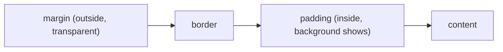

::part[Learn the Concept]{n="1"}

## 🎯 What you'll learn

- Rules, selectors and declarations
- The **cascade**: origin, specificity, order — and inheritance
- The **box model** and `box-sizing: border-box`
- Units (`px`, `rem`, `em`, `%`, `vw`, `ch`) and when to use each
- Colors, typography, **custom properties** (design tokens)
- States: `:hover`, `:focus-visible`, `:disabled`
- Naming conventions (BEM) and where Tailwind fits later (Week 2)

## 🧠 The big idea

CSS is a set of **rules that compete**. Many rules may want to set the same button's color; the browser runs a tournament — the **cascade** — to decide the winner. Most "CSS is broken!" moments are really "I don't know which rule won and why".

## ❓ Why does this exist?

Separating **presentation** (CSS) from **structure** (HTML) means one stylesheet can restyle thousands of pages, users can apply their own styles (larger fonts, high contrast), and the same HTML can look right on a phone, a laptop and in print.

## 💥 What happens if we DON'T understand it?

```css
#job-list .card .title { color: navy; }
.title { color: indigo !important; }          /* fighting back */
.card-title-new-final { color: purple !important; }  /* escalation */
```

Specificity wars and `!important` escalate until nobody dares to change anything. Hardcoded `#4f46e5` in 60 places means a rebrand takes a week. `font-size: 12px` everywhere ignores users who increased their browser font size.

## 📖 How it works, step by step

### 1. Anatomy of a rule

```css
.card__title {            /* selector */
  font-size: 1.25rem;     /* declaration: property: value; */
  margin: 0;
}
```

| Selector | Matches | Specificity (id, class, type) |
|---|---|---|
| `h2` | every h2 | 0,0,1 |
| `.card` | class | 0,1,0 |
| `.card h2` | h2 inside .card | 0,1,1 |
| `.button:hover` | pseudo-class counts as class | 0,2,0 |
| `#main` | id | 1,0,0 |
| `style="..."` | inline | beats all selectors |

### 2. The cascade, in order

1. **Origin & importance**: browser defaults < your styles; `!important` flips the order (avoid it).
2. **Specificity**: higher wins (compare ids, then classes, then types).
3. **Order**: equal specificity → the **later** rule wins.

Plus **inheritance**: text properties (`color`, `font-family`, `line-height`) flow from parent to child; box properties (`margin`, `border`) don't.

Keep specificity **low and flat** (single classes) so order and intention stay predictable. `:where()` gives a selector zero specificity — useful for base styles.

### 3. The box model



```css
*, *::before, *::after { box-sizing: border-box; }
```

With the default `content-box`, `width: 300px; padding: 20px` makes a 340 px box. `border-box` keeps it 300 px — the reason every modern reset includes this line.

Vertical margins between blocks **collapse** (the larger wins); padding never does.

### 4. Units

| Unit | Relative to | Use for |
|---|---|---|
| `rem` | root font size (usually 16px) | font sizes, spacing — respects user settings |
| `em` | current element's font size | padding that scales with a component's text |
| `px` | CSS pixel | borders, shadows, hairlines |
| `%` | parent size | fluid widths |
| `vw` / `vh` / `dvh` | viewport | full-screen sections (`dvh` handles mobile toolbars) |
| `ch` | width of "0" | readable line length: `max-width: 65ch` |

### 5. Colors and typography

```css
body {
  font-family: "Inter", system-ui, sans-serif;  /* fallback stack ends with a generic family */
  line-height: 1.5;                              /* unitless: scales with font size */
  color: #0f172a;
}
.muted { color: rgb(100 116 139); }
.overlay { background: rgb(15 23 42 / 0.6); }   /* alpha channel */
```

Check **contrast**: WCAG AA requires 4.5:1 for normal text.

### 6. Custom properties (design tokens)

```css
:root {
  --color-primary: #4f46e5;
  --radius: 0.75rem;
  --space-4: 1rem;
}
.button { background: var(--color-primary); border-radius: var(--radius); padding: var(--space-4); }

@media (prefers-color-scheme: dark) {
  :root { --color-surface: #0f172a; }          /* dark mode = change tokens, not components */
}
```

Tokens are the bridge to design systems and to Tailwind v4, which generates its utilities from CSS variables.

### 7. States

```css
.button:hover { filter: brightness(1.1); }
.button:focus-visible { outline: 3px solid var(--color-primary); outline-offset: 2px; }
.button:disabled { opacity: 0.5; cursor: not-allowed; }
```

`:focus-visible` shows focus rings for **keyboard** users without flashing them on every mouse click. Never `outline: none` without a replacement.

### 8. Naming: BEM

`block__element--modifier`: `.card`, `.card__title`, `.badge--remote`. Flat class selectors, obvious relationships, no nesting wars. (Week 2 swaps this for Tailwind utility classes — you'll know what they generate.)

## ⚖️ Trade-offs

| Choice | ✅ | ❌ |
|---|---|---|
| Plain CSS + BEM | no tooling, full control | naming discipline required; unused CSS accumulates |
| Utility-first (Tailwind) | fast, consistent, no naming | long class lists; must learn utilities |
| CSS Modules / scoped styles | no global collisions | build step |
| Custom properties | runtime theming, tokens | no compile-time checks for typos |
| `!important` | quick override | breaks the cascade; escalates |

## ✅ When to use it / 🚫 When NOT to use it

- ✅ Tokens for colors, spacing, radii, fonts from day one.
- ✅ Single-class selectors for components.
- 🚫 IDs for styling (keep them for anchors and `label for`).
- 🚫 `!important` except to override third-party inline styles or utility "escape hatches".

## 🏆 Best practices

- [ ] Start with a small reset: `box-sizing: border-box`, `margin: 0` on body, `img { max-width: 100% }`.
- [ ] Define **design tokens** in `:root`; never hardcode brand colors in components.
- [ ] Keep specificity flat; avoid IDs and deep descendant chains.
- [ ] Use `rem` for type and spacing, unitless `line-height`, a font stack with fallbacks.
- [ ] Always style `:focus-visible`; check color contrast (DevTools shows the ratio).
- [ ] Respect user preferences: `prefers-color-scheme`, `prefers-reduced-motion`.
- [ ] Use DevTools' **Computed** and **Styles** panels to see which rule won.

## 🏭 How it's used in industry

- Design systems (Material, Radix Themes, company UI kits) are built on tokens that designers edit in Figma and developers consume as CSS variables.
- Tailwind CSS dominates new React/Next.js projects — understanding the cascade makes its utilities predictable.
- Modern CSS (`:has()`, container queries, nesting, `@layer`) is supported in all evergreen browsers and removes much old JavaScript.

## ⚠️ Common mistakes

- Forgetting `border-box`, then fighting widths.
- Using `px` font sizes that ignore the user's browser settings.
- Removing focus outlines for aesthetics.
- Low-contrast gray text on white.
- Styling with IDs, then needing `!important` to override.

::part[Explain & Design]{n="2"}

## 🗣️ Explain it

A teammate asks: "I wrote `.title { color: red }` at the bottom of the file, why is it still blue?" Explain the cascade and how they'd find the winning rule in DevTools.

## 📐 Design it

Design the token set for CareerPilot's UI: colors (including status colors for saved/applied/interview/offer/rejected), spacing scale, radii, font sizes, and how dark mode works — as CSS custom properties.

:::quiz
Show a possible token set

```css
:root {
  /* brand & neutrals */
  --color-primary: #4f46e5;  --color-primary-contrast: #ffffff;
  --color-text: #0f172a;     --color-muted: #64748b;
  --color-surface: #ffffff;  --color-background: #f8fafc;  --color-border: #e2e8f0;

  /* semantic status colors (used by badges and the pipeline) */
  --status-saved: #64748b;   --status-applied: #2563eb;  --status-interview: #d97706;
  --status-offer: #16a34a;   --status-rejected: #dc2626;

  /* spacing scale (4px base) */
  --space-1: 0.25rem; --space-2: 0.5rem; --space-3: 0.75rem; --space-4: 1rem; --space-6: 1.5rem; --space-8: 2rem;

  --radius-sm: 0.375rem; --radius: 0.75rem; --radius-full: 999px;
  --text-sm: 0.875rem; --text-base: 1rem; --text-lg: 1.125rem; --text-2xl: 1.5rem;
  --font-sans: "Inter", system-ui, sans-serif;
}

@media (prefers-color-scheme: dark) {
  :root {
    --color-text: #e2e8f0; --color-muted: #94a3b8;
    --color-surface: #0f172a; --color-background: #020617; --color-border: #1e293b;
  }
}
```

Components only reference **semantic** tokens (`--status-offer`, `--color-surface`), so dark mode and rebrands change tokens only. Never communicate status by color alone — badges also show text.
:::

### 📝 Self-review checklist

- [ ] Semantic names (what it's for), not literal names (`--blue`)
- [ ] A consistent spacing scale
- [ ] Dark mode changes tokens, not components
- [ ] Status never relies on color alone

::ai-review{task="design"}

::part[Toy Exercise]{n="3"}

:::exercise{path="exercises/web/m4/w1/02-css-fundamentals" ai="no-ai" title="Style job cards with design tokens"}
Write a stylesheet from scratch for a provided page: tokens in `:root`, a border-box reset, readable body typography, BEM card and badge components, hover and focus-visible states — with no IDs, `!important` or pixel font sizes. Tests parse your CSS rules.
:::

:::hints
- Start with tokens and the reset, then `body`, then components top to bottom.
- Use the tokens with `var(--name)` in every component rule.
- `.badge--remote` only overrides what's different from `.badge`.
:::

## ✅ Quick check

:::quiz
Two rules with equal specificity set `color`. Which wins?

The one that appears later in the stylesheet (source order).
:::

:::quiz
Why prefer `rem` over `px` for font sizes?

`rem` scales with the root font size, so it respects users who increase their browser's default text size.
:::

## 📖 Kamus (glossary)

| Term | Bahasa Indonesia |
|---|---|
| Cascade | Kaskade — aturan menentukan style mana yang menang |
| Specificity | Spesifisitas — "kekuatan" selector |
| Box model | Model kotak (content, padding, border, margin) |
| Custom property / design token | Variabel CSS / token desain |
| Inheritance | Pewarisan style dari elemen induk |
| Contrast ratio | Rasio kontras warna |

## 📚 Keep learning

- [MDN: Cascade, specificity, and inheritance](https://developer.mozilla.org/en-US/docs/Learn_web_development/Core/Styling_basics/Handling_conflicts)
- [MDN: Using CSS custom properties](https://developer.mozilla.org/en-US/docs/Web/CSS/Using_CSS_custom_properties)
- [WebAIM contrast checker](https://webaim.org/resources/contrastchecker/)
