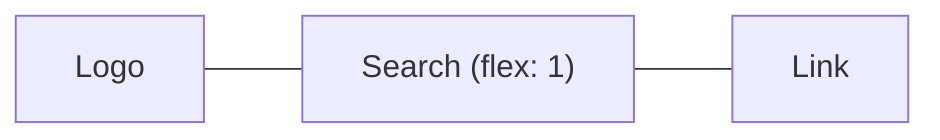

::part[Pelajari Konsepnya]{n="1"}

## 🎯 Yang akan kamu pelajari

- Normal flow, `display`, dan kapan kamu butuh sistem layout
- **Flexbox** untuk perataan satu dimensi
- **Grid** untuk layout dua dimensi, termasuk `repeat(auto-fill, minmax())`
- Media query **mobile-first** dan cara memilih breakpoint
- Container query, tipografi fleksibel dengan `clamp()`, gambar responsif
- Men-debug layout dengan DevTools

## 🧠 Ide besarnya

Flexbox adalah **satu baris rak buku**: item berjajar ke satu arah dan kamu menentukan cara mereka berbagi ruang dan rata. Grid adalah **denah lantai**: baris dan kolom ditentukan di awal, lalu item ditempatkan ke area-areanya.

Desain responsif ibarat **air dalam wadah**: konten harus mengikuti bentuk layar tempat ia dituangkan — bukan kotak 1200 px kaku yang tumpah di ponsel.

## ❓ Kenapa ini ada?

Di Indonesia, sebagian besar penggunaan internet terjadi di ponsel. Recruiter membuka link lowongan di ponsel; pengguna yang sama membuka CareerPilot di laptop belakangan. Satu codebase harus bisa menyesuaikan diri. Sebelum Flexbox dan Grid (2017+), layout butuh float dan berbagai trik; sekarang cukup beberapa declaration.

## 💥 Apa yang terjadi kalau TIDAK?

```css
.page { width: 1200px; }
.sidebar { float: left; width: 300px; }
```

Di ponsel 390 px: scroll horizontal, teks mungil karena di-zoom out, area sentuh terlalu kecil, sidebar menghimpit konten. Mobile-first indexing Google juga menurunkan peringkat halamannya.

## 📖 Cara kerjanya, langkah demi langkah

### 1. Normal flow dulu

Elemen block bertumpuk vertikal; elemen inline mengalir seperti teks. Banyak layout tidak butuh apa-apa selain HTML yang baik plus `max-width` dan spacing. Pakai Flex/Grid saat kamu butuh perataan atau kolom.

### 2. Flexbox

```css
.site-header {
  display: flex;
  justify-content: space-between;  /* main axis: distribute */
  align-items: center;             /* cross axis: align */
  flex-wrap: wrap;                 /* allow a second line on small screens */
  gap: 0.5rem 1rem;                /* row gap, column gap */
}
.search { flex: 1 1 16rem; }       /* grow, shrink, basis */
```



Cocok untuk: navbar, toolbar, grup tombol, centering, layout bagian dalam kartu (dorong tombol ke bawah dengan `margin-top: auto`).

### 3. Grid

```css
.page {
  display: grid;
  gap: 1.5rem;
}
@media (min-width: 48rem) {
  .page { grid-template-columns: 16rem 1fr; }   /* sidebar + flexible content */
}

.jobs {
  display: grid;
  gap: 1rem;
  grid-template-columns: repeat(auto-fill, minmax(16rem, 1fr));   /* as many 16rem+ columns as fit */
}
```

`fr` = pecahan dari sisa ruang. `minmax(16rem, 1fr)` + `auto-fill` menghasilkan grid kartu responsif **tanpa media query sama sekali**.

Named area membuat layout halaman mudah dibaca:

```css
.layout {
  display: grid;
  grid-template-areas: "header" "main" "footer";
}
@media (min-width: 64rem) {
  .layout {
    grid-template-columns: 16rem 1fr;
    grid-template-areas: "header header" "sidebar main" "footer footer";
  }
}
```

### 4. Mobile first

Tulis style dasar untuk layar **terkecil**; tambahkan media query `min-width` seiring ruang bertambah:

```css
.filters { display: none; }                 /* phones: filters behind a button */
@media (min-width: 48rem) {                 /* ~768px */
  .filters { display: block; }
}
```

- Ponsel mendapat CSS paling sederhana (lebih sedikit yang diunduh dan di-override).
- Pilih breakpoint di titik **kontenmu** mulai rusak, bukan per model perangkat. Titik awal yang umum: `40rem`, `48rem`, `64rem`, `80rem` (Tailwind memakai yang mirip).
- Pakai `em`/`rem` di media query agar menghormati zoom pengguna.

### 5. Lebih dari media query

```css
.card-list { container-type: inline-size; }
@container (min-width: 30rem) {             /* the card adapts to its container, not the viewport */
  .card { display: grid; grid-template-columns: 6rem 1fr; }
}

h1 { font-size: clamp(1.75rem, 1.2rem + 2vw, 2.75rem); }   /* fluid type with limits */
.prose { max-width: 65ch; }                                 /* readable line length */
```

### 6. Gambar responsif

```css
img { max-width: 100%; height: auto; display: block; }
```

```html

```

Browser memilih file terkecil yang tetap terlihat tajam. `<Image>` di Next.js melakukannya untukmu (Minggu 6).

### 7. Debugging

DevTools: nyalakan **device mode**, aktifkan **overlay grid/flex**, cek panel **box model**, dan cari elemen yang lebih lebar dari viewport (trik cepat: `* { outline: 1px solid red }` sementara).

## ⚖️ Trade-off

| Pilihan | ✅ | ❌ |
|---|---|---|
| Flexbox | ukuran mengikuti konten, perataan sederhana | layout dua dimensi jadi canggung |
| Grid | baris/kolom eksplisit, area, auto-fill | sedikit lebih banyak yang harus dipelajari |
| Media query | perubahan level halaman | component bergantung pada viewport, bukan slot tempatnya |
| Container query | component yang benar-benar reusable | model berpikir yang lebih baru |
| Menyembunyikan konten di ponsel | layar kecil lebih sederhana | konten tersembunyi bisa jadi penting; tetap buat bisa dijangkau |

## ✅ Kapan dipakai / 🚫 Kapan TIDAK dipakai

- ✅ Flex di dalam component dan untuk baris; Grid untuk struktur halaman dan koleksi kartu.
- ✅ Mobile-first untuk setiap halaman baru.
- 🚫 Lebar/tinggi tetap dalam `px` untuk container.
- 🚫 Breakpoint untuk setiap perangkat; jangan mendesain khusus untuk "iPhone 16".

## 🏆 Praktik terbaik

- [ ] Mobile first dengan media query `min-width` dalam `rem`/`em`.
- [ ] Pakai `gap` alih-alih margin di antara item flex/grid.
- [ ] Container dengan `max-width` + `margin-inline: auto`; `max-width: 65ch` untuk teks panjang.
- [ ] `img { max-width: 100%; height: auto }` dan dimensi gambar eksplisit untuk mencegah layout shift.
- [ ] Utamakan layout intrinsik (`auto-fill`, `minmax`, `clamp`) daripada banyak breakpoint.
- [ ] Area sentuh minimal ~44×44 px; tes dengan ponsel sungguhan dan zoom 200%.
- [ ] Jaga urutan visual sama dengan urutan DOM (pengguna keyboard dan screen reader mengikuti DOM).

## 🏭 Cara dipakai di industri

- Portal lowongan (JobStreet, Glints, Kalibrr) terutama dipakai di ponsel — layout responsif dan gambar yang cepat berpengaruh langsung pada jumlah lamaran yang masuk.
- Design system menyediakan primitive layout responsif (`Stack`, `Grid`, `Container`).
- Prefix responsif Tailwind (`md:grid-cols-2`) sebenarnya adalah media query mobile-first — Minggu 2.

## ⚠️ Kesalahan umum

- CSS desktop-first dengan query `max-width` yang meng-override semuanya di ponsel.
- Lupa meta tag viewport (halaman ter-render dalam keadaan zoom out).
- `height: 100vh` di ponsel (pakai `dvh`).
- Mengubah urutan item secara visual dengan `order` sehingga fokus keyboard melompat-lompat.

::part[Jelaskan & Rancang]{n="2"}

## 🗣️ Jelaskan

Jelaskan ke seorang desainer beda "mobile first" dan "desktop first", dan kenapa mobile first biasanya menghasilkan CSS yang lebih sedikit.

## 📐 Rancang

Rencanakan layout responsif **dashboard lamaran** CareerPilot: kartu statistik, papan pipeline dengan lima kolom (saved, applied, interview, offer, closed), dan panel filter. Jelaskan layout-nya di lebar ponsel, tablet, dan desktop, serta di mana kamu akan memakai Flexbox/Grid/container query.

:::quiz
Tampilkan contoh rencananya

- **Ponsel (dasar)**: satu kolom. Statistik: `grid` dengan `repeat(2, 1fr)` (kartu 2×2). Pipeline: kolom menjadi baris yang **di-scroll horizontal** (`display: flex; overflow-x: auto; scroll-snap-type: x mandatory`), setiap kolom `flex: 0 0 85%` agar kolom berikutnya mengintip. Filter di balik tombol "Filter" (sebuah dialog).
- **Tablet (`min-width: 48rem`)**: statistik dalam 4 kolom (`repeat(4, 1fr)`); pipeline masih di-scroll tapi kolomnya `flex-basis: 16rem`; filter sebagai panel yang bisa dilipat di atas papan.
- **Desktop (`min-width: 80rem`)**: grid halaman `grid-template-columns: 16rem 1fr` (sidebar filter + main); pipeline `grid-template-columns: repeat(5, minmax(0, 1fr))`, tanpa scroll.
- **Kartu lamaran** di dalam kolom memakai **container query**: di kolom sempit tampilkan judul + perusahaan; saat container ≥ 20rem, tampilkan gaji dan update terakhir di kolom kedua.
- Header: flex dengan wrap. Jaga urutan DOM = urutan baca (statistik → papan), dan jaga drag-and-drop tetap aksesibel dengan tombol ("Pindahkan ke…") sebagai alternatif.
:::

### 📝 Checklist self-review

- [ ] Layout ponsel dirancang lebih dulu
- [ ] Setiap tool dipilih berdasarkan alasan 1D vs 2D
- [ ] Adaptasi di level component sudah dipertimbangkan
- [ ] Aksesibilitas pengurutan ulang/scroll sudah dipertimbangkan

::ai-review{task="design"}

::part[Latihan Kecil]{n="3"}

:::exercise{path="exercises/web/m4/w1/03-layout-responsive" ai="no-ai" title="Halaman lowongan mobile-first"}
Ganti layout tetap 1200 px dengan stylesheet mobile-first: container di tengah, header flex yang bisa wrap, grid halaman satu kolom yang menjadi sidebar + konten di 48rem, grid kartu auto-fill, dan gambar yang fleksibel. Tes akan mem-parse rule dan media query-mu.
:::

:::hints
- Rule `.page` dasar **tidak boleh** mengatur kolom; taruh `grid-template-columns: 16rem 1fr` di dalam `@media (min-width: 48rem)`.
- `repeat(auto-fill, minmax(16rem, 1fr))` tidak butuh media query.
- `margin-inline: auto` menaruh block ber-`max-width` di tengah.
:::

## ✅ Cek cepat

:::quiz
Flexbox atau Grid untuk deretan tag yang harus bisa wrap?

Flexbox dengan `flex-wrap: wrap` dan `gap` — satu dimensi dan ukurannya mengikuti konten.
:::

:::quiz
Apa yang dilakukan `repeat(auto-fill, minmax(16rem, 1fr))`?

Membuat kolom sebanyak yang muat, masing-masing minimal selebar 16rem, dan membagi sisa ruang secara merata — grid responsif tanpa media query.
:::

## 📖 Kamus (glosarium)

| Istilah | Bahasa Indonesia |
|---|---|
| Responsive design | Desain responsif — menyesuaikan ukuran layar |
| Mobile first | Mulai dari layar ponsel |
| Breakpoint | Titik ubah tata letak |
| Media / container query | Kueri media / kueri wadah |
| Viewport | Area tampilan browser |
| Layout shift | Pergeseran tata letak |

## 📚 Lanjut belajar

- [MDN: Flexbox](https://developer.mozilla.org/en-US/docs/Learn_web_development/Core/CSS_layout/Flexbox)
- [MDN: Grids](https://developer.mozilla.org/en-US/docs/Learn_web_development/Core/CSS_layout/Grids)
- [Flexbox Froggy](https://flexboxfroggy.com/) dan [Grid Garden](https://cssgridgarden.com/) — game untuk latihan
