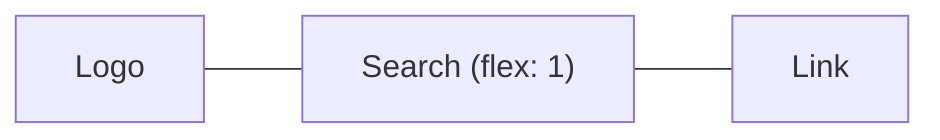

::part[Pelajari Konsepnya]{n="1"}

## 🎯 Yang akan kamu pelajari

- Kapan alur normal halaman sudah cukup, dan kapan kamu butuh alat layout
- **Flexbox** untuk satu baris (atau kolom) item
- **Grid** untuk baris dan kolom sekaligus
- **Mobile first**: mulai dari ponsel, lalu tambahkan ruang untuk layar yang lebih besar
- Teks dan gambar yang fleksibel
- Menemukan masalah layout dengan DevTools

## 🔤 Istilah penting

| Istilah | Artinya (sederhana) |
|---|---|
| **Layout** | Letak setiap hal di halaman |
| **Flexbox** | Alat CSS untuk menjajarkan item ke satu arah (baris atau kolom) |
| **Grid** | Alat CSS untuk baris dan kolom sekaligus |
| **Responsive** | Halaman menyesuaikan diri dengan ukuran layar |
| **Viewport** | Area jendela browser yang terlihat |
| **Media query** | Rule CSS yang hanya berlaku di ukuran layar tertentu |
| **Breakpoint** | Lebar layar tempat layout berubah |

## 🧠 Ide besarnya

**Flexbox** seperti orang yang **berbaris satu antrean** di halte bus: kamu atur arahnya, jaraknya, dan cara mereka berjajar.
**Grid** seperti **tempat parkir**: garis baris dan kolom dicat dulu, lalu mobil parkir di kotak-kotaknya.

**Desain responsif** seperti **air di dalam gelas**: konten mengikuti bentuk layar, bukan kotak 1200 px kaku yang tumpah di ponsel.

## ❓ Kenapa ini penting

Di Indonesia, kebanyakan orang memakai internet lewat ponsel. Recruiter membuka link lowongan di HP; orang yang sama mungkin membuka CareerPilot di laptop belakangan. Satu halaman harus jalan di keduanya.

Layout yang lebarnya tetap akan rusak di ponsel:

```css
.page { width: 1200px; }
.sidebar { float: left; width: 300px; }
```

Di ponsel 390 px: harus scroll ke samping, teksnya mungil, tombol terlalu kecil untuk ditekan. Google juga menurunkan peringkat halaman yang tidak nyaman di ponsel.

## 📖 Langkah demi langkah

### 1. Alur normal dulu

Tanpa CSS layout apa pun, elemen block (seperti `div`, `p`) bertumpuk dari atas ke bawah, dan elemen inline (seperti `a`, `strong`) mengalir seperti kata dalam kalimat. Banyak halaman cukup memakai ini ditambah `max-width` dan jarak. Pakai Flexbox atau Grid saat kamu butuh item bersebelahan atau sejajar.

### 2. Flexbox — satu baris item

```css
.site-header {
  display: flex;
  justify-content: space-between;  /* main axis: distribute */
  align-items: center;             /* cross axis: align */
  flex-wrap: wrap;                 /* allow a second line on small screens */
  gap: 0.5rem 1rem;                /* row gap, column gap */
}
.search { flex: 1 1 16rem; }       /* grow, shrink, basis */
```



- `justify-content` — cara item menyebar **sepanjang** baris (awal, tengah, space-between).
- `align-items` — cara item sejajar **melintang** baris (atas, tengah, bawah).
- `flex-wrap: wrap` — kalau barisnya penuh, lanjut ke baris berikutnya.
- `gap` — jarak antar item.
- `flex: 1` — "ambil ruang yang kosong", seperti orang yang duduk melebar di bangku yang sepi.

Cocok untuk: navbar, grup tombol, menaruh sesuatu di tengah, isi bagian dalam kartu.

### 3. Grid — baris dan kolom

```css
.page {
  display: grid;
  gap: 1.5rem;
}
@media (min-width: 48rem) {
  .page { grid-template-columns: 16rem 1fr; }   /* sidebar + flexible content */
}

.jobs {
  display: grid;
  gap: 1rem;
  grid-template-columns: repeat(auto-fill, minmax(16rem, 1fr));   /* as many 16rem+ columns as fit */
}
```

- `fr` = "bagian dari ruang kosong". `16rem 1fr` = sidebar tetap, dan konten mengambil sisanya.
- `repeat(auto-fill, minmax(16rem, 1fr))` = "buat kolom sebanyak yang muat, masing-masing minimal 16rem". Kartu menyusun ulang dirinya sendiri di layar apa pun — **tanpa media query**.

Kamu juga bisa memberi nama area, seperti menggambar denah rumah:

```css
.layout {
  display: grid;
  grid-template-areas: "header" "main" "footer";
}
@media (min-width: 64rem) {
  .layout {
    grid-template-columns: 16rem 1fr;
    grid-template-areas: "header header" "sidebar main" "footer footer";
  }
}
```

### 4. Mobile first

Tulis CSS dasar untuk layar **terkecil**. Lalu tambahkan rule dengan `min-width` untuk layar yang lebih besar — seperti mengisi tas kecil dulu, lalu menambah barang hanya saat kamu punya koper yang lebih besar.

```css
.filters { display: none; }                 /* phones: filters behind a button */
@media (min-width: 48rem) {                 /* ~768px */
  .filters { display: block; }
}
```

- Ponsel mendapat CSS yang paling sederhana.
- Taruh breakpoint di titik **kontenmu** mulai terlihat jelek, bukan di model HP tertentu. Nilai yang umum: `40rem`, `48rem`, `64rem`, `80rem`.

### 5. Teks dan component yang fleksibel

```css
.card-list { container-type: inline-size; }
@container (min-width: 30rem) {             /* the card adapts to its container, not the viewport */
  .card { display: grid; grid-template-columns: 6rem 1fr; }
}

h1 { font-size: clamp(1.75rem, 1.2rem + 2vw, 2.75rem); }   /* fluid type with limits */
.prose { max-width: 65ch; }                                 /* readable line length */
```

- **Container query** (`@container`): kartu berubah berdasarkan **kotak tempatnya berada**, bukan seluruh layar. Seperti perabot yang menyesuaikan dengan ruangan tempat ia ditaruh.
- `clamp(min, ideal, max)`: heading membesar mengikuti layar, tapi tidak pernah lebih kecil dari min atau lebih besar dari max.

### 6. Gambar responsif

```css
img { max-width: 100%; height: auto; display: block; }
```

```html

```

- `max-width: 100%` mencegah gambar lebih lebar dari kotaknya.
- `srcset` memberi browser beberapa ukuran; browser mengunduh yang terkecil tapi tetap tajam — seperti memilih cetak foto kecil atau besar sesuai bingkainya. `<Image>` di Next.js melakukannya untukmu (Minggu 6).

### 7. Menemukan masalah layout

Di DevTools: nyalakan **device mode** (tampilan ponsel), nyalakan **overlay grid/flex**, dan lihat panel **box model**. Trik cepat untuk menemukan elemen yang terlalu lebar: tambahkan `* { outline: 1px solid red }` sebentar.

## ⚠️ Kesalahan umum

- Membangun untuk desktop dulu, lalu menulis banyak rule untuk "memperbaiki" tampilan ponsel.
- Lupa meta tag viewport (halaman terlihat mengecil di ponsel).
- `height: 100vh` di ponsel (toolbar browser menutupi sebagian — pakai `dvh`).
- Lebar tetap dalam `px` untuk container.
- Mengubah urutan tampilan dengan `order`, sehingga fokus keyboard melompat-lompat.
- Menyembunyikan konten penting di ponsel, bukan membuatnya tetap bisa dijangkau.

## 🏆 Praktik terbaik

- [ ] Mobile first, dengan media query `min-width` dalam `rem`.
- [ ] Flexbox untuk satu baris item, Grid untuk struktur halaman dan daftar kartu.
- [ ] Pakai `gap` untuk jarak antar item, bukan margin.
- [ ] Container dengan `max-width` + `margin-inline: auto`; `max-width: 65ch` untuk teks panjang.
- [ ] `img { max-width: 100%; height: auto }` dan set `width`/`height` gambar.
- [ ] Utamakan layout yang menyesuaikan sendiri (`auto-fill`, `minmax`, `clamp`) daripada banyak breakpoint.
- [ ] Tombol dan link minimal sekitar 44×44 px agar mudah ditekan; tes di ponsel sungguhan dan di zoom 200%.

::part[Jelaskan & Rancang]{n="2"}

## 🗣️ Jelaskan

Jelaskan ke seorang desainer beda "mobile first" dan "desktop first", dan kenapa mobile first biasanya butuh CSS lebih sedikit.

## 📐 Rancang

Rencanakan layout **dashboard lamaran** CareerPilot di ponsel, tablet, dan desktop. Isinya kartu statistik, papan dengan lima kolom (saved, applied, interview, offer, closed), dan panel filter. Sebutkan di mana kamu memakai Flexbox, Grid, atau container query.

:::quiz
Tampilkan contoh rencananya

- **Ponsel (CSS dasar)**: satu kolom.
  - Statistik: `grid` dengan `repeat(2, 1fr)` → kartu 2×2.
  - Papan: lima kolom menjadi satu baris yang digeser ke samping (`display: flex; overflow-x: auto; scroll-snap-type: x mandatory`). Setiap kolom `flex: 0 0 85%` agar kolom berikutnya terlihat mengintip.
  - Filter: disembunyikan di balik tombol "Filter" yang membuka dialog.
- **Tablet (`min-width: 48rem`)**: statistik dalam 4 kolom; papan masih bisa digeser, kolom `flex-basis: 16rem`; filter sebagai panel yang bisa dibuka di atas papan.
- **Desktop (`min-width: 80rem`)**: grid halaman `grid-template-columns: 16rem 1fr` (filter di kiri); papan `grid-template-columns: repeat(5, minmax(0, 1fr))`, tanpa scroll.
- **Kartu** di dalam kolom memakai **container query**: kolom sempit → judul + perusahaan saja; container ≥ 20rem → tambah gaji dan update terakhir.
- Jaga urutan HTML sama dengan urutan baca, dan sediakan tombol "Pindahkan ke…" sebagai alternatif drag-and-drop.
:::

### 📝 Checklist self-review

- [ ] Layout ponsel direncanakan lebih dulu
- [ ] Flexbox untuk satu arah, Grid untuk baris dan kolom
- [ ] Kartu menyesuaikan dengan kolomnya (container query)
- [ ] Scroll dan pemindahan tetap bisa dipakai pengguna keyboard

::ai-review{task="design"}

::part[Latihan Kecil]{n="3"}

:::exercise{path="exercises/web/m4/w1/03-layout-responsive" ai="no-ai" title="Halaman lowongan mobile-first"}
Ganti layout tetap 1200 px dengan CSS mobile-first: container di tengah, header yang bisa pindah baris dengan Flexbox, halaman satu kolom yang menjadi sidebar + konten di 48rem, grid kartu dengan `auto-fill`, dan gambar yang tidak pernah meluber. Tes akan membaca rule dan media query-mu.
:::

:::hints
- Rule `.page` dasar **tidak boleh** mengatur kolom; taruh `grid-template-columns: 16rem 1fr` di dalam `@media (min-width: 48rem)`.
- `repeat(auto-fill, minmax(16rem, 1fr))` tidak butuh media query.
- `margin-inline: auto` menaruh block yang punya `max-width` di tengah.
:::

## ✅ Cek cepat

:::quiz
Flexbox atau Grid untuk deretan tag yang harus pindah ke baris berikutnya?

Flexbox dengan `flex-wrap: wrap` dan `gap` — satu arah, dan tag menentukan ukurannya sendiri.
:::

:::quiz
Apa yang dilakukan `repeat(auto-fill, minmax(16rem, 1fr))`?

Membuat kolom sebanyak yang muat, masing-masing minimal 16rem, dan membagi sisa ruang secara merata. Grid menyesuaikan diri tanpa media query.
:::

## 📚 Lanjut belajar

- [MDN: Flexbox](https://developer.mozilla.org/en-US/docs/Learn_web_development/Core/CSS_layout/Flexbox)
- [MDN: Grids](https://developer.mozilla.org/en-US/docs/Learn_web_development/Core/CSS_layout/Grids)
- [Flexbox Froggy](https://flexboxfroggy.com/) dan [Grid Garden](https://cssgridgarden.com/) — game untuk latihan
