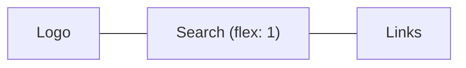

::part[Learn the Concept]{n="1"}

## 🎯 What you'll learn

- When the normal page flow is enough, and when you need a layout tool
- **Flexbox** for a row (or column) of items
- **Grid** for rows and columns together
- **Mobile first**: start with the phone, then add space for bigger screens
- Flexible text and images
- Finding layout problems with DevTools

## 🔤 Key words

| Word | In simple words | Bahasa Indonesia |
|---|---|---|
| **Layout** | Where things are placed on the page | Tata letak |
| **Flexbox** | CSS tool to line up items in one direction (a row or a column) | Susunan satu arah |
| **Grid** | CSS tool for rows and columns at the same time | Susunan baris & kolom |
| **Responsive** | The page adapts to the screen size | Responsif |
| **Viewport** | The visible area of the browser window | Area layar browser |
| **Media query** | A CSS rule that applies only on certain screen sizes | Aturan per ukuran layar |
| **Breakpoint** | The screen width where the layout changes | Titik ubah layout |

## 🧠 The big idea

**Flexbox** is like people standing **in one line** at a bus stop: you decide the direction, the spacing, and how they line up.
**Grid** is like a **parking lot**: rows and columns are painted first, then cars park in the spaces.

**Responsive design** is like **water in a glass**: the content takes the shape of the screen, instead of a fixed 1200 px box that spills over on phones.

## ❓ Why it matters

In Indonesia, most people use the internet on their phones. Recruiters open job links on mobile; the same person may open CareerPilot on a laptop later. One page must work on both.

A fixed layout breaks on phones:

```css
.page { width: 1200px; }
.sidebar { float: left; width: 300px; }
```

On a 390 px phone: sideways scrolling, tiny text, buttons too small to tap. Google also ranks pages that don't work on mobile lower.

## 📖 Step by step

### 1. Normal flow first

Without any layout CSS, block elements (like `div`, `p`) stack from top to bottom, and inline elements (like `a`, `strong`) flow like words in a sentence. Many pages only need this plus a `max-width` and some spacing. Use Flexbox or Grid when you need items side by side or aligned.

### 2. Flexbox — one line of items

```css
.site-header {
  display: flex;
  justify-content: space-between;  /* main axis: distribute */
  align-items: center;             /* cross axis: align */
  flex-wrap: wrap;                 /* allow a second line on small screens */
  gap: 0.5rem 1rem;                /* row gap, column gap */
}
.search { flex: 1 1 16rem; }       /* grow, shrink, basis */
```



- `justify-content` — how items spread **along** the line (start, center, space-between).
- `align-items` — how items line up **across** the line (top, center, bottom).
- `flex-wrap: wrap` — if the line is full, continue on the next line.
- `gap` — the space between items.
- `flex: 1` — "take the free space", like a person spreading out on an empty bench.

Good for: navbars, button groups, centering something, the inside of a card.

### 3. Grid — rows and columns

```css
.page {
  display: grid;
  gap: 1.5rem;
}
@media (min-width: 48rem) {
  .page { grid-template-columns: 16rem 1fr; }   /* sidebar + flexible content */
}

.jobs {
  display: grid;
  gap: 1rem;
  grid-template-columns: repeat(auto-fill, minmax(16rem, 1fr));   /* as many 16rem+ columns as fit */
}
```

- `fr` = "a share of the free space". `16rem 1fr` = a fixed sidebar, and the content takes the rest.
- `repeat(auto-fill, minmax(16rem, 1fr))` = "make as many columns as fit, each at least 16rem wide". Cards rearrange by themselves on any screen — **no media query needed**.

You can also name areas, like drawing a floor plan:

```css
.layout {
  display: grid;
  grid-template-areas: "header" "main" "footer";
}
@media (min-width: 64rem) {
  .layout {
    grid-template-columns: 16rem 1fr;
    grid-template-areas: "header header" "sidebar main" "footer footer";
  }
}
```

### 4. Mobile first

Write the basic CSS for the **smallest** screen. Then add rules with `min-width` for bigger screens — like packing a small bag first, and adding more only when you have a bigger suitcase.

```css
.filters { display: none; }                 /* phones: filters behind a button */
@media (min-width: 48rem) {                 /* ~768px */
  .filters { display: block; }
}
```

- Phones get the simplest CSS.
- Put breakpoints where **your content** starts to look bad, not at specific phone models. Common values: `40rem`, `48rem`, `64rem`, `80rem`.

### 5. Flexible text and components

```css
.card-list { container-type: inline-size; }
@container (min-width: 30rem) {             /* the card adapts to its container, not the viewport */
  .card { display: grid; grid-template-columns: 6rem 1fr; }
}

h1 { font-size: clamp(1.75rem, 1.2rem + 2vw, 2.75rem); }   /* fluid type with limits */
.prose { max-width: 65ch; }                                 /* readable line length */
```

- **Container query** (`@container`): the card changes based on the **box it sits in**, not the whole screen. Like furniture that fits the room it's placed in.
- `clamp(min, preferred, max)`: the heading grows with the screen, but never smaller than min or bigger than max.

### 6. Responsive images

```css
img { max-width: 100%; height: auto; display: block; }
```

```html

```

- `max-width: 100%` stops images from being wider than their box.
- `srcset` gives the browser several sizes; it downloads the smallest one that still looks sharp — like choosing a small or large photo print depending on the frame. Next.js `<Image>` does this for you (Week 6).

### 7. Finding layout problems

In DevTools: turn on **device mode** (phone view), turn on the **grid/flex overlay**, and look at the **box model** panel. Quick trick to find the element that is too wide: add `* { outline: 1px solid red }` for a moment.

## ⚠️ Common mistakes

- Building desktop first, then writing many rules to "fix" phones.
- Forgetting the viewport meta tag (the page looks zoomed out on phones).
- `height: 100vh` on phones (the browser toolbar hides part of it — use `dvh`).
- Fixed widths in `px` for containers.
- Changing the visual order with `order`, so keyboard focus jumps around.
- Hiding important content on mobile instead of making it reachable.

## 🏆 Best practices

- [ ] Mobile first, with `min-width` media queries in `rem`.
- [ ] Flexbox for one line of items, Grid for page structure and card lists.
- [ ] Use `gap` for space between items instead of margins.
- [ ] Containers with `max-width` + `margin-inline: auto`; `max-width: 65ch` for long text.
- [ ] `img { max-width: 100%; height: auto }` and set image `width`/`height`.
- [ ] Prefer self-adjusting layouts (`auto-fill`, `minmax`, `clamp`) over many breakpoints.
- [ ] Buttons and links at least about 44×44 px to tap; test on a real phone and at 200% zoom.

::part[Explain & Design]{n="2"}

## 🗣️ Explain it

Explain to a designer the difference between "mobile first" and "desktop first", and why mobile first usually needs less CSS.

## 📐 Design it

Plan the layout of CareerPilot's **applications dashboard** on phone, tablet and desktop. It has stats cards, a board with five columns (saved, applied, interview, offer, closed), and a filters panel. Say where you'd use Flexbox, Grid or container queries.

:::quiz
Show a possible plan

- **Phone (base CSS)**: one column.
  - Stats: `grid` with `repeat(2, 1fr)` → 2×2 cards.
  - Board: the five columns become one row you swipe sideways (`display: flex; overflow-x: auto; scroll-snap-type: x mandatory`). Each column is `flex: 0 0 85%` so you can see the next one peeking in.
  - Filters: hidden behind a "Filters" button that opens a dialog.
- **Tablet (`min-width: 48rem`)**: stats in 4 columns; the board still scrolls, columns `flex-basis: 16rem`; filters as a panel you can open above the board.
- **Desktop (`min-width: 80rem`)**: page grid `grid-template-columns: 16rem 1fr` (filters on the left); board `grid-template-columns: repeat(5, minmax(0, 1fr))`, no scrolling.
- **Cards** in a column use a **container query**: narrow column → title + company only; container ≥ 20rem → also salary and last update.
- Keep the HTML order the same as the reading order, and offer a "Move to…" button as an alternative to drag-and-drop.
:::

### 📝 Self-review checklist

- [ ] The phone layout was planned first
- [ ] Flexbox for one direction, Grid for rows and columns
- [ ] Cards adapt to their column (container query)
- [ ] Scrolling and reordering still work for keyboard users

::ai-review{task="design"}

::part[Toy Exercise]{n="3"}

:::exercise{path="exercises/web/m4/w1/03-layout-responsive" ai="no-ai" title="Mobile-first jobs page"}
Replace a fixed 1200 px layout with mobile-first CSS: a centered container, a header that wraps with Flexbox, a one-column page that becomes sidebar + content at 48rem, a card grid with `auto-fill`, and images that never overflow. The tests read your rules and media queries.
:::

:::hints
- The base `.page` rule must **not** set columns; put `grid-template-columns: 16rem 1fr` inside `@media (min-width: 48rem)`.
- `repeat(auto-fill, minmax(16rem, 1fr))` needs no media query.
- `margin-inline: auto` centers a block that has a `max-width`.
:::

## ✅ Quick check

:::quiz
Flexbox or Grid for a row of tags that should wrap to the next line?

Flexbox with `flex-wrap: wrap` and `gap` — it is one direction, and the tags decide their own size.
:::

:::quiz
What does `repeat(auto-fill, minmax(16rem, 1fr))` do?

It makes as many columns as fit, each at least 16rem wide, and shares the extra space equally. The grid adapts without media queries.
:::

## 📚 Keep learning

- [MDN: Flexbox](https://developer.mozilla.org/en-US/docs/Learn_web_development/Core/CSS_layout/Flexbox)
- [MDN: Grids](https://developer.mozilla.org/en-US/docs/Learn_web_development/Core/CSS_layout/Grids)
- [Flexbox Froggy](https://flexboxfroggy.com/) and [Grid Garden](https://cssgridgarden.com/) — games for practice
