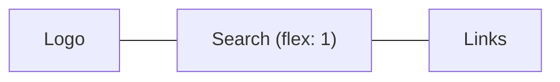

::part[Learn the Concept]{n="1"}

## 🎯 What you'll learn

- Normal flow, `display`, and when you need a layout system
- **Flexbox** for one-dimensional alignment
- **Grid** for two-dimensional layouts, including `repeat(auto-fill, minmax())`
- **Mobile-first** media queries and choosing breakpoints
- Container queries, fluid type with `clamp()`, responsive images
- Debugging layouts with DevTools

## 🧠 The big idea

Flexbox is a **bookshelf row**: items line up in one direction and you decide how they share space and align. Grid is a **floor plan**: rows and columns defined up front, items placed into areas.

Responsive design is **water in containers**: the content should take the shape of whatever screen it's poured into — instead of a fixed 1200 px box that spills over phones.

## ❓ Why does this exist?

In Indonesia, the large majority of internet use happens on phones. Recruiters open job links on mobile; the same user checks CareerPilot on a laptop later. One codebase must adapt. Before Flexbox and Grid (2017+), layouts needed floats and hacks; now they're a few declarations.

## 💥 What happens if we DON'T?

```css
.page { width: 1200px; }
.sidebar { float: left; width: 300px; }
```

On a 390 px phone: horizontal scrolling, tiny zoomed-out text, tap targets too small, sidebar squeezing content. Google's mobile-first indexing also ranks the page lower.

## 📖 How it works, step by step

### 1. Normal flow first

Block elements stack vertically; inline elements flow like text. Many layouts need nothing more than good HTML plus `max-width` and spacing. Reach for Flex/Grid when you need alignment or columns.

### 2. Flexbox

```css
.site-header {
  display: flex;
  justify-content: space-between;  /* main axis: distribute */
  align-items: center;             /* cross axis: align */
  flex-wrap: wrap;                 /* allow a second line on small screens */
  gap: 0.5rem 1rem;                /* row gap, column gap */
}
.search { flex: 1 1 16rem; }       /* grow, shrink, basis */
```



Great for: navbars, toolbars, button groups, centering, cards' internal layout (push the button to the bottom with `margin-top: auto`).

### 3. Grid

```css
.page {
  display: grid;
  gap: 1.5rem;
}
@media (min-width: 48rem) {
  .page { grid-template-columns: 16rem 1fr; }   /* sidebar + flexible content */
}

.jobs {
  display: grid;
  gap: 1rem;
  grid-template-columns: repeat(auto-fill, minmax(16rem, 1fr));   /* as many 16rem+ columns as fit */
}
```

`fr` = a fraction of the remaining space. `minmax(16rem, 1fr)` + `auto-fill` gives a responsive card grid **without any media query**.

Named areas make page layouts readable:

```css
.layout {
  display: grid;
  grid-template-areas: "header" "main" "footer";
}
@media (min-width: 64rem) {
  .layout {
    grid-template-columns: 16rem 1fr;
    grid-template-areas: "header header" "sidebar main" "footer footer";
  }
}
```

### 4. Mobile first

Write base styles for the **smallest** screen; add `min-width` media queries as space grows:

```css
.filters { display: none; }                 /* phones: filters behind a button */
@media (min-width: 48rem) {                 /* ~768px */
  .filters { display: block; }
}
```

- Phones get the simplest CSS (less to download and override).
- Choose breakpoints where **your content** breaks, not per device model. Common starting points: `40rem`, `48rem`, `64rem`, `80rem` (Tailwind uses similar ones).
- Use `em`/`rem` in media queries so they respect user zoom.

### 5. Beyond media queries

```css
.card-list { container-type: inline-size; }
@container (min-width: 30rem) {             /* the card adapts to its container, not the viewport */
  .card { display: grid; grid-template-columns: 6rem 1fr; }
}

h1 { font-size: clamp(1.75rem, 1.2rem + 2vw, 2.75rem); }   /* fluid type with limits */
.prose { max-width: 65ch; }                                 /* readable line length */
```

### 6. Responsive images

```css
img { max-width: 100%; height: auto; display: block; }
```

```html

```

The browser picks the smallest file that looks sharp. Next.js's `<Image>` does this for you (Week 6).

### 7. Debugging

DevTools: toggle **device mode**, turn on the **grid/flex overlays**, check the **box model** panel, and look for elements wider than the viewport (a quick trick: `* { outline: 1px solid red }` temporarily).

## ⚖️ Trade-offs

| Choice | ✅ | ❌ |
|---|---|---|
| Flexbox | content-driven sizing, simple alignment | two-dimensional layouts get awkward |
| Grid | explicit rows/columns, areas, auto-fill | slightly more to learn |
| Media queries | page-level changes | components depend on viewport, not their slot |
| Container queries | truly reusable components | newer mental model |
| Hiding content on mobile | simpler small screens | hidden content may be important; keep it reachable |

## ✅ When to use it / 🚫 When NOT to use it

- ✅ Flex inside components and for rows; Grid for page structure and card collections.
- ✅ Mobile-first for every new page.
- 🚫 Fixed widths/heights in `px` for containers.
- 🚫 A breakpoint for every device; don't design for "iPhone 16" specifically.

## 🏆 Best practices

- [ ] Mobile first with `min-width` media queries in `rem`/`em`.
- [ ] Use `gap` instead of margins between flex/grid items.
- [ ] `max-width` + `margin-inline: auto` containers; `max-width: 65ch` for long text.
- [ ] `img { max-width: 100%; height: auto }` and explicit image dimensions to avoid layout shift.
- [ ] Prefer intrinsic layouts (`auto-fill`, `minmax`, `clamp`) over many breakpoints.
- [ ] Tap targets at least ~44×44 px; test with real phones and zoom at 200%.
- [ ] Keep visual order matching DOM order (keyboard and screen reader users follow the DOM).

## 🏭 How it's used in industry

- Job portals (JobStreet, Glints, Kalibrr) are primarily used on mobile — responsive layouts and fast images directly affect applications submitted.
- Design systems ship responsive layout primitives (`Stack`, `Grid`, `Container`).
- Tailwind's responsive prefixes (`md:grid-cols-2`) are mobile-first media queries under the hood — Week 2.

## ⚠️ Common mistakes

- Desktop-first CSS with `max-width` queries that override everything on phones.
- Forgetting the viewport meta tag (the page renders zoomed out).
- `height: 100vh` on mobile (use `dvh`).
- Reordering items visually with `order` so keyboard focus jumps around.

::part[Explain & Design]{n="2"}

## 🗣️ Explain it

Explain to a designer the difference between "mobile first" and "desktop first", and why mobile first usually produces less CSS.

## 📐 Design it

Plan the responsive layout of CareerPilot's **applications dashboard**: stats cards, a pipeline board with five columns (saved, applied, interview, offer, closed), and a filters panel. Describe the layout at phone, tablet and desktop widths, and which of Flexbox/Grid/container queries you'd use where.

:::quiz
Show a possible plan

- **Phone (base)**: single column. Stats: `grid` with `repeat(2, 1fr)` (2×2 cards). Pipeline: columns become a **horizontal scroll** row (`display: flex; overflow-x: auto; scroll-snap-type: x mandatory`), each column `flex: 0 0 85%` so the next column peeks in. Filters behind a "Filters" button (a dialog).
- **Tablet (`min-width: 48rem`)**: stats in 4 columns (`repeat(4, 1fr)`); pipeline still scrolls but columns `flex-basis: 16rem`; filters as a collapsible panel above the board.
- **Desktop (`min-width: 80rem`)**: page grid `grid-template-columns: 16rem 1fr` (filters sidebar + main); pipeline `grid-template-columns: repeat(5, minmax(0, 1fr))`, no scrolling.
- **Application cards** inside columns use a **container query**: in a narrow column show title + company; when the container is ≥ 20rem, show salary and last update in a second column.
- Header: flex with wrap. Keep DOM order = reading order (stats → board), and keep drag-and-drop accessible with buttons ("Move to…") as an alternative.
:::

### 📝 Self-review checklist

- [ ] Phone layout designed first
- [ ] Each tool chosen for 1D vs 2D reasons
- [ ] Component-level adaptation considered
- [ ] Accessibility of reordering/scrolling considered

::ai-review{task="design"}

::part[Toy Exercise]{n="3"}

:::exercise{path="exercises/web/m4/w1/03-layout-responsive" ai="no-ai" title="Mobile-first jobs page"}
Replace a fixed 1200 px layout with a mobile-first stylesheet: a centered container, a wrapping flex header, a one-column page grid that becomes sidebar + content at 48rem, an auto-fill card grid and fluid images. Tests parse your rules and media queries.
:::

:::hints
- The base `.page` rule must **not** set columns; put `grid-template-columns: 16rem 1fr` inside `@media (min-width: 48rem)`.
- `repeat(auto-fill, minmax(16rem, 1fr))` needs no media query.
- `margin-inline: auto` centers a block with a `max-width`.
:::

## ✅ Quick check

:::quiz
Flexbox or Grid for a row of tags that should wrap?

Flexbox with `flex-wrap: wrap` and `gap` — it's one-dimensional and content-sized.
:::

:::quiz
What does `repeat(auto-fill, minmax(16rem, 1fr))` do?

Creates as many columns as fit, each at least 16rem wide, sharing extra space equally — a responsive grid without media queries.
:::

## 📖 Kamus (glossary)

| Term | Bahasa Indonesia |
|---|---|
| Responsive design | Desain responsif — menyesuaikan ukuran layar |
| Mobile first | Mulai dari layar ponsel |
| Breakpoint | Titik ubah tata letak |
| Media / container query | Kueri media / kueri wadah |
| Viewport | Area tampilan browser |
| Layout shift | Pergeseran tata letak |

## 📚 Keep learning

- [MDN: Flexbox](https://developer.mozilla.org/en-US/docs/Learn_web_development/Core/CSS_layout/Flexbox)
- [MDN: Grids](https://developer.mozilla.org/en-US/docs/Learn_web_development/Core/CSS_layout/Grids)
- [Flexbox Froggy](https://flexboxfroggy.com/) and [Grid Garden](https://cssgridgarden.com/) — games for practice
