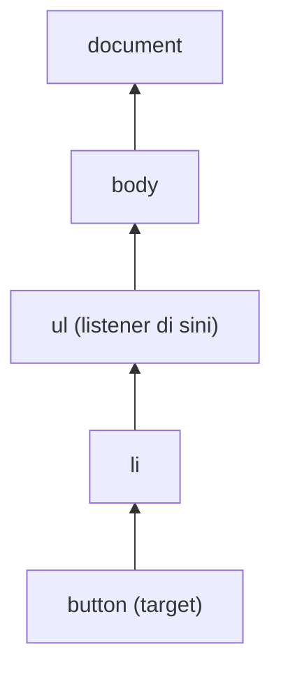

::part[Pelajari Konsepnya]{n="1"}

## 🎯 Yang akan kamu pelajari

- Apa itu DOM dan bagaimana JavaScript mengubah halaman
- Mencari, membuat, dan memperbarui elemen
- Menampilkan data dengan **aman** (menghindari serangan XSS)
- Menanggapi klik, ketikan, dan submit form
- Satu listener untuk seluruh list (event delegation)
- Menjaga data dan layar tetap sinkron: state → render

## 🔤 Istilah penting

| Istilah | Artinya (sederhana) |
|---|---|
| **DOM** | Halaman dalam bentuk pohon object yang bisa dibaca dan diubah JavaScript |
| **Event** | Sesuatu yang terjadi: klik, tekan tombol keyboard, submit form |
| **Event listener** | Function yang berjalan saat sebuah event terjadi |
| **Bubbling** | Event merambat naik dari elemen yang diklik ke parent-parent-nya |
| **Event delegation** | Satu listener di parent menangani event untuk semua child-nya |
| **XSS** | Serangan di mana seseorang menyelipkan script ke halamanmu lewat data |
| **State** | Data yang sedang ditampilkan halaman saat ini (teks pencarian, lowongan tersimpan) |
| **Render** | Menggambar layar berdasarkan state |

## 🧠 Ide besarnya

DOM itu seperti **wayang**: HTML membuat wayangnya, dan JavaScript menarik talinya — ubah teks ini, tambah item itu, bereaksi saat ada yang mengeklik.

Saat aplikasi membesar, menarik banyak tali satu per satu jadi kacau. Trik para profesional: simpan data di satu tempat (**state**), dan tulis satu function **render** yang menggambar ulang layar dari data itu. Seperti **papan skor**: kamu ubah skornya, papan menampilkan skor baru. React (Minggu 3) melakukan ini secara otomatis.

## ❓ Kenapa ini penting

HTML biasa tidak bisa memfilter lowongan saat kamu mengetik, men-toggle tombol "Tersimpan", atau menampilkan error form. DOM API memungkinkanmu memperbarui halaman tanpa reload. Setiap framework memakainya di balik layar, jadi memahaminya membuat React lebih mudah.

Kalau dilakukan sembarangan, berbahaya:

```js
list.innerHTML += `<li>${job.title}<button onclick="save(${job.id})">Save</button></li>`;
```

- Judul lowongan seperti `` menjalankan kode orang lain di halamanmu (**XSS**).
- `+=` membangun ulang seluruh list setiap kali, menghapus listener dan fokus yang ada.
- Satu-satunya catatan "lowongan ini sudah disimpan belum?" adalah teks tombol, yang mudah jadi tidak sinkron.

## 📖 Langkah demi langkah

### 1. Mencari elemen

```js
const list = document.querySelector("#jobs");            // first match (CSS selector)
const buttons = document.querySelectorAll(".save");       // static NodeList
const card = button.closest("li");                        // nearest ancestor matching
```

`querySelector` memakai selector CSS, seperti mencari ruangan di gedung berdasarkan nomornya. `closest` naik **ke atas** ke parent terdekat yang cocok.

### 2. Membuat dan memperbarui dengan aman

```js
const item = document.createElement("li");
item.dataset.id = String(job.id);                  // <li data-id="1">
const title = document.createElement("h2");
title.textContent = job.title;                     // ✅ text, never parsed as HTML
item.append(title);
list.append(item);

button.setAttribute("aria-pressed", "true");
card.classList.toggle("card--saved", isSaved);
list.replaceChildren(...newItems);                 // swap all children at once
```

- `textContent` selalu menampilkan data sebagai **teks biasa**. Walaupun teksnya berisi `<script>`, teks itu hanya ditampilkan, tidak dijalankan.
- `dataset.id` menyimpan data tambahan di elemen (`data-id="1"`).
- `classList.toggle` menambah atau menghapus sebuah class.

:::danger[XSS]
`innerHTML`, `insertAdjacentHTML`, dan `outerHTML` membaca string **sebagai HTML**, sehingga tag tersembunyi di dalam data bisa menjalankan kode. Bayangkan bedanya membacakan surat dari orang asing dengan menuruti semua isi suratnya. Jangan pernah mengoper data dari pengguna atau API ke sana. Kalau kamu memang harus menampilkan HTML dari sumber tepercaya, bersihkan dulu dengan library seperti DOMPurify.
:::

### 3. Event

```js
function onSubmit(event) {
  event.preventDefault();          // stop the browser's default (page reload)
  const data = new FormData(event.currentTarget);
  console.log(data.get("email"));
}
form.addEventListener("submit", onSubmit);
input.addEventListener("input", (event) => search(event.target.value));   // every keystroke
input.addEventListener("change", ...);                                      // on commit/blur
document.addEventListener("keydown", (e) => { if (e.key === "Escape") closeDialog(); });
```

- `addEventListener("click", fn)` = "saat ini terjadi, panggil `fn`", seperti bel pintu yang memutar lagu saat ditekan.
- `event.preventDefault()` menghentikan apa yang biasanya dilakukan browser (untuk form: me-reload halaman).
- `event.target` = elemen persis yang diklik (bisa jadi ikon kecil di dalam tombol). `event.currentTarget` = elemen tempat listener dipasang.
- Untuk form, dengarkan `submit` (berfungsi untuk tombol **dan** tombol Enter), bukan `click` pada tombol.

### 4. Bubbling dan event delegation

Saat kamu mengeklik tombol, event merambat **naik** melewati parent-parent-nya — seperti keluhan yang naik dari staf ke supervisor lalu ke manajer.



Jadi daripada memberi setiap tombol listener sendiri, pasang **satu** listener di list — seperti satu resepsionis untuk seluruh gedung. Cara ini juga berfungsi untuk tombol yang ditambahkan belakangan.

```js
list.addEventListener("click", (event) => {
  const button = event.target.closest("button[data-action='save']");
  if (!button) return;                          // click was somewhere else
  const id = Number(button.closest("li").dataset.id);
  toggleSaved(id);
});
```

### 5. State → render

```js
const state = { query: "", saved: new Set() };

function render() {
  const visible = jobs.filter((job) => job.title.toLowerCase().includes(state.query.toLowerCase()));
  list.replaceChildren(...visible.map((job) => renderJob(job, state.saved.has(job.id))));
  status.textContent = `${visible.length} jobs · ${state.saved.size} saved`;
}

input.addEventListener("input", () => { state.query = input.value; render(); });
```

Aturannya: **ubah state, lalu panggil `render()`**. Jangan pernah membaca data balik dari layar — papan skor hanya menampilkan skor, bukan yang menentukan skor.

Satu jebakan: menggambar ulang sebuah elemen mereset hal seperti posisi kursor. Jadi gambar ulang hanya bagian yang berubah — bukan input yang sedang diketik pengguna. React menyelesaikan ini untukmu.

### 6. Memberi tahu screen reader tentang perubahan

Screen reader tidak menyadari perubahan halaman dengan sendirinya. **Live region** mengumumkannya:

```html
<p aria-live="polite">3 jobs · 1 saved</p>
```

### 7. Bersih-bersih

```js
function mount(root) {
  const onClick = () => { ... };
  root.addEventListener("click", onClick);
  return () => root.removeEventListener("click", onClick);   // unmount
}
```

Kalau kamu menambahkan listener, hapus saat widget-nya sudah tidak dipakai — seperti mematikan lampu saat keluar ruangan. `AbortController` bisa menghapus banyak listener sekaligus: oper `{ signal }` saat menambahkan, lalu panggil `controller.abort()`. Cleanup di `useEffect` React adalah ide yang sama (Minggu 5).

## ⚠️ Kesalahan umum

- `innerHTML` dengan data dari pengguna atau API (XSS).
- Listener di setiap tombol, yang hilang setelah list digambar ulang.
- `event.target` ternyata `<span>` di dalam tombol — pakai `closest("button")`.
- Lupa `preventDefault()` — form me-reload halaman dan datamu hilang.
- Menggambar ulang input di setiap ketikan, sehingga kursor melompat.
- Memakai DOM langsung untuk aplikasi besar dengan banyak data bersama — itu tugas React (Minggu 3).

## 🏆 Praktik terbaik

- [ ] Tampilkan data dengan `textContent` / `createElement`; bersihkan HTML dengan DOMPurify kalau benar-benar perlu.
- [ ] Simpan data di variabel JavaScript (state); gambar layar dari state.
- [ ] Pakai `submit` untuk form, dengan `preventDefault()`.
- [ ] Pakai event delegation untuk list; simpan id di atribut `data-*`.
- [ ] Perbarui state ARIA (`aria-pressed`, `aria-expanded`) dan pakai `aria-live` untuk pesan status.
- [ ] Hapus listener yang kamu tambahkan (kembalikan function cleanup atau pakai `AbortController`).
- [ ] Perbarui DOM sekaligus (`replaceChildren`), bukan banyak sisipan satu per satu.

::part[Jelaskan & Rancang]{n="2"}

## 🗣️ Jelaskan

Jelaskan event delegation ke rekan tim dengan analogi resepsionis, dan kenapa tetap berfungsi setelah list digambar ulang.

## 📐 Rancang

Rencanakan widget kecil "catatan lamaran" dengan JavaScript biasa untuk halaman Flask/Jinja: tampilkan catatan, tambah catatan lewat form, hapus catatan, tampilkan "Menyimpan…" dan error, dan jaga layar tetap benar kalau panggilan API gagal. Jelaskan state, function render, event, dan panggilan API-nya.

:::quiz
Tampilkan contoh desainnya

**State**: `{ notes: [{ id, body, createdAt, pending?: boolean }], error: null | string, draft: "" }`

**Render** (hanya list dan teks status — bukan textarea):
- `ul` berisi catatan. Setiap isi diatur dengan `textContent`, plus tombol hapus `button[data-action="delete"]`. Catatan yang masih disimpan berwarna abu-abu dengan "Menyimpan…".
- `p[aria-live="polite"]` menampilkan error atau "3 catatan".

**Event**
- `form submit` → `preventDefault()`; tolak teks kosong. **Tampilkan langsung** (optimistic update): tambahkan `{ id: tempId, body, pending: true }`, render, lalu `POST /api/v1/applications/:id/notes`.
  - Berhasil: ganti catatan sementara dengan catatan dari server.
  - Gagal: hapus catatan itu, set `error = "Catatanmu gagal disimpan. Coba lagi."`, kembalikan teksnya ke textarea, render.
- `ul click` (delegation) → hapus: buang dari state dan render saat itu juga; `DELETE /api/v1/notes/:id`; kalau gagal, kembalikan catatan ke posisi semula dan tampilkan error.

**Keamanan**: hanya `textContent`; nonaktifkan tombol submit selama menyimpan (tanpa kiriman ganda); kirim header auth; kembalikan function cleanup yang menghapus listener.
:::

### 📝 Checklist self-review

- [ ] Satu tempat untuk data (state), satu function render
- [ ] Kalau API gagal, layar kembali ke keadaan yang benar
- [ ] Output teks yang aman dan pesan status yang diumumkan

::ai-review{task="design"}

::part[Latihan Kecil]{n="3"}

:::exercise{path="exercises/web/m4/w1/05-dom-events" ai="no-ai" title="Papan lowongan interaktif dengan vanilla JS"}
Bangun daftar lowongan yang bisa dicari dengan tombol simpan: HTML yang aksesibel, filter saat mengetik, pesan "kosong", lowongan tersimpan yang tetap tersimpan saat difilter, baris status live, output aman untuk data berbahaya, satu listener klik ber-delegation, dan function cleanup. Tes memakai halaman seperti pengguna sungguhan (Testing Library).
:::

:::hints
- Simpan `query` dan sebuah `Set` berisi id tersimpan di variabel di dalam function-mu (closure); tulis `render()` yang hanya membangun ulang list, status, dan pesan kosong.
- Buat form dan input **sekali saja**, di luar `render()`, agar ketikan tidak terganggu.
- Di click handler: `event.target.closest("button")`, lalu `closest("li").dataset.id`.
:::

## ✅ Cek cepat

:::quiz
Apa beda `event.target` dan `event.currentTarget`?

`target` adalah elemen tempat event bermula (bisa jadi child). `currentTarget` adalah elemen yang listener-nya sedang berjalan.
:::

:::quiz
Kenapa `textContent` lebih aman daripada `innerHTML` untuk data API?

`textContent` menampilkan teks biasa. `innerHTML` membaca teks sebagai HTML, sehingga tag atau event handler tersembunyi di dalam data bisa berjalan (XSS).
:::

## 📚 Lanjut belajar

- [MDN: Introduction to the DOM](https://developer.mozilla.org/en-US/docs/Web/API/Document_Object_Model/Introduction)
- [MDN: Event bubbling and delegation](https://developer.mozilla.org/en-US/docs/Learn_web_development/Core/Scripting/Event_bubbling)
- [OWASP: Cross Site Scripting Prevention Cheat Sheet](https://cheatsheetseries.owasp.org/cheatsheets/Cross_Site_Scripting_Prevention_Cheat_Sheet.html)
