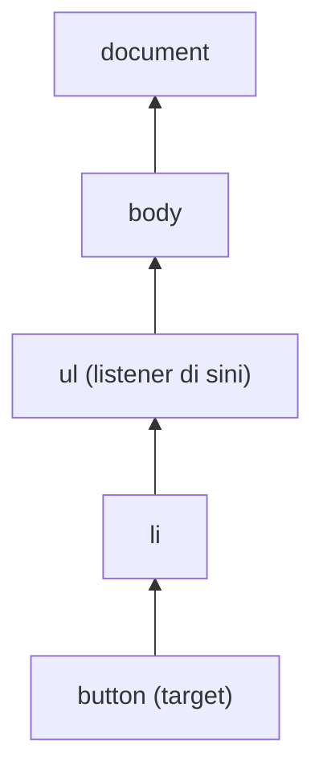

::part[Pelajari Konsepnya]{n="1"}

## 🎯 Yang akan kamu pelajari

- Pohon DOM dan cara JavaScript membaca serta mengubahnya
- Memilih (`querySelector`), membuat (`createElement`), memperbarui (`textContent`, atribut, `classList`, `dataset`)
- **Me-render data dengan aman** — kenapa `innerHTML` berisi data memicu XSS
- Event: listener, event object, `preventDefault`, bubbling, dan **event delegation**
- Siklus kecil **state → render** (ide yang diotomatisasi React)
- Membereskan listener dan elemen

## 🧠 Ide besarnya

DOM adalah **boneka wayang**: HTML menyiapkan bonekanya, dan JavaScript menarik talinya — ubah teks di sini, tambah item di sana, bereaksi saat seseorang mengeklik.

Seiring aplikasi membesar, menarik tali satu per satu jadi kacau. Trik yang dipakai para profesional: simpan datamu di **state**, dan tulis satu function **render** yang menggambar ulang boneka dari state. Itulah persis yang dilakukan React untukmu minggu depan.

## ❓ Kenapa ini ada?

HTML statis tidak bisa memfilter daftar lowongan saat kamu mengetik, men-toggle tombol "Tersimpan", atau menampilkan error validasi. DOM API adalah cara bawaan browser untuk memperbarui halaman tanpa reload. Setiap framework dibangun di atasnya — memahaminya membuat perilaku (dan bug) React jadi masuk akal.

## 💥 Apa yang terjadi kalau TIDAK dilakukan dengan hati-hati?

```js
list.innerHTML += `<li>${job.title}<button onclick="save(${job.id})">Save</button></li>`;
```

- Judul lowongan seperti `` menjalankan kode penyerang (**XSS**).
- `+=` mem-parse ulang seluruh list setiap kali, menghancurkan listener dan fokus yang ada.
- `onclick` inline butuh function global.
- State tinggal di DOM ("tombol ini sudah disimpan belum? cek teksnya") dan jadi tidak sinkron.

## 📖 Cara kerjanya, langkah demi langkah

### 1. Memilih elemen

```js
const list = document.querySelector("#jobs");            // first match (CSS selector)
const buttons = document.querySelectorAll(".save");       // static NodeList
const card = button.closest("li");                        // nearest ancestor matching
```

### 2. Membuat dan memperbarui dengan aman

```js
const item = document.createElement("li");
item.dataset.id = String(job.id);                  // <li data-id="1">
const title = document.createElement("h2");
title.textContent = job.title;                     // ✅ text, never parsed as HTML
item.append(title);
list.append(item);

button.setAttribute("aria-pressed", "true");
card.classList.toggle("card--saved", isSaved);
list.replaceChildren(...newItems);                 // swap all children at once
```

:::danger[XSS]
`innerHTML`, `insertAdjacentHTML`, dan `outerHTML` mem-parse string sebagai HTML. Jangan pernah mengoper data pengguna atau API ke sana. Kalau kamu memang harus me-render HTML tepercaya (misalnya Markdown yang sudah disanitasi), sanitasi dulu dengan library seperti DOMPurify.
:::

### 3. Event

```js
function onSubmit(event) {
  event.preventDefault();          // stop the browser's default (page reload)
  const data = new FormData(event.currentTarget);
  console.log(data.get("email"));
}
form.addEventListener("submit", onSubmit);
input.addEventListener("input", (event) => search(event.target.value));   // every keystroke
input.addEventListener("change", ...);                                      // on commit/blur
document.addEventListener("keydown", (e) => { if (e.key === "Escape") closeDialog(); });
```

- `event.target` — elemen yang benar-benar diklik (bisa jadi child-nya).
- `event.currentTarget` — elemen tempat listener dipasang.
- Pakai `submit` pada form (menangani Enter dan tombol) alih-alih `click` pada tombol.

### 4. Bubbling dan event delegation

Event merambat **naik** dari target melewati ancestor-nya:



Jadi satu listener di list bisa menangani setiap tombol — termasuk tombol yang di-render belakangan:

```js
list.addEventListener("click", (event) => {
  const button = event.target.closest("button[data-action='save']");
  if (!button) return;                          // click was somewhere else
  const id = Number(button.closest("li").dataset.id);
  toggleSaved(id);
});
```

Lebih sedikit listener, tidak perlu memasang ulang setelah re-render, lebih hemat memori.

### 5. State → render

```js
const state = { query: "", saved: new Set() };

function render() {
  const visible = jobs.filter((job) => job.title.toLowerCase().includes(state.query.toLowerCase()));
  list.replaceChildren(...visible.map((job) => renderJob(job, state.saved.has(job.id))));
  status.textContent = `${visible.length} jobs · ${state.saved.size} saved`;
}

input.addEventListener("input", () => { state.query = input.value; render(); });
```

Aturannya: **ubah state, lalu panggil render**; jangan pernah membaca state balik dari DOM. React memformalkan ini: `setState` → re-render.

Trade-off: me-render ulang seluruh list mereset fokus di dalamnya. Diffing React menyelesaikan itu; di vanilla JS, jaga area yang di-render ulang tetap kecil (jangan me-render ulang input yang sedang kamu ketik).

### 6. Mengumumkan perubahan

Screen reader tidak otomatis menyadari perubahan DOM. Live region mengumumkannya:

```html
<p aria-live="polite">3 jobs · 1 saved</p>
```

### 7. Cleanup

```js
function mount(root) {
  const onClick = () => { ... };
  root.addEventListener("click", onClick);
  return () => root.removeEventListener("click", onClick);   // unmount
}
```

Atau pakai `AbortController`: `addEventListener("click", handler, { signal })` lalu `controller.abort()` menghapus semuanya. Cleanup di `useEffect` React adalah ide yang sama (Minggu 5).

## ⚖️ Trade-off

| Pilihan | ✅ | ❌ |
|---|---|---|
| DOM vanilla | tanpa dependency, cepat untuk widget kecil | sinkronisasi state/render manual, bertele-tele |
| `innerHTML` dengan template | pendek | risiko XSS, menghancurkan listener/fokus |
| Event delegation | satu listener, berfungsi untuk item dinamis | sedikit logika tambahan (`closest`) |
| Re-render semuanya | sederhana dan konsisten | kehilangan fokus/scroll; lambat untuk list besar |
| Framework (React) | deklaratif, update efisien | ukuran bundle, kurva belajar |

## ✅ Kapan dipakai / 🚫 Kapan TIDAK dipakai

- ✅ Peningkatan kecil di halaman yang di-render server (template Flask/Jinja), browser extension, widget yang kritis performanya.
- ✅ Memahami apa yang dikerjakan framework di balik layar.
- 🚫 Aplikasi kompleks dengan banyak state bersama — pakai React (Minggu 3).
- 🚫 `innerHTML` untuk data apa pun yang tidak kamu tulis sendiri.

## 🏆 Praktik terbaik

- [ ] Render data dengan `textContent`/`createElement`; sanitasi kalau HTML tak terhindarkan.
- [ ] Simpan state di variabel JavaScript; render dari state; jangan simpan kebenaran di DOM.
- [ ] Pakai `submit` untuk form dan `preventDefault` saat menanganinya di JS.
- [ ] Pakai **event delegation** untuk list; pakai atribut `data-*` untuk id.
- [ ] Perbarui state ARIA (`aria-pressed`, `aria-expanded`) dan pakai `aria-live` untuk pesan status.
- [ ] Hapus listener yang kamu tambahkan (kembalikan function cleanup atau pakai `AbortController`).
- [ ] Kelompokkan penulisan DOM (`replaceChildren`, `DocumentFragment`) alih-alih banyak penyisipan satu per satu.

## 🏭 Cara dipakai di industri

- Framework (React, Vue, Svelte) semuanya berujung pada operasi DOM; library seperti htmx dan Alpine.js meningkatkan aplikasi yang di-render server dengan update DOM kecil — populer di tim Flask/Django.
- XSS masih ada di OWASP Top 10; React meng-escape teks secara default, salah satu alasan tim mengadopsinya.
- Widget analytics dan support memakai event delegation di `document` untuk melacak klik di seluruh situs.

## ⚠️ Kesalahan umum

- Memasang listener di setiap tombol, lalu kehilangannya setelah re-render.
- `event.target` ternyata `<span>` di dalam tombol — pakai `closest()`.
- Lupa `preventDefault` → form me-reload halaman dan state hilang.
- Me-render ulang elemen input di setiap ketikan, sehingga kursor melompat.

::part[Jelaskan & Rancang]{n="2"}

## 🗣️ Jelaskan

Jelaskan event delegation ke rekan tim dengan analogi (misalnya resepsionis gedung yang melayani tamu untuk setiap kantor), dan kenapa tetap berfungsi setelah list di-render ulang.

## 📐 Rancang

Rancang widget "catatan lamaran" dengan vanilla JS untuk halaman Flask/Jinja: menampilkan catatan, menambah catatan lewat form, menghapus catatan, menampilkan "Menyimpan…"/error, dan menjaga UI tetap benar kalau panggilan API gagal. Jelaskan object state, function render, event, dan panggilan API-nya.

:::quiz
Tampilkan contoh desainnya

**State**: `{ notes: [{ id, body, createdAt, pending?: boolean }], error: null | string, draft: "" }`

**Render** (hanya list dan status; bukan textarea):
- `ul` berisi catatan dengan body lewat `textContent`, tombol hapus `button[data-action="delete"]`, catatan yang pending dibuat abu-abu dengan "Menyimpan…".
- `p[aria-live="polite"]` menampilkan error atau "3 catatan".

**Event**
- `form submit` → `preventDefault`; validasi tidak kosong; **optimistic update**: tambahkan `{ id: tempId, body, pending: true }`, render, `POST /api/v1/applications/:id/notes`. Kalau berhasil, ganti catatan sementara dengan catatan dari server; kalau gagal, hapus catatan itu, set `error = "Catatanmu gagal disimpan. Coba lagi."`, kembalikan teks draft, render.
- `ul click` (delegation) → hapus: buang dari state dan render langsung; `DELETE /api/v1/notes/:id`; kalau gagal, kembalikan ke indeks lamanya dan tampilkan error.

**Keamanan**: hanya `textContent`, nonaktifkan tombol submit selama pending (tanpa double post), kirim header CSRF/JWT, dan kembalikan function cleanup yang menghapus listener.
:::

### 📝 Checklist self-review

- [ ] Satu sumber kebenaran (state), satu render
- [ ] Jalur gagal mengembalikan UI
- [ ] Render yang aman dan status yang aksesibel

::ai-review{task="design"}

::part[Latihan Kecil]{n="3"}

:::exercise{path="exercises/web/m4/w1/05-dom-events" ai="no-ai" title="Papan lowongan interaktif dengan vanilla JS"}
Bangun daftar lowongan yang bisa dicari dengan tombol simpan: markup yang aksesibel, filter langsung, tampilan kosong, status tersimpan yang bertahan saat difilter, baris status live, render aman untuk data berbahaya, satu listener klik ber-delegation, dan function cleanup. Tes menjalankannya seperti pengguna dengan Testing Library.
:::

:::hints
- Simpan `query` dan sebuah `Set` berisi id tersimpan di variabel closure; tulis `render()` yang hanya membangun ulang list, status, dan pesan kosong.
- Buat form dan input **sekali** di luar `render()` agar ketikan tidak terganggu.
- Di click handler: `event.target.closest("button")`, lalu `closest("li").dataset.id`.
:::

## ✅ Cek cepat

:::quiz
Apa beda `event.target` dan `event.currentTarget`?

`target` adalah elemen tempat event bermula (bisa jadi child); `currentTarget` adalah elemen yang listener-nya sedang berjalan.
:::

:::quiz
Kenapa `textContent` lebih aman daripada `innerHTML` untuk data API?

`textContent` menyisipkan teks biasa; `innerHTML` mem-parse markup, sehingga tag atau event handler yang disisipkan bisa dieksekusi (XSS).
:::

## 📖 Kamus (glosarium)

| Istilah | Bahasa Indonesia |
|---|---|
| DOM manipulation | Manipulasi DOM — mengubah elemen halaman lewat JavaScript |
| Event listener | Pendengar peristiwa |
| Event bubbling | Penggelembungan peristiwa ke elemen induk |
| Event delegation | Delegasi peristiwa |
| XSS (Cross-Site Scripting) | Serangan penyisipan skrip |
| Live region | Area yang diumumkan pembaca layar saat berubah |

## 📚 Lanjut belajar

- [MDN: Introduction to the DOM](https://developer.mozilla.org/en-US/docs/Web/API/Document_Object_Model/Introduction)
- [MDN: Event bubbling and delegation](https://developer.mozilla.org/en-US/docs/Learn_web_development/Core/Scripting/Event_bubbling)
- [OWASP: Cross Site Scripting Prevention Cheat Sheet](https://cheatsheetseries.owasp.org/cheatsheets/Cross_Site_Scripting_Prevention_Cheat_Sheet.html)
