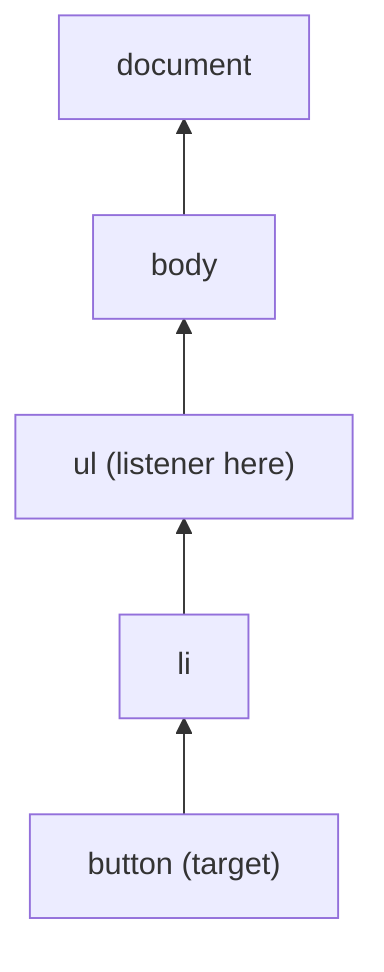

::part[Learn the Concept]{n="1"}

## 🎯 What you'll learn

- The DOM tree and how JavaScript reads and changes it
- Selecting (`querySelector`), creating (`createElement`), updating (`textContent`, attributes, `classList`, `dataset`)
- **Rendering data safely** — why `innerHTML` with data causes XSS
- Events: listeners, the event object, `preventDefault`, bubbling and **event delegation**
- A tiny **state → render** loop (the idea React automates)
- Cleaning up listeners and elements

## 🧠 The big idea

The DOM is a **puppet**: HTML sets up the puppet, and JavaScript pulls the strings — change text here, add an item there, react when someone clicks.

As apps grow, pulling individual strings becomes chaos. The trick professionals use is: keep your data in **state**, and write one **render** function that redraws the puppet from state. That's exactly what React does for you next week.

## ❓ Why does this exist?

Static HTML can't filter a job list as you type, toggle a "Saved" button, or show validation errors. The DOM API is the browser's built-in way to update the page without reloading. Every framework is built on it — understanding it makes React's behavior (and bugs) make sense.

## 💥 What happens if we DON'T do it carefully?

```js
list.innerHTML += `<li>${job.title}<button onclick="save(${job.id})">Save</button></li>`;
```

- A job title like `` runs attacker code (**XSS**).
- `+=` re-parses the whole list every time, destroying existing listeners and focus.
- Inline `onclick` needs global functions.
- State lives in the DOM ("is this button saved? check its text") and gets out of sync.

## 📖 How it works, step by step

### 1. Selecting

```js
const list = document.querySelector("#jobs");            // first match (CSS selector)
const buttons = document.querySelectorAll(".save");       // static NodeList
const card = button.closest("li");                        // nearest ancestor matching
```

### 2. Creating and updating safely

```js
const item = document.createElement("li");
item.dataset.id = String(job.id);                  // <li data-id="1">
const title = document.createElement("h2");
title.textContent = job.title;                     // ✅ text, never parsed as HTML
item.append(title);
list.append(item);

button.setAttribute("aria-pressed", "true");
card.classList.toggle("card--saved", isSaved);
list.replaceChildren(...newItems);                 // swap all children at once
```

:::danger[XSS]
`innerHTML`, `insertAdjacentHTML` and `outerHTML` parse strings as HTML. Never pass user or API data to them. If you must render trusted HTML (e.g. sanitized Markdown), sanitize it with a library like DOMPurify first.
:::

### 3. Events

```js
function onSubmit(event) {
  event.preventDefault();          // stop the browser's default (page reload)
  const data = new FormData(event.currentTarget);
  console.log(data.get("email"));
}
form.addEventListener("submit", onSubmit);
input.addEventListener("input", (event) => search(event.target.value));   // every keystroke
input.addEventListener("change", ...);                                      // on commit/blur
document.addEventListener("keydown", (e) => { if (e.key === "Escape") closeDialog(); });
```

- `event.target` — the element that was actually clicked (maybe a child).
- `event.currentTarget` — the element the listener is on.
- Use `submit` on forms (handles Enter and the button) instead of `click` on the button.

### 4. Bubbling and event delegation

Events travel **up** from the target through its ancestors:



So one listener on the list can handle every button — including buttons rendered later:

```js
list.addEventListener("click", (event) => {
  const button = event.target.closest("button[data-action='save']");
  if (!button) return;                          // click was somewhere else
  const id = Number(button.closest("li").dataset.id);
  toggleSaved(id);
});
```

Fewer listeners, no re-attaching after re-render, less memory.

### 5. State → render

```js
const state = { query: "", saved: new Set() };

function render() {
  const visible = jobs.filter((job) => job.title.toLowerCase().includes(state.query.toLowerCase()));
  list.replaceChildren(...visible.map((job) => renderJob(job, state.saved.has(job.id))));
  status.textContent = `${visible.length} jobs · ${state.saved.size} saved`;
}

input.addEventListener("input", () => { state.query = input.value; render(); });
```

Rules: **change state, then call render**; never read state back from the DOM. React formalizes this: `setState` → re-render.

Trade-off: re-rendering the whole list resets focus inside it. React's diffing solves that; in vanilla JS, keep re-rendered regions small (don't re-render the input you're typing in).

### 6. Announcing changes

Screen readers don't notice DOM updates automatically. A live region announces them:

```html
<p aria-live="polite">3 jobs · 1 saved</p>
```

### 7. Cleanup

```js
function mount(root) {
  const onClick = () => { ... };
  root.addEventListener("click", onClick);
  return () => root.removeEventListener("click", onClick);   // unmount
}
```

Or use `AbortController`: `addEventListener("click", handler, { signal })` then `controller.abort()` removes all of them. React's `useEffect` cleanup is the same idea (Week 5).

## ⚖️ Trade-offs

| Choice | ✅ | ❌ |
|---|---|---|
| Vanilla DOM | no dependencies, fast for small widgets | manual state/render sync, verbose |
| `innerHTML` with templates | short | XSS risk, destroys listeners/focus |
| Event delegation | one listener, works for dynamic items | slightly more logic (`closest`) |
| Re-render everything | simple and consistent | loses focus/scroll; slow for huge lists |
| Framework (React) | declarative, efficient updates | bundle size, learning curve |

## ✅ When to use it / 🚫 When NOT to use it

- ✅ Small enhancements on server-rendered pages (Flask/Jinja templates), browser extensions, performance-critical widgets.
- ✅ Understanding what frameworks do underneath.
- 🚫 Complex apps with lots of shared state — use React (Week 3).
- 🚫 `innerHTML` for any data you didn't write yourself.

## 🏆 Best practices

- [ ] Render data with `textContent`/`createElement`; sanitize if HTML is unavoidable.
- [ ] Keep state in JavaScript variables; render from state; don't store truth in the DOM.
- [ ] Use `submit` for forms and `preventDefault` when handling them in JS.
- [ ] Use **event delegation** for lists; use `data-*` attributes for ids.
- [ ] Update ARIA state (`aria-pressed`, `aria-expanded`) and use `aria-live` for status messages.
- [ ] Remove listeners you add (return a cleanup function or use `AbortController`).
- [ ] Batch DOM writes (`replaceChildren`, `DocumentFragment`) instead of many single insertions.

## 🏭 How it's used in industry

- Frameworks (React, Vue, Svelte) all compile down to DOM operations; libraries like htmx and Alpine.js enhance server-rendered apps with small DOM updates — popular with Flask/Django teams.
- XSS remains in the OWASP Top 10; React escapes text by default, which is one reason teams adopt it.
- Analytics and support widgets use event delegation on `document` to track clicks site-wide.

## ⚠️ Common mistakes

- Attaching a listener to each button, then losing them after re-rendering.
- `event.target` being a child `<span>` inside the button — use `closest()`.
- Forgetting `preventDefault` → form reloads the page and state is lost.
- Re-rendering the input element on each keystroke, so the cursor jumps.

::part[Explain & Design]{n="2"}

## 🗣️ Explain it

Explain event delegation to a teammate with an analogy (e.g. a building receptionist who handles visitors for every office), and why it keeps working after the list re-renders.

## 📐 Design it

Design a vanilla-JS "application notes" widget for a Flask/Jinja page: list notes, add a note with a form, delete a note, show "Saving…"/errors, and keep the UI correct if the API call fails. Describe the state object, render function, events and API calls.

:::quiz
Show a possible design

**State**: `{ notes: [{ id, body, createdAt, pending?: boolean }], error: null | string, draft: "" }`

**Render** (only the list and status; not the textarea):
- `ul` of notes with `textContent` body, a delete `button[data-action="delete"]`, pending notes greyed with "Saving…".
- `p[aria-live="polite"]` shows errors or "3 notes".

**Events**
- `form submit` → `preventDefault`; validate non-blank; **optimistic update**: add `{ id: tempId, body, pending: true }`, render, `POST /api/v1/applications/:id/notes`. On success replace the temp note with the server note; on failure remove it, set `error = "Couldn't save your note. Try again."`, restore the draft text, render.
- `ul click` (delegation) → delete: remove from state and render immediately; `DELETE /api/v1/notes/:id`; on failure put it back at its old index and show an error.

**Safety**: `textContent` only, disable the submit button while pending (no double posts), send the CSRF/JWT header, and return a cleanup function that removes listeners.
:::

### 📝 Self-review checklist

- [ ] One source of truth (state), one render
- [ ] Failure path restores the UI
- [ ] Safe rendering and accessible status

::ai-review{task="design"}

::part[Toy Exercise]{n="3"}

:::exercise{path="exercises/web/m4/w1/05-dom-events" ai="no-ai" title="An interactive job board in vanilla JS"}
Build a searchable job list with save buttons: accessible markup, live filtering, an empty state, saved state that survives filtering, a live status line, safe rendering of malicious data, a single delegated click listener, and a cleanup function. Tests drive it like a user with Testing Library.
:::

:::hints
- Keep `query` and a `Set` of saved ids in closure variables; write a `render()` that rebuilds only the list, status and empty message.
- Create the form and input **once** outside `render()` so typing isn't interrupted.
- In the click handler: `event.target.closest("button")`, then `closest("li").dataset.id`.
:::

## ✅ Quick check

:::quiz
What's the difference between `event.target` and `event.currentTarget`?

`target` is the element where the event started (possibly a child); `currentTarget` is the element whose listener is running.
:::

:::quiz
Why is `textContent` safer than `innerHTML` for API data?

`textContent` inserts plain text; `innerHTML` parses markup, so injected tags or event handlers can execute (XSS).
:::

## 📖 Kamus (glossary)

| Term | Bahasa Indonesia |
|---|---|
| DOM manipulation | Manipulasi DOM — mengubah elemen halaman lewat JavaScript |
| Event listener | Pendengar peristiwa |
| Event bubbling | Penggelembungan peristiwa ke elemen induk |
| Event delegation | Delegasi peristiwa |
| XSS (Cross-Site Scripting) | Serangan penyisipan skrip |
| Live region | Area yang diumumkan pembaca layar saat berubah |

## 📚 Keep learning

- [MDN: Introduction to the DOM](https://developer.mozilla.org/en-US/docs/Web/API/Document_Object_Model/Introduction)
- [MDN: Event bubbling and delegation](https://developer.mozilla.org/en-US/docs/Learn_web_development/Core/Scripting/Event_bubbling)
- [OWASP: Cross Site Scripting Prevention Cheat Sheet](https://cheatsheetseries.owasp.org/cheatsheets/Cross_Site_Scripting_Prevention_Cheat_Sheet.html)
