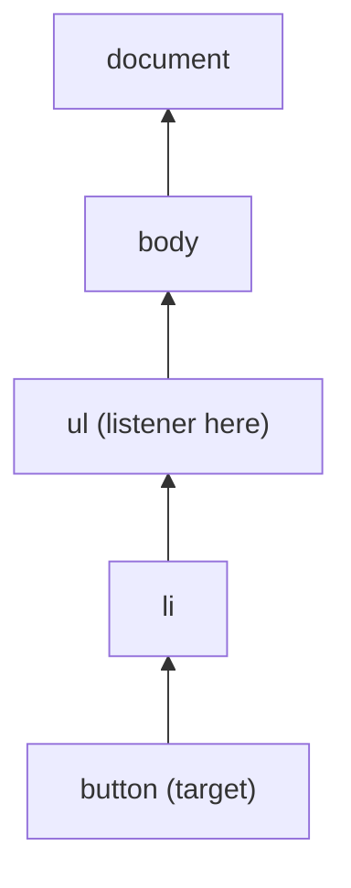

::part[Learn the Concept]{n="1"}

## 🎯 What you'll learn

- What the DOM is and how JavaScript changes the page
- Finding, creating and updating elements
- Showing data **safely** (avoiding XSS attacks)
- Reacting to clicks, typing and form submits
- One listener for a whole list (event delegation)
- Keeping your data and the screen in sync: state → render

## 🔤 Key words

| Word | In simple words | Bahasa Indonesia |
|---|---|---|
| **DOM** | The page as a tree of objects JavaScript can read and change | Pohon elemen halaman |
| **Event** | Something that happens: a click, a key press, a form submit | Kejadian |
| **Event listener** | A function that runs when an event happens | Pendengar kejadian |
| **Bubbling** | An event travels up from the clicked element to its parents | Merambat ke atas |
| **Event delegation** | One listener on a parent handles events for all its children | Satu pendengar untuk banyak elemen |
| **XSS** | An attack where someone sneaks a script into your page through data | Serangan sisipan skrip |
| **State** | The data your page is showing right now (search text, saved jobs) | Data saat ini |
| **Render** | Draw the screen from the state | Menampilkan ulang |

## 🧠 The big idea

The DOM is like a **puppet**: HTML builds the puppet, and JavaScript pulls the strings — change this text, add that item, react when someone clicks.

When an app grows, pulling many single strings gets messy. The professional trick: keep your data in one place (**state**), and write one **render** function that redraws the screen from that data. Like a **scoreboard**: you update the score, and the board shows the new score. React (Week 3) does this for you automatically.

## ❓ Why it matters

Plain HTML can't filter jobs as you type, toggle a "Saved" button or show form errors. The DOM API lets you update the page without reloading. Every framework uses it underneath, so understanding it makes React easier.

Doing it carelessly is dangerous:

```js
list.innerHTML += `<li>${job.title}<button onclick="save(${job.id})">Save</button></li>`;
```

- A job title like `` runs someone else's code on your page (**XSS**).
- `+=` rebuilds the whole list every time, removing existing listeners and focus.
- The only record of "is this job saved?" is the button text, which easily gets out of sync.

## 📖 Step by step

### 1. Finding elements

```js
const list = document.querySelector("#jobs");            // first match (CSS selector)
const buttons = document.querySelectorAll(".save");       // static NodeList
const card = button.closest("li");                        // nearest ancestor matching
```

`querySelector` uses CSS selectors, like searching a building by room number. `closest` goes **up** to the nearest parent that matches.

### 2. Creating and updating safely

```js
const item = document.createElement("li");
item.dataset.id = String(job.id);                  // <li data-id="1">
const title = document.createElement("h2");
title.textContent = job.title;                     // ✅ text, never parsed as HTML
item.append(title);
list.append(item);

button.setAttribute("aria-pressed", "true");
card.classList.toggle("card--saved", isSaved);
list.replaceChildren(...newItems);                 // swap all children at once
```

- `textContent` always shows data as **plain text**. Even if the text contains `<script>`, it is shown, not run.
- `dataset.id` stores extra data on an element (`data-id="1"`).
- `classList.toggle` adds or removes a class.

:::danger[XSS]
`innerHTML`, `insertAdjacentHTML` and `outerHTML` read a string **as HTML**, so hidden tags in the data can run code. Think of it as reading a stranger's letter out loud versus doing whatever the letter says. Never pass user or API data to them. If you must show HTML from a trusted source, clean it first with a library like DOMPurify.
:::

### 3. Events

```js
function onSubmit(event) {
  event.preventDefault();          // stop the browser's default (page reload)
  const data = new FormData(event.currentTarget);
  console.log(data.get("email"));
}
form.addEventListener("submit", onSubmit);
input.addEventListener("input", (event) => search(event.target.value));   // every keystroke
input.addEventListener("change", ...);                                      // on commit/blur
document.addEventListener("keydown", (e) => { if (e.key === "Escape") closeDialog(); });
```

- `addEventListener("click", fn)` = "when this happens, call `fn`", like a doorbell that plays a song when pressed.
- `event.preventDefault()` stops what the browser would normally do (for a form: reload the page).
- `event.target` = the exact element that was clicked (maybe a small icon inside the button). `event.currentTarget` = the element the listener is attached to.
- For forms, listen to `submit` (works for the button **and** the Enter key), not `click` on the button.

### 4. Bubbling and event delegation

When you click a button, the event travels **up** through its parents — like a complaint going from a worker to the supervisor to the manager.



So instead of giving every button its own listener, put **one** listener on the list — like one receptionist for a whole building. It also works for buttons added later.

```js
list.addEventListener("click", (event) => {
  const button = event.target.closest("button[data-action='save']");
  if (!button) return;                          // click was somewhere else
  const id = Number(button.closest("li").dataset.id);
  toggleSaved(id);
});
```

### 5. State → render

```js
const state = { query: "", saved: new Set() };

function render() {
  const visible = jobs.filter((job) => job.title.toLowerCase().includes(state.query.toLowerCase()));
  list.replaceChildren(...visible.map((job) => renderJob(job, state.saved.has(job.id))));
  status.textContent = `${visible.length} jobs · ${state.saved.size} saved`;
}

input.addEventListener("input", () => { state.query = input.value; render(); });
```

The rule: **change the state, then call `render()`**. Never read your data back from the screen — the scoreboard shows the score, it doesn't decide it.

One catch: redrawing an element resets things like cursor position. So only redraw the parts that change — not the input the user is typing in. React solves this for you.

### 6. Telling screen readers about changes

Screen readers don't notice page updates by themselves. A **live region** announces them:

```html
<p aria-live="polite">3 jobs · 1 saved</p>
```

### 7. Cleaning up

```js
function mount(root) {
  const onClick = () => { ... };
  root.addEventListener("click", onClick);
  return () => root.removeEventListener("click", onClick);   // unmount
}
```

If you add a listener, remove it when the widget goes away — like switching off the lights when you leave a room. `AbortController` can remove many listeners at once: pass `{ signal }` when adding, then call `controller.abort()`. React's `useEffect` cleanup is the same idea (Week 5).

## ⚠️ Common mistakes

- `innerHTML` with data from users or an API (XSS).
- A listener on each button, which disappears after the list is redrawn.
- `event.target` is a `<span>` inside the button — use `closest("button")`.
- Forgetting `preventDefault()` — the form reloads the page and your data is lost.
- Redrawing the input on every key press, so the cursor jumps.
- Using the DOM for big apps with lots of shared data — that's React's job (Week 3).

## 🏆 Best practices

- [ ] Show data with `textContent` / `createElement`; clean HTML with DOMPurify if you really need it.
- [ ] Keep data in JavaScript variables (state); draw the screen from state.
- [ ] Use `submit` for forms, with `preventDefault()`.
- [ ] Use event delegation for lists; store ids in `data-*` attributes.
- [ ] Update ARIA state (`aria-pressed`, `aria-expanded`) and use `aria-live` for status messages.
- [ ] Remove listeners you added (return a cleanup function or use `AbortController`).
- [ ] Update the DOM in batches (`replaceChildren`) instead of many single inserts.

::part[Explain & Design]{n="2"}

## 🗣️ Explain it

Explain event delegation to a teammate using the receptionist analogy, and why it still works after the list is redrawn.

## 📐 Design it

Plan a small "application notes" widget in plain JavaScript for a Flask/Jinja page: show notes, add a note with a form, delete a note, show "Saving…" and errors, and keep the screen correct if the API call fails. Describe the state, the render function, the events and the API calls.

:::quiz
Show a possible design

**State**: `{ notes: [{ id, body, createdAt, pending?: boolean }], error: null | string, draft: "" }`

**Render** (only the list and the status text — not the textarea):
- A `ul` of notes. Each body is set with `textContent`, plus a delete `button[data-action="delete"]`. Notes still saving are grey with "Saving…".
- A `p[aria-live="polite"]` shows the error or "3 notes".

**Events**
- `form submit` → `preventDefault()`; reject empty text. **Show it right away** (optimistic update): add `{ id: tempId, body, pending: true }`, render, then `POST /api/v1/applications/:id/notes`.
  - Success: replace the temporary note with the note from the server.
  - Failure: remove it, set `error = "Couldn't save your note. Try again."`, put the text back in the textarea, render.
- `ul click` (delegation) → delete: remove from state and render at once; `DELETE /api/v1/notes/:id`; if it fails, put the note back where it was and show an error.

**Safety**: only `textContent`; disable the submit button while saving (no double posts); send the auth header; return a cleanup function that removes the listeners.
:::

### 📝 Self-review checklist

- [ ] One place for data (state), one render function
- [ ] If the API fails, the screen goes back to the correct state
- [ ] Safe text output and an announced status message

::ai-review{task="design"}

::part[Toy Exercise]{n="3"}

:::exercise{path="exercises/web/m4/w1/05-dom-events" ai="no-ai" title="An interactive job board in vanilla JS"}
Build a searchable job list with save buttons: accessible HTML, filtering while typing, an "empty" message, saved jobs that stay saved while filtering, a live status line, safe output for dangerous data, one delegated click listener, and a cleanup function. The tests use the page like a real user (Testing Library).
:::

:::hints
- Keep `query` and a `Set` of saved ids in variables inside your function (closure); write a `render()` that rebuilds only the list, the status and the empty message.
- Create the form and input **once**, outside `render()`, so typing isn't interrupted.
- In the click handler: `event.target.closest("button")`, then `closest("li").dataset.id`.
:::

## ✅ Quick check

:::quiz
What's the difference between `event.target` and `event.currentTarget`?

`target` is the element where the event started (maybe a child). `currentTarget` is the element whose listener is running.
:::

:::quiz
Why is `textContent` safer than `innerHTML` for API data?

`textContent` shows plain text. `innerHTML` reads the text as HTML, so hidden tags or event handlers in the data can run (XSS).
:::

## 📚 Keep learning

- [MDN: Introduction to the DOM](https://developer.mozilla.org/en-US/docs/Web/API/Document_Object_Model/Introduction)
- [MDN: Event bubbling and delegation](https://developer.mozilla.org/en-US/docs/Learn_web_development/Core/Scripting/Event_bubbling)
- [OWASP: Cross Site Scripting Prevention Cheat Sheet](https://cheatsheetseries.owasp.org/cheatsheets/Cross_Site_Scripting_Prevention_Cheat_Sheet.html)
