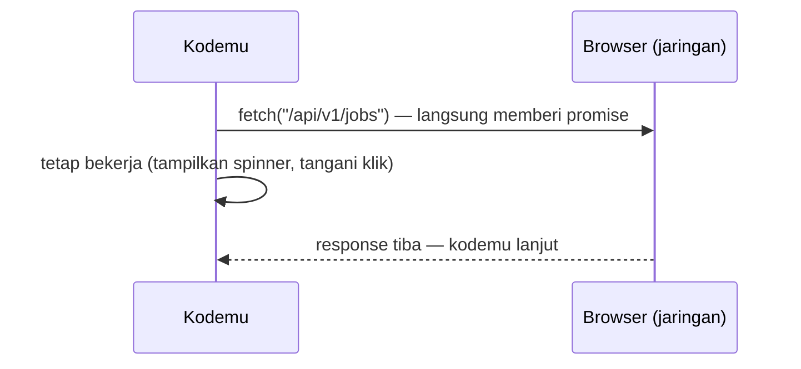

::part[Pelajari Konsepnya]{n="1"}

## 🎯 Yang akan kamu pelajari

- Kenapa halaman tidak macet saat menunggu jawaban server
- Promise dan `async`/`await` — dua cara menulis "tunggu ini dulu"
- Memanggil Flask API-mu dengan `fetch`, dan menangani error dengan benar
- Timeout, menjalankan request bersamaan, dan mencoba ulang dengan aman
- Arti error CORS dan di mana memperbaikinya

## 🔤 Istilah penting

| Istilah | Artinya (sederhana) |
|---|---|
| **Asynchronous (async)** | "Mulai sekarang, hasilnya nanti" — kode tidak berhenti untuk menunggu |
| **Promise** | Object yang berkata "hasilnya datang nanti — atau error" |
| **`await`** | "Jeda function ini sampai promise-nya selesai" |
| **Event loop** | Bagian JavaScript yang menjalankan pekerjaan yang menunggu, saat sudah siap |
| **Timeout** | Batas waktu: "kalau 8 detik tidak ada jawaban, berhenti" |
| **Retry** | Mencoba lagi request yang gagal |
| **CORS** | Aturan browser: halaman hanya boleh membaca data dari server lain kalau server itu mengizinkan |

## 🧠 Ide besarnya

Bayangkan memesan di **warung** yang ramai. Kamu pesan, dapat nomor, lalu duduk. Juru masak bekerja; kamu ngobrol atau main HP. Saat nomormu dipanggil, kamu ambil makanannya.

JavaScript bekerja dengan cara yang sama:
- Pesananmu = sebuah request (`fetch`).
- Nomor yang kamu pegang = sebuah **promise**.
- Melakukan hal lain sambil menunggu = halaman tetap bisa dipakai.
- Nomormu dipanggil = hasilnya datang, dan kodemu lanjut berjalan.

## ❓ Kenapa ini penting

Memanggil server butuh waktu (100 ms sampai beberapa detik). Kalau JavaScript diam menunggu, halaman akan macet: tidak bisa scroll, tidak bisa mengetik. Kode async menjaga halaman tetap bisa dipakai.

Kalau salah, muncul bug nyata:

```js
function loadJobs() {
  let jobs;
  fetch("/api/v1/jobs").then((r) => r.json()).then((data) => { jobs = data; });
  return jobs;                        // 🐛 undefined — the request hasn't finished yet
}

const response = await fetch("/api/v1/jobs");
const data = await response.json(); // 🐛 on a 401/500 you show the error body as if it were jobs
```

## 📖 Langkah demi langkah

### 1. JavaScript mengerjakan satu hal dalam satu waktu — tapi tidak pernah menunggu sambil diam

Seperti juru masak warung yang hanya punya dua tangan: terima pesanan, teruskan ke dapur, layani pembeli berikutnya, kembali saat ada yang sudah siap.



Satu peringatan: perhitungan yang panjang (loop yang sangat besar) tetap memblokir semuanya. Async membantu saat **menunggu**, bukan saat menghitung berat.

### 2. Promise

Promise punya tiga keadaan, seperti nomor pesananmu: **menunggu** (pending), **selesai** (fulfilled, ada nilainya), atau **gagal** (rejected, ada error-nya).

```js
fetch("/api/v1/jobs")
  .then((response) => response.json())   // when done: read the body
  .then((body) => render(body.data))     // then show it
  .catch((error) => showError(error))    // if anything failed
  .finally(() => hideSpinner());         // always, at the end
```

### 3. `async` / `await` — cara menulis yang lebih mudah

Sama saja, tapi dibaca dari atas ke bawah seperti kode biasa:

```js
async function loadJobs() {
  showSpinner();
  try {
    const response = await fetch("/api/v1/jobs");
    const body = await response.json();
    render(body.data);
  } catch (error) {
    showError(error);
  } finally {
    hideSpinner();
  }
}
```

- `await` hanya menjeda **function ini**, bukan seluruh halaman.
- Function `async` selalu mengembalikan promise.

:::fastapi
Python punya ide yang sama: `async def` dan `await` dengan `asyncio`. Kamu akan memakainya di FastAPI (Modul 3).
:::

### 4. `fetch` — dan jebakan yang sering kena

`fetch` hanya gagal saat **tidak ada jawaban sama sekali** (tidak ada internet, server mati). `404` atau `500` tetap dianggap "jawaban", jadi `fetch` **tidak** melempar error. Kamu harus mengeceknya sendiri — seperti mengecek pesananmu sebelum meninggalkan kasir.

```js
const response = await fetch(`${API_URL}/api/v1/applications`, {
  method: "POST",
  headers: { "Content-Type": "application/json", Authorization: `Bearer ${token}` },
  body: JSON.stringify({ company_id: 3, role: "Backend Engineer" }),
});

if (!response.ok) {                              // fetch only rejects on network errors!
  const errorBody = await response.json().catch(() => null);
  throw new ApiError(response.status, errorBody);
}
const { data } = await response.json();
```

`ApiError` adalah class error kecil buatan sendiri yang menyimpan status code, supaya UI bisa menampilkan pesan yang tepat. Taruh logika ini di **satu file** (sebuah "API client") agar semua halaman menangani error dengan cara yang sama.

### 5. Timeout — jangan menunggu selamanya

Kalau warung butuh 30 menit, kamu pergi. Lakukan hal yang sama dengan request: pasang batas waktu, lalu berhenti menunggu.

```js
const controller = new AbortController();
const timer = setTimeout(() => controller.abort(), 8_000);
try {
  const response = await fetch(url, { signal: controller.signal });
} finally {
  clearTimeout(timer);
}
// newer browsers: fetch(url, { signal: AbortSignal.timeout(8000) })
```

`AbortController` adalah tombol "batal". Pakai juga saat request sudah tidak dibutuhkan — misalnya pengguna mengetik pencarian baru, jadi batalkan yang lama.

### 6. Bersamaan vs satu per satu

Memesan tiga menu satu per satu (tunggu yang pertama datang, baru pesan yang kedua…) itu lambat. Pesan ketiganya sekaligus.

```js
// ❌ sequential: 300 ms + 300 ms + 300 ms
const me = await getJson("/api/v1/me");
const apps = await getJson("/api/v1/applications");

// ✅ parallel: ~300 ms total
const [me, apps, stats] = await Promise.all([getJson("/api/v1/me"), getJson("/api/v1/applications"), getJson("/api/v1/stats")]);
```

| Tool | Pakai saat |
|---|---|
| `Promise.all` | kamu butuh **semua** hasil; kalau satu gagal, semuanya gagal |
| `Promise.allSettled` | sebagian hasil tetap berguna walau ada yang gagal (widget dashboard) |

### 7. Retry — hanya kalau masuk akal

Kalau teleponnya sibuk, menelepon lagi nanti masuk akal. Kalau nomornya salah, menelepon lagi tidak akan membantu.

- ✅ Retry: tidak ada koneksi, `500`–`599` (masalah di server), `429` (terlalu banyak request).
- 🚫 Jangan retry error `4xx` lain seperti `400` atau `422` (datamu salah — pasti gagal lagi).
- Tunggu sedikit lebih lama sebelum setiap percobaan (1 detik, 2 detik, 4 detik…). Ini disebut **exponential backoff**.
- Hanya retry otomatis untuk request yang aman diulang, seperti `GET`. Mengulang `POST` bisa membuat dua lamaran.

### 8. CORS — "blocked by CORS policy"

Halamanmu berjalan di `http://localhost:3091`; API-mu di `http://localhost:5091`. Bagi browser, ini **dua situs berbeda**. Seperti satpam gedung, browser bertanya ke API: "Situs ini boleh masuk?" Kalau API tidak menjawab "boleh" (header `Access-Control-Allow-Origin: http://localhost:3091`), browser memblokir response-nya.

Perbaikannya ada **di server**, bukan di kode frontend: atur `flask-cors` dengan situs yang diizinkan, atau kirim panggilan API lewat server frontend-mu sendiri (route handler Next.js — Minggu 4).

## ⚠️ Kesalahan umum

- Menganggap `404`/`500` sukses karena `fetch` tidak melempar error.
- `await` di dalam `forEach` — tidak menunggu. Pakai `for...of` atau `Promise.all(items.map(...))`.
- Lupa `Content-Type: application/json` saat mengirim JSON (`get_json()` di Flask mengembalikan `None`).
- Mencoba "memperbaiki" CORS di kode frontend, bukan di API.

## 🏆 Praktik terbaik

- [ ] Taruh semua kode HTTP di satu API client: base URL dari config, header auth, JSON, `ApiError`.
- [ ] Selalu cek `response.ok`.
- [ ] Pasang timeout di setiap request; batalkan request yang sudah tidak dibutuhkan.
- [ ] Jalankan request yang tidak saling bergantung secara bersamaan.
- [ ] Retry hanya untuk error sementara, dengan batas dan jeda yang makin lama, dan hanya untuk request yang aman.
- [ ] Selalu tangani error (`try/catch`) dan tampilkan keadaan loading, kosong, dan error.
- [ ] Oper `fetch` (atau client-nya) ke dalam function supaya tes bisa memakai versi palsu.

::part[Jelaskan & Rancang]{n="2"}

## 🗣️ Jelaskan

Pakai analogi warung untuk menjelaskan ke teman kenapa halaman tidak macet saat memuat lowongan. Lalu jelaskan kenapa memakai `await` di dalam loop untuk 10 request yang tidak saling bergantung membuat halaman lambat.

## 📐 Rancang

Rencanakan **API client** CareerPilot (satu file yang dipakai semua halaman). Jawab: base URL diambil dari mana? Bagaimana token ditambahkan? Apa yang terjadi saat `401`? Error apa saja yang di-retry? Bagaimana component memanggilnya?

:::quiz
Tampilkan contoh rencananya

- **Base URL**: dari environment variable (`NEXT_PUBLIC_API_URL` — Minggu 4), tidak pernah ditulis langsung di kode.
- **Token**: client menambahkan `Authorization: Bearer …` di satu tempat, jadi halaman tidak pernah menyusun header sendiri.
- **Timeout**: setiap request mendapat `AbortSignal.timeout(10_000)`.
- **Error**: non-2xx → `ApiError(status, body)`; UI mengubah `body.error.code` menjadi pesan yang ramah.
- **401**: hapus sesi dan arahkan pengguna ke halaman login — ditangani sekali, di client.
- **Retry**: hanya `GET`, hanya error jaringan dan `5xx`, maksimal 2 kali tambahan dengan jeda yang makin lama. `POST` tidak pernah di-retry otomatis.
- **Component** memanggil function kecil seperti `listApplications(client)` — tidak pernah `fetch` langsung:

```js
export const listApplications = (client, signal) => client.get("/api/v1/applications", { signal });
```
:::

### 📝 Checklist self-review

- [ ] Header, JSON, error, dan timeout ada di satu tempat
- [ ] Hanya request yang aman yang di-retry
- [ ] `401` ditangani di satu tempat
- [ ] Kode error diubah menjadi pesan yang dipahami pengguna

::ai-review{task="design"}

::part[Latihan Kecil]{n="3"}

:::exercise{path="exercises/web/m4/w1/07-async-fetch" ai="no-ai" title="Fetch client yang tangguh"}
Buat API client kecil yang menerima `fetch` sebagai parameter: baca JSON dan lempar `ApiError` untuk response non-2xx, pasang timeout dengan `AbortController`, muat data dashboard secara bersamaan, tangani gagal sebagian dengan `allSettled`, dan retry error sementara dengan jeda yang makin lama. Tes memakai `fetch` palsu dan timer palsu.
:::

:::hints
- Di `getJsonWithTimeout`, cek `controller.signal.aborted` di dalam `catch` untuk membedakan timeout dari error lain; bersihkan timer di `finally`.
- `Promise.allSettled` menyimpan hasil dengan urutan yang sama seperti input — pakai indeksnya untuk menemukan id yang gagal.
- Di `withRetry`, loop `for (let attempt = 1; ; attempt++)` dengan `return await fn()` di dalam `try` adalah bentuk paling sederhana.
:::

## ✅ Cek cepat

:::quiz
Apakah `fetch` melempar error untuk response `404`?

Tidak. `fetch` hanya melempar error saat tidak ada response sama sekali (error jaringan) atau request dibatalkan. Cek `response.ok` sendiri.
:::

:::quiz
Kapan `Promise.allSettled` lebih baik daripada `Promise.all`?

Saat sebagian hasil tetap berguna walau satu request gagal — misalnya widget-widget dashboard yang terpisah.
:::

## 📚 Lanjut belajar

- [MDN: Using promises](https://developer.mozilla.org/en-US/docs/Web/JavaScript/Guide/Using_promises)
- [MDN: Using the Fetch API](https://developer.mozilla.org/en-US/docs/Web/API/Fetch_API/Using_Fetch)
- [MDN: Cross-Origin Resource Sharing (CORS)](https://developer.mozilla.org/en-US/docs/Web/HTTP/Guides/CORS)
