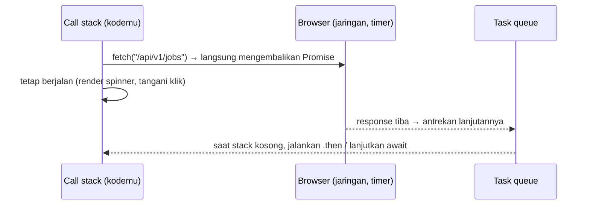

::part[Pelajari Konsepnya]{n="1"}

## 🎯 Yang akan kamu pelajari

- **Event loop**: kenapa satu thread tidak membeku saat menunggu jaringan
- Callback → **Promise** → **async/await**
- `fetch`: request, header, body JSON, dan kenapa response 500 tidak reject
- Penanganan error dengan class error custom
- Timeout dan pembatalan dengan `AbortController`
- `Promise.all`, `allSettled`, `race`, `any` — paralel vs berurutan
- Retry dengan exponential backoff (terhubung ke Minggu 5 Modul 2)
- CORS: kenapa browser memblokir panggilan API-mu

## 🧠 Ide besarnya

JavaScript adalah **satu pelayan** di sebuah restoran. Pelayan yang buruk menerima satu pesanan, berdiri di dapur sampai makanannya siap, dan mengabaikan tamu lain. Pelayan yang baik menerima pesanan, menyerahkannya ke dapur, lalu melayani meja lain sampai dapur membunyikan bel. **Event loop** adalah pelayannya; **Promise** adalah tiket pesanan ("makanannya kuantar nanti — atau kukabari kalau gagal").

## ❓ Kenapa ini ada?

Request jaringan, timer, dan membaca file butuh waktu. Kalau browser menunggu secara sinkron, halaman akan membeku — tidak bisa scroll, tidak bisa mengetik — selama API-mu merespons. Kode async membuat UI tetap responsif selagi data dimuat. Setiap tool data-fetching React (Minggu 4) dibangun di atas promise.

## 💥 Apa yang terjadi kalau TIDAK memahaminya?

```js
function loadJobs() {
  let jobs;
  fetch("/api/v1/jobs").then((r) => r.json()).then((data) => { jobs = data; });
  return jobs;                        // 🐛 undefined — the request hasn't finished
}

const response = await fetch("/api/v1/jobs");
const data = await response.json(); // 🐛 on a 401/500, you render an error body as if it were jobs
```

- `await` berurutan untuk request yang saling independen membuat dashboard 3× lebih lambat.
- Tanpa timeout → spinner berputar selamanya di koneksi yang tidak stabil.
- Response pencarian lama menimpa hasil yang lebih baru.

## 📖 Cara kerjanya, langkah demi langkah

### 1. Event loop



Microtask (callback promise) dijalankan sebelum macrotask berikutnya (timer, event). Loop sinkron yang panjang tetap memblokir semuanya — async tidak membuat kerja CPU jadi paralel.

### 2. Promise

Sebuah Promise berstatus **pending**, lalu **fulfilled** dengan sebuah nilai atau **rejected** dengan sebuah error — hanya sekali.

```js
const wait = (ms) => new Promise((resolve) => setTimeout(resolve, ms));

fetch("/api/v1/jobs")
  .then((response) => response.json())
  .then((body) => render(body.data))
  .catch((error) => showError(error))
  .finally(() => hideSpinner());
```

### 3. async / await

Hal yang sama, dibaca dari atas ke bawah:

```js
async function loadJobs() {
  showSpinner();
  try {
    const response = await fetch("/api/v1/jobs");
    const body = await response.json();
    render(body.data);
  } catch (error) {
    showError(error);
  } finally {
    hideSpinner();
  }
}
```

Function `async` **selalu mengembalikan Promise**. `await` menjeda function itu (bukan halamannya).

:::fastapi
`async def` / `await` di Python dengan `asyncio` bekerja dengan prinsip yang sama — event loop yang menjalankan coroutine. Kamu akan memakainya di FastAPI (Modul 3). Perbedaan besarnya: di browser, event loop selalu ada; di Python, kamu yang memulainya (`asyncio.run`) atau framework yang melakukannya.
:::

### 4. fetch dalam praktik

```js
const response = await fetch(`${API_URL}/api/v1/applications`, {
  method: "POST",
  headers: { "Content-Type": "application/json", Authorization: `Bearer ${token}` },
  body: JSON.stringify({ company_id: 3, role: "Backend Engineer" }),
});

if (!response.ok) {                              // fetch only rejects on network errors!
  const errorBody = await response.json().catch(() => null);
  throw new ApiError(response.status, errorBody);
}
const { data } = await response.json();
```

Petakan format error Flask-mu (`{"error": {"code": ...}}`) ke pesan UI di **satu** tempat — sebuah module API client.

```js
export class ApiError extends Error {
  constructor(status, body) {
    super(`Request failed with status ${status}`);
    this.name = "ApiError";
    this.status = status;
    this.body = body;
  }
}
```

### 5. Timeout dan pembatalan

```js
const controller = new AbortController();
const timer = setTimeout(() => controller.abort(), 8_000);
try {
  const response = await fetch(url, { signal: controller.signal });
} finally {
  clearTimeout(timer);
}
// newer browsers: fetch(url, { signal: AbortSignal.timeout(8000) })
```

Abort juga membatalkan request yang **sudah usang**: saat pengguna mengetik pencarian baru, batalkan yang sebelumnya.

### 6. Paralel vs berurutan

```js
// ❌ sequential: 300 ms + 300 ms + 300 ms
const me = await getJson("/api/v1/me");
const apps = await getJson("/api/v1/applications");

// ✅ parallel: ~300 ms total
const [me, apps, stats] = await Promise.all([getJson("/api/v1/me"), getJson("/api/v1/applications"), getJson("/api/v1/stats")]);
```

| Combinator | Resolve saat | Reject saat |
|---|---|---|
| `Promise.all` | semua berhasil → array berisi nilai | **salah satu** gagal (fail fast) |
| `Promise.allSettled` | semua selesai → `{status, value/reason}` untuk masing-masing | tidak pernah |
| `Promise.race` | yang pertama selesai (berhasil atau gagal) | yang pertama selesai dengan gagal |
| `Promise.any` | yang pertama **berhasil** | semua gagal (`AggregateError`) |

Pakai `allSettled` saat hasil sebagian tetap berguna (dashboard yang salah satu widget-nya bisa gagal). Batasi konkurensi untuk batch besar (misalnya 5 sekaligus) agar tidak membanjiri API-mu — ingat Locust.

### 7. Retry

Retry hanya untuk kegagalan **sementara**: error jaringan (`TypeError: Failed to fetch`), `5xx`, `429`. Jangan pernah retry `4xx` seperti `422`. Pakai exponential backoff dengan jitter, dan hanya untuk request yang idempotent (GET) atau dengan idempotency key (Modul 2 Minggu 5).

### 8. CORS dalam satu paragraf

Halaman di `http://localhost:3091` yang memanggil `http://localhost:5091/api` adalah request **cross-origin**. Browser bertanya ke API (preflight `OPTIONS`) apakah origin itu diizinkan; kalau Flask API tidak menjawab dengan `Access-Control-Allow-Origin: http://localhost:3091`, browser memblokir response-nya. Perbaiki **di server** (`flask-cors` dengan daftar origin yang eksplisit) atau proxy panggilan API lewat server frontend-mu (route handler Next.js — Minggu 4).

## ⚖️ Trade-off

| Pilihan | ✅ | ❌ |
|---|---|---|
| `async/await` | mudah dibaca, try/catch | mudah tanpa sengaja menjalankan hal secara berurutan |
| Rangkaian `.then` | bagus untuk pipeline kecil | nesting dan penanganan error jadi berantakan |
| `Promise.all` | paling cepat | satu kegagalan me-reject semuanya |
| `allSettled` | hasil sebagian yang tangguh | harus memeriksa setiap hasil |
| Retry | meredam gangguan sesaat | memperbesar beban saat outage; butuh batas dan backoff |
| `fetch` mentah | bawaan, kecil | boilerplate → bungkus, atau pakai TanStack Query (Minggu 4) |

## ✅ Kapan dipakai / 🚫 Kapan TIDAK dipakai

- ✅ `await` di function async untuk I/O apa pun; `Promise.all` untuk request yang independen.
- ✅ Module API client kecil yang menangani base URL, header, JSON, error, dan timeout.
- 🚫 Function `async` untuk pekerjaan berat CPU (pakai Web Worker).
- 🚫 Promise "tembak lalu lupakan" tanpa `.catch` — rejection yang tidak ditangani menyembunyikan bug.

## 🏆 Praktik terbaik

- [ ] Pusatkan HTTP di sebuah API client: base URL dari config, header auth, parsing JSON, `ApiError`.
- [ ] Selalu cek `response.ok`; parse body error secara defensif.
- [ ] Tambahkan timeout; batalkan request yang usang (pencarian, navigasi).
- [ ] Jalankan request independen secara paralel; batasi konkurensi untuk batch besar.
- [ ] Retry hanya untuk error sementara, dengan backoff, batas, dan idempotency.
- [ ] Selalu tangani rejection (`try/catch` atau `.catch`); tampilkan pesan error yang bisa ditindaklanjuti pengguna, log detailnya.
- [ ] Tampilkan state loading, kosong, dan error untuk setiap request.
- [ ] Inject `fetch` (atau client-nya) ke function agar bisa dites dengan fake.

## 🏭 Cara dipakai di industri

- API client sering **di-generate** dari spesifikasi OpenAPI backend (openapi-typescript, Orval) — dokumentasi Flask-smorest-mu dari Modul 2 bisa menjadi sumbernya.
- TanStack Query / SWR menangani caching, retry, deduplikasi, dan pembatalan di atas fetch.
- Streaming response LLM di aplikasi AI memakai `fetch` dengan `ReadableStream` (Modul 7).

## ⚠️ Kesalahan umum

- Menganggap 4xx/5xx sebagai sukses karena fetch tidak melempar error.
- `await` di dalam `forEach` (tidak menunggu) — pakai `for...of` atau `Promise.all(items.map(...))`.
- Lupa `Content-Type: application/json` saat mengirim JSON (`get_json()` di Flask-mu mengembalikan `None`).
- Menyalahkan kode frontend atas error CORS alih-alih mengonfigurasi API.

::part[Jelaskan & Rancang]{n="2"}

## 🗣️ Jelaskan

Jelaskan event loop dengan analogi pelayan restoran, lalu jelaskan kenapa `await` di dalam loop `for` untuk 10 request independen membuat halaman lambat.

## 📐 Rancang

Rancang **API client** frontend CareerPilot untuk Flask API Fase 2: penanganan base URL dan token, parsing JSON dan error (memetakan `{"error": {"code", "fields"}}`), timeout, aturan retry, penanganan 401 (token kedaluwarsa), dan cara component memakainya. Berikan signature function-nya.

:::quiz
Tampilkan contoh desainnya

```js
// api/client.js
export function createApiClient({ baseUrl, getToken, onUnauthorized, fetchImpl = fetch, timeoutMs = 10_000 }) {
  async function request(method, path, { body, query, signal, retries = method === "GET" ? 2 : 0 } = {}) {
    const url = new URL(path, baseUrl);
    Object.entries(query ?? {}).forEach(([k, v]) => v != null && url.searchParams.set(k, String(v)));
    return withRetry(async () => {
      const response = await fetchImpl(url, {
        method,
        headers: {
          Accept: "application/json",
          ...(body ? { "Content-Type": "application/json" } : {}),
          ...(getToken() ? { Authorization: `Bearer ${getToken()}` } : {}),
        },
        body: body ? JSON.stringify(body) : undefined,
        signal: AbortSignal.any([signal, AbortSignal.timeout(timeoutMs)].filter(Boolean)),
      });
      const payload = response.status === 204 ? null : await response.json().catch(() => null);
      if (response.status === 401) onUnauthorized();                         // clear session, redirect to login
      if (!response.ok) throw new ApiError(response.status, payload?.error?.code ?? "unknown", payload?.error?.fields);
      return payload;
    }, { attempts: retries + 1 });                                           // retries only on network/5xx (inside withRetry)
  }
  return {
    get: (path, options) => request("GET", path, options),
    post: (path, body, options) => request("POST", path, { ...options, body }),
    patch: (path, body, options) => request("PATCH", path, { ...options, body }),
    delete: (path, options) => request("DELETE", path, options),
  };
}

// api/applications.js — typed-ish resource functions used by components
export const listApplications = (client, filters, signal) => client.get("/api/v1/applications", { query: filters, signal });
export const moveStatus = (client, id, status) => client.post(`/api/v1/applications/${id}/status`, { status });
```

- Component memanggil function resource, tidak pernah `fetch` langsung.
- `ApiError.code` menentukan pesan: `invalid_transition` → "Perpindahan itu tidak diizinkan", `fields` → error inline di form.
- POST tidak di-retry otomatis (tidak idempotent) kecuali API mendukung idempotency key.
- Base URL berasal dari config environment (`NEXT_PUBLIC_API_URL` — Minggu 4).
:::

### 📝 Checklist self-review

- [ ] Satu tempat untuk header, JSON, error, dan timeout
- [ ] Retry hanya untuk request yang aman
- [ ] 401 ditangani secara terpusat
- [ ] Kode error dipetakan ke pesan untuk pengguna

::ai-review{task="design"}

::part[Latihan Kecil]{n="3"}

:::exercise{path="exercises/web/m4/w1/07-async-fetch" ai="no-ai" title="Fetch client yang tangguh"}
Tulis API client kecil dengan `fetch` yang di-inject: parsing JSON dan `ApiError` untuk response non-2xx, timeout dengan `AbortController`, pemuat dashboard paralel, penanganan gagal sebagian dengan `allSettled`, dan retry dengan exponential backoff khusus untuk error sementara. Tes memakai fake fetch dan fake timer.
:::

:::hints
- Di `getJsonWithTimeout`, cek `controller.signal.aborted` di dalam `catch` untuk membedakan timeout dari error lain; bersihkan timer di `finally`.
- Hasil `Promise.allSettled` menjaga urutan input — pakai indeksnya untuk menemukan id yang gagal.
- Di `withRetry`, loop `for (let attempt = 1; ; attempt++)` dengan `return await fn()` di dalam `try` adalah bentuk paling sederhana.
:::

## ✅ Cek cepat

:::quiz
Apakah `fetch` reject untuk HTTP 404?

Tidak — hanya untuk error jaringan atau abort. Cek `response.ok`.
:::

:::quiz
Kapan kamu memilih `Promise.allSettled` daripada `Promise.all`?

Saat keberhasilan sebagian tetap berguna dan satu kegagalan tidak boleh membuang hasil lainnya (misalnya widget dashboard yang saling independen).
:::

## 📖 Kamus (glosarium)

| Istilah | Bahasa Indonesia |
|---|---|
| Asynchronous | Asinkron — tidak menunggu sampai selesai |
| Event loop | Putaran peristiwa |
| Promise | Janji — nilai yang akan tersedia nanti |
| Timeout | Batas waktu |
| Abort / cancel | Membatalkan permintaan |
| CORS | Aturan berbagi sumber lintas asal |

## 📚 Lanjut belajar

- [MDN: Using promises](https://developer.mozilla.org/en-US/docs/Web/JavaScript/Guide/Using_promises)
- [MDN: Using the Fetch API](https://developer.mozilla.org/en-US/docs/Web/API/Fetch_API/Using_Fetch)
- [MDN: Cross-Origin Resource Sharing (CORS)](https://developer.mozilla.org/en-US/docs/Web/HTTP/Guides/CORS)
