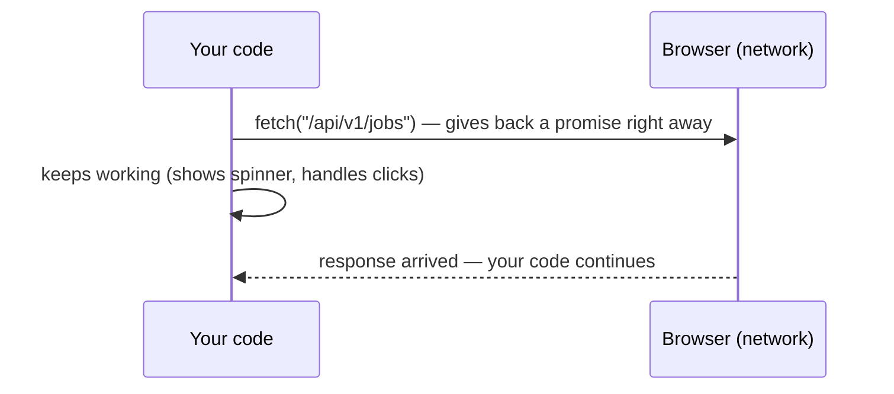

::part[Learn the Concept]{n="1"}

## 🎯 What you'll learn

- Why the page doesn't freeze while it waits for the server
- Promises and `async`/`await` — two ways to write "wait for this"
- Calling your Flask API with `fetch`, and handling errors correctly
- Timeouts, running requests in parallel, and retrying safely
- What CORS errors mean and where to fix them

## 🔤 Key words

| Word | In simple words | Bahasa Indonesia |
|---|---|---|
| **Asynchronous (async)** | "Start it now, get the result later" — the code doesn't stop and wait | Asinkron |
| **Promise** | An object that says "the result will come later — or an error" | Janji hasil nanti |
| **`await`** | "Pause this function until the promise is finished" | Tunggu |
| **Event loop** | The part of JavaScript that runs waiting work when it's ready | Pengatur antrean kerja |
| **Timeout** | A time limit: "if no answer after 8 seconds, give up" | Batas waktu |
| **Retry** | Trying a failed request again | Coba lagi |
| **CORS** | A browser rule: a page may only read another server's data if that server allows it | Izin lintas situs |

## 🧠 The big idea

Think of ordering at a busy **warung**. You order, get a number, and sit down. The cook works; you chat or check your phone. When your number is called, you pick up the food.

JavaScript works the same way:
- Your order = a request (`fetch`).
- The number you hold = a **promise**.
- Doing other things while waiting = the page stays usable.
- Your number being called = the result arrives, and your code continues.

## ❓ Why it matters

Calling a server takes time (100 ms to many seconds). If JavaScript just stood and waited, the page would freeze: no scrolling, no typing. Async code keeps the page usable.

Getting it wrong causes real bugs:

```js
function loadJobs() {
  let jobs;
  fetch("/api/v1/jobs").then((r) => r.json()).then((data) => { jobs = data; });
  return jobs;                        // 🐛 undefined — the request hasn't finished yet
}

const response = await fetch("/api/v1/jobs");
const data = await response.json(); // 🐛 on a 401/500 you show the error body as if it were jobs
```

## 📖 Step by step

### 1. JavaScript does one thing at a time — but never waits idle

Like the warung cook with one pair of hands: take an order, pass it on, serve the next customer, come back when something is ready.



One warning: a long calculation (a huge loop) still blocks everything. Async helps with **waiting**, not with heavy computing.

### 2. Promises

A promise has three states, like your order number: **waiting** (pending), **done** (fulfilled, with a value), or **failed** (rejected, with an error).

```js
fetch("/api/v1/jobs")
  .then((response) => response.json())   // when done: read the body
  .then((body) => render(body.data))     // then show it
  .catch((error) => showError(error))    // if anything failed
  .finally(() => hideSpinner());         // always, at the end
```

### 3. `async` / `await` — the easier way to write it

Same thing, but it reads top to bottom like normal code:

```js
async function loadJobs() {
  showSpinner();
  try {
    const response = await fetch("/api/v1/jobs");
    const body = await response.json();
    render(body.data);
  } catch (error) {
    showError(error);
  } finally {
    hideSpinner();
  }
}
```

- `await` pauses **only this function**, not the whole page.
- An `async` function always returns a promise.

:::fastapi
Python has the same idea: `async def` and `await` with `asyncio`. You'll use it in FastAPI (Module 3).
:::

### 4. `fetch` — and the trap everyone falls into

`fetch` only fails when there is **no answer at all** (no internet, server down). A `404` or `500` is still "an answer", so `fetch` does **not** throw. You must check it yourself — like checking your food before you walk away from the counter.

```js
const response = await fetch(`${API_URL}/api/v1/applications`, {
  method: "POST",
  headers: { "Content-Type": "application/json", Authorization: `Bearer ${token}` },
  body: JSON.stringify({ company_id: 3, role: "Backend Engineer" }),
});

if (!response.ok) {                              // fetch only rejects on network errors!
  const errorBody = await response.json().catch(() => null);
  throw new ApiError(response.status, errorBody);
}
const { data } = await response.json();
```

`ApiError` is a small custom error class that keeps the status code, so the UI can show the right message. Put this logic in **one file** (an "API client") so every page handles errors the same way.

### 5. Timeouts — don't wait forever

If the warung takes 30 minutes, you leave. Do the same with requests: set a limit, then stop waiting.

```js
const controller = new AbortController();
const timer = setTimeout(() => controller.abort(), 8_000);
try {
  const response = await fetch(url, { signal: controller.signal });
} finally {
  clearTimeout(timer);
}
// newer browsers: fetch(url, { signal: AbortSignal.timeout(8000) })
```

`AbortController` is the "cancel" button. Use it too when a request is no longer needed — for example, the user typed a new search, so cancel the old one.

### 6. Parallel vs one-by-one

Ordering three dishes one at a time (wait for the first, then order the second…) is slow. Order all three at once.

```js
// ❌ sequential: 300 ms + 300 ms + 300 ms
const me = await getJson("/api/v1/me");
const apps = await getJson("/api/v1/applications");

// ✅ parallel: ~300 ms total
const [me, apps, stats] = await Promise.all([getJson("/api/v1/me"), getJson("/api/v1/applications"), getJson("/api/v1/stats")]);
```

| Tool | Use it when |
|---|---|
| `Promise.all` | you need **all** results; if one fails, everything fails |
| `Promise.allSettled` | some results are still useful even if one fails (dashboard widgets) |

### 7. Retry — but only when it makes sense

If the line was busy, calling again later makes sense. If the number is wrong, calling again won't help.

- ✅ Retry: no connection, `500`–`599` (server problem), `429` (too many requests).
- 🚫 Don't retry other `4xx` errors like `400` or `422` (your data is wrong — it will fail again).
- Wait a bit longer before each try (1 s, 2 s, 4 s…). This is called **exponential backoff**.
- Only auto-retry requests that are safe to repeat, like `GET`. Repeating a `POST` could create two applications.

### 8. CORS — "blocked by CORS policy"

Your page runs on `http://localhost:3091`; your API runs on `http://localhost:5091`. For the browser these are **different sites**. Like a building guard, the browser asks the API: "Is this site allowed?" If the API doesn't answer "yes" (the header `Access-Control-Allow-Origin: http://localhost:3091`), the browser blocks the response.

The fix is **on the server**, not in your frontend code: configure `flask-cors` with the allowed site, or send API calls through your own frontend server (Next.js route handlers — Week 4).

## ⚠️ Common mistakes

- Treating a `404`/`500` as success because `fetch` didn't throw.
- `await` inside `forEach` — it doesn't wait. Use `for...of` or `Promise.all(items.map(...))`.
- Forgetting `Content-Type: application/json` when sending JSON (Flask's `get_json()` returns `None`).
- Trying to "fix" CORS in frontend code instead of in the API.

## 🏆 Best practices

- [ ] Keep all HTTP code in one API client: base URL from config, auth header, JSON, `ApiError`.
- [ ] Always check `response.ok`.
- [ ] Add a timeout to every request; cancel requests that are no longer needed.
- [ ] Run independent requests in parallel.
- [ ] Retry only temporary errors, with a limit and growing waits, and only for safe requests.
- [ ] Always handle errors (`try/catch`) and show a loading, empty and error state.
- [ ] Pass `fetch` (or the client) into functions so tests can use a fake one.

::part[Explain & Design]{n="2"}

## 🗣️ Explain it

Use the warung analogy to explain to a friend why the page doesn't freeze while it loads jobs. Then explain why using `await` in a loop for 10 independent requests makes the page slow.

## 📐 Design it

Plan CareerPilot's **API client** (one file every page uses). Answer: where does the base URL come from? How is the token added? What happens on a `401`? Which errors are retried? How does a component call it?

:::quiz
Show a possible plan

- **Base URL**: from an environment variable (`NEXT_PUBLIC_API_URL` — Week 4), never hard-coded.
- **Token**: the client adds `Authorization: Bearer …` in one place, so pages never build headers.
- **Timeout**: every request gets `AbortSignal.timeout(10_000)`.
- **Errors**: non-2xx → `ApiError(status, body)`; the UI turns `body.error.code` into a friendly message.
- **401**: clear the session and send the user to the login page — handled once, in the client.
- **Retries**: only `GET`, only network errors and `5xx`, at most 2 extra tries with growing waits. `POST` is never retried automatically.
- **Components** call small functions like `listApplications(client)` — never `fetch` directly:

```js
export const listApplications = (client, signal) => client.get("/api/v1/applications", { signal });
```
:::

### 📝 Self-review checklist

- [ ] Headers, JSON, errors and timeouts are in one place
- [ ] Only safe requests are retried
- [ ] `401` is handled in one place
- [ ] Error codes become messages a user understands

::ai-review{task="design"}

::part[Toy Exercise]{n="3"}

:::exercise{path="exercises/web/m4/w1/07-async-fetch" ai="no-ai" title="A robust fetch client"}
Build a small API client that receives `fetch` as a parameter: read JSON and throw `ApiError` for non-2xx responses, add a timeout with `AbortController`, load dashboard data in parallel, handle partial failures with `allSettled`, and retry temporary errors with growing waits. The tests use a fake `fetch` and fake timers.
:::

:::hints
- In `getJsonWithTimeout`, check `controller.signal.aborted` inside `catch` to tell a timeout from other errors; clear the timer in `finally`.
- `Promise.allSettled` keeps results in the same order as the input — use the index to find which ids failed.
- In `withRetry`, a `for (let attempt = 1; ; attempt++)` loop with `return await fn()` inside `try` is the simplest shape.
:::

## ✅ Quick check

:::quiz
Does `fetch` throw an error for a `404` response?

No. It only throws when there is no response at all (network error) or the request was cancelled. Check `response.ok` yourself.
:::

:::quiz
When is `Promise.allSettled` better than `Promise.all`?

When some results are still useful even if one request fails — for example, separate dashboard widgets.
:::

## 📚 Keep learning

- [MDN: Using promises](https://developer.mozilla.org/en-US/docs/Web/JavaScript/Guide/Using_promises)
- [MDN: Using the Fetch API](https://developer.mozilla.org/en-US/docs/Web/API/Fetch_API/Using_Fetch)
- [MDN: Cross-Origin Resource Sharing (CORS)](https://developer.mozilla.org/en-US/docs/Web/HTTP/Guides/CORS)
