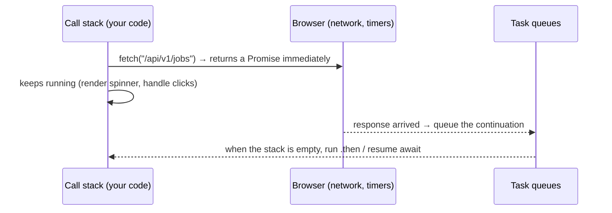

::part[Learn the Concept]{n="1"}

## 🎯 What you'll learn

- The **event loop**: why a single thread doesn't freeze while waiting for the network
- Callbacks → **Promises** → **async/await**
- `fetch`: requests, headers, JSON bodies, and why a 500 doesn't reject
- Error handling with custom error classes
- Timeouts and cancellation with `AbortController`
- `Promise.all`, `allSettled`, `race`, `any` — parallel vs sequential
- Retries with exponential backoff (connect to Week 5 of Module 2)
- CORS: why the browser blocks your API call

## 🧠 The big idea

JavaScript is a **single waiter** in a restaurant. A bad waiter takes one order, stands at the kitchen until the food is ready, and ignores everyone else. A good waiter takes an order, hands it to the kitchen, and serves other tables until the kitchen rings the bell. The **event loop** is the waiter; a **Promise** is the order ticket ("I'll bring the food later — or tell you it failed").

## ❓ Why does this exist?

Network requests, timers and file reads take time. If the browser waited synchronously, the page would freeze — no scrolling, no typing — while your API responds. Async code lets the UI stay responsive while data loads. Every React data-fetching tool (Week 4) is built on promises.

## 💥 What happens if we DON'T understand it?

```js
function loadJobs() {
  let jobs;
  fetch("/api/v1/jobs").then((r) => r.json()).then((data) => { jobs = data; });
  return jobs;                        // 🐛 undefined — the request hasn't finished
}

const response = await fetch("/api/v1/jobs");
const data = await response.json(); // 🐛 on a 401/500, you render an error body as if it were jobs
```

- Sequential awaits for independent requests make the dashboard 3× slower.
- No timeout → a spinner that spins forever on a flaky connection.
- An old search response overwrites newer results.

## 📖 How it works, step by step

### 1. The event loop



Microtasks (promise callbacks) run before the next macrotask (timers, events). Long synchronous loops still block everything — async doesn't make CPU work parallel.

### 2. Promises

A Promise is **pending**, then **fulfilled** with a value or **rejected** with an error — once.

```js
const wait = (ms) => new Promise((resolve) => setTimeout(resolve, ms));

fetch("/api/v1/jobs")
  .then((response) => response.json())
  .then((body) => render(body.data))
  .catch((error) => showError(error))
  .finally(() => hideSpinner());
```

### 3. async / await

The same thing, reading top to bottom:

```js
async function loadJobs() {
  showSpinner();
  try {
    const response = await fetch("/api/v1/jobs");
    const body = await response.json();
    render(body.data);
  } catch (error) {
    showError(error);
  } finally {
    hideSpinner();
  }
}
```

An `async` function **always returns a Promise**. `await` pauses that function (not the page).

:::fastapi
Python's `async def` / `await` with `asyncio` works on the same principle — an event loop running coroutines. You'll use it in FastAPI (Module 3). The big difference: in the browser, the event loop is always there; in Python, you start one (`asyncio.run`) or the framework does.
:::

### 4. fetch in practice

```js
const response = await fetch(`${API_URL}/api/v1/applications`, {
  method: "POST",
  headers: { "Content-Type": "application/json", Authorization: `Bearer ${token}` },
  body: JSON.stringify({ company_id: 3, role: "Backend Engineer" }),
});

if (!response.ok) {                              // fetch only rejects on network errors!
  const errorBody = await response.json().catch(() => null);
  throw new ApiError(response.status, errorBody);
}
const { data } = await response.json();
```

Map your Flask error format (`{"error": {"code": ...}}`) to UI messages in **one** place — an API client module.

```js
export class ApiError extends Error {
  constructor(status, body) {
    super(`Request failed with status ${status}`);
    this.name = "ApiError";
    this.status = status;
    this.body = body;
  }
}
```

### 5. Timeouts and cancellation

```js
const controller = new AbortController();
const timer = setTimeout(() => controller.abort(), 8_000);
try {
  const response = await fetch(url, { signal: controller.signal });
} finally {
  clearTimeout(timer);
}
// newer browsers: fetch(url, { signal: AbortSignal.timeout(8000) })
```

Abort also cancels **outdated** requests: when the user types a new search, abort the previous one.

### 6. Parallel vs sequential

```js
// ❌ sequential: 300 ms + 300 ms + 300 ms
const me = await getJson("/api/v1/me");
const apps = await getJson("/api/v1/applications");

// ✅ parallel: ~300 ms total
const [me, apps, stats] = await Promise.all([getJson("/api/v1/me"), getJson("/api/v1/applications"), getJson("/api/v1/stats")]);
```

| Combinator | Resolves when | Rejects when |
|---|---|---|
| `Promise.all` | all succeed → array of values | **any** fails (fail fast) |
| `Promise.allSettled` | all finish → `{status, value/reason}` for each | never |
| `Promise.race` | the first settles (success or failure) | first settles with failure |
| `Promise.any` | the first **succeeds** | all fail (`AggregateError`) |

Use `allSettled` when partial results are useful (a dashboard where one widget may fail). Limit concurrency for large batches (e.g. 5 at a time) to avoid hammering your API — remember Locust.

### 7. Retries

Retry only **transient** failures: network errors (`TypeError: Failed to fetch`), `5xx`, `429`. Never retry `4xx` like `422`. Use exponential backoff with jitter, and only for idempotent requests (GET) or with idempotency keys (Module 2 Week 5).

### 8. CORS in one paragraph

A page on `http://localhost:3091` calling `http://localhost:5091/api` is a **cross-origin** request. The browser asks the API (preflight `OPTIONS`) whether that origin is allowed; if the Flask API doesn't answer with `Access-Control-Allow-Origin: http://localhost:3091`, the browser blocks the response. Fix it **on the server** (`flask-cors` with an explicit origin list) or proxy API calls through your frontend server (Next.js route handlers — Week 4).

## ⚖️ Trade-offs

| Choice | ✅ | ❌ |
|---|---|---|
| `async/await` | readable, try/catch | easy to accidentally run things sequentially |
| `.then` chains | good for small pipelines | nesting and error handling get messy |
| `Promise.all` | fastest | one failure rejects all |
| `allSettled` | resilient partial results | must inspect every result |
| Retries | smooth over blips | amplify load during outages; need limits and backoff |
| Raw `fetch` | built-in, small | boilerplate → wrap it, or use TanStack Query (Week 4) |

## ✅ When to use it / 🚫 When NOT to use it

- ✅ `await` in async functions for any I/O; `Promise.all` for independent requests.
- ✅ A small API client module that handles base URL, headers, JSON, errors and timeouts.
- 🚫 `async` functions for CPU-heavy work (use a Web Worker).
- 🚫 Fire-and-forget promises without `.catch` — unhandled rejections hide bugs.

## 🏆 Best practices

- [ ] Centralize HTTP in an API client: base URL from config, auth header, JSON parsing, `ApiError`.
- [ ] Always check `response.ok`; parse error bodies defensively.
- [ ] Add timeouts; abort outdated requests (search, navigation).
- [ ] Run independent requests in parallel; cap concurrency for large batches.
- [ ] Retry only transient errors, with backoff, a limit and idempotency.
- [ ] Always handle rejections (`try/catch` or `.catch`); show users actionable error messages, log details.
- [ ] Show loading, empty and error states for every request.
- [ ] Inject `fetch` (or the client) into functions so they're testable with fakes.

## 🏭 How it's used in industry

- API clients are often **generated** from the backend's OpenAPI spec (openapi-typescript, Orval) — your Flask-smorest docs from Module 2 can feed them.
- TanStack Query / SWR handle caching, retries, deduplication and cancellation on top of fetch.
- Streaming LLM responses in AI apps use `fetch` with `ReadableStream` (Module 7).

## ⚠️ Common mistakes

- Treating a 4xx/5xx as success because fetch didn't throw.
- `await` inside `forEach` (doesn't wait) — use `for...of` or `Promise.all(items.map(...))`.
- Forgetting `Content-Type: application/json` when sending JSON (your Flask `get_json()` returns `None`).
- Blaming CORS errors on the frontend code instead of configuring the API.

::part[Explain & Design]{n="2"}

## 🗣️ Explain it

Explain the event loop with the restaurant waiter analogy, then explain why `await` inside a `for` loop for 10 independent requests makes a page slow.

## 📐 Design it

Design CareerPilot's frontend **API client** for the Phase 2 Flask API: base URL and token handling, JSON and error parsing (mapping `{"error": {"code", "fields"}}`), timeouts, retry rules, 401 handling (token expired), and how components use it. Give function signatures.

:::quiz
Show a possible design

```js
// api/client.js
export function createApiClient({ baseUrl, getToken, onUnauthorized, fetchImpl = fetch, timeoutMs = 10_000 }) {
  async function request(method, path, { body, query, signal, retries = method === "GET" ? 2 : 0 } = {}) {
    const url = new URL(path, baseUrl);
    Object.entries(query ?? {}).forEach(([k, v]) => v != null && url.searchParams.set(k, String(v)));
    return withRetry(async () => {
      const response = await fetchImpl(url, {
        method,
        headers: {
          Accept: "application/json",
          ...(body ? { "Content-Type": "application/json" } : {}),
          ...(getToken() ? { Authorization: `Bearer ${getToken()}` } : {}),
        },
        body: body ? JSON.stringify(body) : undefined,
        signal: AbortSignal.any([signal, AbortSignal.timeout(timeoutMs)].filter(Boolean)),
      });
      const payload = response.status === 204 ? null : await response.json().catch(() => null);
      if (response.status === 401) onUnauthorized();                         // clear session, redirect to login
      if (!response.ok) throw new ApiError(response.status, payload?.error?.code ?? "unknown", payload?.error?.fields);
      return payload;
    }, { attempts: retries + 1 });                                           // retries only on network/5xx (inside withRetry)
  }
  return {
    get: (path, options) => request("GET", path, options),
    post: (path, body, options) => request("POST", path, { ...options, body }),
    patch: (path, body, options) => request("PATCH", path, { ...options, body }),
    delete: (path, options) => request("DELETE", path, options),
  };
}

// api/applications.js — typed-ish resource functions used by components
export const listApplications = (client, filters, signal) => client.get("/api/v1/applications", { query: filters, signal });
export const moveStatus = (client, id, status) => client.post(`/api/v1/applications/${id}/status`, { status });
```

- Components call resource functions, never `fetch` directly.
- `ApiError.code` drives messages: `invalid_transition` → "That move isn't allowed", `fields` → inline form errors.
- POSTs aren't retried automatically (not idempotent) unless the API supports idempotency keys.
- Base URL comes from environment config (`NEXT_PUBLIC_API_URL` — Week 4).
:::

### 📝 Self-review checklist

- [ ] One place for headers, JSON, errors and timeouts
- [ ] Retries only for safe requests
- [ ] 401 handled centrally
- [ ] Error codes mapped to user messages

::ai-review{task="design"}

::part[Toy Exercise]{n="3"}

:::exercise{path="exercises/web/m4/w1/07-async-fetch" ai="no-ai" title="A robust fetch client"}
Write a small API client with injected `fetch`: JSON parsing and `ApiError` for non-2xx responses, a timeout with `AbortController`, a parallel dashboard loader, partial-failure handling with `allSettled`, and retries with exponential backoff for transient errors only. Tests use fake fetch and fake timers.
:::

:::hints
- In `getJsonWithTimeout`, check `controller.signal.aborted` inside `catch` to tell a timeout from other errors; clear the timer in `finally`.
- `Promise.allSettled` results keep the input order — use the index to find failed ids.
- In `withRetry`, a `for (let attempt = 1; ; attempt++)` loop with `return await fn()` inside `try` is the simplest shape.
:::

## ✅ Quick check

:::quiz
Does `fetch` reject for HTTP 404?

No — only for network errors or aborts. Check `response.ok`.
:::

:::quiz
When would you choose `Promise.allSettled` over `Promise.all`?

When partial success is useful and one failure shouldn't discard the other results (e.g. independent dashboard widgets).
:::

## 📖 Kamus (glossary)

| Term | Bahasa Indonesia |
|---|---|
| Asynchronous | Asinkron — tidak menunggu sampai selesai |
| Event loop | Putaran peristiwa |
| Promise | Janji — nilai yang akan tersedia nanti |
| Timeout | Batas waktu |
| Abort / cancel | Membatalkan permintaan |
| CORS | Aturan berbagi sumber lintas asal |

## 📚 Keep learning

- [MDN: Using promises](https://developer.mozilla.org/en-US/docs/Web/JavaScript/Guide/Using_promises)
- [MDN: Using the Fetch API](https://developer.mozilla.org/en-US/docs/Web/API/Fetch_API/Using_Fetch)
- [MDN: Cross-Origin Resource Sharing (CORS)](https://developer.mozilla.org/en-US/docs/Web/HTTP/Guides/CORS)
