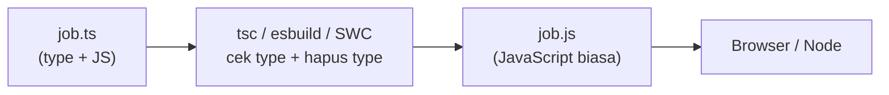

::part[Pelajari Konsepnya]{n="1"}

## 🎯 Yang akan kamu pelajari

- Apa yang ditambahkan TypeScript ke JavaScript — dan apa yang tidak
- Setup `tsconfig.json` dengan strict mode
- Menulis type untuk variabel dan function
- Kapan menulis type sendiri dan kapan TypeScript bisa menebaknya
- Union type dan menangani `null` dengan aman
- Kenapa type menghilang saat aplikasi berjalan

## 🔤 Istilah penting

| Istilah | Artinya (sederhana) |
|---|---|
| **Type** | Penjelasan nilai itu bisa berupa apa: angka, string, object `Job`… |
| **Type annotation** | Menulis type-nya sendiri: `count: number` |
| **Inference** | TypeScript menebak type untukmu dari nilainya |
| **Compile / type-check** | TypeScript membaca kodemu dan melaporkan kesalahan type sebelum dijalankan |
| **Strict mode** | Pengaturan TypeScript yang teliti dan menangkap bug paling banyak |
| **Union type** | "Salah satu dari ini": `"IDR" \| "USD"` atau `number \| null` |
| **Narrowing** | Setelah pengecekan seperti `if (x !== null)`, TypeScript tahu type yang lebih pasti |

## 🧠 Ide besarnya

TypeScript itu seperti **cek ejaan di Google Docs**, tapi untuk makna. Selagi kamu mengetik, ia menggarisbawahi kesalahan: "function ini butuh angka, kamu memberi string", "ini mungkin `null`". JavaScript biasa baru memberi tahu saat aplikasi crash — sering di depan pengguna.

Kamu sudah pernah melihat idenya: type hint Python + `mypy --strict` di Modul 2. TypeScript sama saja, dan hampir semua proyek React/Next.js memakainya.

## ❓ Kenapa ini penting

- Di proyek JavaScript besar, mengganti nama field bisa diam-diam merusak 40 file. TypeScript menunjukkan setiap tempat yang rusak.
- Editor-mu hanya bisa memberi autocomplete dan rename yang aman kalau tahu type-nya.
- Kontrak API-mu terlihat di kode: `Application` punya `status: Status`, bukan "string apa saja".

Tanpa type, bug seperti ini sampai ke pengguna:

```js
function formatSalary(job) {
  return "Rp " + job.salary.max.toLocaleString("id-ID");   // 💥 TypeError when salary is null
}
formatSalary({ salaryMax: 14000000 });                     // typo in field name: no warning
```

Dengan TypeScript, keduanya jadi garis merah bahkan sebelum kamu menyimpan file.

## 📖 Langkah demi langkah

### 1. Type hanya ada saat kamu menulis kode



Bayangkan type sebagai **perancah (scaffolding)** di proyek bangunan: membantu selama membangun, dan dibongkar sebelum orang pindah masuk. Browser hanya menerima JavaScript biasa.

- `tsc` **mengecek** type dan melaporkan error.
- Tool seperti Vite dan Next.js hanya **menghapus** type dengan cepat (tidak mengecek). Jadi jalankan `tsc` terpisah, misalnya di CI.

### 2. Setup

```bash
npm install --save-dev typescript
npx tsc --init          # creates tsconfig.json
npx tsc --noEmit        # type-check without writing files
```

Pengaturan terpenting di `tsconfig.json`:

```json
{
  "compilerOptions": {
    "strict": true,                      // all strict checks: null safety, no implicit any, …
    "noUncheckedIndexedAccess": true,    // items[0] is T | undefined
    "target": "ES2023",
    "module": "ESNext",
    "moduleResolution": "Bundler",
    "jsx": "react-jsx",
    "noEmit": true                       // the bundler emits JS; tsc only checks
  }
}
```

- `strict: true` — nyalakan semua pengecekan teliti. Mulai setiap proyek dengan ini; menambahkannya belakangan itu menyakitkan.
- `noUncheckedIndexedAccess` — `items[0]` mungkin tidak ada, jadi type-nya termasuk `undefined`.

### 3. Menulis type vs membiarkan TypeScript menebak

```ts
let count = 0;                              // inferred: number — don't annotate the obvious
const title: string = "Backend Engineer";   // allowed, but redundant

function salaryLabel(min: number | null, max: number | null): string {   // ✅ annotate function boundaries
  ...
}

const skills: string[] = [];                // annotate empty collections
const range: readonly [min: number, max: number] = [9_000_000, 14_000_000];   // labeled, readonly tuple
```

Aturan sederhana: **tulis type di "pintu-pintu" kodemu** — input function, function yang di-export, dan list kosong. Di dalamnya, biarkan TypeScript menebak.

- **Tuple** adalah array dengan panjang tetap dan type untuk setiap posisinya: `[min, max]`.
- `readonly` berarti tidak bisa diubah.

| Python | TypeScript |
|---|---|
| `def f(x: int) -> str:` | `function f(x: number): string` |
| `list[str]` | `string[]` atau `Array<string>` |
| `tuple[int, int]` | `[number, number]` |
| `int \| None` | `number \| null` |
| `Literal["IDR", "USD"]` | `"IDR" \| "USD"` |
| `Any` | `any` (hindari) / `unknown` |
| `mypy --strict` | `tsc --noEmit` dengan `"strict": true` |

### 4. Union type: "salah satu dari ini"

Seperti form dengan menu dropdown: kamu hanya bisa memilih salah satu opsi yang tersedia.

```ts
type Currency = "IDR" | "USD";
function formatAmount(amount: number, currency: Currency = "IDR"): string { ... }

formatAmount(10, "EUR");   // ❌ Argument of type '"EUR"' is not assignable to parameter of type 'Currency'
```

Daftar string yang diizinkan menggantikan "magic string" yang mudah salah ketik. (TypeScript juga punya `enum`, tapi union seperti ini lebih sederhana.)

### 5. Menangani `null` dengan aman

```ts
function parseSalary(input: string): number | null { ... }

const salary = parseSalary(text);
salary.toFixed();                  // ❌ 'salary' is possibly 'null'
if (salary !== null) salary.toFixed();   // ✅ narrowed to number
const shown = salary ?? 0;
```

TypeScript mengikuti pengecekan `if`-mu, seperti satpam yang ingat kamu sudah menunjukkan KTP. Setelah `if (salary !== null)`, ia tahu `salary` adalah angka. Ini disebut **narrowing**. `typeof x === "string"`, `Array.isArray(x)`, dan `"field" in obj` bekerja dengan cara yang sama.

### 6. `any`, `unknown`, dan `as`

```ts
const data: any = await res.json();
data.whatever.you.want();          // compiles, crashes at runtime — any disables checking

const data: unknown = await res.json();
data.jobs;                          // ❌ must narrow or validate first

const el = document.querySelector("#search") as HTMLInputElement;   // assertion: "trust me"
```

- `any` = mematikan cek ejaan. Kesalahan lolos diam-diam.
- `unknown` = "paket tersegel": kamu harus mengecek isinya sebelum dipakai.
- `as` = "percaya saja, aku tahu type-nya". Tidak mengecek apa pun. Pakai jarang-jarang, hanya saat kamu benar-benar tahu lebih banyak dari TypeScript (misalnya elemen yang kamu buat sendiri).

### 7. Type menghilang saat aplikasi berjalan

```ts
type Job = { id: number; title: string };
const jobs = (await res.json()) as Job[];   // no check happens here!
```

Ingat perancahnya: begitu aplikasi berjalan, type sudah tidak ada. Kalau Flask API-mu mengganti `title` menjadi `name`, TypeScript tidak akan sadar. Lindungi dirimu dengan: type yang di-generate dari spesifikasi OpenAPI, validasi saat aplikasi berjalan (Zod, Minggu 5), dan end-to-end test.

## ⚠️ Kesalahan umum

- Mengira `as Job[]` sudah mengecek response API.
- Mematikan strict mode "biar cepat".
- `Number("")` bernilai `0` — type-nya benar, tapi logikanya salah (latihan ini punya bug tersebut).
- Memakai `any` atau `@ts-ignore` untuk membungkam error, bukan memperbaiki type-nya.
- Type yang terlalu longgar seperti `object`, `Function`, atau `{}` — jelaskan bentuk aslinya.
- Menulis type untuk semuanya, padahal TypeScript sudah tahu.

## 🏆 Praktik terbaik

- [ ] `strict: true` (plus `noUncheckedIndexedAccess`); jalankan `tsc --noEmit` di CI.
- [ ] Tulis type untuk input function dan function yang di-export; biarkan TypeScript menebak sisanya.
- [ ] Pakai union seperti `"IDR" | "USD"` untuk kumpulan nilai yang tetap.
- [ ] Utamakan `unknown` daripada `any`; blokir `any` dengan ESLint (`@typescript-eslint/no-explicit-any`).
- [ ] Tangani `null`/`undefined` dengan pengecekan `if`, `??`, dan `?.`.
- [ ] Jarang memakai `as`, dan jangan pernah `as any`.
- [ ] Cek data dari luar (API, form) saat aplikasi berjalan — type bukan validasi.

::part[Jelaskan & Rancang]{n="2"}

## 🗣️ Jelaskan

Dengan analogi perancah, jelaskan ke rekan tim kenapa TypeScript bisa memperingatkan "mungkin null" saat kamu mengetik, tapi tetap tidak bisa menjamin response API benar-benar `Job[]` saat aplikasi berjalan.

## 📐 Rancang

Kamu menambahkan TypeScript ke frontend JavaScript CareerPilot yang sudah ada (50 file). Rencanakan perpindahannya: pengaturan, urutan file, cara menangani data API, dan apa yang harus dicek CI.

:::quiz
Tampilkan contoh rencananya

1. **Tambahkan tool-nya**: install `typescript`; `tsconfig.json` dengan `allowJs: true`, `checkJs: false`, `strict: true`, `noEmit: true`. CI menjalankan `tsc --noEmit` (awalnya lolos, karena file JS belum dicek).
2. **Type untuk API dulu**: buat `api/types.ts` (idealnya di-generate dari spesifikasi OpenAPI Flask) — `Application`, `Status`, `Company`, bentuk error.
3. **Ubah file "ujung" dulu**: helper (`format.ts`, `dates.ts`) dan API client. File ini tidak meng-import file lain, dan semua file lain meng-import mereka.
4. **Lalu component dan halaman**, satu pull request kecil setiap kali. Tanpa `any` — pakai `unknown` dengan TODO kalau perlu.
5. **Cek data sungguhan** di API client untuk response yang penting (schema Zod yang sekaligus menghasilkan type).
6. **Perketat aturan** saat semua sudah `.ts/.tsx`: `allowJs: false`, `noUncheckedIndexedAccess`, dan aturan ESLint `no-explicit-any` sebagai error.
7. **CI**: type-check, lint, dan tes wajib lolos di setiap pull request.

Pindah selangkah demi selangkah, bukan satu rewrite besar — setiap langkah bisa dirilis.
:::

### 📝 Checklist self-review

- [ ] Strict sejak awal, JavaScript masih diizinkan selama perpindahan
- [ ] Type API dan pengecekan saat runtime sudah direncanakan
- [ ] Langkah-langkah kecil, dijaga oleh CI

::ai-review{task="design"}

::part[Latihan Kecil]{n="3"}

:::exercise{path="exercises/web/m4/w2/01-typescript-basics" ai="no-ai" title="Beri type pada parser gaji"}
Hapus `@ts-nocheck` dari sebuah file JavaScript, tambahkan type yang ketat (union, tuple readonly berlabel, function yang bisa mengembalikan `null`), dan perbaiki bug tersembunyi yang ditunjukkan type. Tes mengecek perilakunya dan menjalankan `tsc` — termasuk pengecekan yang harus **gagal** di-compile kalau type-mu terlalu longgar.
:::

:::hints
- `parseSalary`: kembalikan `null` kalau tidak ada angka yang ditemukan — `Number("")` bernilai `0`.
- Type guard di `filter((amount): amount is number => amount !== null)` memberi tahu TypeScript bahwa null-nya sudah hilang.
- Kelompokkan digit dengan `/\B(?=(\d{3})+(?!\d))/g`.
:::

## ✅ Cek cepat

:::quiz
Bagian mana dari `strict: true` yang menangkap bug paling banyak?

`strictNullChecks` (nilai tidak boleh `null`/`undefined` kecuali type-nya bilang begitu) dan `noImplicitAny` (parameter tanpa type menjadi error).
:::

:::quiz
Kapan sebaiknya kamu menulis type sendiri, bukan membiarkan TypeScript menebak?

Di "pintu-pintu" kodemu: parameter function, function yang di-export, list kosong, dan API publik. Di dalam function, biarkan TypeScript menebak.
:::

## 📚 Lanjut belajar

- [TypeScript Handbook: The Basics](https://www.typescriptlang.org/docs/handbook/2/basic-types.html)
- [TypeScript Handbook: Narrowing](https://www.typescriptlang.org/docs/handbook/2/narrowing.html)
- [TSConfig reference](https://www.typescriptlang.org/tsconfig/)
