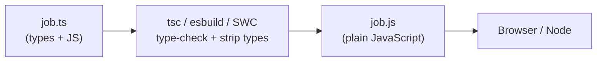

::part[Learn the Concept]{n="1"}

## 🎯 What you'll learn

- What TypeScript adds to JavaScript — and what it doesn't
- `tsconfig.json`, **strict mode**, and running `tsc`
- Primitive types, arrays, tuples, `readonly`, function signatures
- Type **inference**: when to write types and when not to
- Literal types, unions, `null`/`undefined` safety and narrowing
- `any` vs `unknown`, type assertions, and why types disappear at runtime

## 🧠 The big idea

JavaScript is a **conversation without a dictionary**: you find out a word was misunderstood only when things go wrong (in production). TypeScript adds a **spell-checker for meaning** that runs while you type: "this function expects a number, you passed a string", "this might be `null`".

You already met the idea in Module 2: Python type hints + `mypy --strict`. TypeScript is the same deal, but the ecosystem takes it much more seriously — almost every React/Next.js codebase uses it.

## ❓ Why does this exist?

- Large JavaScript codebases break in refactors: rename a field and 40 files silently read `undefined`.
- Editors can offer autocomplete, go-to-definition and safe renames only when they know the types.
- API contracts (your Phase 2 endpoints) become visible in code: `Application` has `status: Status`, not "some string".

## 💥 What happens if we DON'T?

```js
function formatSalary(job) {
  return "Rp " + job.salary.max.toLocaleString("id-ID");   // 💥 TypeError when salary is null
}
formatSalary({ salaryMax: 14000000 });                     // typo in field name: no warning
```

These bugs reach users. With TypeScript they're red squiggles before you save.

## 📖 How it works, step by step

### 1. Compile-time only



- **Type checking** (`tsc`) finds errors; **transpiling** (Vite/Next.js use fast tools like esbuild/SWC) just removes types.
- TypeScript 7 introduced a much faster native compiler (a Go port announced in 2025), making `tsc` on large projects many times quicker.
- Node.js can run many `.ts` files directly by stripping types — but it doesn't type-check them.

### 2. Setup

```bash
npm install --save-dev typescript
npx tsc --init          # creates tsconfig.json
npx tsc --noEmit        # type-check without writing files
```

Key `tsconfig.json` options:

```json
{
  "compilerOptions": {
    "strict": true,                      // all strict checks: null safety, no implicit any, …
    "noUncheckedIndexedAccess": true,    // items[0] is T | undefined
    "target": "ES2023",
    "module": "ESNext",
    "moduleResolution": "Bundler",
    "jsx": "react-jsx",
    "noEmit": true                       // the bundler emits JS; tsc only checks
  }
}
```

Always start new projects in **strict** mode — adding strictness later is painful.

### 3. Annotations and inference

```ts
let count = 0;                              // inferred: number — don't annotate the obvious
const title: string = "Backend Engineer";   // allowed, but redundant

function salaryLabel(min: number | null, max: number | null): string {   // ✅ annotate function boundaries
  ...
}

const skills: string[] = [];                // annotate empty collections
const range: readonly [min: number, max: number] = [9_000_000, 14_000_000];   // labeled, readonly tuple
```

Rule of thumb: **annotate inputs and exports; let TypeScript infer the rest.**

| Python | TypeScript |
|---|---|
| `def f(x: int) -> str:` | `function f(x: number): string` |
| `list[str]` | `string[]` or `Array<string>` |
| `tuple[int, int]` | `[number, number]` |
| `int \| None` | `number \| null` |
| `Literal["IDR", "USD"]` | `"IDR" \| "USD"` |
| `Any` | `any` (avoid) / `unknown` |
| `mypy --strict` | `tsc --noEmit` with `"strict": true` |

### 4. Literal types and unions

```ts
type Currency = "IDR" | "USD";
function formatAmount(amount: number, currency: Currency = "IDR"): string { ... }

formatAmount(10, "EUR");   // ❌ Argument of type '"EUR"' is not assignable to parameter of type 'Currency'
```

Unions of string literals replace magic strings and most enums. (TypeScript `enum` exists, but union types are simpler and don't generate runtime code.)

### 5. Null safety and narrowing

```ts
function parseSalary(input: string): number | null { ... }

const salary = parseSalary(text);
salary.toFixed();                  // ❌ 'salary' is possibly 'null'
if (salary !== null) salary.toFixed();   // ✅ narrowed to number
const shown = salary ?? 0;
```

TypeScript follows your control flow: `typeof x === "string"`, `x !== null`, `Array.isArray(x)`, `"field" in obj`, and `switch` statements all **narrow** types.

### 6. `any`, `unknown` and assertions

```ts
const data: any = await res.json();
data.whatever.you.want();          // compiles, crashes at runtime — any disables checking

const data: unknown = await res.json();
data.jobs;                          // ❌ must narrow or validate first

const el = document.querySelector("#search") as HTMLInputElement;   // assertion: "trust me"
```

Assertions (`as`) don't convert or check anything. Use them rarely, where you truly know more than the compiler (DOM lookups you control). For external data, **validate** (Zod, Week 5).

### 7. Types vanish at runtime

```ts
type Job = { id: number; title: string };
const jobs = (await res.json()) as Job[];   // no check happens here!
```

If your Flask API changes `title` to `name`, TypeScript won't notice. Solutions: shared/generated types from the OpenAPI spec, runtime validation at boundaries, and end-to-end tests.

## ⚖️ Trade-offs

| Choice | ✅ | ❌ |
|---|---|---|
| TypeScript | early errors, refactoring safety, editor help | build/type-check step, learning curve |
| Plain JS + JSDoc types | no compile step | more verbose, weaker tooling |
| `strict: true` | catches null and implicit-any bugs | more annotations at first |
| `any` | fast escape hatch | silently spreads, hides bugs |
| Unions vs `enum` | zero runtime cost, simple | enums give a runtime object (rarely needed) |

## ✅ When to use it / 🚫 When NOT to use it

- ✅ Any app beyond a small script, any shared component library, anything with an API contract.
- ✅ Strict mode from day one.
- 🚫 Don't fight the compiler with `any`/`@ts-ignore` — fix the type or narrow properly.
- 🚫 Don't over-annotate what inference already knows.

## 🏆 Best practices

- [ ] `strict: true` (+ `noUncheckedIndexedAccess`); run `tsc --noEmit` in CI.
- [ ] Annotate function parameters, return types of exported functions and public APIs.
- [ ] Use literal unions for fixed sets of values.
- [ ] Prefer `unknown` over `any`; ban `any` with ESLint (`@typescript-eslint/no-explicit-any`).
- [ ] Handle `null`/`undefined` explicitly with narrowing, `??` and `?.`.
- [ ] Keep `as` assertions rare and justified; never `as any`.
- [ ] Validate external data at runtime; types are not validation.

## 🏭 How it's used in industry

- TypeScript is the default for new React/Next.js projects and one of the most-used languages in developer surveys.
- Backend teams generate TypeScript client types from OpenAPI (openapi-typescript) so the frontend breaks at compile time when the API changes.
- Job listings for frontend and full-stack roles in Indonesia increasingly list TypeScript as required, not "nice to have".

## ⚠️ Common mistakes

- Thinking `as Job[]` validated the API response.
- Turning strict mode off to "go faster".
- `Number("")` is `0` — a type-correct but logically wrong parse (the exercise has this bug).
- `object`/`Function`/`{}` as types — too loose; describe the real shape.

::part[Explain & Design]{n="2"}

## 🗣️ Explain it

Explain to a teammate why TypeScript can say a value "is possibly null" while typing, but still can't guarantee the API response matches `Job[]` at runtime.

## 📐 Design it

You're adding TypeScript to CareerPilot's existing JavaScript frontend (50 files). Plan the migration: tsconfig steps, order of files, how to handle API data, and what to enforce in CI.

:::quiz
Show a possible plan

1. **Add tooling**: `typescript`, `tsconfig.json` with `allowJs: true`, `checkJs: false`, `strict: true`, `noEmit: true`; CI runs `tsc --noEmit` (passes immediately because JS isn't checked yet).
2. **Types for the contract first**: create `api/types.ts` (ideally generated from the Flask OpenAPI spec) — `Application`, `Status`, `Company`, error shape.
3. **Convert leaves first**: utilities (`format.ts`, `dates.ts`) and the API client — they have no dependencies, and everything imports them.
4. **Then components/pages**, one PR at a time, feature by feature. No `any` — use `unknown` + TODO comments where needed, tracked with an ESLint rule.
5. **Runtime validation** at the API client for critical responses (Zod schemas that also produce the types).
6. **Ratchet**: after all files are `.ts/.tsx`, set `allowJs: false`, enable `noUncheckedIndexedAccess`, and add ESLint `no-explicit-any` as an error.
7. **CI**: type-check + lint + tests required on every PR.

Rename files incrementally rather than a big-bang rewrite; each step ships.
:::

### 📝 Self-review checklist

- [ ] Strict from the start, JS allowed during migration
- [ ] API types and validation addressed
- [ ] Incremental order with CI enforcement

::ai-review{task="design"}

::part[Toy Exercise]{n="3"}

:::exercise{path="exercises/web/m4/w2/01-typescript-basics" ai="no-ai" title="Type a salary parser"}
Remove `@ts-nocheck` from a JavaScript file, add strict types (literal unions, a labeled readonly tuple, nullable returns) and fix the hidden bugs the types reveal. Tests check behavior and run `tsc`, including checks that must **fail** to compile if your types are too loose.
:::

:::hints
- `parseSalary`: return `null` when no digits were found — `Number("")` is `0`.
- A type guard in `filter((amount): amount is number => amount !== null)` narrows the array type.
- Group digits with `/\B(?=(\d{3})+(?!\d))/g`.
:::

## ✅ Quick check

:::quiz
What does `strict: true` enable that catches the most bugs?

`strictNullChecks` (values can't be null/undefined unless typed that way) and `noImplicitAny` (untyped parameters become errors), among others.
:::

:::quiz
When should you write a type annotation instead of relying on inference?

At boundaries: function parameters, exported function return types, empty collections, and public APIs. Let inference handle local variables.
:::

## 📖 Kamus (glossary)

| Term | Bahasa Indonesia |
|---|---|
| Type annotation | Anotasi tipe |
| Type inference | Inferensi tipe — tipe ditebak otomatis |
| Strict mode | Mode ketat |
| Union type | Tipe gabungan |
| Narrowing | Penyempitan tipe |
| Type assertion | Penegasan tipe (`as`) |

## 📚 Keep learning

- [TypeScript Handbook: The Basics](https://www.typescriptlang.org/docs/handbook/2/basic-types.html)
- [TypeScript Handbook: Narrowing](https://www.typescriptlang.org/docs/handbook/2/narrowing.html)
- [TSConfig reference](https://www.typescriptlang.org/tsconfig/)
