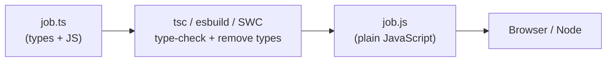

::part[Learn the Concept]{n="1"}

## 🎯 What you'll learn

- What TypeScript adds to JavaScript — and what it doesn't
- Setting up `tsconfig.json` with strict mode
- Writing types for variables and functions
- When to write types and when TypeScript can guess them
- Union types and handling `null` safely
- Why types disappear when the app runs

## 🔤 Key words

| Word | In simple words | Bahasa Indonesia |
|---|---|---|
| **Type** | A description of what a value can be: a number, a string, a `Job` object… | Tipe |
| **Type annotation** | Writing the type yourself: `count: number` | Menulis tipe |
| **Inference** | TypeScript guesses the type for you from the value | Tebakan tipe otomatis |
| **Compile / type-check** | TypeScript reads your code and reports type mistakes before it runs | Pengecekan tipe |
| **Strict mode** | TypeScript's careful setting that catches the most bugs | Mode ketat |
| **Union type** | "One of these": `"IDR" \| "USD"` or `number \| null` | Salah satu dari |
| **Narrowing** | After a check like `if (x !== null)`, TypeScript knows the more exact type | Mempersempit tipe |

## 🧠 The big idea

TypeScript is like **spell check in Google Docs**, but for meaning. While you type, it underlines mistakes: "this function needs a number, you gave a string", "this might be `null`". Plain JavaScript only tells you when the app crashes — often in front of users.

You've seen the idea before: Python type hints + `mypy --strict` in Module 2. TypeScript is the same, and almost every React/Next.js project uses it.

## ❓ Why it matters

- In big JavaScript projects, renaming a field can silently break 40 files. TypeScript shows every broken place.
- Your editor can autocomplete and rename safely only when it knows the types.
- Your API contract becomes visible in code: an `Application` has `status: Status`, not "some string".

Without types, these bugs reach users:

```js
function formatSalary(job) {
  return "Rp " + job.salary.max.toLocaleString("id-ID");   // 💥 TypeError when salary is null
}
formatSalary({ salaryMax: 14000000 });                     // typo in field name: no warning
```

With TypeScript, both are red underlines before you even save.

## 📖 Step by step

### 1. Types exist only while you write code



Think of types as **scaffolding** on a building site: it helps while you build, and it's removed before people move in. The browser only receives plain JavaScript.

- `tsc` **checks** types and reports errors.
- Tools like Vite and Next.js just **remove** types quickly (they don't check). So run `tsc` separately, for example in CI.

### 2. Setup

```bash
npm install --save-dev typescript
npx tsc --init          # creates tsconfig.json
npx tsc --noEmit        # type-check without writing files
```

The most important settings in `tsconfig.json`:

```json
{
  "compilerOptions": {
    "strict": true,                      // all strict checks: null safety, no implicit any, …
    "noUncheckedIndexedAccess": true,    // items[0] is T | undefined
    "target": "ES2023",
    "module": "ESNext",
    "moduleResolution": "Bundler",
    "jsx": "react-jsx",
    "noEmit": true                       // the bundler emits JS; tsc only checks
  }
}
```

- `strict: true` — turn on all careful checks. Start every project with it; adding it later is painful.
- `noUncheckedIndexedAccess` — `items[0]` might not exist, so its type includes `undefined`.

### 3. Writing types vs letting TypeScript guess

```ts
let count = 0;                              // inferred: number — don't annotate the obvious
const title: string = "Backend Engineer";   // allowed, but redundant

function salaryLabel(min: number | null, max: number | null): string {   // ✅ annotate function boundaries
  ...
}

const skills: string[] = [];                // annotate empty collections
const range: readonly [min: number, max: number] = [9_000_000, 14_000_000];   // labeled, readonly tuple
```

Simple rule: **write types at the "doors" of your code** — function inputs, exported functions and empty lists. Inside, let TypeScript guess.

- A **tuple** is an array with a fixed length and a type for each position: `[min, max]`.
- `readonly` means it can't be changed.

| Python | TypeScript |
|---|---|
| `def f(x: int) -> str:` | `function f(x: number): string` |
| `list[str]` | `string[]` or `Array<string>` |
| `tuple[int, int]` | `[number, number]` |
| `int \| None` | `number \| null` |
| `Literal["IDR", "USD"]` | `"IDR" \| "USD"` |
| `Any` | `any` (avoid) / `unknown` |
| `mypy --strict` | `tsc --noEmit` with `"strict": true` |

### 4. Union types: "one of these"

Like a form with a dropdown menu: you can only pick one of the listed options.

```ts
type Currency = "IDR" | "USD";
function formatAmount(amount: number, currency: Currency = "IDR"): string { ... }

formatAmount(10, "EUR");   // ❌ Argument of type '"EUR"' is not assignable to parameter of type 'Currency'
```

A list of allowed strings replaces "magic strings" that are easy to mistype. (TypeScript also has `enum`, but a union like this is simpler.)

### 5. Handling `null` safely

```ts
function parseSalary(input: string): number | null { ... }

const salary = parseSalary(text);
salary.toFixed();                  // ❌ 'salary' is possibly 'null'
if (salary !== null) salary.toFixed();   // ✅ narrowed to number
const shown = salary ?? 0;
```

TypeScript follows your `if` checks, like a security guard who remembers you already showed your ID. After `if (salary !== null)`, it knows `salary` is a number. This is called **narrowing**. `typeof x === "string"`, `Array.isArray(x)` and `"field" in obj` work the same way.

### 6. `any`, `unknown` and `as`

```ts
const data: any = await res.json();
data.whatever.you.want();          // compiles, crashes at runtime — any disables checking

const data: unknown = await res.json();
data.jobs;                          // ❌ must narrow or validate first

const el = document.querySelector("#search") as HTMLInputElement;   // assertion: "trust me"
```

- `any` = switch off the spell checker. Mistakes pass silently.
- `unknown` = "a sealed package": you must check what's inside before using it.
- `as` = "trust me, I know the type". It checks nothing. Use it rarely, only when you really know more than TypeScript (like an element you created yourself).

### 7. Types vanish when the app runs

```ts
type Job = { id: number; title: string };
const jobs = (await res.json()) as Job[];   // no check happens here!
```

Remember the scaffolding: once the app runs, the types are gone. If your Flask API renames `title` to `name`, TypeScript won't notice. Protect yourself with: types generated from the API's OpenAPI spec, runtime validation (Zod, Week 5), and end-to-end tests.

## ⚠️ Common mistakes

- Believing `as Job[]` checked the API response.
- Turning off strict mode "to go faster".
- `Number("")` is `0` — the type is right, but the logic is wrong (the exercise has this bug).
- Using `any` or `@ts-ignore` to silence errors instead of fixing the type.
- Very loose types like `object`, `Function` or `{}` — describe the real shape instead.
- Writing types for everything, even when TypeScript already knows them.

## 🏆 Best practices

- [ ] `strict: true` (plus `noUncheckedIndexedAccess`); run `tsc --noEmit` in CI.
- [ ] Write types for function inputs and exported functions; let TypeScript guess the rest.
- [ ] Use unions like `"IDR" | "USD"` for fixed sets of values.
- [ ] Prefer `unknown` over `any`; block `any` with ESLint (`@typescript-eslint/no-explicit-any`).
- [ ] Handle `null`/`undefined` with `if` checks, `??` and `?.`.
- [ ] Use `as` rarely, and never `as any`.
- [ ] Check data from outside (APIs, forms) while the app runs — types are not validation.

::part[Explain & Design]{n="2"}

## 🗣️ Explain it

Using the scaffolding analogy, explain to a teammate why TypeScript can warn "possibly null" while you type, but still can't guarantee the API response is really `Job[]` when the app runs.

## 📐 Design it

You're adding TypeScript to CareerPilot's existing JavaScript frontend (50 files). Plan the move: settings, the order of files, how to handle API data, and what CI should check.

:::quiz
Show a possible plan

1. **Add the tools**: install `typescript`; `tsconfig.json` with `allowJs: true`, `checkJs: false`, `strict: true`, `noEmit: true`. CI runs `tsc --noEmit` (it passes at first, because JS files aren't checked yet).
2. **Types for the API first**: create `api/types.ts` (ideally generated from the Flask OpenAPI spec) — `Application`, `Status`, `Company`, the error shape.
3. **Convert the "leaf" files first**: helpers (`format.ts`, `dates.ts`) and the API client. They don't import other files, and everything else imports them.
4. **Then components and pages**, one small pull request at a time. No `any` — use `unknown` with a TODO if needed.
5. **Check real data** at the API client for important responses (Zod schemas that also create the types).
6. **Tighten the rules** when everything is `.ts/.tsx`: `allowJs: false`, `noUncheckedIndexedAccess`, and the ESLint rule `no-explicit-any` as an error.
7. **CI**: type-check, lint and tests must pass on every pull request.

Move step by step, not in one huge rewrite — each step can ship.
:::

### 📝 Self-review checklist

- [ ] Strict from the start, JavaScript still allowed during the move
- [ ] API types and runtime checks are planned
- [ ] Small steps, protected by CI

::ai-review{task="design"}

::part[Toy Exercise]{n="3"}

:::exercise{path="exercises/web/m4/w2/01-typescript-basics" ai="no-ai" title="Type a salary parser"}
Remove `@ts-nocheck` from a JavaScript file, add strict types (unions, a labeled readonly tuple, functions that can return `null`) and fix the hidden bugs the types reveal. The tests check the behavior and run `tsc` — including checks that must **fail** to compile if your types are too loose.
:::

:::hints
- `parseSalary`: return `null` when no digits were found — `Number("")` is `0`.
- A type guard in `filter((amount): amount is number => amount !== null)` tells TypeScript that the nulls are gone.
- Group digits with `/\B(?=(\d{3})+(?!\d))/g`.
:::

## ✅ Quick check

:::quiz
Which part of `strict: true` catches the most bugs?

`strictNullChecks` (a value can't be `null`/`undefined` unless its type says so) and `noImplicitAny` (parameters without a type become errors).
:::

:::quiz
When should you write a type yourself instead of letting TypeScript guess?

At the "doors" of your code: function parameters, exported functions, empty lists and public APIs. Inside functions, let TypeScript guess.
:::

## 📚 Keep learning

- [TypeScript Handbook: The Basics](https://www.typescriptlang.org/docs/handbook/2/basic-types.html)
- [TypeScript Handbook: Narrowing](https://www.typescriptlang.org/docs/handbook/2/narrowing.html)
- [TSConfig reference](https://www.typescriptlang.org/tsconfig/)
